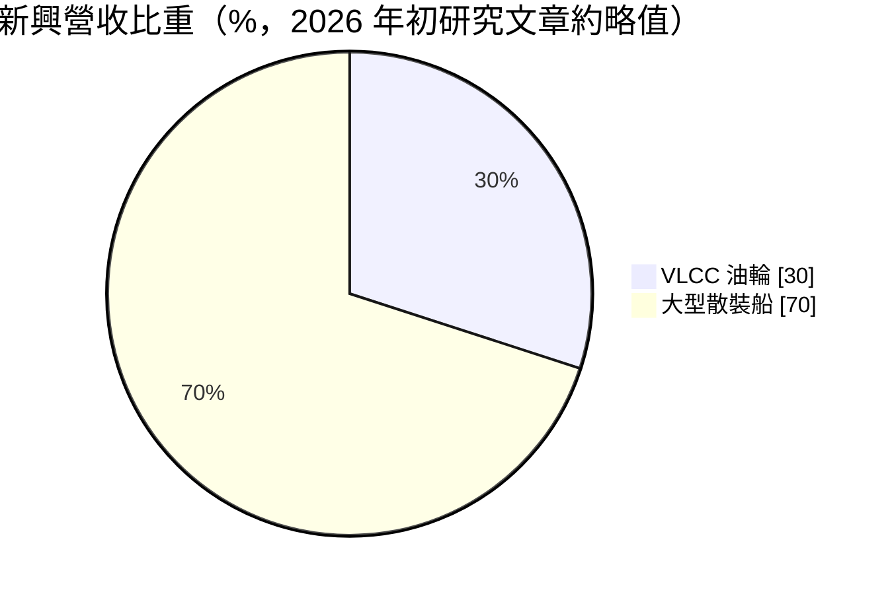
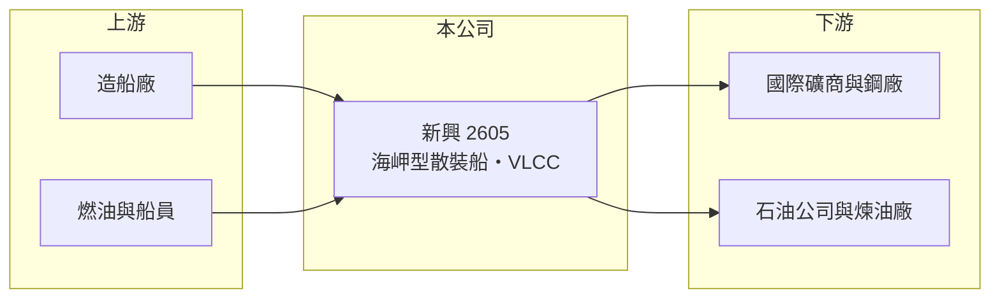

# 2605 新興

> 上市｜[[產業索引-航運業|航運業]]｜上市（櫃）日期 1989/12/08

# 第一章：企業模式與商業藍圖

> [!info] 撰寫說明
> 精簡版，由 Claude 依公開資料整理，架構比照 [[2330台積電]] 的四章研究，資料截至 2026-10-08。財務數字來源：Goodinfo 年度經營績效頁、方格子 2026 年 1 月新興航運研究文章（船隊與營收結構）、證交所開放資料（基本資料、2026 年第二季資產負債與綜合損益、營益分析、股利、本益比）；實際客戶名單未查得。#待校對

在評估單一個股的長期價值時，首要步驟是拆解企業的獲利來源。本章說明新興航運（股票代號：2605，以下簡稱新興）以大型散裝船與[[VLCC]]為主的船隊配置，以及長期租約如何讓它在劇烈的運價循環中維持相對穩定的收入。

- **核心業務：** 新興成立於 1968 年，1989 年上市，董事長兼總經理為許積皋，實收資本額約 58.5 億元。依 2026 年 1 月的研究文章，船隊約 15 艘、總載重噸超過 300 萬噸，其中約 8 艘為[[海岬型散裝船]]或超大型礦砂船（VLOC），另有超大型油輪，平均船齡約 12 年。
- **營收結構：** 約 30% 的營收來自 VLCC 油輪，其餘主要來自大型散裝船。散裝船運送鐵礦砂與煤炭，客戶是國際礦商與鋼廠；油輪運送原油，客戶是石油公司。兩種船型的運價循環不完全同步，雙核心配置有分散風險的效果。
- **租約策略：** 新興以[[期租]]長約為主，2025 年第三季海岬型船隊的簽約覆蓋率達 91%，平均日租金約 20,700 美元。高覆蓋率代表收入大致在年初就已鎖定，現貨運價暴漲時賺得少，但運價崩跌時也不會大幅虧損。
- **長期方向：** 船隊平均船齡約 12 年，未來十年面臨汰舊換新與國際海事組織（IMO）減碳法規的雙重要求。新興長期維持低負債與高現金，具備在船價低點更新船隊的財務能力，換船時點的選擇將決定下一個十年的報酬率。

# 第二章：護城河深度與競爭優勢

本章分析新興的競爭優勢與限制。散裝航運是高度同質化的產業，護城河主要來自財務紀律與客戶關係。

- **競爭優勢：** 散裝與油輪運輸沒有品牌差異，誰的成本低、財務穩，誰就能撐過低谷。新興的負債幾乎都是流動負債，非流動負債僅約 0.1 億元，2025 年中現金與定存約 2.19 億美元，是台灣航運股中財務最保守的公司之一。長約客戶多為國際大型礦商、鋼廠與石油公司，信用風險低。
- **限制與弱點：** 長約鎖定收入也鎖定了上限，運價大漲時獲利彈性小於以現貨為主的同業。船隊規模約 15 艘，遠小於國際大型散裝船東，議價能力有限。
- **主要對手：** 國內散裝同業 [[2612中航]]、[[2606裕民]]、[[2637慧洋-KY]]、[[2617台航]]、[[5608四維航]]，以及國際大型散裝與油輪船東。
- **觀察重點：** 第一，船隊汰舊換新的時點與造船價格；第二，長約到期續約時的日租金水準；第三，業外收益的來源與持續性。

# 第三章：財務體質與盈利規模

資料日期：2026-10-08，表格是撰寫當時的快照；最新月營收、毛利率、累計 EPS 由自動排程寫在本筆記的屬性欄位（月營收、毛利率、累計EPS 等）。#待校對

本章用多年度三率、ROE 與資本報酬，檢視新興在運價循環中的獲利品質。

| 年度 | 營收（新台幣） | [[毛利率]] | [[營業利益率]] | EPS（元） | [[ROE]] |
|---|---|---|---|---|---|
| 2020 | 39.3 億 | 24.5% | 19.8% | 0.24 | 1.58% |
| 2021 | 43.0 億 | 30.1% | 24.8% | 1.20 | 5.45% |
| 2022 | 39.7 億 | 15.1% | 9.57% | 0.34 | 1.99% |
| 2023 | 40.3 億 | 17.2% | 10.5% | 0.76 | 3.14% |
| 2024 | 44.1 億 | 30.1% | 22.2% | 2.56 | 8.78% |
| 2025 | 44.1 億 | 26.0% | 18.1% | 1.45 | 4.74% |
| 2026 上半年 | 27.0 億 | 43.97% | 33.49% | 3.67 | 未查得 |

註：2020 至 2025 年取自 Goodinfo（2020 與 2022 年 EPS 明顯低於營業利益水準，推估有減損或業外損失，待校對），2026 上半年取自證交所營益分析與綜合損益表。

- **營收規模：** 2020 至 2025 年營收在 39 億至 44 億元之間，年複合成長率約 2.3%（推算）。2021 至 2022 年散裝運價大漲時營收並未暴增，正是長約策略的結果。
- **獲利結構：** 營業利益率在 10% 至 25% 之間，2026 年上半年升到 33.49%。同期業外收入約 14.6 億元，比營業利益還高（性質未查得），使上半年 EPS 達 3.67 元，評估本業時應排除。
- **長期指標：** 2021 至 2025 年平均 ROE 約 4.8%（推算），偏低的原因是權益中累積了大量現金與保留盈餘。現金股利 2024 年度 1.3 元（研究文章）、2025 年度 1.00 元（證交所資料），配息隨獲利調整。
- **財務特色：** 2026 年第二季底總資產約 264.4 億元，負債約 71.1 億元，權益約 193.3 億元，負債比約 27%，保留盈餘約 134.8 億元（證交所開放資料）。

**[[ROIC]] 與 [[WACC]]：** 以 2025 年營業利益約 7.98 億元（44.1 億 × 18.1%）計，稅後約 6.39 億元；投入資本以權益 193.3 億元加上假設的有息負債約 30 億元，合計約 223 億元，ROIC 約 2.9%（推算）。WACC 以 CAPM 推估：無風險利率 1.75%、市場風險溢酬 6%、β 取航運股常見值 1.1，股東權益成本約 8.35%；負債成本 3.0%、稅後 2.4%；權益約占 87%，WACC 約 7.6%（推算）。以帳面計算 ROIC 低於 WACC，但新興權益中有相當部分是現金與非營運資產，若只計算船隊投入資本，本業 ROIC 會較高。整體而言，新興的特色是低風險而非高報酬，長期價值取決於能否在低點買船、高點簽約。

# 第四章：總體風險與地緣政治

本章分析新興長期面對的風險。

- **產業週期：** 散裝運價（[[BDI]]）與油輪運價受全球鋼鐵生產、中國基建、原油供需與新船交付量影響，循環劇烈。長約可以延後衝擊，但長約到期時若碰上運價低谷，續約日租金會明顯下降。
- **營運風險：** 船隊平均船齡約 12 年，老船油耗較高，在 IMO 碳強度指標（CII）等減碳規範下競爭力會下降，汰換需要大筆資本支出。船隊規模小，單艘船進塢或事故的影響比例較高。
- **其他風險：** 營收以美元計價，新台幣升值會降低帳面營收；地緣政治事件（如航道受阻、制裁）會改變油輪與散裝的航線距離與運價；燃油價格與碳稅成本也會影響期租以外的營運成本。

# 專有名詞解析

## 金融

- **[[ROIC]]**：投入資本報酬率，稅後營業利益除以股東權益與有息負債的合計，衡量本業對所有資金提供者的報酬。
- **[[WACC]]**：加權平均資金成本，依股東權益與負債的比重加權計算的資金成本，ROIC 高於它才代表創造價值。

## 產業

- **[[VLCC]]**：超大型原油輪，載重約 30 萬噸，是遠洋原油運輸的主力船型。
- **[[海岬型散裝船]]**：載重約 15 萬至 21 萬噸的大型散裝船，主要運送鐵礦砂與煤炭，因船身太大無法通過舊巴拿馬運河而得名。
- **[[期租]]**：船東把船連同船員出租給租船人一段期間、按日收取租金的合約，可鎖定收入、降低運價波動影響。
- **[[BDI]]**：波羅的海乾散貨綜合運價指數，反映全球散裝船運價水準，是散裝航運景氣的主要指標。

# 核心供應鏈

- 上游：中、日、韓與台灣造船廠（如 [[2208台船]]）、燃油供應商、船員與船舶管理服務。
- 下游／客戶：國際礦商與鋼廠（鐵礦砂、煤炭運輸）、石油公司與煉油廠（原油運輸）。
- 同業：[[2612中航]]、[[2606裕民]]、[[2637慧洋-KY]]、[[2617台航]]、[[5608四維航]]。

## 最新新聞
<!-- news:start（自動產生，請勿手動編輯此範圍） -->
- 2026-10-12 📰 媒體 17:52｜營收速報 - 新興(2605)9月營收5.94億元年增率高達60.11％｜[鉅亨網](https://news.cnyes.com/news/id/6628269)

完整紀錄：[[2605新興 新聞]]
<!-- news:end -->

## 相關連結
- [公開資訊觀測站](https://mopsov.twse.com.tw/mops/web/t05st03?step=1&firstin=1&co_id=2605)
- [Goodinfo](https://goodinfo.tw/tw/StockDetail.asp?STOCK_ID=2605)
- [Yahoo 股市](https://tw.stock.yahoo.com/quote/2605)
- [鉅亨網新聞](https://www.cnyes.com/twstock/2605/news)
