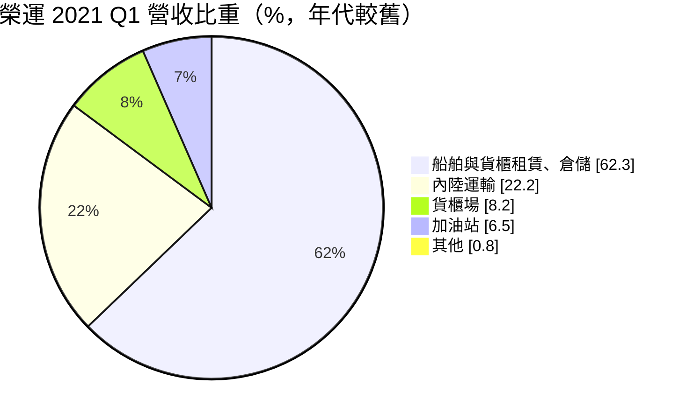
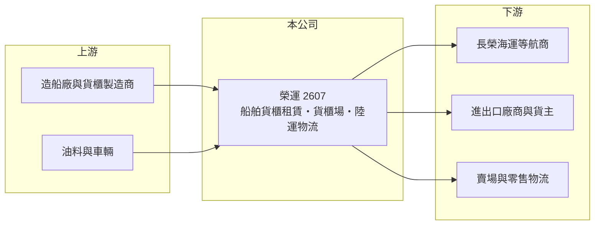

# 2607 榮運

> 上市｜[[產業索引-航運業|航運業]]｜上市（櫃）日期 1990/12/14

# 第一章：企業模式與商業藍圖

> [!info] 撰寫說明
> 精簡版，由 Claude 依公開資料整理，架構比照 [[2330台積電]] 的四章研究，資料截至 2026-10-08。財務數字來源：Goodinfo 年度經營績效頁、CMoney 2021 年 7 月榮運研究報告（業務結構與營收比重，年代較舊）、證交所開放資料（基本資料、2026 年第二季資產負債與綜合損益、營益分析、股利、本益比）；最新營收比重與船隊數量未查得。#待校對

在評估單一個股的長期價值時，首要步驟是拆解企業的獲利來源。本章說明長榮國際儲運（股票代號：2607，以下簡稱榮運）作為長榮集團的物流與航運周邊平台，如何從船舶與貨櫃租賃、[[貨櫃場]]與內陸運輸取得收入。

- **核心業務：** 榮運成立於 1973 年，總部位於桃園，1990 年上市，董事長為邱顯育，實收資本額約 53.4 億元。公司隸屬長榮集團，提供碼頭裝卸、貨櫃倉儲、貨櫃運輸、內陸貨運與客運、加油站等整合式服務，貨櫃集散場分布在汐止、桃園、台中等工業區與交流道附近。
- **營收結構：** 依 2021 年第一季資料，國際海運相關的倉儲、船舶與貨櫃租賃占 62.3%，內陸運輸（貨物與乘客）占 22.2%，貨櫃場裝卸占 8.2%，加油站占 6.5%。當時 13 艘貨櫃船已全數出租，並計畫投資 1.8 萬只新貨櫃。比重會隨租金行情變動，最新數字未查得。
- **商業模式：** 榮運的核心是「資產出租」：擁有貨櫃船與貨櫃，主要租給集團內的 [[2603長榮]] 等航商，收取[[期租]]租金。這讓榮運間接參與貨櫃航運的景氣，但收入比航商本身穩定，因為租約期間租金固定。陸上的貨櫃場、拖車與物流則提供較穩定的基本收入。
- **長期方向：** 依 2021 年資料，公司投資大園物流園區並承攬大型賣場物流中心的複合式運輸業務，顯示正從單純的航運周邊服務往綜合物流延伸。長期成長取決於船隊與貨櫃的投資節奏，以及物流業務能否擴大。

# 第二章：護城河深度與競爭優勢

本章分析榮運的競爭優勢與限制。它的護城河主要來自集團內的穩定需求與場站區位。

- **競爭優勢：** 長榮集團的航運需求提供船舶與貨櫃租賃的穩定客戶，降低了閒置風險；北中南交流道附近的貨櫃場土地取得不易，新進者難以複製同樣的場站網絡。業務橫跨海運租賃、陸運、場站與物流，可以提供一條龍服務。
- **限制與弱點：** 收入高度依賴集團內關係企業，議價空間受集團整體安排影響，獨立性較低。船舶與貨櫃租賃的租金最終仍跟著貨櫃航運景氣，2022 年高峰後營收出現明顯波動。
- **主要對手：** 貨櫃場與內陸運輸同業 [[2613中櫃]]、陽明集團相關物流業者；物流同業 [[2608嘉里大榮]]；國際貨櫃租賃公司如 Triton、Textainer 等。
- **觀察重點：** 第一，船舶與貨櫃租約到期後的續租價格；第二，物流園區等非租賃業務的成長；第三，業外投資收益的變化。

# 第三章：財務體質與盈利規模

資料日期：2026-10-08，表格是撰寫當時的快照；最新月營收、毛利率、累計 EPS 由自動排程寫在本筆記的屬性欄位（月營收、毛利率、累計EPS 等）。#待校對

本章用多年度三率、ROE 與資本報酬，檢視榮運的獲利品質。

| 年度 | 營收（新台幣） | [[毛利率]] | [[營業利益率]] | EPS（元） | [[ROE]] |
|---|---|---|---|---|---|
| 2020 | 69.7 億 | 14.2% | 10.7% | 0.64 | 2.96% |
| 2021 | 88.8 億 | 15.2% | 10.8% | 1.00 | 4.24% |
| 2022 | 176 億 | 25.6% | 18.2% | 3.30 | 12.8% |
| 2023 | 164 億 | 25.0% | 15.9% | 2.55 | 9.18% |
| 2024 | 212 億 | 20.2% | 12.5% | 2.60 | 8.57% |
| 2025 | 171 億 | 21.7% | 11.9% | 3.56 | 8.81% |
| 2026 上半年 | 90.4 億 | 20.87% | 11.94% | 2.68 | 未查得 |

註：2020 至 2025 年取自 Goodinfo，2026 上半年取自證交所營益分析與綜合損益表。

- **營收規模：** 2020 至 2025 年營收年複合成長率約 19.7%（推算），2022 年營收倍增後維持在 160 億至 210 億元，反映船隊與貨櫃規模擴大，以及疫情後貨櫃航運高峰的租金上升。
- **獲利結構：** 營業利益率在 2022 年達 18.2% 後回落到 12% 左右。2026 年上半年業外收入約 7.8 億元，占稅前淨利相當比重，2025 年 EPS 高於營業利益水準也顯示業外貢獻增加（來源未查得）。
- **長期指標：** 2021 至 2025 年平均 ROE 約 8.7%（推算）。2025 年度配發現金股利 2.70 元，以 EPS 3.56 元計，配息率約 76%（推算）。
- **財務特色：** 2026 年第二季底總資產約 480.8 億元，負債約 164.0 億元，權益約 316.8 億元，負債比約 34%，每股淨值約 58.8 元（證交所開放資料）。

**[[ROIC]] 與 [[WACC]]：** 以 2025 年營業利益約 20.4 億元（171 億 × 11.9%）計，稅後約 16.3 億元；投入資本以權益 316.8 億元加上假設占總負債五成的有息負債約 82 億元，合計約 399 億元，ROIC 約 4.1%（推算）。WACC 以 CAPM 推估：無風險利率 1.75%、市場風險溢酬 6%、β 取航運周邊股常見值 1.0，股東權益成本約 7.75%；負債成本 2.5%、稅後 2.0%；權益約占 79%，WACC 約 6.6%（推算）。以帳面計算 ROIC 低於 WACC，部分原因是權益中包含長期股權投資等非營運資產；若只看營運資產，本業報酬會略高，但仍不算明顯創造價值。榮運的價值較多來自穩定配息與資產，而非高資本報酬。

# 第四章：總體風險與地緣政治

本章分析榮運長期面對的風險。

- **產業週期：** 貨櫃船與貨櫃的租金跟著貨櫃航運景氣，運力過剩時租金下滑、續約條件變差。全球新造貨櫃船在 2024 至 2028 年大量交付，可能壓低未來的租金水準（業界普遍看法）。#待校對
- **營運風險：** 對長榮集團的依賴意味著集團航運策略的變化會直接影響榮運；船舶與貨櫃屬重資產，投資時點若在高點，未來折舊負擔會壓縮獲利。
- **其他風險：** 租金以美元計價，匯率變動影響帳面獲利；陸運業務面臨司機短缺、油價與碳排法規；加油站業務長期受電動車普及影響。

# 專有名詞解析

## 金融

- **[[ROIC]]**：投入資本報酬率，稅後營業利益除以股東權益與有息負債的合計，衡量本業對所有資金提供者的報酬。
- **[[WACC]]**：加權平均資金成本，依股東權益與負債的比重加權計算的資金成本，ROIC 高於它才代表創造價值。

## 產業

- **[[貨櫃場]]**：位於港口或內陸交通節點、提供貨櫃堆存、裝卸、拆併櫃與調度服務的場站。
- **[[期租]]**：船東把船連同船員出租給租船人一段期間、按日收取租金的合約，可鎖定收入、降低運價波動影響。

# 核心供應鏈

- 上游：造船廠、貨櫃製造商、拖車與車輛、油料供應商。
- 下游／客戶：[[2603長榮]] 等航商（租船、租櫃與碼頭服務）、進出口廠商、零售與賣場物流中心。
- 同業：[[2613中櫃]]、[[2608嘉里大榮]]、[[2612中航]]（兼營內陸貨櫃運輸）。

## 最新新聞
<!-- news:start（自動產生，請勿手動編輯此範圍） -->
- 2026-10-12 📰 媒體 18:50｜營收速報 - 榮運(2607)9月營收21.84億元年增率高達64.7％｜[鉅亨網](https://news.cnyes.com/news/id/6628376)

完整紀錄：[[2607榮運 新聞]]
<!-- news:end -->

## 相關連結
- [公開資訊觀測站](https://mopsov.twse.com.tw/mops/web/t05st03?step=1&firstin=1&co_id=2607)
- [Goodinfo](https://goodinfo.tw/tw/StockDetail.asp?STOCK_ID=2607)
- [Yahoo 股市](https://tw.stock.yahoo.com/quote/2607)
- [鉅亨網新聞](https://www.cnyes.com/twstock/2607/news)
