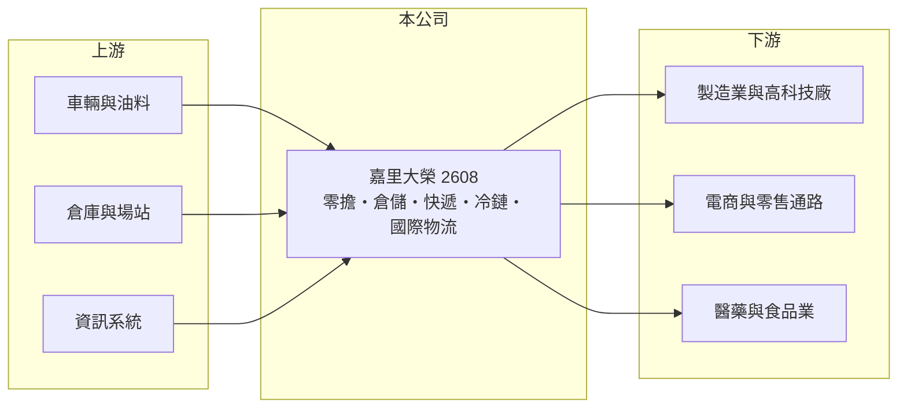

# 2608 嘉里大榮

> 上市｜[[產業索引-航運業|航運業]]｜上市（櫃）日期 1990/12/20

# 第一章：企業模式與商業藍圖

> [!info] 撰寫說明
> 精簡版，由 Claude 依公開資料整理，架構比照 [[2330台積電]] 的四章研究，資料截至 2026-10-08。財務數字來源：Goodinfo 年度經營績效頁、富果研究整理的 2026 年 9 月法說會摘要（據點、車隊、倉儲面積、收購案）、證交所開放資料（基本資料、2026 年第二季資產負債與綜合損益、營益分析、股利、本益比）；各業務線營收比重與嘉里集團持股比例未查得。#待校對

在評估單一個股的長期價值時，首要步驟是拆解企業的獲利來源。本章說明嘉里大榮物流（股票代號：2608，以下簡稱嘉里大榮）如何以全台運輸網絡為基礎，延伸到倉儲、快遞、冷鏈與國際物流，以及網絡型事業的規模效益。

- **核心業務：** 嘉里大榮前身為大榮汽車貨運，證交所登記成立日期為 1959 年（法說資料稱 1954 年創立），1990 年上市，董事長為沈宗桂，實收資本額約 46.7 億元，大股東為香港嘉里物流集團（持股比例未查得）。#待校對 依 2026 年 9 月法說，公司員工超過 5,100 人，自有營運車隊約 3,300 部，全台營業據點 158 個。
- **業務組成：** 主力是全台[[零擔運輸]]路線網絡，集配車輛 2,173 部；倉儲物流提供常溫、恆溫與低溫的多溫層倉儲，總營業面積超過 33,000 坪；子公司嘉里快遞負責都會區配送與跨境電商；嘉里醫藥物流（汐止園區取得 GMP 與 GDP 認證）、科學城物流（服務竹科與南科高科技客戶）則提供專業物流。[[冷鏈物流]]配送已取得 ISO 23412 認證。
- **結構性變化：** 2026 年 8 月完成收購嘉里國際物流 100% 股權，把海空運國際運輸納入集團，從國內物流延伸到進出口物流。公司希望藉此提供「國內運輸、倉儲加國際海空運」的一站式服務並交叉銷售。
- **長期方向：** 公司策略是提高醫藥、高科技等高附加價值物流比重，推動配送路線優化與自動化，並分階段汰換高碳排車輛。2026 年 4 月常溫貨運取得碳標籤認證，代表 ESG 已成為大型企業客戶選擇物流商的條件之一。

# 第二章：護城河深度與競爭優勢

本章分析嘉里大榮的競爭優勢與限制。物流業的護城河來自網絡密度與規模。

- **競爭優勢：** 零擔運輸的成本取決於網絡密度：據點與車輛越多，每條路線的裝載率越高、單位成本越低。嘉里大榮擁有 158 個據點與數千部車輛，新進者需要龐大投資才能建立同等網絡。醫藥 GDP 與高科技物流需要認證與專業設備，客戶轉換成本較高。
- **限制與弱點：** 物流業屬勞力與資本密集，司機與油料成本占比高，價格調整常落後於成本上升。2020 至 2025 年營業利益率從 15.9% 一路降到 11.9%，[[ROE]] 由 15.1% 降到 8.38%，顯示競爭與成本壓力持續。
- **主要對手：** 宅配與零擔同業如統一速達（黑貓宅急便）、新竹物流、[[2642宅配通]]，電商自建物流，以及國際物流同業 [[5609中菲行]]、[[2636台驊控股]]。
- **觀察重點：** 第一，嘉里國際物流併入後的營收與綜效；第二，高附加價值物流的比重；第三，營業利益率能否止跌。

# 第三章：財務體質與盈利規模

資料日期：2026-10-08，表格是撰寫當時的快照；最新月營收、毛利率、累計 EPS 由自動排程寫在本筆記的屬性欄位（月營收、毛利率、累計EPS 等）。#待校對

本章用多年度三率、ROE 與資本報酬，檢視嘉里大榮的獲利品質。

| 年度 | 營收（新台幣） | [[毛利率]] | [[營業利益率]] | EPS（元） | [[ROE]] |
|---|---|---|---|---|---|
| 2020 | 123 億 | 21.6% | 15.9% | 3.21 | 15.1% |
| 2021 | 130 億 | 19.4% | 13.9% | 2.99 | 13.3% |
| 2022 | 127 億 | 18.4% | 13.2% | 2.66 | 11.5% |
| 2023 | 120 億 | 18.2% | 12.8% | 3.63 | 14.5% |
| 2024 | 127 億 | 18.2% | 12.4% | 2.25 | 9.17% |
| 2025 | 128 億 | 17.9% | 11.9% | 1.97 | 8.38% |
| 2026 上半年 | 62.1 億 | 18.12% | 11.86% | 0.96 | 未查得 |

註：2020 至 2025 年取自 Goodinfo（2023 年 EPS 偏高，推估含一次性收益，待校對），2026 上半年取自證交所營益分析與法說摘要。

- **營收規模：** 2020 至 2025 年營收在 120 億至 130 億元之間，年複合成長率僅約 0.8%（推算），國內物流市場已趨成熟。2026 年 8 月營收年增 18.56%，主要反映嘉里國際物流併入。
- **獲利結構：** 毛利率穩定在 18% 左右，營業利益率緩步下滑，反映人力與油料等成本上升。2026 年上半年營收年減 1.69%，管理層歸因於國際經貿變化導致貨量減少。
- **長期指標：** 2021 至 2025 年平均 ROE 約 11.4%（推算）。2025 年度配發現金股利 1.65 元，以 EPS 1.97 元計，配息率約 84%（推算），屬高配息的穩定型公司。
- **財務特色：** 2026 年第二季底總資產約 252.0 億元，負債約 123.5 億元，其中非流動負債約 82.5 億元（推估多為倉庫與場站的租賃負債與長期借款），權益約 128.5 億元，負債比約 49%（證交所開放資料）。

**[[ROIC]] 與 [[WACC]]：** 以 2025 年營業利益約 15.2 億元（128 億 × 11.9%）計，稅後約 12.2 億元；投入資本以權益 128.5 億元加上假設占總負債五成的有息負債（含租賃負債）約 61.7 億元，合計約 190 億元，ROIC 約 6.4%（推算）。WACC 以 CAPM 推估：無風險利率 1.75%、市場風險溢酬 6%、β 取物流股常見值 0.6，股東權益成本約 5.35%；負債成本 2.5%、稅後 2.0%；權益約占 68%，WACC 約 4.3%（推算）。ROIC 高於 WACC 約 2 個百分點，嘉里大榮長期仍在創造價值，但利差隨營業利益率下滑而縮小，收購案能否提高整體報酬是未來的關鍵。

# 第四章：總體風險與地緣政治

本章分析嘉里大榮長期面對的風險。

- **產業週期：** 貨運量跟著製造業出貨、進出口與民間消費變動，景氣下行時企業客戶貨量減少。電商包裹量雖長期成長，但單價低、競爭激烈。
- **營運風險：** 司機短缺與工資上漲是物流業的長期結構問題；油價上升會直接壓縮毛利。併購嘉里國際物流後，需整合系統與人員，並承擔國際海空運價大幅波動的風險。
- **其他風險：** 減碳法規可能要求加速汰換車隊，增加資本支出；交通法規與勞動法規（工時、休假）變動會提高營運成本；大型電商與通路自建物流，會分走部分高量客戶。

# 專有名詞解析

## 金融

- **[[ROIC]]**：投入資本報酬率，稅後營業利益除以股東權益與有息負債的合計，衡量本業對所有資金提供者的報酬。
- **[[WACC]]**：加權平均資金成本，依股東權益與負債的比重加權計算的資金成本，ROIC 高於它才代表創造價值。

## 產業

- **[[零擔運輸]]**：貨量不足一整車的貨物，由物流商在據點集貨、併車後再分送，依重量或材積計費的運輸模式。
- **[[冷鏈物流]]**：在倉儲與運送全程維持特定低溫的物流服務，用於生鮮、冷凍食品與醫藥品。

# 核心供應鏈

- 上游：貨車與冷凍車、油料、倉庫與場站土地、物流資訊系統。
- 下游／客戶：製造業與科學園區高科技廠、電商與零售通路、醫藥與食品業者、進出口貨主。
- 同業：[[2642宅配通]]、[[5609中菲行]]、[[2636台驊控股]]、[[2607榮運]]，以及統一速達、新竹物流（未上市）。

## 最新新聞
<!-- news:start -->
<!-- news:end -->

## 相關連結
- [公開資訊觀測站](https://mopsov.twse.com.tw/mops/web/t05st03?step=1&firstin=1&co_id=2608)
- [Goodinfo](https://goodinfo.tw/tw/StockDetail.asp?STOCK_ID=2608)
- [Yahoo 股市](https://tw.stock.yahoo.com/quote/2608)
- [鉅亨網新聞](https://www.cnyes.com/twstock/2608/news)
