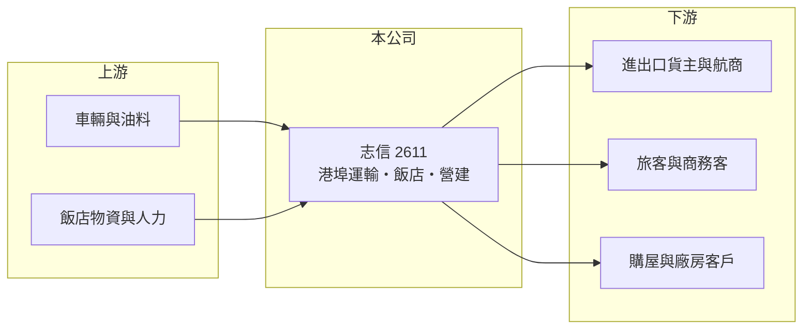

# 2611 志信

> 上市｜[[產業索引-航運業|航運業]]｜上市（櫃）日期 1993/10/28

# 第一章：企業模式與商業藍圖

> [!info] 撰寫說明
> 精簡版，由 Claude 依公開資料整理，架構比照 [[2330台積電]] 的四章研究，資料截至 2026-10-08。財務數字來源：Goodinfo 年度經營績效頁、科技新報公司資料頁（經營項目與轉投資持股）、證交所開放資料（基本資料、2026 年第二季資產負債與綜合損益、營益分析、股利、本益比）；各業務營收比重與港口據點未查得，部分業務描述憑既有知識撰寫，已標「待校對」。公開資料有限。#待校對

在評估單一個股的長期價值時，首要步驟是拆解企業的獲利來源。本章說明志信國際（股票代號：2611，以下簡稱志信）這家歸類在航運業、實際上橫跨運輸、觀光飯店與營建的多角化公司，以及它的獲利為何長期依賴本業以外的收益。

- **核心業務：** 志信成立於 1973 年，1993 年上市，董事長為黃春發，實收資本額約 18.9 億元。依公司資料，經營項目為運輸、營建、觀光休閒與貿易商品買賣，登記營業項目包括汽車貨櫃貨運、汽車貨運、加油站、住宅與工業廠房開發租售等。運輸業務以港埠相關的[[散雜貨]]與貨櫃運輸為主（推估以台中港、高雄港一帶為據點）。#待校對
- **轉投資：** 持有美麗信酒店約 73.03%（帳面約 3.1 億元）、新海運輸倉儲約 47.47%（帳面約 0.56 億元），以及美麗灣渡假村約 13.33%（帳面已降為 0）。美麗信酒店持股過半，推估已納入合併營收，這代表志信的營收中有相當部分來自台北的飯店經營（比重未查得）。#待校對
- **營收特性：** 營收規模小，2020 至 2025 年在 6 億至 8 億元之間。毛利率由 2020 年的 7.55% 一路提升到 2025 年的 31.7%，推估與飯店業務在疫情後復甦、營收組合改變有關。2026 年 1 至 8 月累計營收年增約 64%（證交所每月營收），成長來源未查得。
- **長期方向：** 志信的業務分散在幾個彼此關聯不大的領域，缺乏單一核心事業。長期價值取決於飯店與運輸本業能否穩定獲利，以及營建與土地開發是否能帶來實質收益，而非依賴業外處分或投資收益。

# 第二章：護城河深度與競爭優勢

本章分析志信的競爭優勢與限制。多角化小型公司的優勢通常來自資產，而非經營規模。

- **競爭優勢：** 志信擁有飯店與運輸相關資產，港埠運輸需要車隊、場地與客戶關係，飯店則具有地段價值。這些資產提供一定的穩定收入與資產支撐，2026 年第二季每股淨值約 14.7 元。
- **限制與弱點：** 本業長期虧損或微利，2020 至 2024 年營業利益率都是負值，2025 年才轉正到 1.7%。EPS 多數年度為正，主要靠[[業外收益]]；2024 年第四季業外淨損約 2.1 億元，2026 年上半年業外淨收入約 1.5 億元，波動很大，盈餘品質不穩定。
- **主要對手：** 港埠運輸同業如 [[2613中櫃]]、[[2607榮運]]；飯店同業為台北中型商務飯店業者；美麗灣渡假村曾涉及長年環評爭議（年份未查得）。
- **觀察重點：** 第一，本業營業利益率能否維持為正；第二，2026 年營收大幅成長的來源與持續性；第三，業外收益的性質是一次性還是經常性。

# 第三章：財務體質與盈利規模

資料日期：2026-10-08，表格是撰寫當時的快照；最新月營收、毛利率、累計 EPS 由自動排程寫在本筆記的屬性欄位（月營收、毛利率、累計EPS 等）。#待校對

本章用多年度三率、ROE 與資本報酬，檢視志信的獲利品質。

| 年度 | 營收（新台幣） | [[毛利率]] | [[營業利益率]] | EPS（元） | [[ROE]] |
|---|---|---|---|---|---|
| 2020 | 6.06 億 | 7.55% | -24.6% | -0.10 | -2.25% |
| 2021 | 7.92 億 | 19.9% | -4.02% | 1.69 | 10.5% |
| 2022 | 7.30 億 | 21.7% | -2.18% | -1.37 | -8.19% |
| 2023 | 6.17 億 | 23.6% | -7.77% | 2.48 | 16.0% |
| 2024 | 6.87 億 | 28.3% | -2.41% | 1.64 | 10.2% |
| 2025 | 6.72 億 | 31.7% | 1.7% | 0.52 | 3.81% |
| 2026 上半年 | 6.24 億 | 27.64% | 8.81% | 0.90 | 未查得 |

註：2020 至 2025 年取自 Goodinfo，2026 上半年取自證交所營益分析與綜合損益表。

- **營收規模：** 2020 至 2025 年營收年複合成長率約 2.1%（推算），規模在台股中屬於很小的公司。2026 年上半年營收已接近 2025 年全年，若持續將是結構性改變，需觀察。
- **獲利結構：** 2023 年本業營業利益率為 -7.77%，EPS 卻達 2.48 元，說明盈餘主要來自業外。2026 年上半年營業利益約 0.55 億元，營業利益率回升到 8.81%，本業首次出現較明顯的獲利。
- **長期指標：** 2021 至 2025 年平均 ROE 約 6.5%（推算），但多數來自業外。2025 年度配發現金股利 0.52 元，等於當年 EPS，配息率約 100%（推算）。
- **財務特色：** 2026 年第二季底總資產約 37.9 億元，負債約 8.4 億元，權益約 29.5 億元，負債比約 22%，財務槓桿低（證交所開放資料）。

**[[ROIC]] 與 [[WACC]]：** 以 2025 年營業利益約 0.11 億元（6.72 億 × 1.7%）計，稅後約 0.09 億元；投入資本以權益 29.5 億元加上假設占總負債五成的有息負債約 4.2 億元，合計約 33.7 億元，ROIC 約 0.3%（推算）。WACC 以 CAPM 推估：無風險利率 1.75%、市場風險溢酬 6%、β 取中小型股常見值 0.8，股東權益成本約 6.55%；負債成本 2.5%、稅後 2.0%；權益約占 88%，WACC 約 6.0%（推算）。2025 年本業 ROIC 遠低於 WACC，2020 至 2024 年本業更是虧損，代表志信的營運資產長期沒有創造價值；若 2026 年上半年的本業改善能持續，ROIC 才有機會接近資金成本。

# 第四章：總體風險與地緣政治

本章分析志信長期面對的風險。

- **產業週期：** 港埠運輸受進出口貨量與散雜貨景氣影響；飯店業受觀光與商務旅客人數影響，疫情期間曾大幅衰退；營建與土地開發則跟著房地產景氣起伏。
- **營運風險：** 本業規模小、獲利薄，任何一項業務轉差都會讓營業利益轉負。獲利依賴業外收益，盈餘可預測性低；轉投資美麗灣渡假村帳面已降為 0，反映過去投資的損失。
- **其他風險：** 飯店人力短缺與工資上漲、運輸業的油價與司機成本、營建業的原物料價格，都是持續的成本壓力；觀光政策與兩岸旅遊往來的變化也會影響飯店需求。

# 專有名詞解析

## 金融

- **[[業外收益]]**：本業以外的收入，例如投資收益、資產處分利益、利息收入，通常不具長期持續性。
- **[[ROIC]]**：投入資本報酬率，稅後營業利益除以股東權益與有息負債的合計，衡量本業對所有資金提供者的報酬。
- **[[WACC]]**：加權平均資金成本，依股東權益與負債的比重加權計算的資金成本，ROIC 高於它才代表創造價值。

## 產業

- **[[散雜貨]]**：不裝入貨櫃、以包、捆、件或散裝方式運輸的貨物，例如鋼材、穀物、木材。

# 核心供應鏈

- 上游：貨車與拖車、油料、飯店食材與備品、營建材料與包商。
- 下游／客戶：進出口貨主與航商（運輸）、觀光與商務旅客（美麗信酒店）、住宅與廠房買方（營建）。
- 同業：[[2613中櫃]]、[[2607榮運]]、[[2612中航]]（兼營內陸貨櫃運輸）。

## 最新新聞
<!-- news:start（自動產生，請勿手動編輯此範圍） -->
- 2026-10-08 📰 媒體 17:23｜營收速報 - 志信(2611)9月營收7,687萬元年增率高達51.32％｜[鉅亨網](https://news.cnyes.com/news/id/6625003)

完整紀錄：[[2611志信 新聞]]
<!-- news:end -->

## 相關連結
- [公開資訊觀測站](https://mopsov.twse.com.tw/mops/web/t05st03?step=1&firstin=1&co_id=2611)
- [Goodinfo](https://goodinfo.tw/tw/StockDetail.asp?STOCK_ID=2611)
- [Yahoo 股市](https://tw.stock.yahoo.com/quote/2611)
- [鉅亨網新聞](https://www.cnyes.com/twstock/2611/news)
