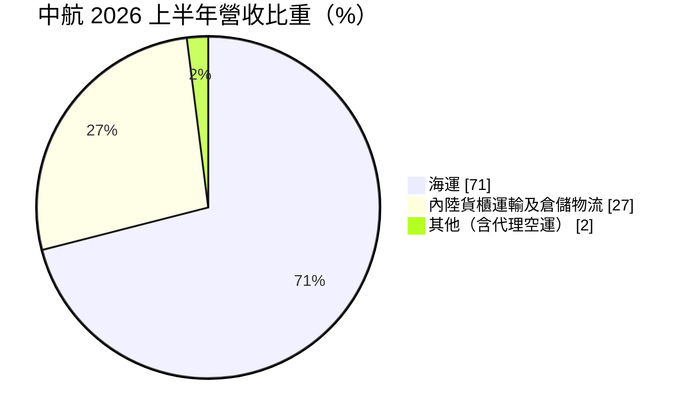
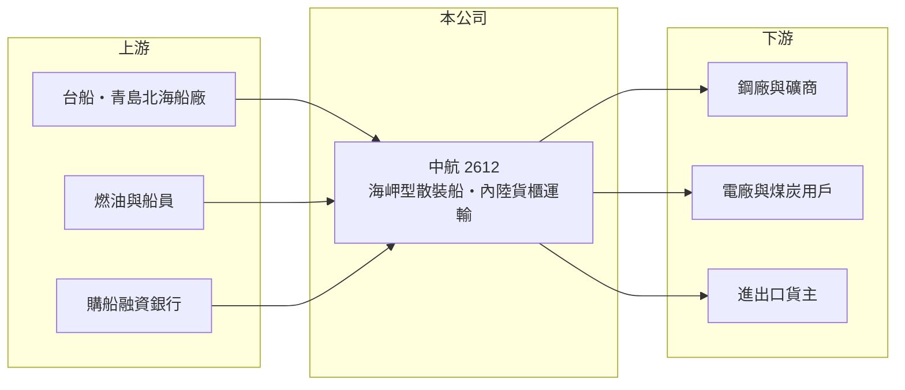

# 2612 中航

> 上市｜[[產業索引-航運業|航運業]]｜上市（櫃）日期 1994/10/20

# 第一章：企業模式與商業藍圖

> [!info] 撰寫說明
> 精簡版，由 Claude 依公開資料整理，架構比照 [[2330台積電]] 的四章研究，資料截至 2026-10-08。財務數字來源：Goodinfo 年度經營績效頁、富果研究整理的 2026 年 9 月法說會摘要（船隊、新船與營收結構）、優分析轉載的台船 2026 年 2 月座談會報導、證交所開放資料（基本資料、2026 年第二季資產負債與綜合損益、營益分析、股利、本益比）；長約比例與主要客戶未查得。#待校對

在評估單一個股的長期價值時，首要步驟是拆解企業的獲利來源。本章說明中國航運（股票代號：2612，以下簡稱中航）如何以[[海岬型散裝船]]為核心，搭配陸上的貨櫃運輸與倉儲，以及船隊更新計畫對它長期競爭力的意義。

- **核心業務：** 中航成立於 1978 年，1994 年上市，董事長為彭士孝，實收資本額約 19.7 億元。依 2026 年 9 月法說，目前營運中的海岬型散裝船共 12 艘，主要運送鐵礦砂與煤炭，公司表示將專注於海岬型散裝航運本業。
- **營收結構：** 2026 年上半年海運約占 71%，內陸貨櫃運輸及倉儲物流合計約 27%，其他（含代理空運）約 2%。陸上業務規模較小，但收入相對穩定，可在散裝運價低迷時提供基本現金流。
- **船隊更新：** 中航已訂造 8 艘 21 萬載重噸新船，[[2208台船]] 與中國青島北海船廠各承造 4 艘，第一艘預計 2026 年 9 月底交付。以現有 12 艘的規模來看，這是改變公司未來十年面貌的大型投資：新型節能船可降低平均船齡與油耗，符合國際海事組織（IMO）日益嚴格的減碳規範，但也大幅增加負債與折舊。
- **長期方向：** 海岬型船的需求主要來自巴西、澳洲到中國等地的鐵礦砂與煤炭運輸。中航的長期報酬取決於新船交付後能否以合理租金簽下長約，以及在運價循環中能否維持船隊滿載。

# 第二章：護城河深度與競爭優勢

本章分析中航的競爭優勢與限制。散裝航運沒有品牌，護城河來自船隊成本與財務能力。

- **競爭優勢：** 中航專注單一船型，營運與維修經驗集中，船員與技術管理效率較高；新造的 21 萬噸節能船在油耗與碳排上優於老船，可在租船市場爭取較好的條件。陸上貨櫃運輸與倉儲提供分散，這是純散裝同業較少有的配置。
- **限制與弱點：** 船隊集中在單一船型，獲利高度依賴海岬型運價，沒有其他船型分散風險。新船計畫使長期負債大幅增加，2026 年第二季非流動負債約 107 億元，未來折舊與利息會明顯上升。
- **主要對手：** 國內散裝同業 [[2605新興]]、[[2606裕民]]、[[2637慧洋-KY]]、[[2617台航]]，以及中鋼運通等鋼廠自有船隊與國際大型散裝船東。
- **觀察重點：** 第一，8 艘新船的交付進度與租約條件；第二，新船交付後負債比與利息保障倍數；第三，海岬型運價在 2027 年後的走勢。

# 第三章：財務體質與盈利規模

資料日期：2026-10-08，表格是撰寫當時的快照；最新月營收、毛利率、累計 EPS 由自動排程寫在本筆記的屬性欄位（月營收、毛利率、累計EPS 等）。#待校對

本章用多年度三率、ROE 與資本報酬，檢視中航在運價循環中的獲利品質。

| 年度 | 營收（新台幣） | [[毛利率]] | [[營業利益率]] | EPS（元） | [[ROE]] |
|---|---|---|---|---|---|
| 2020 | 31.3 億 | 17.5% | 5.06% | 1.67 | 3.25% |
| 2021 | 35.5 億 | 21.8% | 9.96% | 5.27 | 10.2% |
| 2022 | 44.1 億 | 31.4% | 21.1% | 3.88 | 6.87% |
| 2023 | 40.1 億 | 21.4% | 9.32% | 1.66 | 2.78% |
| 2024 | 46.4 億 | 25.5% | 14.9% | 5.13 | 7.99% |
| 2025 | 48.9 億 | 32.7% | 22.4% | 5.46 | 7.93% |
| 2026 上半年 | 25.8 億 | 35.64% | 25.56% | 2.74 | 未查得 |

註：2020 至 2025 年取自 Goodinfo，2026 上半年取自證交所營益分析與法說摘要。

- **營收規模：** 2020 至 2025 年營收年複合成長率約 9.3%（推算），2026 年上半年營收年增 5.39%。營收波動比運價小，推估部分船舶以[[期租]]長約出租（比例未查得）。#待校對
- **獲利結構：** 營業利益率隨運價在 5% 至 22% 之間擺盪，2026 年上半年升到 25.56%，營業利益年增 26%。2021 年 EPS 5.27 元明顯高於營業利益水準，顯示業外投資收益曾是重要貢獻（性質未查得）。
- **長期指標：** 2021 至 2025 年平均 ROE 約 7.2%（推算）。2025 年度配發現金股利 2.20 元，以 EPS 5.46 元計，配息率約 40%（推算），配息率偏低，推估是為新船計畫保留資金。
- **財務特色：** 2026 年第二季底總資產約 278.5 億元，負債約 139.8 億元，其中非流動負債約 107.0 億元，權益約 138.7 億元，負債比約 50%，每股淨值約 70.2 元（證交所開放資料）。

**[[ROIC]] 與 [[WACC]]：** 以 2025 年營業利益約 10.95 億元（48.9 億 × 22.4%）計，稅後約 8.76 億元；投入資本以權益 138.7 億元加上假設占總負債八成的有息負債（多為購船貸款）約 111.8 億元，合計約 250.5 億元，ROIC 約 3.5%（推算）。WACC 以 CAPM 推估：無風險利率 1.75%、市場風險溢酬 6%、β 取航運股常見值 1.1，股東權益成本約 8.35%；負債成本 3.0%、稅後 2.4%；權益約占 55%，WACC 約 5.7%（推算）。目前 ROIC 低於 WACC，原因之一是新船預付款已計入投入資本但尚未產生收入；新船全數交付營運後，ROIC 能否超過 5% 至 6% 的資金成本，是判斷這次大規模投資是否值得的關鍵。

# 第四章：總體風險與地緣政治

本章分析中航長期面對的風險。

- **產業週期：** 海岬型運價主要受中國鋼鐵生產、鐵礦砂與煤炭貿易量，以及全球新船交付量影響，是散裝航運中波動最大的船型。運價低谷若剛好碰上新船大量交付，折舊與利息負擔會放大虧損。
- **營運風險：** 船隊集中單一船型；新船分別在台灣與中國船廠建造，若延遲交付或品質問題，將影響營運計畫。高額購船負債使財務彈性下降，過去依賴的業外投資收益也不穩定。
- **其他風險：** 中國鋼鐵減產或改用電爐、國際減碳政策壓低煤炭需求，長期會減少海岬型船的貨源；新台幣升值降低帳面營收；利率上升提高購船融資成本。

# 專有名詞解析

## 金融

- **[[ROIC]]**：投入資本報酬率，稅後營業利益除以股東權益與有息負債的合計，衡量本業對所有資金提供者的報酬。
- **[[WACC]]**：加權平均資金成本，依股東權益與負債的比重加權計算的資金成本，ROIC 高於它才代表創造價值。

## 產業

- **[[海岬型散裝船]]**：載重約 15 萬至 21 萬噸的大型散裝船，主要運送鐵礦砂與煤炭，因船身太大無法通過舊巴拿馬運河而得名。
- **[[期租]]**：船東把船連同船員出租給租船人一段期間、按日收取租金的合約，可鎖定收入、降低運價波動影響。

# 核心供應鏈

- 上游：[[2208台船]]、中國青島北海船廠、燃油供應商、購船融資銀行。
- 下游／客戶：鋼廠與國際礦商（鐵礦砂）、電廠與煤炭用戶，以及內陸貨櫃運輸的進出口貨主。
- 同業：[[2605新興]]、[[2606裕民]]、[[2637慧洋-KY]]、[[2617台航]]、[[5608四維航]]。

## 最新新聞
<!-- news:start -->
<!-- news:end -->

## 相關連結
- [公開資訊觀測站](https://mopsov.twse.com.tw/mops/web/t05st03?step=1&firstin=1&co_id=2612)
- [Goodinfo](https://goodinfo.tw/tw/StockDetail.asp?STOCK_ID=2612)
- [Yahoo 股市](https://tw.stock.yahoo.com/quote/2612)
- [鉅亨網新聞](https://www.cnyes.com/twstock/2612/news)
