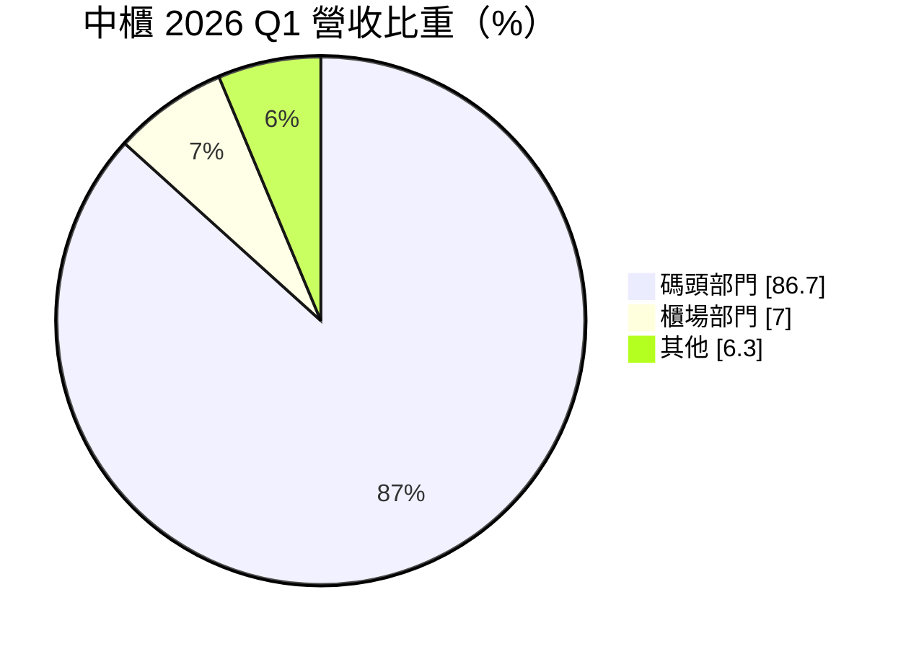
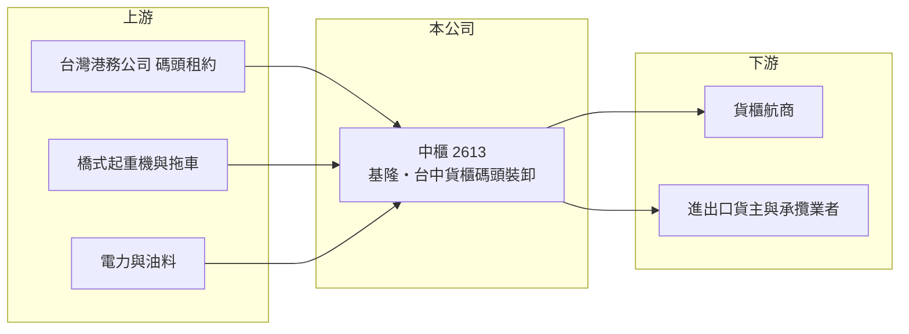

# 2613 中櫃

> 上市｜[[產業索引-航運業|航運業]]｜上市（櫃）日期 1995/01/20

# 第一章：企業模式與商業藍圖

> [!info] 撰寫說明
> 精簡版，由 Claude 依公開資料整理，架構比照 [[2330台積電]] 的四章研究，資料截至 2026-10-08。財務數字來源：Goodinfo 年度經營績效頁、富果研究整理的 2026 年 5 月法說會摘要（營收結構、碼頭據點、負債比）、證交所開放資料（基本資料、2026 年第二季資產負債與綜合損益、營益分析、股利、本益比）。#待校對

在評估單一個股的長期價值時，首要步驟是拆解企業的獲利來源。本章說明中國貨櫃運輸（股票代號：2613，以下簡稱中櫃）如何以基隆港與台中港的貨櫃碼頭經營權為核心，靠裝卸量取得穩定收入。

- **核心業務：** 中櫃成立於 1969 年，總部位於新北汐止，1995 年上市，董事長為林宏年，實收資本額約 14.8 億元。核心業務是[[貨櫃碼頭]]裝卸服務，替航商把貨櫃從船上卸下或裝上船，並提供堆存、[[CFS]] 倉儲與冷凍櫃等服務。
- **營收結構：** 依 2026 年第一季法說，碼頭部門占總營收 86.7%，櫃場部門占 7.0%，其他收入占 6.3%。CFS 倉儲與冷凍櫃屬利基業務，公司表示成長約一至二成。
- **營運據點：** 中櫃在基隆港經營西 19 至 21 號碼頭，在台中港經營 10、11 號碼頭與 31 號後線場地（2020 年起 31 號碼頭租給 [[2607榮運]] 使用）。碼頭屬於港務公司的公共資產，業者透過長期租約或經營契約取得使用權，同一港口的碼頭數量有限，這是港埠業的進入門檻。
- **長期方向：** 公司以 ESG 為核心策略，台中站導入儲能櫃、智慧電表與電動拖車，並與台灣科技大學合作制定貨櫃碼頭裝卸服務的碳足跡規則。長期成長取決於基隆、台中兩港的貨櫃量，以及碼頭機具更新後的作業效率。

# 第二章：護城河深度與競爭優勢

本章分析中櫃的競爭優勢與限制。港埠業的護城河來自碼頭經營權，但成長空間受港口規模限制。

- **競爭優勢：** 碼頭泊位是稀缺資源，新業者幾乎不可能在既有港口取得新碼頭，中櫃在基隆與台中的碼頭經營權提供長期穩定的業務基礎。裝卸費依貨櫃量計算，收入與航運運價的關聯小於航商，營收波動較小。
- **限制與弱點：** 基隆港與台中港的貨櫃量規模遠小於高雄港，成長空間有限；同港口另有聯興國際通運、[[2603長榮]]、[[2615萬海]] 等經營碼頭，航商自營碼頭會分走部分裝卸量。毛利率長期只有 15% 至 18%，獲利能力偏低。
- **主要對手：** 基隆港的聯興國際通運與港務公司，台中港的長榮海運與萬海航運自營碼頭，以及貨櫃場同業 [[2607榮運]]。
- **觀察重點：** 第一，基隆、台中兩港的貨櫃裝卸量趨勢；第二，新機具折舊與碼頭租金上升對毛利率的影響；第三，CFS 與冷凍櫃等利基業務的成長。

# 第三章：財務體質與盈利規模

資料日期：2026-10-08，表格是撰寫當時的快照；最新月營收、毛利率、累計 EPS 由自動排程寫在本筆記的屬性欄位（月營收、毛利率、累計EPS 等）。#待校對

本章用多年度三率、ROE 與資本報酬，檢視中櫃的獲利品質。

| 年度 | 營收（新台幣） | [[毛利率]] | [[營業利益率]] | EPS（元） | [[ROE]] |
|---|---|---|---|---|---|
| 2020 | 28.3 億 | 11.6% | 6.28% | 0.23 | 1.01% |
| 2021 | 30.8 億 | 17.7% | 11.4% | 1.63 | 6.97% |
| 2022 | 31.5 億 | 17.0% | 10.9% | 1.05 | 4.43% |
| 2023 | 31.5 億 | 14.9% | 8.55% | 0.71 | 3.18% |
| 2024 | 32.9 億 | 16.8% | 10.4% | 0.84 | 3.59% |
| 2025 | 33.7 億 | 17.0% | 10.4% | 1.14 | 4.87% |
| 2026 上半年 | 17.5 億 | 15.86% | 9.71% | 0.68 | 未查得 |

註：2020 至 2025 年取自 Goodinfo，2026 上半年取自證交所營益分析與綜合損益表。

- **營收規模：** 2020 至 2025 年營收年複合成長率約 3.6%（推算），每年小幅成長，反映港埠裝卸業務穩定但成長有限的特性。
- **獲利結構：** 營業利益率維持在 8.5% 至 11.4% 之間，但營業外長期為淨支出（2026 年上半年約 -0.51 億元），推估主要是租賃負債與借款的利息，使稅後淨利率明顯低於營業利益率。2026 年第一季毛利率降到 13.5%，公司說明是基隆橋式起重機全損後的額外公共碼頭費用、新機具折舊與場地租金上升所致，並認為屬暫時性。
- **長期指標：** 2021 至 2025 年平均 ROE 約 4.6%（推算）。2025 年度配發現金股利 1.00 元，配息率約 87.7%，配息穩定但 ROE 偏低。
- **財務特色：** 2026 年第二季底總資產約 102.9 億元，負債約 70.2 億元，權益約 32.6 億元。依法說，負債比約 69.3%，排除 IFRS 16 租賃負債後約 53.7%，碼頭與場地租約是負債的重要組成。

**[[ROIC]] 與 [[WACC]]：** 以 2025 年營業利益約 3.50 億元（33.7 億 × 10.4%）計，稅後約 2.80 億元；投入資本以權益 32.6 億元加上假設占總負債六成的有息負債（含租賃負債）約 42 億元，合計約 74.6 億元，ROIC 約 3.8%（推算）。WACC 以 CAPM 推估：無風險利率 1.75%、市場風險溢酬 6%、β 取港埠服務股常見值 0.7，股東權益成本約 5.95%；負債成本 2.5%、稅後 2.0%；權益約占 44%，WACC 約 3.7%（推算）。ROIC 與 WACC 幾乎相等，代表中櫃的碼頭業務大致只賺回資金成本，沒有明顯創造或破壞價值；它的價值在於穩定與配息，而非成長。

# 第四章：總體風險與地緣政治

本章分析中櫃長期面對的風險。

- **產業週期：** 裝卸量跟著台灣進出口貿易與航商的航線配置變動，全球貿易放緩或航商調整靠港順序時，基隆與台中港的貨櫃量會受影響。
- **營運風險：** 碼頭機具老化或意外（如起重機全損）會造成作業中斷與額外成本；碼頭租約到期續約的條件、港務公司的租金調整，都直接影響成本結構。高比例的租賃負債使固定成本偏高。
- **其他風險：** 航商自營碼頭與聯盟重組可能分流裝卸量；港口減碳要求會增加電動化機具的投資；基隆港腹地有限，長期在北部港口競爭中可能被台北港分走貨量。#待校對

# 專有名詞解析

## 金融

- **[[ROIC]]**：投入資本報酬率，稅後營業利益除以股東權益與有息負債的合計，衡量本業對所有資金提供者的報酬。
- **[[WACC]]**：加權平均資金成本，依股東權益與負債的比重加權計算的資金成本，ROIC 高於它才代表創造價值。

## 產業

- **[[貨櫃碼頭]]**：港口中專供貨櫃船靠泊與裝卸的泊位與後線場地，通常由業者向港務機關租用經營。
- **[[CFS]]**：貨櫃集散站，把多個貨主的併櫃貨物在站內拆櫃、裝櫃、分類與暫存的場所。

# 核心供應鏈

- 上游：台灣港務公司（碼頭與場地租約）、橋式起重機與場內機具供應商、電力與油料。
- 下游／客戶：靠泊基隆港與台中港的貨櫃航商、進出口貨主與貨運承攬業者。
- 同業：[[2607榮運]]、[[2611志信]]，以及聯興國際通運、航商自營碼頭。

## 最新新聞
<!-- news:start -->
<!-- news:end -->

## 相關連結
- [公開資訊觀測站](https://mopsov.twse.com.tw/mops/web/t05st03?step=1&firstin=1&co_id=2613)
- [Goodinfo](https://goodinfo.tw/tw/StockDetail.asp?STOCK_ID=2613)
- [Yahoo 股市](https://tw.stock.yahoo.com/quote/2613)
- [鉅亨網新聞](https://www.cnyes.com/twstock/2613/news)
