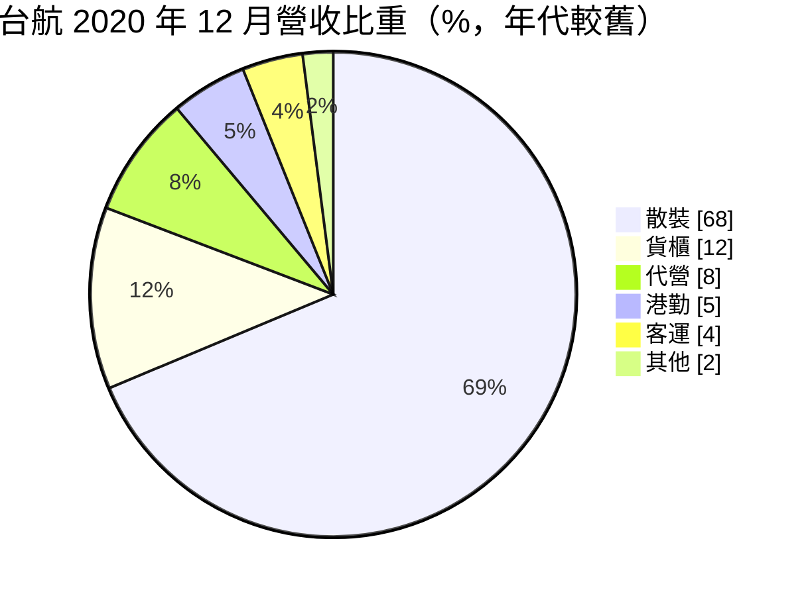
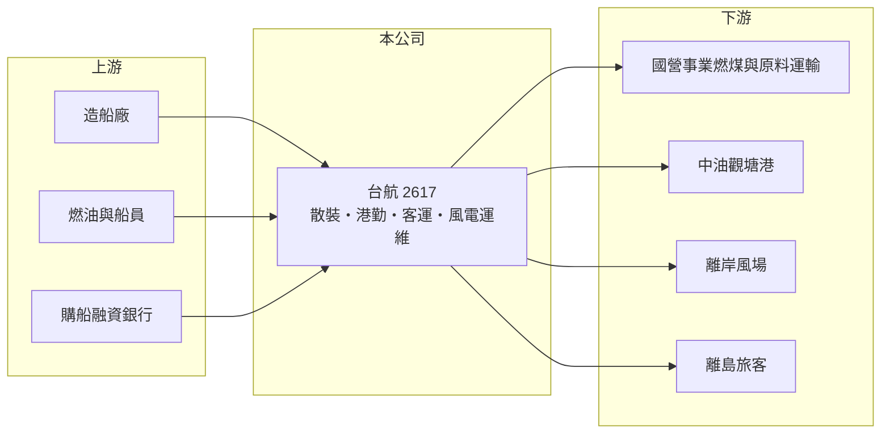

# 2617 台航

> 上市｜[[產業索引-航運業|航運業]]｜上市（櫃）日期 1998/06/24

# 第一章：企業模式與商業藍圖

> [!info] 撰寫說明
> 精簡版，由 Claude 依公開資料整理，架構比照 [[2330台積電]] 的四章研究，資料截至 2026-10-08。財務數字來源：Goodinfo 年度經營績效頁、CMoney 2021 年 1 月台航研究報告（營收結構、觀塘港勤合約，年代較舊）、Yahoo 新聞標題（新船訂單）、證交所開放資料（基本資料、2026 年第二季資產負債與綜合損益、營益分析、股利、本益比）；最新船隊數量與客戶名單未查得，部分內容憑既有知識撰寫，已標「待校對」。#待校對

在評估單一個股的長期價值時，首要步驟是拆解企業的獲利來源。本章說明台灣航業（股票代號：2617，以下簡稱台航）這家具官股背景的老牌航運公司，如何以合約型散裝運輸為主體，再搭配港勤、客運與[[離岸風電]]運維，建立相對穩定的收入。

- **核心業務：** 台航成立於 1946 年，是台灣歷史最悠久的航運公司之一，1998 年上市，董事長為魏健宏，實收資本額約 41.7 億元。依 2021 年資料，交通部持股約 26%，屬官股色彩濃厚的公司。主要業務為散裝船運輸，另有貨櫃船出租、船舶代營、[[港勤拖船]]與離島客運。
- **營收結構：** 依 2020 年 12 月資料，散裝占 68%、貨櫃 12%、代營 8%、港勤 5%、客運 4%、其他 2%。散裝船以合約船為主，約占 70%，多為 1 至 1.5 年合約，主要客戶推估包括台電等國營事業的燃煤運輸。#待校對 客運業務推估包括往返基隆與馬祖的離島航線。#待校對
- **長約型新事業：** 2020 年 12 月取得中油觀塘工業港 25 年港勤船勞務案，以 5 艘新建拖船與 2 艘港勤交通兼帶纜船提供服務，估計每年貢獻約 2.8 億元營收。2018 年與新加坡東方航業及沃旭能源簽署合作備忘錄，提供大彰化離岸風場的運維船服務。這兩項都是十年以上的長期收入，讓台航的收入結構比純散裝航商更穩定。
- **長期方向：** 依新聞標題，台航已訂造 2 艘 6.4 萬噸級散裝船，預計 2028 年下半年交船，持續汰舊換新。長期方向是以國營事業長約與港勤、風電運維等合約型業務為基礎，降低對散裝運價的依賴。

# 第二章：護城河深度與競爭優勢

本章分析台航的競爭優勢與限制。它的護城河來自官股背景下的長期合約與特許性質業務。

- **競爭優勢：** 港勤拖船、離島客運與國營事業運輸屬於需要長期信任與在地實績的業務，台航的官股背景與數十年經驗使它在這類標案中具備優勢。觀塘港勤 25 年合約、離岸風電運維等長期合約，提供不受運價影響的穩定現金流。
- **獲利能力：** 2021 年以來營業利益率維持在 29% 至 38% 的高水準，在散裝航運同業中波動相對小，反映合約船比重高。
- **限制與弱點：** 官股公司的經營決策可能需兼顧政策任務，例如離島客運的公共服務性質，不一定以獲利最大化為目標。散裝合約多為 1 至 1.5 年，續約時仍會反映市場運價。
- **主要對手：** 國內散裝同業 [[2605新興]]、[[2612中航]]、[[2606裕民]]、[[2637慧洋-KY]]、[[5608四維航]]；港勤與風電運維則有國內外專業船東。
- **觀察重點：** 第一，新船交付後的船隊規模與合約條件；第二，離岸風電運維業務的實際營收貢獻；第三，國營事業長約的續約狀況。

# 第三章：財務體質與盈利規模

資料日期：2026-10-08，表格是撰寫當時的快照；最新月營收、毛利率、累計 EPS 由自動排程寫在本筆記的屬性欄位（月營收、毛利率、累計EPS 等）。#待校對

本章用多年度三率、ROE 與資本報酬，檢視台航的獲利品質。

| 年度 | 營收（新台幣） | [[毛利率]] | [[營業利益率]] | EPS（元） | [[ROE]] |
|---|---|---|---|---|---|
| 2020 | 24.9 億 | 23.9% | 18.5% | 1.24 | 4.93% |
| 2021 | 32.3 億 | 39.6% | 34.5% | 3.16 | 9.99% |
| 2022 | 38.7 億 | 34.6% | 29.3% | 4.83 | 12.9% |
| 2023 | 39.9 億 | 36.1% | 31.0% | 3.98 | 10.5% |
| 2024 | 44.0 億 | 41.9% | 37.7% | 3.08 | 7.5% |
| 2025 | 43.0 億 | 41.7% | 36.9% | 3.18 | 7.35% |
| 2026 上半年 | 23.7 億 | 43.52% | 40.05% | 1.55 | 未查得 |

註：2020 至 2025 年取自 Goodinfo，2026 上半年取自證交所營益分析與綜合損益表。

- **營收規模：** 2020 至 2025 年營收年複合成長率約 11.5%（推算），2024 年後穩定在 43 億至 44 億元，反映觀塘港勤等新合約與新船投入。
- **獲利結構：** 營業利益率逐年墊高到 2026 年上半年的 40.05%，屬於航運業中相當高的水準。營業外長期為淨支出（2026 年上半年約 -1.03 億元），推估主要是購船借款利息。持有的 [[2609陽明]] 股票依 2021 年資料列入其他綜合損益，股價漲跌不影響 EPS。
- **長期指標：** 2021 至 2025 年平均 ROE 約 9.6%（推算）。2025 年度配發現金股利 1.50 元，以 EPS 3.18 元計，配息率約 47%（推算），保留部分盈餘支應造船。
- **財務特色：** 2026 年第二季底總資產約 277.7 億元，負債約 98.1 億元，其中非流動負債約 72.5 億元，權益約 179.6 億元，負債比約 35%，每股淨值約 43.0 元（證交所開放資料）。

**[[ROIC]] 與 [[WACC]]：** 以 2025 年營業利益約 15.9 億元（43.0 億 × 36.9%）計，稅後約 12.7 億元；投入資本以權益 179.6 億元加上假設占總負債七成的有息負債約 68.7 億元，合計約 248.3 億元，ROIC 約 5.1%（推算）。WACC 以 CAPM 推估：無風險利率 1.75%、市場風險溢酬 6%、β 取航運股常見值 1.0（官股合約型業務波動較低，可能偏保守），股東權益成本約 7.75%；負債成本 3.0%、稅後 2.4%；權益約占 72%，WACC 約 6.3%（推算）。以帳面計算 ROIC 略低於 WACC，但權益中包含陽明等金融資產，若只計算船隊投入資本，本業報酬接近或略高於資金成本。台航的價值主要來自穩定的合約現金流，而非高資本報酬。

# 第四章：總體風險與地緣政治

本章分析台航長期面對的風險。

- **產業週期：** 散裝合約雖以 1 至 1.5 年為主，續約時仍反映 [[BDI]] 等市場運價；全球散裝船新船交付量增加或中國需求轉弱時，續約租金會下降。
- **營運風險：** 船隊汰舊換新需要大筆資本支出與借款；港勤與客運業務的人力與安全要求高，船員短缺與老化是長期挑戰。離岸風電運維收入取決於風場開發進度。
- **其他風險：** 官股背景使經營層人事與政策任務可能受政治影響（2026 年第二季總經理為代理）；國營事業客戶的能源政策（如減煤）會改變燃煤運輸需求；新台幣升值與燃油價格波動影響獲利。

# 專有名詞解析

## 金融

- **[[ROIC]]**：投入資本報酬率，稅後營業利益除以股東權益與有息負債的合計，衡量本業對所有資金提供者的報酬。
- **[[WACC]]**：加權平均資金成本，依股東權益與負債的比重加權計算的資金成本，ROIC 高於它才代表創造價值。

## 產業

- **[[港勤拖船]]**：在港內協助大型船舶靠離碼頭、轉向與帶纜的小型高馬力船舶，通常以長期勞務合約經營。
- **[[BDI]]**：波羅的海乾散貨綜合運價指數，反映全球散裝船運價水準，是散裝航運景氣的主要指標。
- **[[離岸風電]]**：在海上設置風力發電機組，需要專業船舶進行基礎與風機的運輸、安裝與運維。

# 核心供應鏈

- 上游：國內外造船廠（如 [[2208台船]]）、燃油供應商、船員、購船融資銀行。
- 下游／客戶：國營事業的燃煤與原料運輸（推估包括台電，待校對）、中油觀塘工業港（港勤）、離岸風場開發商（運維）、離島旅客。
- 同業：[[2605新興]]、[[2612中航]]、[[2606裕民]]、[[2637慧洋-KY]]、[[5608四維航]]。

## 最新新聞
<!-- news:start -->
<!-- news:end -->

## 相關連結
- [公開資訊觀測站](https://mopsov.twse.com.tw/mops/web/t05st03?step=1&firstin=1&co_id=2617)
- [Goodinfo](https://goodinfo.tw/tw/StockDetail.asp?STOCK_ID=2617)
- [Yahoo 股市](https://tw.stock.yahoo.com/quote/2617)
- [鉅亨網新聞](https://www.cnyes.com/twstock/2617/news)
