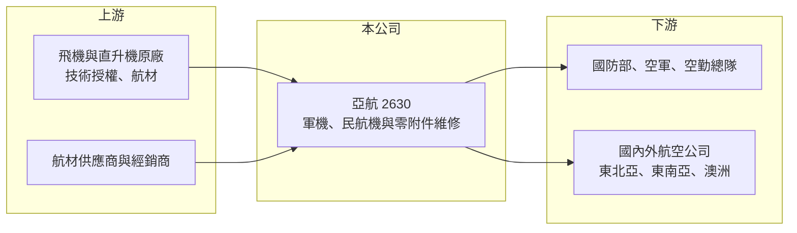

# 2630 亞航

> 上市｜[[產業索引-航運業|航運業]]｜上市（櫃）日期 2018/02/22

# 第一章：企業模式與商業藍圖

> [!info] 撰寫說明
> 精簡版，由 Claude 依公開資料整理，架構比照 [[2330台積電]] 的四章研究，資料截至 2026-10-08。來源：證交所開放資料（基本資料、綜合損益、資產負債、營益分析、股利、本益比）、Goodinfo 年度經營績效、富果 2026 年 4 月法說會備忘錄、nstock 公司簡介。產業描述為整理性內容，尚未逐條比對原始文件。#待校對

亞洲航空（以下簡稱亞航）是台灣歷史最久的航空器維修公司之一，理解它的關鍵在於：這是一家以政府與軍方長期委外合約為基本盤、再逐步往民航機維修擴張的 [[MRO]] 業者。

- **核心業務：** 亞航主要從事飛機及其零附件的維修，業務分成四類：飛機維修（含軍機與商用機）、機隊維持與修護補給、委外送修與航材買賣，以及自家工廠的零附件維修。公司 1955 年設立、2018 年在證交所上市，總部與主要棚廠位於台南機場旁。維修業的收入來自飛機「服役期間」的保養需求，而不是新飛機銷售，因此只要機隊持續飛行，就會有穩定的維修需求。
- **營收結構：** 依富果整理的法說內容，亞航的客戶以國防部與政府機關的長期委外案為主，例如空軍第二後勤指揮部軍工廠委託民間經營案、空軍松山基地修護補給隊委託案（2026 年初續約兩年、約 10.8 億元）、OH-58D 與 TH-67 等直升機商維案、空勤總隊 UH-60 委商維修案，以及 2025 年底取得的八年期、約 12 億元運輸直升機商維案。民航與海外客戶則分布在東北亞與東南亞，2026 年取得首張澳洲客戶訂單。各類別的營收比重公司未在可取得的資料中揭露。
- **營運據點：** 主要維修基地在台南，另在桃園、台中、台南、高雄機場設有停機線服務據點（[[停機線維修]]）（2026 年法說資料），提供航空公司過境飛機的日常檢查與排故。停機線服務門檻較低，但能讓亞航和航空公司建立日常往來，是爭取更大型檢修工作的入口。
- **長期方向：** 公司的中長期目標是開拓機體重度檢修（[[C check]]）並擴大全代理服務的機型範圍，2026 年完成 B737 MAX 線上維修訓練，法說會稱為台灣唯一能執行該機型線上維修的 MRO 業者。另一條路線是[[無人機]]的維修、產製與研發，搭配國防自主政策。這兩個方向若做起來，可以降低公司對少數軍方合約的依賴。

# 第二章：護城河深度與競爭優勢

護城河分析要回答的是：別人為什麼很難搶走亞航的生意。亞航的優勢主要來自軍方資格與長年累積的機型認證，但民航維修市場競爭激烈，護城河屬於窄而集中的類型。

- **競爭優勢：** 軍機與政府機隊的維修需要保密資格、原廠技術授權與長期的履約紀錄，新進業者很難在短時間取得。亞航長年承接空軍與空勤總隊的委外案，續約紀錄本身就是進入門檻；這類合約通常一簽兩年到八年，讓營收有一定的能見度。其次，維修人員的機型執照與經驗需要多年培養，人才累積也是不易複製的資產。
- **主要對手：** 國內同業包括 [[2645長榮航太]]（以長榮航空機隊與發動機維修為主）、華航旗下的台灣飛機維修公司，以及 [[2634漢翔]] 的軍機維修與發動機維修業務；海外則有新加坡、香港與中國的大型 MRO 業者。長榮航太背靠集團機隊，規模與獲利率都明顯高於亞航，這是亞航在民航機維修市場最大的競爭壓力。
- **觀察重點：** 第一是重度檢修與全代理機型能否擴大，這決定亞航能否從「軍方委外承包商」轉為「區域型民航 MRO」。第二是軍方大型合約的續約與新增，因為少數合約占比高，任何一案流失都會明顯影響營收。第三是毛利率能否維持在 2025 年約 10% 的水準以上，2026 年上半年毛利率回落到 8.49%，顯示成本或專案組合仍有壓力。

# 第三章：財務體質與盈利規模

資料日期：2026-10-08，表格是撰寫當時的快照；最新月營收、毛利率、累計 EPS 由自動排程寫在本筆記的屬性欄位（月營收、毛利率、累計EPS 等）。#待校對

財務數字能檢驗護城河是否轉化為獲利。亞航的特點是營收穩定成長、但利潤率偏薄，獲利對專案組合相當敏感。

| 年度 | 營收（新台幣） | [[毛利率]] | [[營業利益率]] | EPS（元） | [[ROE]] |
|---|---|---|---|---|---|
| 2021 | 38.8 億 | 5.87% | 0.18% | 0.53 | 4.30% |
| 2022 | 40.7 億 | 6.17% | 0.95% | 0.08 | 0.70% |
| 2023 | 48.6 億 | 6.94% | 1.96% | 0.31 | 2.13% |
| 2024 | 52.0 億 | 8.89% | 3.80% | 0.67 | 4.07% |
| 2025 | 54.5 億 | 10.40% | 5.33% | 1.00 | 5.98% |
| 2026 上半年 | 20.96 億 | 8.49% | 2.07% | 0.12 | 未查得 |

註：2021 至 2025 年取自 Goodinfo；2026 上半年取自證交所營益分析與綜合損益開放資料。

- **營收規模：** 營收由 2021 年 38.8 億元成長到 2025 年 54.5 億元，4 年年複合成長率約 8.9%（推算）。成長主要來自軍方委外案擴大與飛機、零附件維修量增加。2026 年上半年營收約 21 億元，低於 2025 年的半年平均，可能與專案認列時點有關（推估）。
- **獲利：** 毛利率由 2021 年 5.87% 逐年提升到 2025 年 10.4%，營業利益率同步由接近零升到 5.33%，顯示亞航正在擺脫低毛利的人力派遣型工作、轉向技術含量較高的維修項目。不過 2026 上半年毛利率回落到 8.49%、EPS 僅 0.12 元，說明這個改善趨勢還不穩定。近 5 年平均 ROE 約 3.4%（推算），資本效率偏低。
- **財務特色：** 2026 年第二季底總資產約 57.5 億元，權益約 33.8 億元、負債約 23.7 億元，每股淨值 16.16 元，財務結構保守。2025 年度配發現金股利 0.9 元，配息率約 90%（推算），公司章程規定至少提撥可分配盈餘 50% 分派，以現金股利為優先。
- **[[ROIC]] 與 [[WACC]]：** 以 2025 年營業利益約 2.9 億元（54.5 億元乘以 5.33%）扣除 20% 稅率，稅後營業利益約 2.3 億元；投入資本以權益 33.8 億元加上推估有息負債約 7 億元（約占總負債三成，推估）計，約 40.8 億元，ROIC 約 5.7%（推算）。WACC 假設台灣 10 年期公債 1.75%、市場風險溢酬 6%、β 取維修服務業常見值 0.8（推估），權益成本約 6.55%；負債成本 2.5%、稅後 2.0%，權益與負債比約 83 比 17，WACC 約 5.8%（推算）。ROIC 與 WACC 大致打平，代表亞航 2025 年剛走到「不毀損價值」的邊緣，2021 至 2023 年則明顯低於資金成本；要長期創造價值，營業利益率需要穩定站上 5% 以上。

# 第四章：總體風險與地緣政治

風險分析關注的是什麼事情會讓長期故事走不下去。亞航的風險集中在客戶結構與民航市場競爭。

- **產業週期：** 軍方委外維修受國防預算支撐，週期性低；民航維修則跟著航空公司機隊規模與飛行時數波動，疫情這類事件會讓需求瞬間下滑。亞航目前以軍方與政府業務為主，景氣波動相對小，但也代表成長受預算編列節奏限制。
- **營運風險：** 少數大型政府合約占營收比重高，續約失敗或得標價格被壓低，會直接衝擊營收與毛利。維修業屬人力密集，技師薪資上漲而合約價格固定時，利潤會被擠壓；2026 上半年毛利率回落就是這類壓力的警訊。
- **其他風險：** 航材多以美元計價，匯率波動會影響成本；國防採購與美方技術授權受地緣政治影響，若美台軍售或維修授權政策改變，軍機維修業務的範圍可能隨之變動。無人機業務仍在早期，投資回收時間不確定。

# 專有名詞解析

## 金融

- **[[ROIC]]**：投入資本報酬率，稅後營業利益除以股東權益與有息負債之和，衡量所有投入資本的報酬。
- **[[WACC]]**：加權平均資金成本，依權益與負債比重加權的資金成本，是 ROIC 需要超越的門檻。

## 產業

- **[[MRO]]**：維護、修理與大修，指飛機在服役期間的定期檢修、零件修理與發動機大修等售後服務。
- **[[C check]]**：飛機的重度定期檢修，通常每一到兩年進行一次，需進棚數週，檢查結構與系統。
- **[[無人機]]**：無人駕駛的飛行器，可用於監偵、物流與國防，台灣近年推動國產無人機供應鏈。
- **[[停機線維修]]**：飛機在機坪過境或過夜時進行的例行檢查與小型排故，不需進棚，是航空公司日常委外最多的維修項目。

# 核心供應鏈

- 上游：飛機與直升機原廠（技術授權、手冊與航材）、國際航材供應商與送修廠。
- 下游／客戶：國防部與空軍（軍工廠委託經營、松山基地修護補給、直升機商維）、內政部空勤總隊、國內外航空公司的停機線與機體維修。
- 同業：[[2645長榮航太]]、[[2634漢翔]]、台灣飛機維修（華航子公司）、新加坡與香港的大型 MRO 業者。

## 最新新聞
<!-- news:start（自動產生，請勿手動編輯此範圍） -->
- 2026-10-21 🏛️ 重訊 14:18｜本公司受邀參加台新證券舉辦之法人說明會｜[觀測站](https://mops.twse.com.tw/mops/#/web/t05st01)

完整紀錄：[[2630亞航 新聞]]
<!-- news:end -->

## 相關連結
- [公開資訊觀測站](https://mopsov.twse.com.tw/mops/web/t05st03?step=1&firstin=1&co_id=2630)
- [Goodinfo](https://goodinfo.tw/tw/StockDetail.asp?STOCK_ID=2630)
- [Yahoo 股市](https://tw.stock.yahoo.com/quote/2630)
- [鉅亨網新聞](https://www.cnyes.com/twstock/2630/news)
