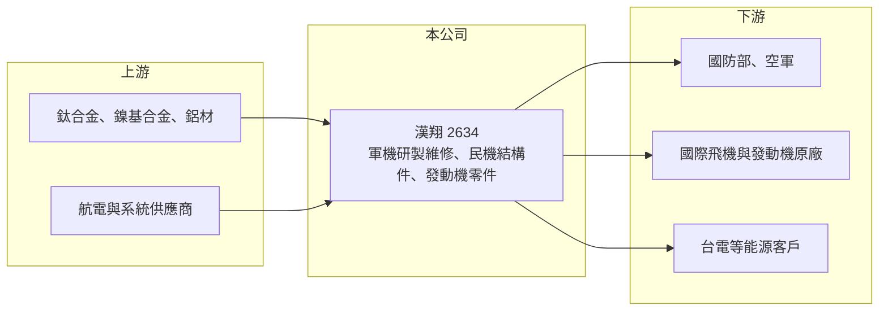

# 2634 漢翔

> 上市｜[[產業索引-航運業|航運業]]｜上市（櫃）日期 2014/08/25

# 第一章：企業模式與商業藍圖

> [!info] 撰寫說明
> 精簡版，由 Claude 依公開資料整理，架構比照 [[2330台積電]] 的四章研究，資料截至 2026-10-08。來源：證交所開放資料（基本資料、綜合損益、資產負債、營益分析、股利、本益比）、Goodinfo 年度經營績效、聯合新聞網 2026 年 6 月法說會報導（含中華信評評等說明）。主要股東與民機客戶名稱憑記憶撰寫，已標待校對。#待校對

漢翔航空工業（以下簡稱漢翔）是台灣唯一具備自主研發軍機能力的航太公司，理解它要抓住兩條主線：一條是國防自主帶來的軍機研製與全壽期維修，另一條是全球民航供應鏈的機體結構件與發動機零件。

- **核心業務：** 漢翔的前身是國防部中山科學研究院航空工業發展中心，1996 年改制成立公司，2014 年在證交所上市，目前由經濟部為最大股東（待校對）。業務分為軍用、民用航空與科技服務三大塊：軍用負責軍機研製與維修，民用航空替國際飛機與發動機廠製造零組件，科技服務則把航太技術延伸到能源與工業設備。中華信評在 2026 年的評等說明中指出，漢翔是台灣唯一自主研發軍機並提供後勤維修的廠商，具獨占地位。
- **營收結構：** 軍用業務的代表是「勇鷹」新式高級教練機，公司目標在 2026 年完成全案 66 架交付；新機交付高峰過後，業務會轉向空軍機隊的維修、維護與大修，公司稱為「全壽期服務」。民用航空包括民機機體結構件與航空發動機零件，2026 年上半年新接訂單 128 億元，其中發動機需求最強。各板塊營收比重未在本次查得的資料中揭露。
- **營運據點：** 主要廠區位於台中（待校對），擁有軍機總裝、機體結構與發動機零件的製造與維修能力。航太製造需要大量專用廠房、熱處理與表面處理設備，以及原廠認證的特殊製程，據點本身就是長年投資的成果。
- **長期方向：** 公司理念是「航太核心、轉型創新」。科技服務方面，取得台電 MW 級混氫型氣渦輪發電機組統包工程（得標金額近 8 億元），並推出自建儲能產品「電力島」（預計 2026 年上線）；國防方面，2026 年 5 月發表無 GPS 時可定位的無人機視覺導航系統，並發展無人機反制系統。長期看，軍機全壽期維修與發動機零件是兩個最具延續性的收入來源。

# 第二章：護城河深度與競爭優勢

護城河要看漢翔的地位能否抵擋競爭、並轉化成合理的利潤。漢翔在國內軍機領域幾乎沒有對手，但在國際民機市場只是眾多供應商之一。

- **競爭優勢：** 第一是國防獨占：軍機研製涉及機密與國家安全，國防部長期把軍機研製與後勤維修交給漢翔，新進者難以取代，這也帶來數十年的維修需求。第二是原廠認證：民航零件須通過飛機與發動機原廠的品質系統與特殊製程認證，一旦取得就能長期供貨，客戶不會輕易更換。第三是技術累積：軍機研發經驗讓漢翔具備系統整合能力，是一般零件廠沒有的。
- **主要對手：** 國內航太同業包括 [[2645長榮航太]]（維修與客艙改裝）、[[2630亞航]]（軍機與民航機維修）、[[8222寶一]]、[[4572駐龍]]（發動機零件）與 [[8033雷虎]]（無人機）；國際上則與日本、韓國、歐洲與中國的航太結構件與發動機零件廠競爭。民機市場的價格由原廠主導，漢翔議價能力有限。
- **觀察重點：** 2025 年營業利益率降到 3.3%，2026 上半年回升到接近 10%，關鍵在於高教機交付收尾後，軍用營收能否由維修業務接手、毛利率能否維持。另一個重點是發動機零件訂單能否隨全球窄體客機交機量放大，以及科技服務新事業能否形成穩定獲利。

# 第三章：財務體質與盈利規模

資料日期：2026-10-08，表格是撰寫當時的快照；最新月營收、毛利率、累計 EPS 由自動排程寫在本筆記的屬性欄位（月營收、毛利率、累計EPS 等）。#待校對

漢翔的財報呈現典型的「專案型製造業」特徵：營收受大型軍案與民機交付節奏影響，利潤率不高，波動明顯。

| 年度 | 營收（新台幣） | [[毛利率]] | [[營業利益率]] | EPS（元） | [[ROE]] |
|---|---|---|---|---|---|
| 2021 | 237 億 | 7.46% | 2.07% | 0.59 | 3.95% |
| 2022 | 302 億 | 9.63% | 4.98% | 1.73 | 10.8% |
| 2023 | 391 億 | 11.1% | 7.14% | 2.36 | 13.5% |
| 2024 | 393 億 | 9.47% | 5.64% | 2.30 | 12.3% |
| 2025 | 355 億 | 7.14% | 3.30% | 0.78 | 4.06% |
| 2026 上半年 | 167.8 億 | 13.93% | 9.96% | 1.30 | 未查得 |

註：2021 至 2025 年取自 Goodinfo；2026 上半年取自證交所營益分析與綜合損益開放資料。

- **營收規模：** 營收由 2021 年 237 億元成長到 2023 至 2024 年約 390 億元，再回落到 2025 年 355 億元，4 年年複合成長率約 10.6%（推算）。2021 年是民航業疫情谷底，之後的成長來自民機需求復甦與高教機量產。2025 年營收與獲利同步下滑的原因，本次未查得公司說明。
- **獲利：** 毛利率長期落在 7% 至 11%，營業利益率 2% 至 7%，屬於薄利的製造業。2026 年第一季 EPS 0.28 元、第二季 1.02 元，上半年營業利益率回升到 9.96%，是近年高點，但能否延續要看下半年的產品組合。近 5 年平均 ROE 約 8.9%（推算）。
- **財務特色：** 2026 年第二季底總資產約 499 億元，負債約 315 億元、權益約 184 億元，負債比約 63%，其中相當比例為預收款與應付款等營運性負債（推估）。2025 年度配發現金股利 0.778 元，幾乎全數配出當年盈餘；公司章程說明因屬資金密集產業，以現金股利為優先。中華信評 2026 年給予長期 twAA、短期 twA-1+ 評等，反映政府股東背景與獨占地位。
- **[[ROIC]] 與 [[WACC]]：** 2025 年營業利益約 11.7 億元（355 億元乘以 3.3%），扣除 20% 稅率後約 9.4 億元；投入資本以權益 184 億元加推估有息負債約 120 億元（推估）計，約 304 億元，ROIC 約 3.1%（推算）。若以 2026 上半年營業利益 16.7 億元年化，ROIC 約 8.8%（推算）。WACC 假設公債 1.75%、市場風險溢酬 6%、β 取國防航太常見值 0.9（推估），權益成本約 7.15%；負債成本 2.2%、稅後約 1.8%，權益與負債比約 60 比 40，WACC 約 5.0%（推算）。2025 年 ROIC 低於 WACC，2022 至 2024 年與 2026 上半年則高於 WACC，代表漢翔只有在軍民機業務同時順暢時才創造價值，長期利差並不穩定。

# 第四章：總體風險與地緣政治

漢翔的長期風險來自政府預算、國際航空景氣與大型專案執行，三者都不完全在公司掌控之內。

- **產業週期：** 民機零件需求跟著波音、空巴的交機量與航空公司的機隊擴張走，疫情或原廠品質問題都可能讓交機延後，連帶影響漢翔出貨。發動機零件的售後市場較穩定，但新機型量產初期需要大量學習成本。
- **營運風險：** 大型軍案多為固定價格合約，若成本超支或交期延誤，損失由公司吸收；高教機交付結束後若維修業務接續不足，營收可能出現斷層。政府股東背景也可能使公司承擔政策性任務，報酬率未必以股東利益最大化為優先。
- **其他風險：** 民機訂單以美元計價，新台幣升值會壓縮毛利；鈦合金、鎳基合金等原物料價格波動影響成本；地緣政治使國防需求增加，但也可能帶來出口管制與技術授權的限制。

# 專有名詞解析

## 應用

- **[[軍工]]**：為國防需求研發與製造武器、軍機與相關系統的產業，客戶以政府為主。

## 金融

- **[[ROIC]]**：投入資本報酬率，稅後營業利益除以股東權益與有息負債之和，衡量所有投入資本的報酬。
- **[[WACC]]**：加權平均資金成本，依權益與負債比重加權的資金成本，是 ROIC 需要超越的門檻。

## 產業

- **[[航太零組件]]**：飛機機體結構、發動機與系統所用的零件，需通過原廠認證與嚴格品質追溯。
- **[[MRO]]**：維護、修理與大修，指飛機在服役期間的定期檢修、零件修理與發動機大修等售後服務。
- **[[全壽期服務]]**：從新機交付到退役為止，提供維修、升級與後勤支援的長期服務模式，收入期間可達數十年。
- **[[無人機]]**：無人駕駛的飛行器，可用於監偵、物流與國防，台灣近年推動國產無人機供應鏈。

# 核心供應鏈

- 上游：航太級金屬材料（鈦合金、鎳基合金、鋁材）、航電與系統供應商、國內航太零件協力廠。
- 下游／客戶：國防部與空軍（勇鷹高教機、軍機維修）、國際飛機與發動機原廠（民機結構件與發動機零件，客戶名稱待校對）、台電（氣渦輪發電機組統包）。
- 同業：[[2645長榮航太]]、[[2630亞航]]、[[8222寶一]]、[[4572駐龍]]、[[8033雷虎]]。

## 最新新聞
<!-- news:start（自動產生，請勿手動編輯此範圍） -->
- 2026-10-06 📰 媒體 12:48｜漢翔拚產學合作到產品化 攜手成大發表黑翼X無人機｜[鉅亨網](https://news.cnyes.com/news/id/6622585)

完整紀錄：[[2634漢翔 新聞]]
<!-- news:end -->

## 相關連結
- [公開資訊觀測站](https://mopsov.twse.com.tw/mops/web/t05st03?step=1&firstin=1&co_id=2634)
- [Goodinfo](https://goodinfo.tw/tw/StockDetail.asp?STOCK_ID=2634)
- [Yahoo 股市](https://tw.stock.yahoo.com/quote/2634)
- [鉅亨網新聞](https://www.cnyes.com/twstock/2634/news)
