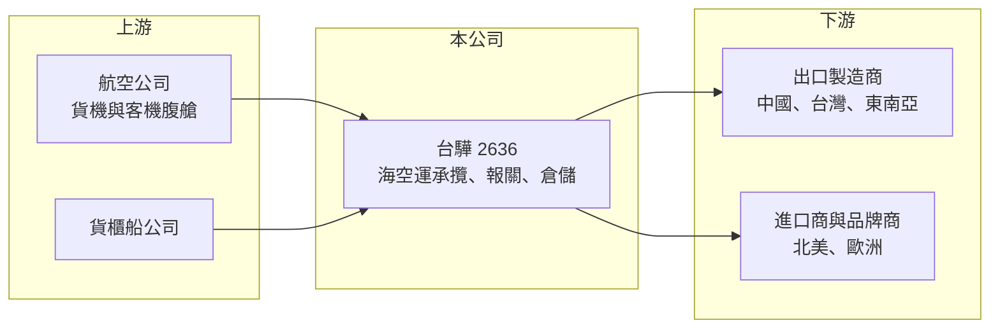

# 2636 台驊控股

> 上市｜[[產業索引-航運業|航運業]]｜上市（櫃）日期 2016/12/22

# 第一章：企業模式與商業藍圖

> [!info] 撰寫說明
> 精簡版，由 Claude 依公開資料整理，架構比照 [[2330台積電]] 的四章研究，資料截至 2026-10-08。來源：證交所開放資料（基本資料、綜合損益、資產負債、營益分析、股利、本益比）、Goodinfo 年度經營績效、nstock 公司簡介。空運與海運營收比重、主要航線未查得，相關描述為整理性內容。#待校對

台驊國際控股（以下簡稱台驊）是台灣規模較大的海空運[[貨運承攬]]業者。理解它的商業模式，要先知道承攬業者不擁有飛機與船，而是向航空公司與船公司買艙位，再轉售並整合成門到門服務，賺的是運價差與服務費。

- **核心業務：** 台驊主要經營海空運貨物運輸承攬與物流整合，前身於 1987 年成立，2016 年以控股公司形式在證交所上市。集團旗下有香港、上海、廣州等地子公司，以及台灣航空貨運承攬公司，形成兩岸三地加海外代理的服務網路（nstock 引 2023 年資料）。承攬業屬輕資產模式，主要資產是客戶關係、艙位採購能力與全球代理網路。
- **營收結構：** 台驊的營收包含空運承攬、海運承攬與報關、倉儲等附加服務，各項比重本次未查得。市場一般認為台驊以亞洲出口到北美的貨物為重要市場（推估），因此營收與美國進口需求、跨太平洋運價高度連動。承攬業的營收會隨運價放大或縮小，因此觀察時要看毛利額而不是只看營收。
- **營運據點：** 總部在台北信義區，主要營運據點分布在香港與中國華南、華東，再透過海外代理覆蓋歐美市場。據點越多、自營比例越高，越能直接掌握貨源與攬貨時效，但也意味著較高的人事與管理成本。
- **長期方向：** 承攬業的長期成長來自兩件事：一是隨製造業供應鏈移轉到東南亞、印度與墨西哥，跟著客戶布建新據點；二是從單純訂艙延伸到倉儲、報關、跨境電商與供應鏈管理，提高每位客戶的服務價值，往[[第三方物流]]的角色發展。台驊的具體布局計畫本次未查得。

# 第二章：護城河深度與競爭優勢

護城河分析要看台驊在高度分散的承攬市場裡，憑什麼保住客戶與毛利。承攬業整體護城河偏淺，競爭優勢主要來自規模與網路。

- **競爭優勢：** 第一是艙位採購規模：承攬業者向航空公司、船公司簽年度艙位合約，量越大議價越有利，旺季也比較能保證艙位，這是中小業者難以取得的。第二是兩岸三地的據點網路：自有據點讓台驊能直接接觸出口工廠，而不只是轉手同業的貨。第三是財務體質：承攬業需要先墊付運費，現金充足的業者在運價暴漲時更能接單。
- **主要對手：** 國內同業包括 [[5609中菲行]]、[[2643捷迅]]、[[2608嘉里大榮]] 等，國際上則有 DHL、Kuehne+Nagel、DSV 等大型跨國物流集團，以及數量眾多的中國承攬業者。跨國集團的全球網路與數位平台明顯領先，台驊的定位比較接近區域型、靠價格與服務彈性競爭的業者。
- **觀察重點：** 營業利益率由 2021 年 12% 一路降到 2025 年 3.6%、2026 上半年 2.99%，顯示疫情後運價回落、同業削價讓本業利潤明顯變薄。未來要觀察毛利率能否穩在 15% 上下、營業費用能否控制，以及業外收益（2026 上半年稅前淨利率 5.74% 高於營業利益率）是否屬於一次性。

# 第三章：財務體質與盈利規模

資料日期：2026-10-08，表格是撰寫當時的快照；最新月營收、毛利率、累計 EPS 由自動排程寫在本筆記的屬性欄位（月營收、毛利率、累計EPS 等）。#待校對

台驊的財報是「運價週期放大器」的典型：疫情運價暴漲時獲利爆發，運價回落後營收與利潤率同步下修。

| 年度 | 營收（新台幣） | [[毛利率]] | [[營業利益率]] | EPS（元） | [[ROE]] |
|---|---|---|---|---|---|
| 2021 | 360 億 | 22.5% | 12.0% | 30.03 | 59.4% |
| 2022 | 282 億 | 19.8% | 8.99% | 18.03 | 27.5% |
| 2023 | 146 億 | 20.0% | 6.18% | 10.76 | 17.2% |
| 2024 | 254 億 | 15.3% | 4.37% | 9.39 | 13.9% |
| 2025 | 208 億 | 16.0% | 3.60% | 7.74 | 10.5% |
| 2026 上半年 | 114.2 億 | 14.81% | 2.99% | 3.84 | 未查得 |

註：2021 至 2025 年取自 Goodinfo；2026 上半年取自證交所營益分析與綜合損益開放資料。

- **營收規模：** 營收在 2021 年達 360 億元高峰，2023 年回落到 146 億元，2024 年因紅海[[繞航]]、運價再漲回升到 254 億元，2025 年約 208 億元。2021 至 2025 年營收年複合成長率約負 12.8%（推算），但這主要反映運價從異常高點回到常態，而非業務萎縮。
- **獲利：** EPS 從 2021 年 30 元降到 2025 年 7.74 元，ROE 從 59% 降到 10.5%，近 5 年平均 ROE 約 25.7%（推算），但被 2021 年高點拉高，常態水準應看 2024 至 2025 年的 10% 至 14%。2026 上半年歸屬母公司淨利約 5.26 億元，其中業外收益占相當比例。
- **財務特色：** 2026 年第二季底總資產約 238 億元，權益約 98 億元，負債約 140 億元，絕大部分為流動負債（應付運費等營運性負債），非流動負債僅約 6.3 億元，顯示有息負債不高（推估）。公司採半年配息，2025 年下半年盈餘配發現金股利 5.0 元，2026 年 10 月初殖利率約 7.13%、股價淨值比約 1.0 倍。
- **[[ROIC]] 與 [[WACC]]：** 2025 年營業利益約 7.5 億元（208 億元乘以 3.6%），扣除 20% 稅率約 6.0 億元；投入資本以權益 98 億元加推估有息負債約 30 億元（推估）計，約 128 億元，ROIC 約 4.7%（推算）。由於權益中有大量現金，若扣除超額現金，實際 ROIC 會更高。WACC 假設公債 1.75%、市場風險溢酬 6%、β 取物流業常見值 0.8（推估），權益成本約 6.55%；負債成本 2.5%、稅後 2.0%，權益與負債比約 77 比 23，WACC 約 5.5%（推算）。以帳面計算，2025 年 ROIC 略低於 WACC；在 2021 至 2023 年運價高檔時則遠高於資金成本。長期而言，台驊能否創造價值取決於運價常態化後本業利潤率能否止跌。

# 第四章：總體風險與地緣政治

承攬業的風險多半來自外部：運價、貿易政策與客戶產業的景氣，公司只能靠分散與彈性來應對。

- **產業週期：** 海空運[[即期運價]]受船舶與飛機供給、港口壅塞、地緣衝突影響，可在一兩年內上漲數倍或腰斬。承攬業者的營收與毛利額跟著放大縮小，獲利波動大，不適合用單一年度評估。
- **營運風險：** 承攬業進入門檻低、同業眾多，運價回落期常出現削價搶貨；若與航空公司、船公司簽下的艙位承諾高於實際攬貨量，還要承擔空艙成本。營業費用以人事為主，營收下滑時難以同步縮減。
- **其他風險：** 中美貿易政策與關稅變化會改變貨流方向，若台驊對中國出口北美的貨量依賴較高（推估），會受到供應鏈移轉的衝擊；營收以美元計價，匯率影響獲利；應收帳款與墊付運費也帶有客戶信用風險。

# 專有名詞解析

## 金融

- **[[ROIC]]**：投入資本報酬率，稅後營業利益除以股東權益與有息負債之和，衡量所有投入資本的報酬。
- **[[WACC]]**：加權平均資金成本，依權益與負債比重加權的資金成本，是 ROIC 需要超越的門檻。

## 產業

- **[[貨運承攬]]**：不擁有運輸工具，向航空公司與船公司採購艙位，再為貨主安排運送、報關與倉儲的中間服務業。
- **[[即期運價]]**：依當下市場供需決定的單次航程運價，景氣好時上漲快速，景氣差時也下跌快速。
- **[[繞航]]**：船舶為避開戰亂或封鎖區域改走較長航線，會拉長航程、吸收運能並推升運價。
- **[[第三方物流]]**：由專業物流業者代替貨主處理倉儲與配送的外包服務。

# 核心供應鏈

- 上游：航空公司（[[2610華航]]、[[2618長榮航]] 等貨運艙位，推估）、貨櫃船公司（[[2603長榮]]、[[2609陽明]]、[[2615萬海]] 等，推估）。
- 下游／客戶：兩岸三地與東南亞的出口製造商、北美與歐洲的進口商與品牌商。
- 同業：[[5609中菲行]]、[[2643捷迅]]、[[2608嘉里大榮]]，以及 DHL、Kuehne+Nagel 等跨國物流集團。

## 最新新聞
<!-- news:start（自動產生，請勿手動編輯此範圍） -->
- 2026-10-12 📰 媒體 18:50｜營收速報 - 台驊控股(2636)9月營收29.96億元年增率高達99.17％｜[鉅亨網](https://news.cnyes.com/news/id/6628377)

完整紀錄：[[2636台驊控股 新聞]]
<!-- news:end -->

## 相關連結
- [公開資訊觀測站](https://mopsov.twse.com.tw/mops/web/t05st03?step=1&firstin=1&co_id=2636)
- [Goodinfo](https://goodinfo.tw/tw/StockDetail.asp?STOCK_ID=2636)
- [Yahoo 股市](https://tw.stock.yahoo.com/quote/2636)
- [鉅亨網新聞](https://www.cnyes.com/twstock/2636/news)
