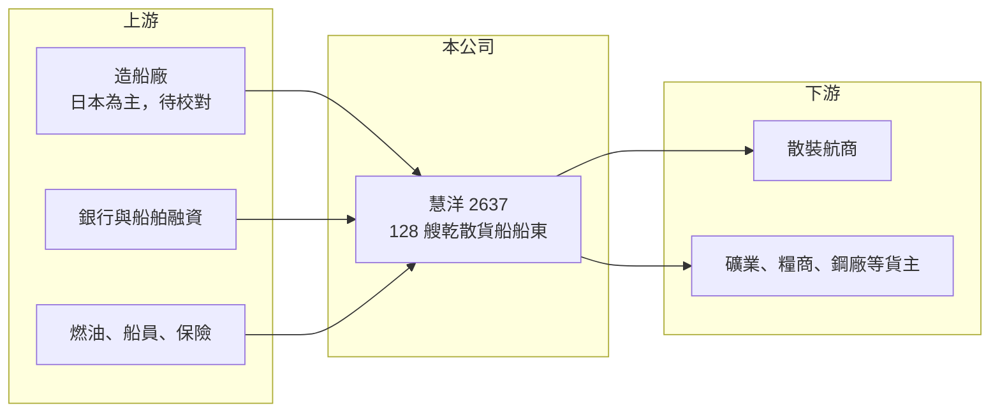

# 2637 慧洋-KY

> 上市｜[[產業索引-航運業|航運業]]｜上市（櫃）日期 2010/12/01

# 第一章：企業模式與商業藍圖

> [!info] 撰寫說明
> 精簡版，由 Claude 依公開資料整理，架構比照 [[2330台積電]] 的四章研究，資料截至 2026-10-08。來源：證交所開放資料（基本資料、綜合損益、資產負債、營益分析、股利、本益比）、Goodinfo 年度經營績效、理財周刊 2026 年船隊與租約報導。造船來源與租家結構部分憑記憶撰寫，已標待校對。#待校對

慧洋海運（以下簡稱慧洋）是台灣船隊艘數最多的乾散貨船東。它的商業模式很單純：擁有大量中小型散裝船，把船以期租或指數連結的方式租給航商與貨主，收入由船隊規模乘以每日租金決定。

- **核心業務：** 慧洋以開曼群島公司在台上市（-KY），2008 年設立、2010 年掛牌。公司主要擁有並出租乾散貨船，載運穀物、煤炭、礦砂、鋼材、肥料等大宗物資。慧洋的定位是「船東」而非「航商」：它不自己攬貨，而是把船租給需要運力的航運公司與貨主，因此收入相對單純，但每日租金仍與散裝市況高度連動。
- **營收結構：** 依理財周刊報導，2026 年初船隊共 128 艘，其中巴拿馬型 35 艘、超極限型（Supramax）29 艘、輕便型（Handy）38 艘、小型輕便型 23 艘，主力並非大型[[海岬型船]]。2026 年約 81 至 85 艘船採用[[指數連結租約]]，租金依 [[BDI]] 等分船型指數浮動，其餘為固定日租金的[[期租]]。這個結構代表慧洋同時享有部分運價上漲的好處，也承擔運價下跌的風險。
- **營運據點：** 慧洋的船隊航行全球，管理團隊主要在台灣。船隊多向日本船廠訂造（待校對），中小型散裝船的優點是能進出較小的港口、貨種多元，需求比大型船分散。
- **長期方向：** 公司的策略是汰舊換新：趁二手船價處於高檔時出售老船，換入較新、較省油、符合環保規範的節能船。2026 年 9 月一艘 4 萬噸級 Handy 新船加入營運，2026 年 8 月前已認列 5 艘老船處分收益，全年賣船目標為雙位數。這種「低買高賣、持續更新船隊」的資本配置，是散裝船東長期報酬的主要來源之一。

# 第二章：護城河深度與競爭優勢

散裝航運是同質性極高的產業，護城河本質上偏淺。慧洋的優勢不在於能訂高價，而在於規模、船隊結構與資本配置。

- **競爭優勢：** 第一是規模：128 艘船的船隊讓慧洋在採購、保險、船員管理與融資上享有規模經濟，也讓單一船舶的閒置風險被分散。第二是船型選擇：中小型散裝船貨種多元、可進出的港口多，需求不像海岬型船那樣依賴鐵礦砂與煤炭。第三是資本配置紀律：在船價高點出售老船、在低點購入新船，可以在週期中累積資產價值，這比單純賺租金更能決定長期報酬。
- **主要對手：** 國內散裝航運同業包括 [[5608四維航]]、[[2641正德]]、[[2606裕民]]、[[2612中航]]、[[2605新興]]；國際上則有 Star Bulk、Golden Ocean、Eagle Bulk 等上市船東，以及大量日本與希臘私人船東。這些業者提供的運力幾乎沒有差異，運價由全球供需決定。
- **觀察重點：** 第一是新船訂造與老船出售的價差，觀察公司是否在週期高點賣、低點買。第二是指數連結租約比例：市況好時有利，市況差時收入下滑快。第三是全球散裝船新船訂單占現有船隊的比例，訂單過多會壓抑未來幾年的租金。

# 第三章：財務體質與盈利規模

資料日期：2026-10-08，表格是撰寫當時的快照；最新月營收、毛利率、累計 EPS 由自動排程寫在本筆記的屬性欄位（月營收、毛利率、累計EPS 等）。#待校對

船東的財報特色是高毛利、高折舊、高負債：營業成本大多是折舊與船員費用，運價一變動，獲利就大幅波動。

| 年度 | 營收（新台幣） | [[毛利率]] | [[營業利益率]] | EPS（元） | [[ROE]] |
|---|---|---|---|---|---|
| 2021 | 192 億 | 44.1% | 43.1% | 11.05 | 26.8% |
| 2022 | 249 億 | 47.0% | 46.0% | 14.16 | 25.7% |
| 2023 | 170 億 | 21.4% | 20.5% | 4.38 | 7.10% |
| 2024 | 204 億 | 34.2% | 33.3% | 8.08 | 12.4% |
| 2025 | 169 億 | 25.0% | 23.9% | 5.27 | 7.83% |
| 2026 上半年 | 96.8 億 | 34.47% | 33.36% | 4.10 | 未查得 |

註：2021 至 2025 年取自 Goodinfo；2026 上半年取自證交所營益分析與綜合損益開放資料。

- **營收規模：** 營收在 170 億至 250 億元之間循環，2022 年散裝市場高峰時達 249 億元，2023 年回落到 170 億元，2025 年約 169 億元。營收變動主要來自每日租金，而非船隊規模。
- **獲利：** 毛利率與營業利益率非常接近，因為船東的營業費用很低，大部分成本在營業成本中。營業利益率在 20% 至 46% 之間波動，2026 上半年回升到 33%。近 5 年平均 ROE 約 16.0%（推算），但 2023 與 2025 年的 7% 至 8% 更接近運價平淡時的常態水準。
- **財務特色：** 2026 年第二季底總資產約 843 億元，其中非流動資產（船舶）約 768 億元；權益約 496 億元，負債約 347 億元，非流動負債約 266 億元，主要為購船貸款（推估）。2025 年度配發現金股利 3.5 元，配息率約 66%（推算），公司章程規定每年至少分配當年歸屬母公司淨利的 10%。
- **[[ROIC]] 與 [[WACC]]：** 2025 年營業利益約 40.4 億元（169 億元乘以 23.9%），依規則以 20% 稅率估算稅後約 32.3 億元（船東實際多適用[[噸位稅]]，稅負較低）；投入資本以權益 496 億元加推估有息負債約 300 億元（推估）計，約 796 億元，ROIC 約 4.1%（推算）。以 2026 上半年營業利益 32.3 億元年化，ROIC 約 6.5%（推算）。WACC 假設公債 1.75%、市場風險溢酬 6%、β 取航運業常見值 1.1（推估），權益成本約 8.35%；負債成本 3%、稅後 2.4%，權益與負債比約 62 比 38，WACC 約 6.1%（推算）。結論是慧洋只有在散裝市況中等以上時才創造價值，2025 年 ROIC 低於 WACC，2021 至 2022 年則遠高於資金成本；長期創造價值的關鍵在於船舶買賣時點與融資成本控制。

# 第四章：總體風險與地緣政治

散裝航運的風險高度集中在全球景氣與船舶供給，船東能控制的主要是船隊結構與財務槓桿。

- **產業週期：** 散裝運價取決於中國基建與鋼鐵需求、全球糧食與能源貿易，以及船舶供給。新船從下單到交船約 2 至 3 年，業者常在高點集體訂船、在交船時遇上需求轉弱，形成典型的長週期。[[BDI]] 可以在一年內上下數倍，慧洋的指數連結租約會直接反映這種波動。
- **營運風險：** 船隊規模大代表折舊與利息支出固定且龐大，運價低迷時容易虧損。老船維修成本較高、燃油效率較差，若汰舊速度跟不上環保規範，可能面臨租家偏好新船、老船租金折價的情況。
- **其他風險：** 國際海事組織的減碳規範會逐步提高老船的營運成本，未來可能需要投資替代燃料船；營收以美元計價，匯率影響以新台幣表達的獲利；購船貸款多為浮動利率，利率上升會增加財務成本；地緣衝突（如航道封鎖）會改變航程與運價。

# 專有名詞解析

## 金融

- **[[ROIC]]**：投入資本報酬率，稅後營業利益除以股東權益與有息負債之和，衡量所有投入資本的報酬。
- **[[WACC]]**：加權平均資金成本，依權益與負債比重加權的資金成本，是 ROIC 需要超越的門檻。

## 產業

- **[[BDI]]**：波羅的海乾散貨指數，綜合各型散裝船運價編製，是觀察散裝航運景氣最常用的指標。
- **[[期租]]**：船東把船連同船員出租給租船人一段期間、按日收取租金的合約，可鎖定收入、降低運價波動影響。
- **[[指數連結租約]]**：租金依波羅的海分船型運價指數的一定比例浮動的租船合約，船東可分享運價上漲，但也承擔下跌風險。
- **[[海岬型船]]**：載重約 18 萬噸以上的大型散裝船，因船體過大無法通過巴拿馬運河，需繞行好望角或合恩角，主要載運鐵礦砂與煤炭。
- **[[噸位稅]]**：航運業依船舶噸位而非實際獲利計算的定額稅制，許多國家用來吸引船東登記，使航運公司實際稅負偏低。

# 核心供應鏈

- 上游：造船廠（以日本船廠為主，待校對）、銀行船舶融資、燃油與船員管理服務。
- 下游／客戶：國際散裝航商與大宗物資貨主（穀物、煤炭、礦砂、鋼材）。
- 同業：[[5608四維航]]、[[2641正德]]、[[2606裕民]]、[[2612中航]]、[[2605新興]]，國際上的 Star Bulk、Golden Ocean。

## 最新新聞
<!-- news:start（自動產生，請勿手動編輯此範圍） -->
- 2026-10-09 📰 媒體 08:10｜鉅亨速報 - Factset 最新調查：慧洋-KY(2637-TW)EPS預估上修至10.8元，預估目標價為104.5元｜[鉅亨網](https://news.cnyes.com/news/id/6626607)

完整紀錄：[[2637慧洋-KY 新聞]]
<!-- news:end -->

## 相關連結
- [公開資訊觀測站](https://mopsov.twse.com.tw/mops/web/t05st03?step=1&firstin=1&co_id=2637)
- [Goodinfo](https://goodinfo.tw/tw/StockDetail.asp?STOCK_ID=2637)
- [Yahoo 股市](https://tw.stock.yahoo.com/quote/2637)
- [鉅亨網新聞](https://www.cnyes.com/twstock/2637/news)
