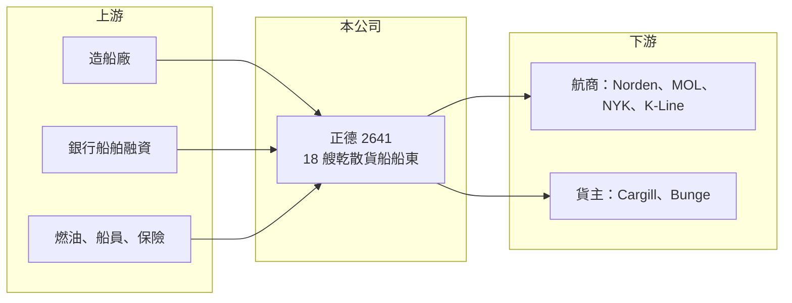

# 2641 正德

> 上櫃｜[[產業索引-航運業|航運業]]｜上市（櫃）日期 2014/10/09

# 第一章：企業模式與商業藍圖

> [!info] 撰寫說明
> 精簡版，由 Claude 依公開資料整理，架構比照 [[2330台積電]] 的四章研究，資料截至 2026-10-08。來源：櫃買中心開放資料（基本資料、綜合損益、資產負債、本益比）、Goodinfo 年度經營績效、富果 2026 年 5 月法說會備忘錄。新船交期在法說紀錄中有兩種說法，已標待校對。#待校對

正德海運（以下簡稱正德）是在櫃買中心掛牌的中型散裝船東。它和多數台灣散裝航運公司一樣，靠擁有船舶並長期出租給國際航商賺取租金，差別在於船隊較年輕、以長約為主。

- **核心業務：** 正德 1998 年設立、2014 年上櫃，主要擁有並出租乾散貨船，船型包括巴拿馬型、輕便極限型（Ultramax）、超級極限型（Supramax）與輕便型（Handysize）。這些中小型散裝船載運穀物、煤炭、礦砂、肥料與鋼材，是全球大宗物資貿易的基礎運力。公司的收入主要是租金，因此獲利取決於船隊規模與簽約時的租金水準。
- **營收結構：** 截至 2026 年 4 月底，正德共有 18 艘船、總載重約 90.73 萬噸、平均[[船齡]]約 8.85 年（富果法說備忘錄）。法說資料指出多數船舶簽訂長期租約，主要租家包括丹麥 Norden、日本 MOL、NYK、K-Line，以及 Cargill、Bunge 等大型穀物與大宗物資商。各船型的營收比重未揭露。
- **營運據點：** 正德的船隊航行全球，經營團隊在台灣。由於租家多為日本與歐洲的大型航商與貨主，信用品質較好，租金收款風險相對低。
- **長期方向：** 公司已訂購 11 艘新船，法說紀錄中交期有 2026 至 2027 年與 2027 至 2028 年兩種說法（待校對），其中提到包含[[多用途船]]（MPP）。若新船如期交付，船隊艘數將接近倍增，這是正德未來幾年營收成長的主要來源，也代表資本支出與負債會同步增加。

# 第二章：護城河深度與競爭優勢

散裝航運的運力高度同質，正德的競爭力不在於定價，而在於船隊年輕度、長約比例與租家品質。

- **競爭優勢：** 第一是長約為主：多數船舶以長期[[期租]]出租給大型航商，收入可預測性高於以即期市場為主的同業，這也是正德毛利率長期維持在 40% 以上的原因之一。第二是船隊年輕：平均船齡不到 9 年，燃油效率與環保合規較好，租家較願意簽長約。第三是租家品質：Norden、日本三大航商與國際穀物商都是信用良好的大型企業，降低違約風險。
- **主要對手：** 國內散裝船東包括 [[2637慧洋-KY]]、[[5608四維航]]、[[2606裕民]]、[[2612中航]]、[[2605新興]]；國際上有大量希臘、日本與中國船東。正德規模遠小於慧洋，在採購與融資上的規模經濟較弱，但長約比例較高、獲利波動較小。
- **觀察重點：** 第一是 11 艘新船的交期、價格與融資條件，訂造成本決定未來十幾年的折舊負擔。第二是新船交付時能否以合理租金簽下長約，若交船時遇上市況低迷，可能被迫接受較低租金。第三是負債比隨擴船上升後的財務壓力。

# 第三章：財務體質與盈利規模

資料日期：2026-10-08，表格是撰寫當時的快照；最新月營收、毛利率、累計 EPS 由自動排程寫在本筆記的屬性欄位（月營收、毛利率、累計EPS 等）。#待校對

正德的財報顯示長約船東的特色：利潤率高且相對穩定，營收隨船隊擴張逐步成長。

| 年度 | 營收（新台幣） | [[毛利率]] | [[營業利益率]] | EPS（元） | [[ROE]] |
|---|---|---|---|---|---|
| 2021 | 12.3 億 | 38.3% | 30.9% | 2.24 | 16.9% |
| 2022 | 14.7 億 | 52.4% | 43.2% | 6.23 | 31.2% |
| 2023 | 13.4 億 | 45.6% | 38.3% | 1.69 | 7.36% |
| 2024 | 16.5 億 | 46.1% | 40.9% | 1.92 | 8.18% |
| 2025 | 23.7 億 | 41.6% | 35.9% | 2.01 | 8.05% |
| 2026 上半年 | 11.77 億 | 39.9%（推算） | 34.5%（推算） | 1.25 | 未查得 |

註：2021 至 2025 年取自 Goodinfo；2026 上半年營收、EPS 取自櫃買中心綜合損益開放資料，毛利率與營業利益率以毛利 4.70 億元、營業利益 4.07 億元除以營收推算。

- **營收規模：** 營收由 2021 年 12.3 億元成長到 2025 年 23.7 億元，4 年年複合成長率約 17.8%（推算），主要來自船隊增加。2025 年營收跳升幅度較大，是否含船舶以外的收入本次未查證。
- **獲利：** 毛利率長期在 38% 至 52%，營業利益率在 31% 至 43%，2023 年散裝市況轉弱時仍維持 38%，展現長約的保護效果。EPS 在 2022 年達 6.23 元高點，之後維持在 2 元上下；近 5 年平均 ROE 約 14.3%（推算），常態水準約 8%。
- **財務特色：** 2026 年第二季底總資產約 148 億元，權益約 92.5 億元（歸屬母公司 84.2 億元），負債約 55.7 億元，其中非流動負債約 47.6 億元，主要為購船貸款（推估）。每股淨值 25.48 元，2026 年 10 月初股價淨值比約 0.68 倍，最近一次現金股利 0.5 元。
- **[[ROIC]] 與 [[WACC]]：** 2025 年營業利益約 8.5 億元（23.7 億元乘以 35.9%），以 20% 稅率估算稅後約 6.8 億元（實際稅負可能較低）；投入資本以權益 92.5 億元加推估有息負債約 50 億元（推估）計，約 142 億元，ROIC 約 4.8%（推算）。WACC 假設公債 1.75%、市場風險溢酬 6%、β 取散裝航運常見值 1.0（推估），權益成本約 7.75%；負債成本 3%、稅後 2.4%，權益與負債比約 65 比 35，WACC 約 5.9%（推算）。ROIC 略低於 WACC，代表在目前船價與租金水準下，擴船帶來的報酬大致只能打平資金成本；新船能否以較高租金簽約，是未來能否創造價值的關鍵。

# 第四章：總體風險與地緣政治

正德的風險在於擴船節奏與散裝市場週期是否對得上，以及負債增加後的財務彈性。

- **產業週期：** 散裝運價（可參考 [[BDI]]）隨全球大宗物資貿易與船舶供給循環，長約能平滑短期波動，但每次續約都會重新反映當下市況。若新船集中在市況低迷時交付，長約反而會鎖住較低的租金水準。
- **營運風險：** 11 艘新船的訂造與融資將使資本支出與負債大幅增加，若造船廠延遲交船或新船成本超支，會影響現金流。租家集中於少數大型航商，個別租家調整船隊策略時，續約條件可能轉差。
- **其他風險：** 國際海事組織的減碳規範可能使現有船隊需要改裝或提前汰換；營收以美元計價，匯率波動影響獲利；購船貸款利率上升會增加利息負擔。

# 專有名詞解析

## 金融

- **[[ROIC]]**：投入資本報酬率，稅後營業利益除以股東權益與有息負債之和，衡量所有投入資本的報酬。
- **[[WACC]]**：加權平均資金成本，依權益與負債比重加權的資金成本，是 ROIC 需要超越的門檻。

## 產業

- **[[期租]]**：船東把船連同船員出租給租船人一段期間、按日收取租金的合約，可鎖定收入、降低運價波動影響。
- **[[BDI]]**：波羅的海乾散貨指數，綜合各型散裝船運價編製，是觀察散裝航運景氣最常用的指標。
- **[[多用途船]]**：可載運散裝貨、件雜貨、重件與貨櫃的船型，通常配有自備吊桿，適合裝卸設施不足的港口。
- **[[船齡]]**：船舶自交船起算的年數，船齡越高通常油耗與維修成本越高，租金與轉售價值越低。

# 核心供應鏈

- 上游：造船廠（新船 11 艘訂造中）、銀行船舶融資、燃油與船員管理服務。
- 下游／客戶：丹麥 Norden、日本 MOL、NYK、K-Line 等航商，以及 Cargill、Bunge 等大宗物資商。
- 同業：[[2637慧洋-KY]]、[[5608四維航]]、[[2606裕民]]、[[2612中航]]、[[2605新興]]。

## 最新新聞
<!-- news:start -->
<!-- news:end -->

## 相關連結
- [公開資訊觀測站](https://mopsov.twse.com.tw/mops/web/t05st03?step=1&firstin=1&co_id=2641)
- [Goodinfo](https://goodinfo.tw/tw/StockDetail.asp?STOCK_ID=2641)
- [Yahoo 股市](https://tw.stock.yahoo.com/quote/2641)
- [鉅亨網新聞](https://www.cnyes.com/twstock/2641/news)
