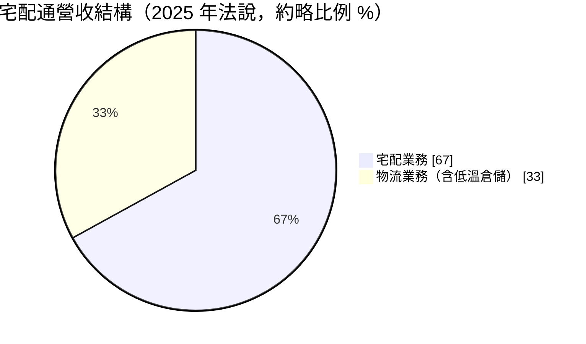
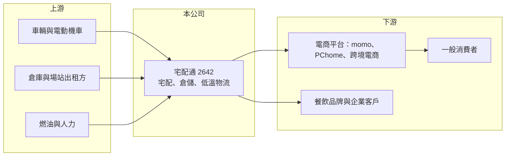

# 2642 宅配通

> 上市｜[[產業索引-航運業|航運業]]｜上市（櫃）日期 2013/12/12

# 第一章：企業模式與商業藍圖

> [!info] 撰寫說明
> 精簡版，由 Claude 依公開資料整理，架構比照 [[2330台積電]] 的四章研究，資料截至 2026-10-08。來源：證交所開放資料（基本資料、綜合損益、資產負債、營益分析、股利、本益比）、Goodinfo 年度經營績效、富果 2025 年 8 月法說會備忘錄。股東結構憑記憶撰寫，已標待校對。#待校對

台灣宅配通（以下簡稱宅配通）是國內老牌的宅配物流業者，理解它的處境，要從電商物流的結構變化看起：大型電商平台開始自建物流後，傳統宅配業者的量與價同時受到壓力。

- **核心業務：** 宅配通 1999 年成立、2013 年上市，主要提供包裹宅配與倉儲物流服務，品牌源自日本通運的「Pelican」，股東包含東元集團與日本通運（待校對）。宅配業務是把電商、郵購與企業的包裹從集貨站送到消費者手上，物流業務則包括倉儲、理貨與低溫倉儲，提供企業完整的[[第三方物流]]服務。
- **營收結構：** 依 2025 年法說會備忘錄，宅配業務約占營收三分之二，物流業務約占三分之一。宅配業務因國內電商市場結構改變而衰退，主要電商客戶包括 momo 與 PChome；物流業務則持續成長，主要動能來自低溫倉儲。

- **營運據點：** 宅配通在全台設有集配站與物流中心，低溫倉庫於 2024 年 5 月開始建置、8 月正式營運，2025 年使用率接近九成。車隊方面，2025 年規劃導入 100 輛電動機車，以降低末端配送成本並因應減碳需求。據點與車隊的確切數量本次未查得。
- **長期方向：** 公司策略是宅配「維穩」、物流「衝刺」：宅配業務調整客戶結構、提高單價、組織合理化，目標是止住營收下滑；物流業務則提升低溫倉儲的使用率與效率，並推出店到宅與客製化月台服務。2025 年也開始與韓國電商與跨境電商合作。這個方向等於承認純宅配的成長期已過，未來要靠高附加價值的倉儲與冷鏈服務。

# 第二章：護城河深度與競爭優勢

宅配業的護城河主要來自網路密度：據點與車隊越密，[[最後一哩]]的單件配送成本越低。但當最大的客戶自建物流，網路密度的優勢就會被削弱。

- **競爭優勢：** 宅配通擁有全台集配網路與二十多年的配送經驗，對中小型電商與企業客戶而言，仍是可靠的外包選擇。新建置的低溫倉儲具備 [[冷鏈物流]] 能力，已引進多家知名餐飲品牌，這類客戶對溫控品質要求高、轉換成本也高。日系股東背景（待校對）帶來的作業標準與服務品質，是品牌上的差異點。
- **主要對手：** 主要競爭者包括統一速達（黑貓宅急便，[[1216統一]] 與 [[2912統一超]] 集團旗下）、新竹物流、[[2608嘉里大榮]]，以及中華郵政。更大的威脅來自電商自建物流，例如外來電商酷澎與 [[8454富邦媒]]（momo）自有配送體系，這直接造成宅配通 2025 年電商業績下滑。
- **觀察重點：** 第一是宅配業務的營收能否止跌，關鍵在單價調整後客戶是否流失。第二是低溫倉儲是否如公司預期在 2025 年下半年達到損益兩平並持續擴大。第三是人力成本：司機薪資上漲而運價難以同步調升，是宅配業最根本的壓力。

# 第三章：財務體質與盈利規模

資料日期：2026-10-08，表格是撰寫當時的快照；最新月營收、毛利率、累計 EPS 由自動排程寫在本筆記的屬性欄位（月營收、毛利率、累計EPS 等）。#待校對

宅配通的財報清楚顯示產業結構變化的衝擊：營收連年下滑，毛利率被人力成本與固定成本擠壓，2024 年起轉為營業虧損。

| 年度 | 營收（新台幣） | [[毛利率]] | [[營業利益率]] | EPS（元） | [[ROE]] |
|---|---|---|---|---|---|
| 2021 | 44.7 億 | 16.9% | 6.37% | 2.52 | 10.2% |
| 2022 | 45.1 億 | 14.9% | 4.53% | 1.85 | 7.13% |
| 2023 | 41.9 億 | 13.3% | 2.56% | 0.99 | 4.27% |
| 2024 | 40.5 億 | 9.46% | -0.99% | -0.10 | -0.44% |
| 2025 | 38.1 億 | 6.91% | -3.95% | -1.04 | -4.85% |
| 2026 上半年 | 15.94 億 | 4.19% | -8.23% | -1.26 | 未查得 |

註：2021 至 2025 年取自 Goodinfo；2026 上半年取自證交所營益分析與綜合損益開放資料。

- **營收規模：** 營收由 2021 年 44.7 億元降到 2025 年 38.1 億元，4 年年複合成長率約負 3.9%（推算）。2026 上半年營收約 15.9 億元，若下半年未明顯回升，全年將再明顯下滑（推估）。營收減少的主因是電商客戶自建物流與外來電商競爭。
- **獲利：** 毛利率由 16.9% 一路降到 2026 上半年的 4.19%，營業利益率由 6.37% 轉為負 8.23%。宅配是高固定成本的網路型事業，件量下降時車隊、人力與場站成本無法同步縮減，虧損會被放大，這就是負向的[[營運槓桿]]。2026 上半年虧損 1.2 億元，已超過 2025 年全年虧損。近 5 年平均 ROE 約 3.3%（推算）。
- **財務特色：** 2026 年第二季底總資產約 35.9 億元，權益約 18.3 億元、負債約 17.6 億元，其中非流動負債約 10.1 億元，推估以倉庫與場站的[[租賃負債]]為主。2025 年雖然虧損，仍擬以累積盈餘配發 0.5 元現金股利，股利已不是由當年獲利支撐。
- **[[ROIC]] 與 [[WACC]]：** 2025 年營業虧損約 1.5 億元（38.1 億元乘以負 3.95%），虧損年度不計所得稅，稅後營業利益約負 1.5 億元；投入資本以權益 18.3 億元加推估有息負債與租賃負債約 11 億元（推估）計，約 29 億元，ROIC 約負 5.2%（推算）。WACC 假設公債 1.75%、市場風險溢酬 6%、β 取物流業常見值 0.8（推估），權益成本約 6.55%；負債成本 2.5%、稅後 2.0%，權益與負債比約 62 比 38，WACC 約 4.8%（推算）。ROIC 為負、低於 WACC 約 10 個百分點，代表目前每投入一元資本都在侵蝕股東價值；扭轉的條件是宅配件量止跌、低溫倉儲放大到足以吸收固定成本。

# 第四章：總體風險與地緣政治

宅配通的風險已不只是景氣循環，而是產業結構性的轉變，公司需要在虧損中完成轉型。

- **產業週期：** 電商滲透率持續上升本來對宅配業有利，但大型平台自建物流，把最有規模的貨量收回自營，留給第三方宅配業者的是較零散、單價壓力較大的貨源。這個結構變化不會隨景氣好轉而逆轉。
- **營運風險：** 司機與理貨人力短缺、薪資上漲，是宅配業共同的成本壓力；低溫倉儲屬於高固定成本投資，使用率若下滑會很快轉為虧損。連續虧損會侵蝕權益，若持續多年，可能需要股東增資或調整業務規模。
- **其他風險：** 燃油價格影響車隊成本；交通與勞動法規（工時、電動車政策）會改變營運成本；大股東策略若有變化（市場曾傳出尋找新股東的報導，年份未查證），可能影響公司未來方向。

# 專有名詞解析

## 金融

- **[[營運槓桿]]**：固定成本占比高的企業，營收小幅變動就會造成獲利大幅變動的現象。
- **[[租賃負債]]**：企業以租賃方式取得資產時，依會計準則認列未來租金現值的負債，航空公司租用飛機會產生大量租賃負債。
- **[[ROIC]]**：投入資本報酬率，稅後營業利益除以股東權益與有息負債之和，衡量所有投入資本的報酬。
- **[[WACC]]**：加權平均資金成本，依權益與負債比重加權的資金成本，是 ROIC 需要超越的門檻。

## 產業

- **[[第三方物流]]**：由專業物流業者代替貨主處理倉儲與配送的外包服務。
- **[[冷鏈物流]]**：在倉儲與運送全程維持特定低溫的物流服務，用於生鮮、冷凍食品與醫藥品。
- **[[最後一哩]]**：物流從配送站送到消費者手上的最後一段，成本占整體配送比例最高，也是電商物流競爭的核心。

# 核心供應鏈

- 上游：配送車輛與電動機車、倉庫與場站出租方、燃油與司機人力。
- 下游／客戶：電商平台（[[8454富邦媒]]、[[8044網家]]、韓國與跨境電商）、使用低溫倉儲的餐飲品牌、企業客戶。
- 同業：統一速達（黑貓宅急便）、新竹物流、[[2608嘉里大榮]]、中華郵政；股東關係：[[1504東元]]、日本通運（待校對）。

## 最新新聞
<!-- news:start -->
<!-- news:end -->

## 相關連結
- [公開資訊觀測站](https://mopsov.twse.com.tw/mops/web/t05st03?step=1&firstin=1&co_id=2642)
- [Goodinfo](https://goodinfo.tw/tw/StockDetail.asp?STOCK_ID=2642)
- [Yahoo 股市](https://tw.stock.yahoo.com/quote/2642)
- [鉅亨網新聞](https://www.cnyes.com/twstock/2642/news)
