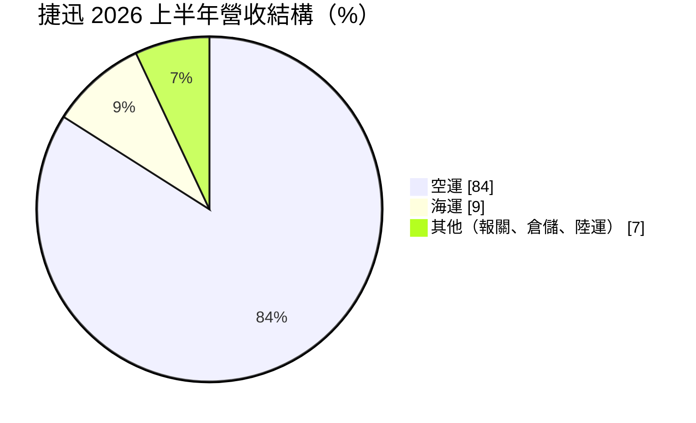
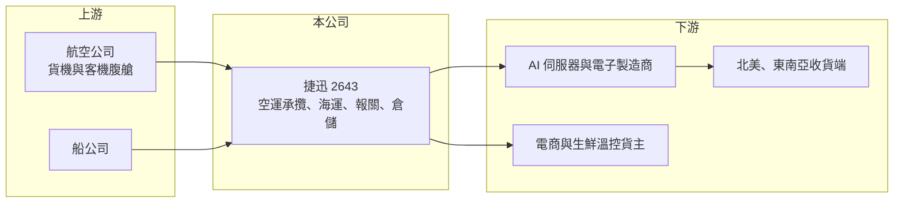

# 2643 捷迅

> 上櫃｜[[產業索引-航運業|航運業]]｜上市（櫃）日期 2016/03/04

# 第一章：企業模式與商業藍圖

> [!info] 撰寫說明
> 精簡版，由 Claude 依公開資料整理，架構比照 [[2330台積電]] 的四章研究，資料截至 2026-10-08。來源：櫃買中心開放資料（基本資料、綜合損益、資產負債、本益比）、Goodinfo 年度經營績效、富果 2026 年 8 月法說會備忘錄。法說備忘錄為 AI 摘要，數字建議與公司簡報核對。#待校對

捷迅是以空運為核心的[[貨運承攬]]業者。它不擁有飛機，而是向航空公司採購艙位，替電子、AI 伺服器與電商等客戶安排出口運送、報關與倉儲，賺取艙位價差與服務費。

- **核心業務：** 捷迅 1984 年成立、2016 年上櫃，提供空運、海運承攬與報關、倉儲、陸運等整合服務。空運承攬的價值在於「時效」與「艙位保證」：高單價、急件的電子產品必須準時上機，承攬業者能否在旺季拿到艙位，直接決定客戶是否續約。
- **營收結構：** 依 2026 年 8 月法說會備忘錄，2026 年上半年空運營收 28.7 億元、占 84%，海運 2.9 億元、占 9%，報關、倉儲與陸運等其他服務占 7%。2026 年初起公司把艙位轉向 AI 伺服器與資料中心相關電子產品客戶，台灣地區營收年增約 53%，同時策略性減少毛利較低的中國、香港出發電商[[包機]]。

- **營運據點：** 全球共 21 個營業據點、12 個倉儲據點。近年擴點節奏為：2023 年印度清奈，2024 年越南、西雅圖，2025 年泰國、多倫多、溫哥華，2026 年 5 月美國達拉斯機場的保稅物流倉（[[保稅倉]]）落成，將服務台積電供應鏈客戶。據點布局明顯跟著台灣電子業往東南亞與北美移動。
- **長期方向：** 公司的策略是優化客戶結構、專注高毛利業務，跟隨客戶布局東南亞、美加、歐洲與印度，並提供從空海運、倉儲到報關的一條龍服務。達拉斯倉儲代表捷迅由「把貨送到美國」延伸到「在美國當地提供倉儲與配送」，若成功可提高客戶黏著度與每位客戶的服務價值。

# 第二章：護城河深度與競爭優勢

承攬業護城河偏淺，捷迅的優勢在於選對客戶族群：高科技電子貨對時效與服務品質的要求，讓它能拿到比一般貨更好的毛利。

- **競爭優勢：** 第一是電子與 AI 伺服器客戶基礎：台灣是全球伺服器與電子產品出口重鎮，這類高價值貨物需要可靠的空運艙位，客戶不會只因運費便宜就更換承攬商。第二是跟隨客戶的海外據點：在越南、泰國、北美設點，讓捷迅能服務台商的跨國供應鏈，這是純本地承攬業者做不到的。第三是資產輕、資本報酬高：ROE 長期維持 11% 以上，財務體質穩健。
- **主要對手：** 國內同業包括 [[5609中菲行]]、[[2636台驊控股]]、[[2608嘉里大榮]]，國際上則有 DHL、Kuehne+Nagel、DSV、日通等跨國物流集團。跨國業者網路更廣、數位化更深，捷迅的利基在於對台灣電子產業的熟悉度與服務彈性。
- **觀察重點：** 第一是 AI 伺服器出貨能否持續帶動空運需求，以及捷迅在其中的市占。第二是減少電商包機後，營收雖下滑但毛利率能否持續提升（2026 上半年毛利率 8.47%，高於前一年同期 7.94%）。第三是達拉斯倉儲等海外投資的使用率與回收期。

# 第三章：財務體質與盈利規模

資料日期：2026-10-08，表格是撰寫當時的快照；最新月營收、毛利率、累計 EPS 由自動排程寫在本筆記的屬性欄位（月營收、毛利率、累計EPS 等）。#待校對

捷迅的財報呈現輕資產承攬業的典型樣貌：毛利率低、資本需求小，營收隨空運運價與貨量大幅波動，但資本報酬率高。

| 年度 | 營收（新台幣） | [[毛利率]] | [[營業利益率]] | EPS（元） | [[ROE]] |
|---|---|---|---|---|---|
| 2021 | 50.7 億 | 11.2% | 7.23% | 9.72 | 28.2% |
| 2022 | 57.0 億 | 16.4% | 10.8% | 16.68 | 37.8% |
| 2023 | 41.7 億 | 13.0% | 7.83% | 7.53 | 13.8% |
| 2024 | 52.6 億 | 9.38% | 4.51% | 6.11 | 11.2% |
| 2025 | 84.0 億 | 7.43% | 4.02% | 6.30 | 11.1% |
| 2026 上半年 | 34.11 億 | 8.47%（推算） | 3.72%（推算） | 2.79 | 未查得 |

註：2021 至 2025 年取自 Goodinfo；2026 上半年營收、EPS 取自櫃買中心綜合損益開放資料，毛利率與營業利益率以毛利 2.89 億元、營業利益 1.27 億元除以營收推算。

- **營收規模：** 營收由 2021 年 50.7 億元成長到 2025 年 84 億元，4 年年複合成長率約 13.4%（推算）。2025 年營收大增主要來自電商包機，但這類業務毛利低，因此 2026 年公司主動縮減，上半年營收回落到約 34 億元。
- **獲利：** 毛利率從 2022 年 16.4% 的高點回落到 2025 年 7.43%，反映疫情後空運運價正常化與低毛利電商貨比重提高。EPS 從 2022 年 16.68 元降到 6 元上下，但仍維持穩定獲利；近 5 年平均 ROE 約 20.4%（推算），常態水準約 11%。
- **財務特色：** 2026 年第二季底總資產約 31.8 億元，權益約 19.6 億元，負債約 12.3 億元，幾乎全為流動負債（應付運費等），非流動負債僅約 1.1 億元，有息負債很低（推估）。股本僅 3.5 億元，每股淨值 55.88 元；最近一次現金股利 4.5 元，以 2025 年 EPS 6.3 元計配息率約 71%（推算），2026 年 10 月初殖利率約 7.26%。
- **[[ROIC]] 與 [[WACC]]：** 2025 年營業利益約 3.4 億元（84 億元乘以 4.02%），扣除 20% 稅率約 2.7 億元；投入資本以權益 19.6 億元加推估有息負債約 3 億元（推估）計，約 22.6 億元，ROIC 約 12%（推算）。WACC 假設公債 1.75%、市場風險溢酬 6%、β 取物流業常見值 0.8（推估），權益成本約 6.55%；負債成本 2.5%、稅後 2.0%，權益與負債比約 87 比 13，WACC 約 6.0%（推算）。ROIC 約為 WACC 的兩倍，代表即使在運價正常化後，捷迅仍持續創造價值；這主要來自輕資產模式，只要維持毛利率與費用控制，資本報酬就能保持在資金成本之上。

# 第四章：總體風險與地緣政治

捷迅的風險集中在空運市場與客戶產業：空運運價與電子產品出貨量的波動，會直接反映在營收與毛利。

- **產業週期：** 空運運價受客機[[腹艙]]與貨機供給、電子產品出貨季節、電商包機需求影響，波動很大。2021 至 2022 年疫情期間運價暴漲，捷迅獲利倍增，之後隨運價回落而下降，這種週期未來仍會反覆出現。
- **營運風險：** 客戶集中在電子與 AI 伺服器產業，若 AI 投資放緩或客戶改走海運，空運需求會明顯下降。海外據點與倉儲擴張帶來固定成本，若新據點攬貨不如預期，會拖累獲利率。承攬業者若事先承諾包機或包板而貨量不足，也要承擔空艙損失。
- **其他風險：** 美國關稅與出口管制政策可能改變電子產品的出口路線與時程；中東等地緣衝突會影響航線與運價；營收與成本多以美元計價，匯率波動影響以新台幣計算的獲利。

# 專有名詞解析

## 金融

- **[[ROIC]]**：投入資本報酬率，稅後營業利益除以股東權益與有息負債之和，衡量所有投入資本的報酬。
- **[[WACC]]**：加權平均資金成本，依權益與負債比重加權的資金成本，是 ROIC 需要超越的門檻。

## 產業

- **[[貨運承攬]]**：不擁有運輸工具，向航空公司與船公司採購艙位，再為貨主安排運送、報關與倉儲的中間服務業。
- **[[腹艙]]**：客機機身下層用來裝載行李與貨物的空間，航空公司可利用客運航班同時運送貨物，增加每趟航班的收入。
- **[[保稅倉]]**：經海關核准、貨物可暫不課徵關稅存放的倉庫，適合轉運、加工與再出口。
- **[[包機]]**：承攬業者或貨主向航空公司整架租用貨機運送貨物，可確保運能，但貨量不足時須自行吸收空艙成本。

# 核心供應鏈

- 上游：航空公司（[[2610華航]]、[[2618長榮航]]、[[2646星宇航空]] 等貨運艙位，推估）、船公司。
- 下游／客戶：AI 伺服器與電子製造商（客戶名稱未揭露）、台積電供應鏈客戶（達拉斯倉儲）、電商與生鮮溫控貨主。
- 同業：[[5609中菲行]]、[[2636台驊控股]]、[[2608嘉里大榮]]，以及 DHL、Kuehne+Nagel 等跨國物流集團。

## 最新新聞
<!-- news:start -->
<!-- news:end -->

## 相關連結
- [公開資訊觀測站](https://mopsov.twse.com.tw/mops/web/t05st03?step=1&firstin=1&co_id=2643)
- [Goodinfo](https://goodinfo.tw/tw/StockDetail.asp?STOCK_ID=2643)
- [Yahoo 股市](https://tw.stock.yahoo.com/quote/2643)
- [鉅亨網新聞](https://www.cnyes.com/twstock/2643/news)
