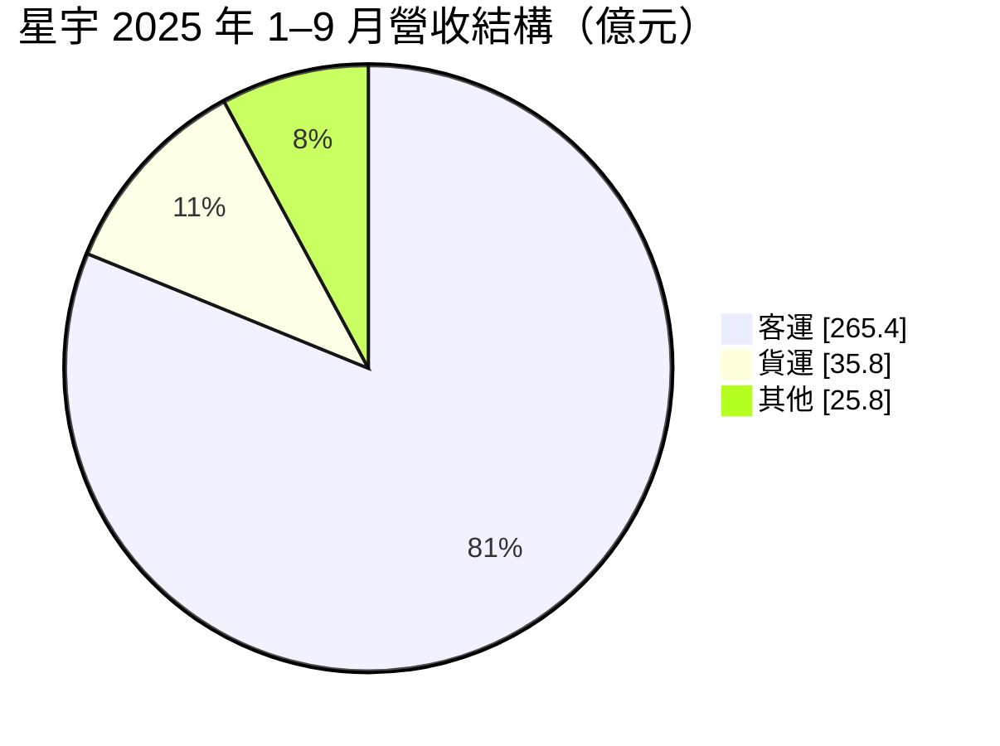
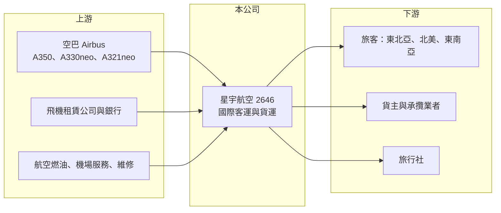

# 2646 星宇航空

> 上市｜[[產業索引-航運業|航運業]]｜上市（櫃）日期 2024/10/25

# 第一章：企業模式與商業藍圖

> [!info] 撰寫說明
> 精簡版，由 Claude 依公開資料整理，架構比照 [[2330台積電]] 的四章研究，資料截至 2026-10-08。來源：證交所開放資料（基本資料、綜合損益、資產負債、營益分析、股利、本益比）、Goodinfo 年度經營績效、星宇航空 2025 年 12 月法人說明會簡報。燃油敏感度為依簡報成本結構推算。#待校對

星宇航空（以下簡稱星宇）是台灣最年輕的國際航空公司，以全新機隊與精品化服務切入市場。理解它要抓住三件事：機隊快速擴張、以台北為轉機[[樞紐]]連接東北亞與北美，以及航空業高固定成本、低利潤率的本質。

- **核心業務：** 星宇 2018 年由張國煒創立，2020 年開航，2024 年 10 月在證交所上市。公司經營國際客運與貨運，定位為全服務航空公司，強調新機、座艙設計與餐飲服務。航空公司的收入是「座位乘以載客率乘以票價」，成本則以燃油、飛機租金與折舊、人事及機場費用為主，絕大部分是固定成本。
- **營收結構：** 依 2025 年 12 月法說簡報，2025 年 1 至 9 月營收約 327 億元，其中客運 265.4 億元（約 81%）、貨運 35.8 億元（約 11%）、其他約 25.8 億元。客運收入以東北亞 45%、北美 29%、東南亞 21%、港澳 5% 為主；貨運收入則有 72% 來自北美，主要靠客機[[腹艙]]與未來的貨機。

- **營運據點：** 以桃園機場為主要樞紐，另有台中出發航線。截至 2025 年底共 30 個航點、35 條航線、每週 259 班，北美有 4 個航點、每週 27 班，2026 年 1 月新增台北至鳳凰城。機隊方面，簡報顯示現有 29 架，2026 年預計增加到 43 架（新增 6 架 A350-1000、5 架 A330-900、3 架 A321neo），2033 年規劃 68 架，其中包括 10 架 A350 貨機。
- **長期方向：** 星宇的核心策略是「深耕轉機市場、提升樞紐效益」：利用台灣位於東北亞與東南亞之間的地理位置，把日本、東南亞旅客經台北轉往北美。與 Alaska Airlines 共掛 20 條航線，延伸北美內陸的銷售網路。機隊在 2033 年前擴張超過一倍，是公司營收成長的主要來源，也是資本需求最大的部分。

# 第二章：護城河深度與競爭優勢

航空業普遍被視為護城河很淺的產業，星宇的優勢在於品牌定位與全新機隊，但要面對規模更大的國內外對手。

- **競爭優勢：** 第一是全新機隊：A350、A330neo、A321neo 都是新世代機型，燃油效率比舊機型好，維修成本在前幾年也較低。第二是精品品牌：星宇以高品質服務建立辨識度，能在部分航線取得較高票價。第三是轉機樞紐的網路效應：航點越多、轉機組合越多，越能吸引東南亞與日本旅客經台北轉往北美。
- **主要對手：** 國內有 [[2610華航]] 與 [[2618長榮航]]，兩家機隊規模、航網密度與貨運能力都遠大於星宇；在轉機市場則與國泰航空、日本航空、全日空、大韓航空、新加坡航空等區域大型航空公司競爭。星宇沒有加入三大[[航空聯盟]]，聯營夥伴與常客計畫的吸引力相對較弱。
- **觀察重點：** 第一是新飛機交付後[[載客率]]能否維持，2025 年 1 至 11 月各月載客率介於 65% 至 86%。第二是北美航線的獲利能力，北美客收 2025 年前三季年增 17%，已是第二大區域。第三是 A350 貨機交付後貨運業務能否成為第二支柱。

# 第三章：財務體質與盈利規模

資料日期：2026-10-08，表格是撰寫當時的快照；最新月營收、毛利率、累計 EPS 由自動排程寫在本筆記的屬性欄位（月營收、毛利率、累計EPS 等）。#待校對

星宇仍處在擴張初期，財報呈現「營收快速成長、獲利微薄」的特徵，評估重點在於規模放大後利潤率能否改善。

| 年度 | 營收（新台幣） | [[毛利率]] | [[營業利益率]] | EPS（元） | [[ROE]] |
|---|---|---|---|---|---|
| 2021 | 7.96 億 | -218% | -400% | -2.69 | -67.8% |
| 2022 | 33.6 億 | -95.6% | -152% | -3.47 | -102% |
| 2023 | 225 億 | 17.4% | 2.13% | 0.08 | 1.76% |
| 2024 | 355 億 | 20.2% | 6.67% | 0.53 | 6.48% |
| 2025 | 441 億 | 15.2% | 3.72% | 0.09 | 0.89% |
| 2026 上半年 | 285.5 億 | 11.69% | 1.81% | -0.11 | 未查得 |

註：2021 至 2025 年取自 Goodinfo；2026 上半年取自證交所營益分析與綜合損益開放資料。2021 至 2022 年為疫情期間、開航初期，股本與 2024 年上市後不同，EPS 不宜直接比較。

- **營收規模：** 營收由 2023 年 225 億元成長到 2025 年 441 億元，兩年成長近一倍，2026 上半年約 286 億元，仍維持快速成長。成長主要來自機隊擴張與新航點開航。
- **獲利：** 2024 年營業利益率 6.67% 是上市前後的高點，2025 年降到 3.72%，2026 上半年再降到 1.81%，並出現稅後虧損約 3.5 億元。航空業固定成本比重高，新飛機交付、新航點開航初期載客率尚未拉高時，利潤率會被壓低，這是快速擴張期的典型[[營運槓桿]]負面效果。
- **財務特色：** 2026 年第二季底總資產約 1,543 億元，負債約 1,235 億元，權益約 308 億元，負債比約 80%，其中非流動負債約 964 億元，推估以飛機的[[租賃負債]]與購機借款為主。燃油成本占營業成本約 23%（2025 年前三季），以 2025 年營業成本約 425 億元推算，燃油成本約 98 億元，油價每上漲 10%，若無法轉嫁，營業利益約減少 9.8 億元，相當於 2025 年營業利益的六成（推算）。2025 年度未配發現金股利。
- **[[ROIC]] 與 [[WACC]]：** 2025 年營業利益約 16.4 億元（441 億元乘以 3.72%），扣除 20% 稅率約 13.1 億元；投入資本以權益 308 億元加推估有息負債與租賃負債約 1,000 億元（推估）計，約 1,308 億元，ROIC 約 1.0%（推算）。WACC 假設公債 1.75%、市場風險溢酬 6%、β 取航空業常見值 1.2（推估），權益成本約 8.95%；負債成本 4%、稅後 3.2%，權益與負債比約 24 比 76，WACC 約 4.6%（推算）。ROIC 明顯低於 WACC，代表星宇目前仍在用資本換規模，尚未創造價值；這在擴張期的航空公司很常見，關鍵在於機隊到位、航網成熟後，營業利益率能否回到 2024 年 6% 以上的水準。

# 第四章：總體風險與地緣政治

航空業是外部衝擊最多的產業之一，星宇又處在高負債擴張期，抗風險能力比老牌航空公司弱。

- **產業週期：** 航空需求隨經濟景氣、匯率與旅遊偏好波動，疫情這類事件可讓營收幾乎歸零，2021 至 2022 年星宇的鉅額虧損就是例子。景氣好時各家航空公司同步加班機，運能過剩又會壓低票價。
- **營運風險：** 機隊在 2026 年單年增加 14 架，新飛機的租金、折舊與機組員訓練成本會先於營收發生；若新航點載客率爬升較慢，虧損可能延續。空巴交機延誤、發動機供應問題，也會打亂航網規劃。高負債結構使公司對利率上升與營收下滑都較敏感。
- **其他風險：** 燃油價格是最大的變動成本，燃油附加費只能部分轉嫁；飛機租金與購機款以美元計價，新台幣貶值會增加成本；地緣政治與兩岸關係影響旅遊需求與航權；國際減碳規範要求使用永續航空燃油，長期會推升成本。

# 專有名詞解析

## 金融

- **[[營運槓桿]]**：固定成本占比高的企業，營收小幅變動就會造成獲利大幅變動的現象。
- **[[租賃負債]]**：企業以租賃方式取得資產時，依會計準則認列未來租金現值的負債，航空公司租用飛機會產生大量租賃負債。
- **[[ROIC]]**：投入資本報酬率，稅後營業利益除以股東權益與有息負債之和，衡量所有投入資本的報酬。
- **[[WACC]]**：加權平均資金成本，依權益與負債比重加權的資金成本，是 ROIC 需要超越的門檻。

## 產業

- **[[載客率]]**：實際售出座位占可用座位的比例，是衡量航空公司運能是否被充分利用的核心指標。
- **[[腹艙]]**：客機機身下層用來裝載行李與貨物的空間，航空公司可利用客運航班同時運送貨物，增加每趟航班的收入。
- **[[樞紐]]**：航空公司集中航班、讓旅客與貨物在此轉機的主要機場，航點越多轉機越方便，能形成網路效應。
- **[[航空聯盟]]**：多家航空公司結盟共享航網、代碼共享與貴賓室，主要有星空聯盟、天合聯盟與寰宇一家。

# 核心供應鏈

- 上游：空巴（飛機）、飛機租賃公司與銀行、航空燃油供應商、機場地勤與飛機維修業者。
- 下游／客戶：個人與商務旅客、貨運承攬業者（如 [[2643捷迅]]、[[5609中菲行]]，推估）、旅行社（如 [[2731雄獅]]，推估）；聯營夥伴 Alaska Airlines。
- 同業：[[2610華航]]、[[2618長榮航]]，以及國泰航空、日本航空、大韓航空等區域航空公司。

## 最新新聞
<!-- news:start（自動產生，請勿手動編輯此範圍） -->
- 2026-10-20 🏛️ 重訊 13:51｜公告本公司申請延長現金增資募集期間｜[觀測站](https://mops.twse.com.tw/mops/#/web/t05st01)
- 2026-10-16 🏛️ 重訊 18:08｜本公司取得1架A350自有客機相關訊息｜[觀測站](https://mops.twse.com.tw/mops/#/web/t05st01)
- 2026-10-12 📰 媒體 17:52｜營收速報 - 星宇航空(2646)9月營收49.75億元年增率高達68.89％｜[鉅亨網](https://news.cnyes.com/news/id/6628270)

完整紀錄：[[2646星宇航空 新聞]]
<!-- news:end -->

## 相關連結
- [公開資訊觀測站](https://mopsov.twse.com.tw/mops/web/t05st03?step=1&firstin=1&co_id=2646)
- [Goodinfo](https://goodinfo.tw/tw/StockDetail.asp?STOCK_ID=2646)
- [Yahoo 股市](https://tw.stock.yahoo.com/quote/2646)
- [鉅亨網新聞](https://www.cnyes.com/twstock/2646/news)
