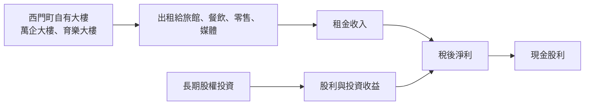
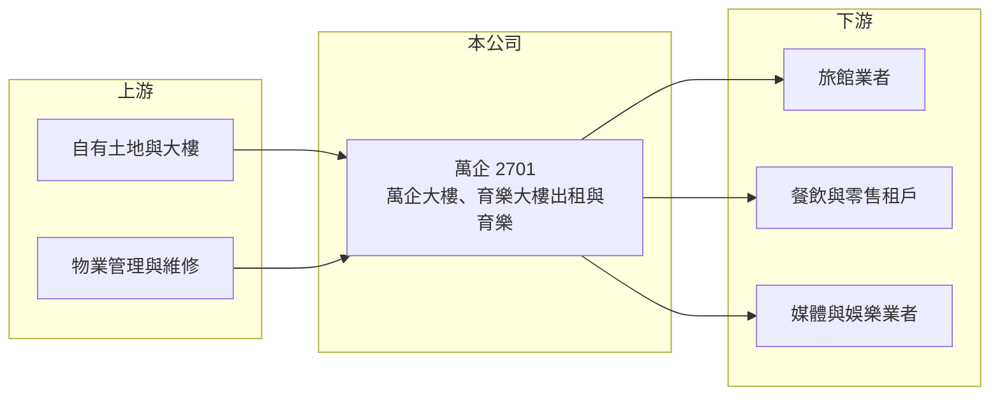

# 2701 萬企

> 上市｜[[產業索引-觀光餐旅|觀光餐旅]]｜上市（櫃）日期 1965/03/22

# 第一章：企業模式與商業藍圖

> [!info] 撰寫說明
> 精簡版，由 Claude 依公開資料整理，架構比照 [[2330台積電]] 的四章研究，資料截至 2026-10-08。來源：Goodinfo 年度經營績效頁、富果研究 2025 年 12 月法說會整理、證交所開放資料（基本資料、2026 年第二季資產負債與綜合損益、營益分析、股利、每月營收）。公司規模小，公開資料有限，轉投資明細與各業務比重未查得。#待校對

萬華企業（以下簡稱萬企）是一家在台北西門町持有商用大樓的老牌公司，雖然被歸類為觀光餐旅股，實質上是以收租與長期投資為主的資產型公司。本章說明它的資產組成與收入來源。

## 一、核心定位：西門町的收租型資產公司

萬企成立於 1958 年，1965 年上市，是台灣最早上市的公司之一，董事長為蔡茂昌、總經理為吳雅珍，實收資本額約 45.0 億元（證交所開放資料）。公司的業務分為租賃與育樂兩大板塊（富果研究）：

* **萬企大樓（中華路，鄰近捷運站出口）：** 主要租戶包括傑斯旅店、洛碁大飯店、愛爾達電視臺、7-ELEVEN 與壽司郎餐廳。
* **育樂大樓（峨眉街，西門町核心商圈）：** 主要租戶包括誠品商場、千葉火鍋與香滿樓餐廳。
* **育樂業務：** 與影城業者合作的電影院，以及設有棒球打擊場、射擊練習場的遊樂場。

除了大樓本身，公司資產中有相當比例是長期投資，股利收入與投資收益是另一個主要的獲利來源（富果研究提及資產以不動產與長期投資為主）。

## 二、商業模式：低營收、高利潤率

萬企每年營收只有約 2.5 億至 3 億元，但因為收入以租金為主、成本以折舊與管理費用為主，毛利率約 60% 至 80%、營業利益率約 50% 至 65%（Goodinfo）。這類公司的經營重點不是擴大營收，而是維持租戶品質與出租率，並管理好長期投資組合。

## 三、長期方向

[[不動產租賃]]的長期價值取決於地段。西門町是台北最主要的觀光與年輕族群商圈，捷運交通便利，國際觀光客回流也帶動旅館與餐飲需求。公司表示會積極尋找多元化且穩健的投資機會（富果研究），但未揭露具體標的；老舊大樓未來是否進行改建或[[資產活化]]，是影響長期價值的關鍵，目前未查得相關計畫。

# 第二章：護城河深度與競爭優勢

收租型公司的競爭優勢來自資產本身，本章分析萬企的資產優勢與限制。

## 一、護城河的核心組成要素

* **稀缺地段：** 西門町核心商圈的整棟商用大樓幾乎沒有新供給，持有數十年的土地帳面成本低，市場價值遠高於帳面（推估）。
* **多元租戶：** 旅館、餐飲、零售、媒體與娛樂業者分散在兩棟大樓，單一租戶退租對整體收入的影響有限。
* **財務保守：** 2026 年第二季底總負債約 14.2 億元、權益約 84.8 億元（證交所資產負債），幾乎沒有財務槓桿，能承受景氣波動。

## 二、主要競爭與比較對象

| 比較對象 | 定位 | 與萬企的比較 |
|---|---|---|
| [[2706第一店]] | 台北南京東路的老牌飯店轉型收租 | 同樣是觀光類股中的收租型資產公司 |
| 西門町周邊商場與大樓業主 | 爭取相同的餐飲、零售與旅館租戶 | 商圈內的租戶競爭 |
| [[2926誠品生活]] | 育樂大樓的主要租戶之一 | 屬於合作關係，租約條件影響萬企收入 |

## 三、守得住與守不住

* **守得住：** 地段帶來的長期租金收入。只要西門町商圈維持人流，大樓的出租需求就相對穩定。
* **守不住：** 租金成長性。老舊大樓的設備與空間規劃難以吸引高租金的新型態業者，租金漲幅有限；營收由 2023 年的 2.97 億元降到 2025 年的 2.54 億元（Goodinfo）。
* **觀察重點：** 主要租約的續約與租金調整、育樂業務的營運狀況，以及大樓是否有改建或活化計畫。

# 第三章：財務體質與盈利規模

資料日期：2026-10-08，表格是撰寫當時的快照；最新月營收、毛利率、累計 EPS 由自動排程寫在本筆記的屬性欄位（月營收、毛利率、累計EPS 等）。#待校對

本章用多年度數據檢視萬企的收租收入、業外收益與資本報酬。

## 一、多年度三率與 ROE

| 年度 | 營收（新台幣） | [[毛利率]] | [[營業利益率]] | EPS（元） | [[ROE]] |
|---|---|---|---|---|---|
| 2020 | 2.65 億 | 63.6% | 52.1% | 0.39 | 2.27% |
| 2021 | 2.40 億 | 61.7% | 49.4% | 0.19 | 1.12% |
| 2022 | 2.27 億 | 60.1% | 46.8% | 0.47 | 2.74% |
| 2023 | 2.97 億 | 67.2% | 56.1% | 0.53 | 2.93% |
| 2024 | 2.90 億 | 69.3% | 57.1% | 0.51 | 2.74% |
| 2025 | 2.54 億 | 78.9% | 63.5% | 0.56 | 2.99% |
| 2026 上半年 | 1.29 億 | 80.06% | 66.24% | 0.29 | 未查得 |

註：2020 至 2025 年取自 Goodinfo；2026 上半年取自證交所營益分析與綜合損益。

* **高利潤率、低成長：** 營業利益率長期在 47% 至 66% 之間，但營收規模停留在 2 億至 3 億元，2020 至 2025 年營收年複合成長率約 -0.8%（推算）。2026 年 1 至 8 月累計營收約 1.70 億元、年增約 1.9%（證交所每月營收）。
* **業外占比高：** 2026 年上半年營業利益約 0.85 億元，營業外收入約 0.78 億元，稅後純益率達 101.86%（證交所營益分析），代表淨利有將近一半來自投資收益等[[業外收益]]。
* **ROE 偏低：** 2021 至 2025 年平均 ROE 約 2.5%（推算）。原因是股東權益約 85 億元，其中包含大量長期投資與累積的其他權益，而每年淨利只有約 2.5 億元。

## 二、股利與財務結構

2025 年度配發現金股利 0.28 元，以 2025 年本期淨利約 2.51 億元計算，配發率約 50%（證交所股利資料，推算）。富果研究指出公司近五年皆穩定發放現金股利。收租型公司資本支出低，自由現金流長期為正（推估），但配發率不高，盈餘多保留在公司。

## 三、[[ROIC]] 與 [[WACC]]

**ROIC 推算：** 2025 年營業利益約 2.54 億元 × 63.5% ≈ 1.61 億元，稅後約 1.29 億元。投入資本以權益約 84.8 億元計算（有息負債極少），ROIC 約 1.5%（推算）。若把投資收益計入，整體資本報酬約與 ROE 相近，約 3%。

**WACC 推算：** 公債殖利率 1.75%、市場風險溢酬 6%、β 取資產型公司常見值 0.5，權益成本約 4.75%；幾乎無負債，WACC 約 4.7%（推算）。

**結論：** 以帳面資本計算，萬企的 ROIC 與 ROE 都低於資金成本，代表帳上大量的不動產與投資並未產生相應的報酬。這類公司的投資價值通常不在於獲利成長，而在於資產的市場價值是否被低估，以及經營層是否有活化資產或提高股東報酬的意願。

# 第四章：總體風險與地緣政治

本章整理萬企長期面對的資產、租賃與治理風險。

## 一、租賃市場

* **商圈景氣：** 收入高度集中在西門町，商圈人流、觀光客數量與消費型態的改變，會影響租戶的經營與續租意願。
* **租戶集中：** 旅館與大型零售租戶占兩棟大樓相當比例的面積，主要租戶退租時可能出現空置期。

## 二、資產與投資

* **大樓老化：** 兩棟大樓屋齡高，維修與設備更新成本增加；若未來改建，改建期間將失去租金收入。
* **投資收益波動：** 業外收益占淨利近半，投資標的的股價與股利變動，會直接影響 EPS 與股東權益。

## 三、其他風險

* **成長性有限：** 公司缺乏明確的擴張或活化計畫，營收長期停滯，股東報酬主要依賴穩定但金額不高的股利。
* **法規與稅負：** 房屋稅、地價稅與都市計畫法規的調整，會影響持有成本與改建可行性。

# 專有名詞解析

## 金融

- **[[業外收益]]**：本業以外的收入，例如投資收益、股利、利息與資產處分利得，波動通常較大。
- **[[ROIC]]**：投入資本報酬率，衡量企業用股東與債權人投入的資本，每年能產生多少稅後營業利益。
- **[[WACC]]**：加權平均資金成本，股東要求報酬與負債利息依資本結構加權後的平均值，是判斷是否創造價值的門檻。

## 產業

- **[[不動產租賃]]**：企業持有房地產出租給他人使用，以租金作為主要收入來源的商業模式。
- **[[資產活化]]**：企業將閒置或低度使用的土地、建物，透過改建、出租、合建或出售等方式提高收益。

# 核心供應鏈

- 上游：自有土地與建物、物業管理與維修服務。
- 下游／客戶：租戶包括傑斯旅店、洛碁大飯店、愛爾達電視臺、7-ELEVEN（[[2912統一超]]）、壽司郎、誠品商場（[[2926誠品生活]]）、千葉火鍋與香滿樓（富果研究）。
- 同業：[[2706第一店]] 等觀光類股中的收租型資產公司。

## 最新新聞
<!-- news:start -->
<!-- news:end -->

## 相關連結
- [公開資訊觀測站](https://mopsov.twse.com.tw/mops/web/t05st03?step=1&firstin=1&co_id=2701)
- [Goodinfo](https://goodinfo.tw/tw/StockDetail.asp?STOCK_ID=2701)
- [Yahoo 股市](https://tw.stock.yahoo.com/quote/2701)
- [鉅亨網新聞](https://www.cnyes.com/twstock/2701/news)
