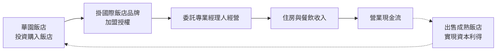
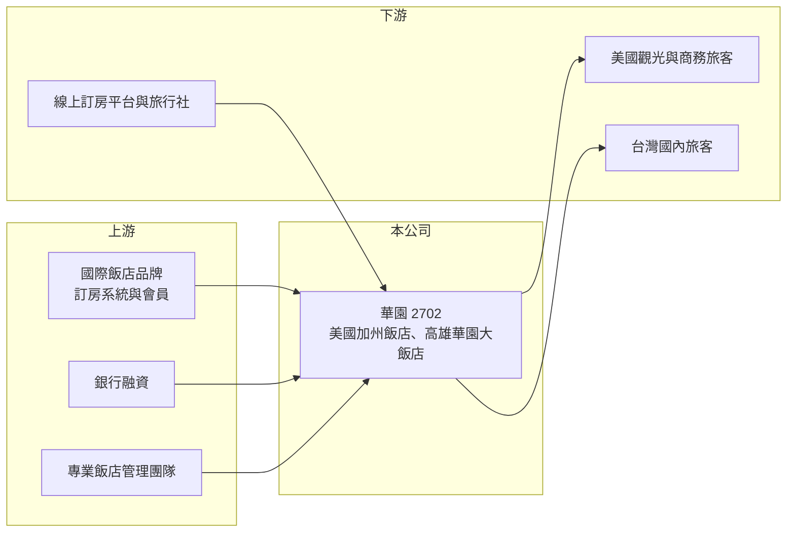

# 2702 華園

> 上市｜[[產業索引-觀光餐旅|觀光餐旅]]｜上市（櫃）日期 1965/02/14

# 第一章：企業模式與商業藍圖

> [!info] 撰寫說明
> 精簡版，由 Claude 依公開資料整理，架構比照 [[2330台積電]] 的四章研究，資料截至 2026-10-08。來源：Goodinfo 年度經營績效頁、科技新報轉載商業周刊 2019 年 11 月專訪、證交所開放資料（基本資料、2026 年第二季資產負債與綜合損益、營益分析、股利、每月營收）。美國飯店的家數、品牌與營收占比取自 2019 年報導，可能已有變動；房間數與近年住房率未查得。#待校對

華園飯店是高雄老字號飯店，但目前的營收主力在美國加州。本章說明它如何從單一飯店轉型為「持有飯店資產、委託國際品牌經營」的跨國飯店投資公司。

## 一、核心定位：以美國飯店為主的飯店資產持有者

華園飯店成立於 1959 年，1965 年上市，董事長兼總經理為陳增東，實收資本額約 15.7 億元（證交所開放資料）。公司在台灣經營高雄華園大飯店與 2018 年開幕的草衙分館；美國方面，1997 年買下第一家位於加州迪士尼樂園大門旁的飯店，2015 年後再陸續購入，2019 年時共持有 5 家加州飯店，其中 2 家為度假型、3 家為商務型（商業周刊 2019 年報導，現況待校對）。

依 2019 年報導，美國營收約占集團九成，美國飯店的平均[[住房率]]約八成，住客以美國本地旅客為主。也就是說，華園雖然在台灣上市、名稱是高雄的飯店，實際上是一家以美國加州飯店為主要資產的公司。

## 二、商業模式：所有權、品牌與經營分離

華園在美國採用[[加盟]]國際飯店品牌的方式：公司負責出資購買飯店，掛上國際品牌以取得訂房系統與會員客源，再委由專業團隊經營。2019 年報導指出，公司評估投資標的時參考過去 5 年的營收與淨利率（約 7% 至 7.5%），要求投資報酬率超過 7%，並重視現金流。2017 年曾以約 2,350 萬美元出售一家飯店，獲利約 1,382 萬美元，顯示公司會在適當時機處分資產、實現增值。

## 三、長期方向

這種模式本質上是「飯店不動產投資」：長期報酬來自營運現金流加上資產增值。未來的關鍵在於能否持續找到報酬率合理的美國飯店標的，以及在利率與房價循環中掌握買賣時機。台灣部分以高雄的飯店為主，規模相對較小。

# 第二章：護城河深度與競爭優勢

飯店業的競爭優勢來自地點、品牌與資本，本章分析華園的定位與限制。

## 一、競爭優勢

* **美國飯店的地點：** 加州迪士尼樂園旁的度假型飯店有穩定的觀光客源，商務型飯店則服務當地的商務旅客，客源以美國本地為主，較不受台灣觀光市場影響。
* **品牌加盟取得客源：** 掛國際品牌可以直接使用全球訂房系統與會員計畫，小型業主不需自建品牌就能維持住房率。
* **資產買賣經驗：** 公司有長期在美國買賣飯店的經驗，能在資產價格合理時購入、在增值後出售。

## 二、主要競爭與比較對象

| 比較對象 | 定位 | 與華園的比較 |
|---|---|---|
| [[2707晶華]] | 台灣飯店經營與品牌管理 | 以品牌與管理收入為主，資產較輕 |
| [[2704國賓]]、[[2705六福]] | 台灣老字號飯店集團 | 以台灣市場為主，華園則以美國為主 |
| 加州當地飯店業主與 REITs | 美國飯店資產持有者 | 在美國市場搶標的與客源 |

## 三、守得住與守不住

* **守得住：** 加盟國際品牌的美國飯店，在正常景氣下可維持穩定的住房率與現金流。
* **守不住：** 獲利穩定度。華園的稅後淨利常受資產處分、匯率與利息影響，2021 年 EPS 16.53 元、2025 年卻是 -0.35 元（Goodinfo），本業以外的因素波動很大。
* **觀察重點：** 美國飯店的[[平均房價]]與住房率、美元利率對借款成本的影響，以及是否再有飯店買賣交易。

# 第三章：財務體質與盈利規模

資料日期：2026-10-08，表格是撰寫當時的快照；最新月營收、毛利率、累計 EPS 由自動排程寫在本筆記的屬性欄位（月營收、毛利率、累計EPS 等）。#待校對

本章用多年度數據檢視華園的營運表現，並區分本業與業外對獲利的影響。

## 一、多年度三率與 ROE

| 年度 | 營收（新台幣） | [[毛利率]] | [[營業利益率]] | EPS（元） | [[ROE]] |
|---|---|---|---|---|---|
| 2020 | 6.59 億 | 71.2% | -26.9% | -2.45 | -24.0% |
| 2021 | 8.21 億 | 76.4% | -12.8% | 16.53 | 98.2% |
| 2022 | 13.6 億 | 80.5% | 3.76% | 2.70 | 13.5% |
| 2023 | 14.3 億 | 81.3% | 5.03% | 0.16 | 0.81% |
| 2024 | 14.4 億 | 86.2% | 7.54% | 0.26 | 1.24% |
| 2025 | 14.1 億 | 87.1% | 7.82% | -0.35 | -1.65% |
| 2026 上半年 | 7.39 億 | 89.13% | 10.32% | 0.31 | 未查得 |

註：2020 至 2025 年取自 Goodinfo；2026 上半年取自證交所營益分析與綜合損益。毛利率偏高是因為飯店的人事等營運成本多列在營業費用，應以營業利益率判斷本業獲利。2021 年 EPS 大幅為正而本業虧損，推估來自資產處分利得。

* **本業逐步改善：** 營業利益率由 2020 年疫情期間的 -26.9% 回升到 2025 年的 7.82%，2026 年上半年達 10.32%。
* **業外拖累：** 2023 至 2025 年本業都有營業利益，但 EPS 只有 0.16、0.26 與 -0.35 元，代表利息、匯率等營業外項目吃掉大部分本業獲利。2026 年上半年營業外淨損約 0.28 億元（證交所綜合損益）。
* **營收：** 2022 年以後營收穩定在 13.6 億至 14.4 億元，疫情後已恢復。2026 年 1 至 8 月累計營收約 10.15 億元、年增約 8.2%（證交所每月營收）。
* **ROE：** 2021 至 2025 年平均 ROE 受 2021 年一次性收益扭曲；扣除 2021 年後，2022 至 2025 年平均約 3.5%（推算）。

## 二、股利與財務結構

2025 年度因虧損未配發股利（證交所股利資料）。2026 年第二季底權益約 33.1 億元、總負債約 34.7 億元，其中流動負債約 18.2 億元（證交所資產負債），負債比約 51%，美國飯店的購置多以借款支應（推估）。

## 三、[[ROIC]] 與 [[WACC]]

**ROIC 推算：** 2025 年營業利益約 14.1 億元 × 7.82% ≈ 1.10 億元，稅後約 0.88 億元。投入資本以權益 33.1 億元加上假設有息負債約 25 億元（推估）計算，約 58 億元，ROIC 約 1.5%（推算）。

**WACC 推算：** 公債殖利率 1.75%、市場風險溢酬 6%、β 取飯店股常見值 0.8，權益成本約 6.55%；美國借款成本假設 5%、稅後 4%，以權益約 57%、負債約 43% 加權，WACC 約 5.4%（推算）。

**結論：** 以本業營業利益計算，華園的 ROIC 明顯低於 WACC，代表以帳面資本衡量，飯店營運報酬不足以支付資金成本。華園模式的長期報酬很大一部分依賴飯店資產增值與處分利得，這部分不會反映在營業利益中，因此評估時需要同時觀察資產的市場價值。

# 第四章：總體風險與地緣政治

本章整理華園長期面對的市場、財務與營運風險。

## 一、市場風險

* **美國旅遊與經濟景氣：** 營收主要來自美國加州，美國經濟衰退、旅遊需求下滑或迪士尼樂園客流變化，會直接影響住房率與房價。
* **台灣市場競爭：** 高雄飯店市場近年新飯店增加，華園大飯店與草衙分館面臨價格競爭。

## 二、財務風險

* **美元利率：** 美國飯店購置多以借款支應，美元利率上升會提高利息支出，這是 2023 年後業外拖累獲利的可能原因之一（推估）。
* **匯率：** 美國營收換算成新台幣時受匯率影響，新台幣升值會使營收與淨利下降。
* **資產價格：** 飯店資產價值隨利率與景氣波動，景氣下行時處分資產可能無法取得預期價格。

## 三、營運風險

* **委託經營的管理風險：** 飯店委由專業經理人經營，公司需要有效監督營運品質與成本。
* **人力成本：** 美國與台灣飯店業都面臨工資上漲與缺工，壓縮利潤率。
* **天災：** 加州的地震與野火風險，可能影響飯店營運與保險成本。

# 專有名詞解析

## 金融

- **[[ROIC]]**：投入資本報酬率，衡量企業用股東與債權人投入的資本，每年能產生多少稅後營業利益。
- **[[WACC]]**：加權平均資金成本，股東要求報酬與負債利息依資本結構加權後的平均值，是判斷是否創造價值的門檻。

## 產業

- **[[住房率]]**：飯店實際售出的房間數占可售房間數的比例，是衡量飯店需求的核心指標。
- **[[平均房價]]**：飯店售出房間的平均每晚價格，與住房率相乘可得每間可售房收入。
- **[[加盟]]**：品牌總部授權加盟主使用商標與營運模式，加盟主負擔開店成本並支付加盟金或權利金。

# 核心供應鏈

- 上游：國際飯店品牌（加盟授權與訂房系統）、銀行融資、專業飯店管理團隊。
- 下游／客戶：美國觀光與商務旅客、台灣國內旅客，以及線上訂房平台與旅行社。
- 同業：[[2707晶華]]、[[2704國賓]]、[[2705六福]]、[[2712遠雄來]]、[[2722夏都]]、[[2739寒舍]]、[[2748雲品]]。

## 最新新聞
<!-- news:start -->
<!-- news:end -->

## 相關連結
- [公開資訊觀測站](https://mopsov.twse.com.tw/mops/web/t05st03?step=1&firstin=1&co_id=2702)
- [Goodinfo](https://goodinfo.tw/tw/StockDetail.asp?STOCK_ID=2702)
- [Yahoo 股市](https://tw.stock.yahoo.com/quote/2702)
- [鉅亨網新聞](https://www.cnyes.com/twstock/2702/news)
