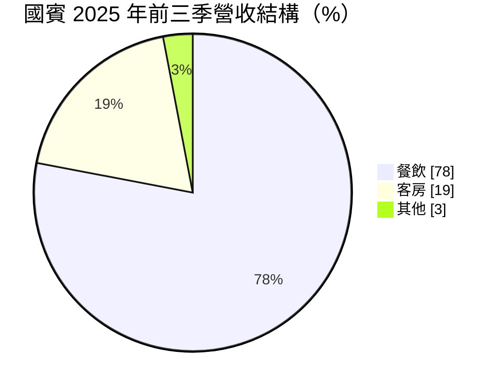
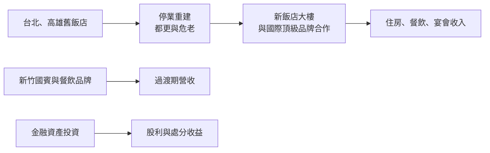
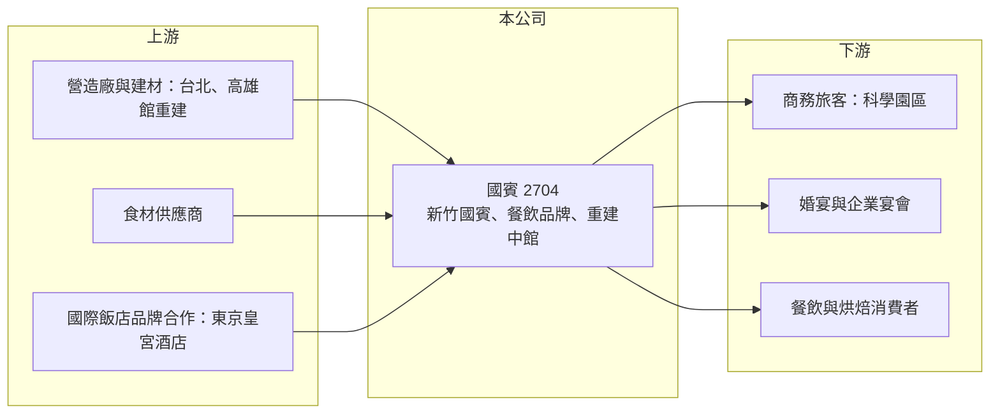

# 2704 國賓

> 上市｜[[產業索引-觀光餐旅|觀光餐旅]]｜上市（櫃）日期 1982/11/10

# 第一章：企業模式與商業藍圖

> [!info] 撰寫說明
> 精簡版，由 Claude 依公開資料整理，架構比照 [[2330台積電]] 的四章研究，資料截至 2026-10-08。來源：Goodinfo 年度經營績效頁、富果研究 2025 年 12 月法說會整理、證交所開放資料（基本資料、2026 年第二季資產負債與綜合損益、營益分析、股利、每月營收）；高雄國賓重建時程、台北國賓停業時間與金融資產持股明細依記憶或報導標題整理，標示待校對。房間數未查得。#待校對

國賓大飯店是台北老字號五星級飯店，目前正處於台北與高雄兩館重建的過渡期。本章說明它現在的營運規模、重建計畫，以及為何它的財報被龐大的金融資產主導。

## 一、核心定位：重建中的老牌飯店集團

國賓成立於 1962 年，1982 年上市，董事長為許育瑞、總經理為許家堯，實收資本額約 36.7 億元（證交所開放資料），員工約 500 人（富果研究）。國賓原本在台北中山北路、高雄愛河畔與新竹各有一家飯店，目前的營運狀態如下：

* **新竹國賓：** 現階段唯一營運中的飯店，住房率維持在 70% 以上，主要客源是科學園區與 AI 產業帶來的商務旅客（富果研究）。
* **台北國賓：** 2022 年 10 月起以都市更新方式拆除重建，2025 年底新大樓約蓋到六樓；公司與日本東京皇宮酒店（Palace Hotel Tokyo）簽訂經營合作，新飯店規劃為頂級飯店（富果研究，開幕時程待校對）。施工期間，餐飲營運移到遼寧街的臨時據點。
* **高雄國賓：** 進行[[危老重建]]（依報導標題，停業與完工時程待校對）。

2025 年前三季營收約 10 億元，其中餐飲約占 78%、客房約占 19%（富果研究）：

## 二、餐飲品牌

在台北飯店重建期間，餐飲品牌是維持品牌能見度的主要方式：歷史超過 60 年的川菜廳、連續多年獲米其林一星的 A CUT 牛排館，以及在台北有兩家門市的國賓烘焙（富果研究）。宴會業務方面，公司指出台灣每年約 12 萬對新人結婚，數量穩定，但市場正轉向小型、家庭式的婚宴，大型宴會的營收因此受到壓力。

## 三、資本轉化邏輯：舊飯店換新資產

飯店重建是典型的「先犧牲、後回收」：重建期間失去主要營收，但完工後可以用新建物與國際品牌大幅提升平均房價。國賓營收由 2020 年的 20.1 億元降到 2025 年的 13.6 億元（Goodinfo），主要就是台北館停業的影響。

## 四、企業長期藍圖

國賓的長期價值取決於兩件事：台北新飯店能否在完工後成為台北最頂級的飯店之一，以及高雄館重建後的定位。在這之前，新竹國賓與餐飲品牌負責維持營運，龐大的金融資產則提供業外收益與財務支撐。

# 第二章：護城河深度與競爭優勢

飯店業的護城河來自地段、品牌與服務，本章分析國賓在重建期間與重建後的競爭位置。

## 一、護城河的核心組成要素

* **核心地段：** 台北中山北路的飯店基地是台北最早的國際觀光飯店區之一，新竹國賓則位於科學園區商務需求的核心區域，好地段的飯店用地幾乎不會再有新供給。
* **國際頂級品牌合作：** 與東京皇宮酒店合作經營台北新館，可以借重日本頂級飯店的服務標準與國際客源，提升新飯店的定位。
* **餐飲品牌資產：** 川菜廳與 A CUT 牛排館具有長期的口碑與米其林評價，餐飲占營收近八成，是國賓與一般商務飯店的差異。
* **雄厚的財務實力：** 2026 年第二季底權益總計約 325.7 億元、總負債約 83.3 億元（證交所資產負債），能支應長期的重建資本支出。

## 二、主要競爭對手

| 對手 | 定位 | 與國賓的比較 |
|---|---|---|
| [[2707晶華]] | 台北頂級飯店與品牌管理 | 台北中山區最直接的頂級飯店對手 |
| [[2739寒舍]] | 台北喜來登、艾美 | 台北國際品牌飯店 |
| [[2748雲品]] | 台北君品、日月潭雲品 | 飯店餐飲與宴會 |
| [[2705六福]] | 台北萬怡、關西六福莊 | 台北商務飯店與宴會 |
| 新竹地區國際品牌飯店 | 商務旅客 | 搶科學園區的商務客源 |

## 三、守得住與守不住

* **守得住：** 新竹的商務客源與餐飲品牌的口碑，在重建期間仍提供穩定營收。
* **守不住：** 過渡期的本業獲利。台北館停業後，營業利益率連續多年為負，2025 年仍為 -1.09%（Goodinfo）。
* **觀察重點：** 台北新館的完工與開幕時程、開幕後的平均房價與住房率，以及高雄館重建進度。

# 第三章：財務體質與盈利規模

資料日期：2026-10-08，表格是撰寫當時的快照；最新月營收、毛利率、累計 EPS 由自動排程寫在本筆記的屬性欄位（月營收、毛利率、累計EPS 等）。#待校對

本章用多年度數據檢視國賓在重建期間的本業表現，以及業外收益與金融資產的角色。

## 一、多年度三率與 ROE

| 年度 | 營收（新台幣） | [[毛利率]] | [[營業利益率]] | EPS（元） | [[ROE]] |
|---|---|---|---|---|---|
| 2020 | 20.1 億 | 23.3% | -13.7% | 0.01 | 0.03% |
| 2021 | 15.2 億 | 17.2% | -24.6% | -0.24 | -0.76% |
| 2022 | 14.5 億 | 0.45% | -50.8% | 2.97 | 8.58% |
| 2023 | 12.8 億 | 28.9% | -20.0% | 1.34 | 2.97% |
| 2024 | 13.0 億 | 28.0% | -2.45% | 2.77 | 4.26% |
| 2025 | 13.6 億 | 28.9% | -1.09% | 0.57 | 0.79% |
| 2026 上半年 | 7.05 億 | 30.08% | 3.05% | 1.67 | 未查得 |

註：2020 至 2025 年取自 Goodinfo；2026 上半年取自證交所營益分析與綜合損益。2022 年毛利率 0.45%、營業利益率 -50.8%，推估與台北館拆除重建的相關成本有關。

* **本業逐步回穩：** 營業利益率由 2022 年的 -50.8% 改善到 2026 年上半年的 3.05%，反映重建初期的一次性成本消化完畢，以及新竹館與餐飲品牌的穩定經營。
* **獲利來自業外：** 2026 年上半年營業利益只有約 0.21 億元，營業外收入卻有約 8.02 億元，稅後純益率達 86.75%（證交所營益分析）。國賓的 EPS 幾乎完全由[[業外收益]]決定。
* **營收：** 2026 年 1 至 8 月累計營收約 9.24 億元、年增約 4.6%（證交所每月營收）。2020 至 2025 年營收年複合成長率約 -7.5%（推算），反映台北館停業。
* **ROE：** 2021 至 2025 年平均 ROE 約 3.2%（推算）。權益規模龐大，即使業外收益可觀，ROE 也很低。

## 二、金融資產、股利與財務結構

2026 年第二季底權益總計約 325.7 億元，實收資本額只有約 36.7 億元，每股參考淨值約 88.76 元（證交所資產負債）。同期其他綜合損益約 65.4 億元，代表公司持有的金融資產市值大幅上升（持股標的未查得）。換句話說，國賓的股東權益主要是金融資產，而不是飯店本身。2025 年度配發現金股利 0.5 元，以本期淨利約 2.10 億元計算配發率約 87%（證交所股利資料，推算）。

## 三、[[ROIC]] 與 [[WACC]]

**ROIC 推算：** 2025 年營業利益約 13.6 億元 × -1.09% ≈ -0.15 億元，稅後營業利益為負，本業 ROIC 約 0%（推算）。若只以飯店與餐飲實際使用的資產計算，資本基礎會小很多，但重建中的台北、高雄館尚未產生收入，本業報酬仍接近零。

**WACC 推算：** 公債殖利率 1.75%、市場風險溢酬 6%、β 取飯店股常見值 0.6，權益成本約 5.35%；有息負債比重低，WACC 約 5.3%（推算）。

**結論：** 重建期間，國賓的本業 ROIC 明顯低於 WACC，這是重建型公司在過渡期的正常現象。長期能否創造價值，要看台北新館開幕後的營運報酬能否超過資金成本；而在此之前，公司的價值主要由金融資產支撐，股價也較容易隨持股市值波動。

# 第四章：總體風險與地緣政治

本章整理國賓長期面對的重建、市場與財務風險。

## 一、重建風險

* **工期與成本：** 都更與危老重建工程期長，營建成本上漲或工期延誤，會增加資本支出並延後收入恢復的時間。
* **開幕後的市場接受度：** 台北頂級飯店市場競爭激烈，新館開幕後能否達到預期的平均房價與住房率，仍有不確定性。

## 二、市場風險

* **婚宴與宴會萎縮：** 大型婚宴市場轉向小型化，宴會營收的長期成長性受限。
* **觀光需求：** 2024 年來台旅客約 786 萬人次，尚未恢復疫情前水準（富果研究）；國際觀光客回流速度影響新館的客源。
* **新竹商務需求集中：** 新竹國賓高度依賴科學園區與 AI 產業的商務旅客，科技業景氣變化會影響住房率。

## 三、財務風險

* **金融資產波動：** 業外收益與股東權益高度依賴金融資產，股市下跌時 EPS 與淨值都會明顯下降。
* **人力成本：** 新館開幕需要大量招募與培訓人力，飯店業缺工與工資上漲可能壓縮開幕初期的利潤率。

# 專有名詞解析

## 金融

- **[[業外收益]]**：本業以外的收入，例如投資收益、股利、利息與資產處分利得，波動通常較大。
- **[[ROIC]]**：投入資本報酬率，衡量企業用股東與債權人投入的資本，每年能產生多少稅後營業利益。
- **[[WACC]]**：加權平均資金成本，股東要求報酬與負債利息依資本結構加權後的平均值，是判斷是否創造價值的門檻。

## 產業

- **[[危老重建]]**：依《都市危險及老舊建築物加速重建條例》，屋齡老舊的建物可申請容積獎勵加速重建。
- **[[都更]]**：都市更新，透過重建、整建或維護老舊市區建物，改善居住環境並提高土地使用效率。

# 核心供應鏈

- 上游：重建工程的營造廠與建材業者、食材供應商、東京皇宮酒店（經營合作）。
- 下游／客戶：新竹科學園區的商務旅客、婚宴與企業宴會客戶、餐飲與烘焙消費者。
- 同業：[[2707晶華]]、[[2739寒舍]]、[[2748雲品]]、[[2705六福]]、[[2702華園]]、[[2712遠雄來]]。

## 最新新聞
<!-- news:start（自動產生，請勿手動編輯此範圍） -->
- 2026-10-08 📰 媒體 19:51｜營收速報 - 國賓(2704)9月營收1.52億元年增率高達35.86％｜[鉅亨網](https://news.cnyes.com/news/id/6625868)

完整紀錄：[[2704國賓 新聞]]
<!-- news:end -->

## 相關連結
- [公開資訊觀測站](https://mopsov.twse.com.tw/mops/web/t05st03?step=1&firstin=1&co_id=2704)
- [Goodinfo](https://goodinfo.tw/tw/StockDetail.asp?STOCK_ID=2704)
- [Yahoo 股市](https://tw.stock.yahoo.com/quote/2704)
- [鉅亨網新聞](https://www.cnyes.com/twstock/2704/news)
