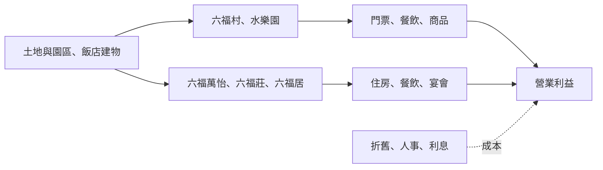
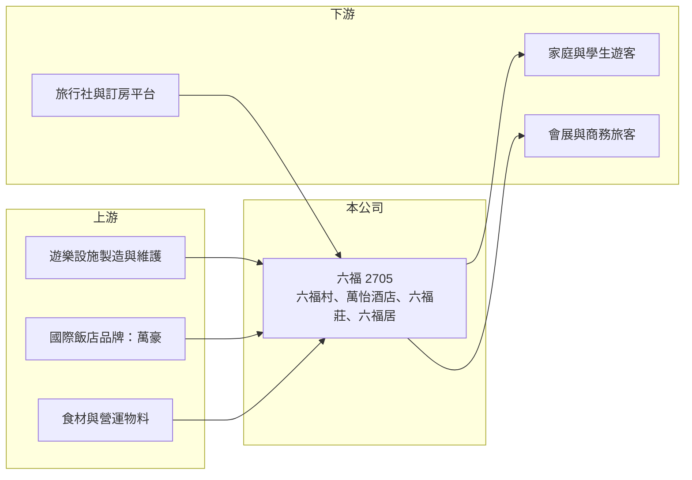

# 2705 六福

> 上市｜[[產業索引-觀光餐旅|觀光餐旅]]｜上市（櫃）日期 1988/12/24

# 第一章：企業模式與商業藍圖

> [!info] 撰寫說明
> 精簡版，由 Claude 依公開資料整理，架構比照 [[2330台積電]] 的四章研究，資料截至 2026-10-08。來源：Goodinfo 年度經營績效頁、富果研究 2025 年 6 月法說會整理、證交所開放資料（基本資料、2026 年第二季資產負債與綜合損益、營益分析、股利、每月營收）。各事業營收比重、入園人次與住房率未查得；負債組成為推估。#待校對

六福旅遊集團同時經營主題樂園與飯店，是台灣少數橫跨休閒遊樂與商務住宿的觀光公司。本章說明它的事業組合、資本密集的特性，以及長期虧損累積下的財務狀況。

## 一、核心定位：主題樂園加飯店的觀光集團

六福成立於 1968 年，1988 年上市，董事長為莊豐如、總經理為賴振融，實收資本額約 19.1 億元（證交所開放資料），員工約 800 人（富果研究）。主要事業如下（富果研究）：

* **六福村主題樂園與六福水樂園：** 位於新竹關西，台灣北部最具代表性的[[主題樂園]]之一。2025 年調整票價並推出「星光票」等彈性票種，水樂園則以夏季營運為主。
* **台北六福萬怡酒店：** 465 間客房，鄰近南港展覽館，大型展覽期間住房接近滿房；館內有粵菜「月亮」與全日餐廳「敘日」。依前一年財報，萬怡仍在努力轉虧為盈。
* **關西六福莊：** 162 間主題客房，與六福村相鄰，近年新增 300 人宴會廳承接會議展覽需求。
* **六福居：** 台北中山區 50 間服務式公寓客房，主打商務旅客。
* **其他：** 「一禮莊園」花藝與禮品服務。

依富果研究整理，前一年六福居、關西六福莊、六福村與水樂園皆有獲利，萬怡酒店則仍在改善中。

## 二、資本轉化邏輯：重資產、高固定成本

主題樂園與飯店都需要大量前期投資，營運後的折舊、人事與維修成本大多固定。只要入園人數或住房率提高，增加的營收大部分會轉為利潤；反之客流不足時就會虧損。六福村受天氣、季節與學生假期影響很大，營收集中在暑假與連假。

## 三、企業長期藍圖

公司在 2025 年法說會提出的方向包括（富果研究）：豐光大樓轉型為飯店式辦公室，預計 2026 年完成；關西六福莊二期已開始開發；在海外尋找新據點；以及改善萬怡酒店的獲利、在缺工環境下控制人事成本。長期而言，六福需要讓萬怡酒店穩定獲利，並把六福村與六福莊打造成可過夜的度假園區，提高每位旅客的消費金額。

# 第二章：護城河深度與競爭優勢

觀光休閒業的護城河來自稀缺的園區土地與品牌，本章分析六福的優勢與限制。

## 一、護城河的核心組成要素

* **主題樂園的進入門檻：** 大型主題樂園需要大面積土地、環評與數十億元投資，台灣北部能與六福村競爭的業者有限，既有園區具有地理上的稀缺性。
* **園區加住宿的組合：** 六福村、水樂園與關西六福莊相鄰，能提供「白天玩樂園、晚上住主題客房」的組合，提升客單價與停留時間。
* **國際品牌飯店：** 六福萬怡掛萬豪集團旗下品牌，可使用國際訂房系統與會員客源，南港展覽館的會展需求也提供商務客源。

## 二、主要競爭對手

| 對手 | 定位 | 與六福的比較 |
|---|---|---|
| 劍湖山、義大遊樂世界、麗寶樂園 | 中南部主題樂園 | 以地區客源為主，搶國內旅遊預算 |
| 九族文化村、小人國等 | 中小型樂園 | 搶學生團體與家庭客群 |
| [[2707晶華]]、[[2739寒舍]]、[[2704國賓]] | 台北飯店 | 搶商務與會展住宿客源 |
| 出國旅遊 | 日本、韓國等短程旅遊 | 國人出國旅遊是國內樂園最大的替代選擇 |

## 三、守得住與守不住

* **守得住：** 北台灣主題樂園的地位與園區土地，以及南港會展商圈的飯店客源。
* **守不住：** 國內旅遊需求。國人出國旅遊熱潮與少子化，使國內主題樂園的客源成長受限；2026 年 1 至 8 月累計營收約 14.37 億元，與去年同期大致持平（證交所每月營收）。
* **觀察重點：** 萬怡酒店能否穩定獲利、豐光大樓與六福莊二期的效益，以及財務結構能否改善到可以恢復配息。

# 第三章：財務體質與盈利規模

資料日期：2026-10-08，表格是撰寫當時的快照；最新月營收、毛利率、累計 EPS 由自動排程寫在本筆記的屬性欄位（月營收、毛利率、累計EPS 等）。#待校對

本章用多年度數據檢視六福在疫情後的復甦程度、財務結構與資本報酬。

## 一、多年度三率與 ROE

| 年度 | 營收（新台幣） | [[毛利率]] | [[營業利益率]] | EPS（元） | [[ROE]] |
|---|---|---|---|---|---|
| 2020 | 15.7 億 | 18.6% | -23.5% | -1.66 | -16.1% |
| 2021 | 12.6 億 | 5.46% | -38.5% | -1.46 | -7.43% |
| 2022 | 16.8 億 | 24.2% | -11.8% | -1.66 | -6.25% |
| 2023 | 22.1 億 | 34.0% | 3.43% | -0.51 | -2.01% |
| 2024 | 23.2 億 | 34.4% | 7.26% | 0.46 | 1.83% |
| 2025 | 22.9 億 | 32.7% | 6.58% | 0.87 | 3.37% |
| 2026 上半年 | 10.4 億 | 27.55% | -0.39% | -0.45 | 未查得 |

註：2020 至 2025 年取自 Goodinfo；2026 上半年取自證交所營益分析與綜合損益。

* **疫情後復甦：** 營收由 2021 年的 12.6 億元回升到 2023 年以後的 22 億至 23 億元，營業利益率在 2024 年達 7.26%。2020 至 2025 年營收年複合成長率約 7.8%（推算）。
* **季節性明顯：** 2026 年上半年營業利益率 -0.39%、稅前淨損約 0.86 億元，其中營業外淨損約 0.82 億元（證交所綜合損益）。上半年不含暑假旺季，加上利息等營業外支出，六福上半年通常較弱（推估）。
* **ROE：** 2021 至 2025 年平均 ROE 約 -2.1%（推算），直到 2024 年才轉正。

## 二、財務結構與股利

2026 年第二季底權益約 49.4 億元、總負債約 110.8 億元，其中流動負債約 52.7 億元，保留盈餘為約 -3.9 億元（證交所資產負債），負債比約 69%。2025 年度期初待彌補虧損約 18.8 億元，雖然當年獲利約 1.67 億元，仍不足以彌補，因此未配發股利（證交所股利資料）。高負債來自飯店與園區的長期投資，利息支出是營業外持續虧損的主要原因（推估）。

## 三、[[ROIC]] 與 [[WACC]]

**ROIC 推算：** 2025 年營業利益約 22.9 億元 × 6.58% ≈ 1.51 億元，稅後約 1.21 億元。投入資本以權益 49.4 億元加上假設有息負債約 80 億元（推估，依總負債規模）計算，約 129 億元，ROIC 約 0.9%（推算）。2026 年上半年營業利益為負，該期間 ROIC 為負值。

**WACC 推算：** 公債殖利率 1.75%、市場風險溢酬 6%、β 取觀光股常見值 0.8，權益成本約 6.55%；負債成本 2.5%、稅後 2.0%，以權益約 38%、負債約 62% 加權，WACC 約 3.7%（推算）。

**結論：** ROIC 低於 WACC，代表六福目前仍在侵蝕資本價值。重資產加上高負債的結構，使得營業利益扣除利息後所剩無幾。要扭轉這個局面，需要萬怡酒店穩定獲利、園區客流成長，並逐步降低負債。

# 第四章：總體風險與地緣政治

本章整理六福長期面對的需求、財務與營運風險。

## 一、需求面

* **少子化與出國旅遊：** 主題樂園的主要客群是家庭與學生，少子化與國人偏好出國旅遊，壓縮國內樂園的長期成長空間。
* **天氣與季節：** 颱風、暴雨與高溫會直接影響入園人數，營收高度集中在暑假與連假。
* **會展與商務景氣：** 萬怡酒店依賴南港展覽館的會展活動與商務旅客，展覽檔期與企業差旅預算的變化會影響住房率。

## 二、財務風險

* **高負債與利率：** 負債比約 69%，流動負債超過 50 億元，利率上升或再融資條件轉差時，財務壓力會加大。
* **累積虧損：** 帳上仍有待彌補虧損，短期內恢復配息的可能性有限。

## 三、營運風險

* **設施老化與安全：** 遊樂設施需要定期更新與嚴格的安全檢查，重大事故將衝擊品牌與營運。
* **缺工與人事成本：** 觀光業普遍缺工，基本工資調漲增加營運成本。
* **新事業執行：** 豐光大樓轉型、六福莊二期與海外據點都需要資本投入，若效益不如預期，將加重財務負擔。

# 專有名詞解析

## 金融

- **[[ROIC]]**：投入資本報酬率，衡量企業用股東與債權人投入的資本，每年能產生多少稅後營業利益。
- **[[WACC]]**：加權平均資金成本，股東要求報酬與負債利息依資本結構加權後的平均值，是判斷是否創造價值的門檻。

## 產業

- **[[主題樂園]]**：以特定主題規劃遊樂設施、表演與餐飲的大型休閒園區，投資大、固定成本高、營收受季節影響。
- **[[住房率]]**：飯店實際售出的房間數占可售房間數的比例，是衡量飯店需求的核心指標。

# 核心供應鏈

- 上游：遊樂設施製造與維護廠商、國際飯店品牌（萬豪集團）、食材與營運物料供應商。
- 下游／客戶：家庭與學生遊客、會展與商務旅客，以及旅行社如 [[2731雄獅]]、[[5706鳳凰]] 與線上訂房平台。
- 同業：劍湖山、義大遊樂世界、麗寶樂園（未上市或非本業上市公司）；飯店同業 [[2707晶華]]、[[2739寒舍]]、[[2704國賓]]、[[2722夏都]]。

## 最新新聞
<!-- news:start -->
<!-- news:end -->

## 相關連結
- [公開資訊觀測站](https://mopsov.twse.com.tw/mops/web/t05st03?step=1&firstin=1&co_id=2705)
- [Goodinfo](https://goodinfo.tw/tw/StockDetail.asp?STOCK_ID=2705)
- [Yahoo 股市](https://tw.stock.yahoo.com/quote/2705)
- [鉅亨網新聞](https://www.cnyes.com/twstock/2705/news)
