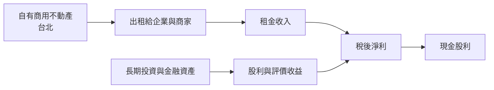
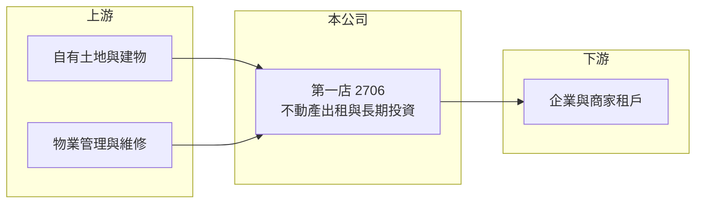

# 2706 第一店

> 上市｜[[產業索引-觀光餐旅|觀光餐旅]]｜上市（櫃）日期 1991/06/25

# 第一章：企業模式與商業藍圖

> [!info] 撰寫說明
> 精簡版，由 Claude 依公開資料整理，架構比照 [[2330台積電]] 的四章研究，資料截至 2026-10-08。來源：Goodinfo 年度經營績效頁、證交所開放資料（基本資料、2026 年第二季資產負債與綜合損益、營益分析、股利、每月營收）。公開資料有限，本次未查得公司持有的不動產明細、租戶與轉投資標的；飯店歷史與目前以收租為主的描述依記憶與財務結構推論，標示待校對。#待校對

第一店（第一大飯店股份有限公司）被歸類為觀光餐旅股，但從財務結構看，它目前是一家以不動產出租與長期投資為主的資產型公司。本章說明它的獲利來源與經營特徵。

## 一、核心定位：飯店起家的收租型資產公司

第一店成立於 1968 年，1991 年上市，董事長為顧安生、總經理為徐小華，實收資本額約 50 億元（證交所開放資料）。公司原本經營台北南京東路的第一大飯店（待校對），目前的營收結構顯示以[[不動產租賃]]為主：2025 年營收約 3.77 億元，毛利率 78.2%、營業利益率 69.4%（Goodinfo），這種「高毛利、低費用、營收規模小」的組合，是典型的收租型公司，而非實際經營飯店的公司（飯店業的營業利益率通常只有個位數到 15% 左右）。

除了租金，公司也持有金融資產。2026 年上半年營業外收入約 1.02 億元、其他綜合損益約 1.51 億元（證交所綜合損益），代表股利收入與金融資產評價對獲利與股東權益都有相當影響。

## 二、商業模式

收租型公司的經營重點在於維持出租率、適時調整租金，並管理好資產的維修與投資組合。營收規模不會大幅成長，但現金流穩定，資本支出主要是建物維護。

## 三、長期方向

老舊商用不動產的長期價值，取決於地段與是否進行改建或[[資產活化]]。台北市近年有多件老飯店、老商辦以都更或危老方式重建，第一店是否有類似計畫，本次未查得相關資料。在缺乏改建計畫的情況下，公司的長期表現大致會維持「穩定收租加投資收益」的模式。

# 第二章：護城河深度與競爭優勢

收租型公司的競爭力來自資產本身，本章分析第一店的優勢與限制。

## 一、競爭優勢

* **台北地段資產：** 持有台北商用不動產數十年，土地帳面成本低，市場價值可能遠高於帳面（推估）。
* **財務保守：** 2026 年第二季底總負債約 17.6 億元、權益約 102.8 億元（證交所資產負債），負債比約 15%，幾乎不依賴財務槓桿。
* **穩定的租金收入：** 營收長期穩定在 2.5 億至 3.8 億元之間，2022 年後營業利益率維持在 68% 以上。

## 二、主要比較對象

| 比較對象 | 定位 | 與第一店的比較 |
|---|---|---|
| [[2701萬企]] | 西門町商用大樓出租與育樂 | 同樣是觀光類股中的收租型資產公司 |
| 台北商辦與商場業主 | 爭取企業與商家租戶 | 租戶市場的競爭 |

## 三、守得住與守不住

* **守得住：** 地段帶來的長期租金與穩定現金流。
* **守不住：** 資本效率。帳上資產約 120 億元，每年稅後淨利只有約 3 億元，ROE 長期在 3% 左右（Goodinfo）。
* **觀察重點：** 租約續約與租金調整、金融資產的表現，以及是否有不動產改建或活化計畫。

# 第三章：財務體質與盈利規模

資料日期：2026-10-08，表格是撰寫當時的快照；最新月營收、毛利率、累計 EPS 由自動排程寫在本筆記的屬性欄位（月營收、毛利率、累計EPS 等）。#待校對

本章用多年度數據檢視第一店的收租收入、業外收益與資本報酬。

## 一、多年度三率與 ROE

| 年度 | 營收（新台幣） | [[毛利率]] | [[營業利益率]] | EPS（元） | [[ROE]] |
|---|---|---|---|---|---|
| 2020 | 2.65 億 | 72.7% | 62.4% | 0.32 | 1.75% |
| 2021 | 2.53 億 | 76.0% | 66.5% | 0.16 | 0.87% |
| 2022 | 2.91 億 | 78.2% | 68.6% | 0.60 | 3.24% |
| 2023 | 3.43 億 | 77.2% | 68.6% | 0.60 | 3.08% |
| 2024 | 3.56 億 | 76.9% | 68.0% | 0.56 | 2.77% |
| 2025 | 3.77 億 | 78.2% | 69.4% | 0.65 | 3.21% |
| 2026 上半年 | 1.78 億 | 76.35% | 67.38% | 0.35 | 未查得 |

註：2020 至 2025 年取自 Goodinfo；2026 上半年取自證交所營益分析與綜合損益。

* **穩定小幅成長：** 2020 至 2025 年營收年複合成長率約 7.3%（推算），主要來自租金調整與疫情後的恢復。2026 年 1 至 8 月累計營收約 2.58 億元、年增約 1.7%（證交所每月營收）。
* **業外收益占比高：** 2026 年上半年營業利益約 1.20 億元，營業外收入約 1.02 億元，稅後純益率達 98.94%（證交所營益分析），淨利有將近一半來自[[業外收益]]。
* **ROE 偏低：** 2021 至 2025 年平均 ROE 約 2.6%（推算），因為股東權益約 103 億元，而年淨利只有約 3 億元。

## 二、股利與財務結構

2025 年度配發現金股利 0.35 元，以 2025 年本期淨利約 3.26 億元、約 5 億股計算，EPS 約 0.65 元，配發率約 54%（證交所股利資料，推算）。收租型公司資本支出低，自由現金流長期為正（推估）。

## 三、[[ROIC]] 與 [[WACC]]

**ROIC 推算：** 2025 年營業利益約 3.77 億元 × 69.4% ≈ 2.62 億元，稅後約 2.09 億元。投入資本以權益約 102.8 億元計算（有息負債極少），ROIC 約 2.0%（推算）。若把投資收益計入，整體資本報酬約與 ROE 相近，約 3%。

**WACC 推算：** 公債殖利率 1.75%、市場風險溢酬 6%、β 取資產型公司常見值 0.5，權益成本約 4.75%；幾乎無負債，WACC 約 4.7%（推算）。

**結論：** 以帳面資本計算，第一店的 ROIC 低於資金成本，代表大量資產並未產生相應的報酬。這類公司的價值主要在於資產本身與穩定的股利，而非獲利成長；股東報酬能否提升，取決於經營層是否活化資產或提高配發率。

# 第四章：總體風險與地緣政治

本章整理第一店長期面對的租賃、資產與治理風險。

## 一、租賃市場

* **租戶與出租率：** 收入集中在少數不動產，主要租戶退租或租金下修，對營收的影響較大（租戶明細未查得）。
* **商圈變化：** 台北商辦與商圈的供需變化，例如新商辦大量完工，可能壓抑老舊建物的租金。

## 二、資產與投資

* **建物老化：** 老舊建物的維修成本逐年增加，若未來改建，改建期間將失去租金收入。
* **金融資產波動：** 業外收益與其他綜合損益受金融市場影響，股市下跌時 EPS 與淨值都會下降。

## 三、其他風險

* **成長性有限：** 缺乏明確的擴張或活化計畫時，營收長期維持小幅成長，股東報酬以股利為主。
* **法規與稅負：** 房屋稅、地價稅與都市計畫法規調整，會影響持有成本與改建可行性。

# 專有名詞解析

## 金融

- **[[業外收益]]**：本業以外的收入，例如投資收益、股利、利息與資產處分利得，波動通常較大。
- **[[ROIC]]**：投入資本報酬率，衡量企業用股東與債權人投入的資本，每年能產生多少稅後營業利益。
- **[[WACC]]**：加權平均資金成本，股東要求報酬與負債利息依資本結構加權後的平均值，是判斷是否創造價值的門檻。

## 產業

- **[[不動產租賃]]**：企業持有房地產出租給他人使用，以租金作為主要收入來源的商業模式。
- **[[資產活化]]**：企業將閒置或低度使用的土地、建物，透過改建、出租、合建或出售等方式提高收益。

# 核心供應鏈

- 上游：自有土地與建物、物業管理與維修服務。
- 下游／客戶：企業與商家租戶（明細未查得）。
- 同業：[[2701萬企]] 等觀光類股中的收租型資產公司。

## 最新新聞
<!-- news:start -->
<!-- news:end -->

## 相關連結
- [公開資訊觀測站](https://mopsov.twse.com.tw/mops/web/t05st03?step=1&firstin=1&co_id=2706)
- [Goodinfo](https://goodinfo.tw/tw/StockDetail.asp?STOCK_ID=2706)
- [Yahoo 股市](https://tw.stock.yahoo.com/quote/2706)
- [鉅亨網新聞](https://www.cnyes.com/twstock/2706/news)
