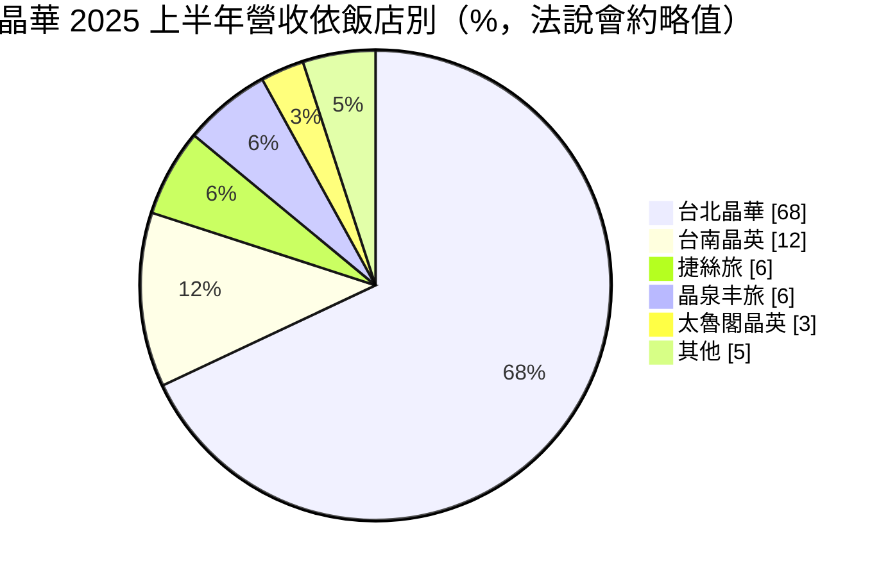
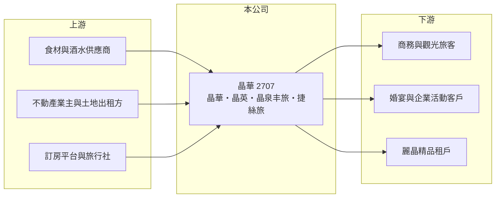

# 2707 晶華

> 上市｜[[產業索引-觀光餐旅|觀光餐旅]]｜上市（櫃）日期 1998/03/09

# 第一章：企業模式與商業藍圖

> [!info] 撰寫說明
> 精簡版，由 Claude 依公開資料整理，架構比照 [[2330台積電]] 的四章研究，資料截至 2026-10-08。財務數字來源：Goodinfo 年度經營績效頁、富果研究整理的 2025 年 9 月法說會摘要、優分析 2025 年 11 月報導、證交所開放資料（基本資料、2026 年第二季資產負債與綜合損益、營益分析、股利、本益比）。#待校對

在評估一家飯店公司的長期價值時，首先要看它靠什麼賺錢：是靠擁有不動產，還是靠品牌與經營能力。本章說明晶華國際酒店集團（股票代號：2707，以下簡稱晶華）如何以台北晶華酒店為現金核心，再用多品牌與管理合約擴張，走向較[[輕資產]]的飯店集團。

- **核心業務：** 晶華成立於 1976 年，1998 年上市，董事長為潘思亮，實收資本額約 12.7 億元。旗下品牌由高到低分為晶華（五星）、晶英、晶泉丰旅、晶英薈旅（四星）與捷絲旅（三星），依 2025 年法說會摘要，集團共營運 15 間酒店、約 2,444 間客房，海外據點為日本大阪心齋橋捷絲旅。多品牌讓晶華能用同一套管理系統，分別服務高端商務客、度假客與平價旅客。
- **營收結構：** 依 2025 年上半年法說會摘要，台北晶華酒店約占集團營收 68%，台南晶英約 12%，捷絲旅與晶泉丰旅各約 6%，太魯閣晶英約 3%。台北晶華內部以餐飲為主（約 60%），客房約 23%，地下樓層的麗晶精品約 15%。這代表晶華本質上是一家「以餐飲撐起的飯店」，宴會、自助餐、外燴與尾牙桌數對獲利的影響，不亞於[[住房率]]與[[平均房價]]。
- **營運據點：** 主要據點集中在台灣，台北、台南、礁溪、北投、花蓮太魯閣等地各有飯店。太魯閣晶英受 2024 年花蓮地震與國家公園封閉影響，2025 年上半年住房率只有約 23%，顯示單一景區飯店受天災影響的程度很大。
- **長期方向：** 依法說會摘要，2027 至 2029 年預計新開 5 間酒店：2027 年新北林口晶英薈旅與捷絲旅（與東森集團合作）、2028 年宜蘭頭城晶泉丰旅與屏東墾丁白沙灣捷絲旅、2029 年大阪心齋橋捷絲旅二館。新案以管理合約或租賃為主，不必自己買地蓋樓，資本支出較少，這是晶華能維持高配息的重要前提。

# 第二章：護城河深度與競爭優勢

本章分析晶華的護城河。飯店業進入門檻看似不高，但頂級飯店的品牌、地段與餐飲口碑很難在短期複製。

- **競爭優勢：** 台北晶華位於中山商圈，經營三十多年累積的宴會與餐飲口碑（例如自助餐、烤鴨、外燴尾牙）讓它在節慶與企業活動中有很強的定價能力，2025 年跨年平均房價有望突破 1 萬元。其次，晶華有自建品牌與管理團隊，可以用管理合約替業主經營飯店，賺取管理費而不必承擔建物成本，這讓集團擴張時資本報酬率不易被稀釋。
- **多品牌與會員：** 從五星到三星的品牌階梯，讓晶華在景氣好時賺高端客，景氣差時仍有平價的捷絲旅接住國旅需求。旅展與住宿券、餐券（2025 年台北國際旅展預估約 1.5 億元收入）也讓公司能提前收到現金，平滑淡旺季。
- **主要對手：** 台北五星級飯店同業如 [[2704國賓]]、[[2739寒舍]]（台北喜來登、艾美）、[[2748雲品]]（台北君品、日月潭雲品），連鎖旅館可對照 [[2705六福]]；國際連鎖品牌則有萬豪、凱悅、洲際等集團在台飯店。
- **觀察重點：** 第一，台北晶華以外的飯店能否把營收占比拉高，降低單一據點集中度；第二，2027 年起林口、頭城、墾丁新館能否如期開幕並在兩至三年內損益兩平；第三，太魯閣晶英何時恢復正常營運。

# 第三章：財務體質與盈利規模

資料日期：2026-10-08，表格是撰寫當時的快照；最新月營收、毛利率、累計 EPS 由自動排程寫在本筆記的屬性欄位（月營收、毛利率、累計EPS 等）。#待校對

本章用多年度三率、ROE 與資本報酬，檢視晶華的獲利品質。

| 年度 | 營收（新台幣） | [[毛利率]] | [[營業利益率]] | EPS（元） | [[ROE]] |
|---|---|---|---|---|---|
| 2021 | 49.3 億 | 27.0% | 10.9% | 17.09 | 50.8% |
| 2022 | 56.0 億 | 33.3% | 21.8% | 7.09 | 20.6% |
| 2023 | 67.7 億 | 37.2% | 27.2% | 11.11 | 31.6% |
| 2024 | 63.0 億 | 31.6% | 23.5% | 10.57 | 27.3% |
| 2025 | 68.3 億 | 32.7% | 25.0% | 11.42 | 31.6% |
| 2026 上半年 | 36.1 億 | 34.8% | 27.3% | 8.62 | 未查得 |

註：2021 至 2025 年取自 Goodinfo，2026 上半年取自證交所營益分析與綜合損益表。

- **營收規模：** 疫情後 2023 年營收回到 67.7 億元，之後維持在 63 億至 68 億元之間，2021 至 2025 年營收年複合成長率約 8.5%（推算）。成長主要來自餐飲與北投晶泉丰旅等新館，而不是大量新增房間。
- **獲利結構：** 2023 年以後營業利益率穩定在 23% 至 27%，在飯店業屬於很高的水準，反映高端餐飲的毛利與管理費收入。2021 年 EPS 17.09 元遠高於當年本業獲利，主要來自業外收益（推估與品牌股權處分相關，待校對）；2026 年上半年業外收入約 4.0 億元，也明顯墊高 EPS，來源本文未查得，評估本業時應以營業利益為準。
- **長期指標：** 2021 至 2025 年平均 ROE 約 32%（推算）。2025 年度配發現金股利約 10.75 元，以 EPS 11.42 元計算配息率約 94%（證交所資料推算）。高 ROE 一部分來自高配息讓股東權益維持在低檔，另一部分來自輕資產擴張。
- **財務特色：** 2026 年第二季底總資產約 96.3 億元，負債約 55.5 億元，其中非流動負債約 31.5 億元，推估大部分是飯店租約產生的[[租賃負債]]；權益約 40.8 億元。

**[[ROIC]] 與 [[WACC]]：** 2025 年營業利益約 17.1 億元（68.3 億 × 25.0%），稅後約 13.7 億元；投入資本以 2026 年第二季權益 40.8 億元加上非流動負債 31.5 億元（作為有息負債與租賃負債的代理）合計約 72.3 億元，ROIC 約 19%（推算）。WACC 以 CAPM 推估：無風險利率 1.75%、市場風險溢酬 6%、β 取觀光飯店股常見值 0.8，股東權益成本約 6.55%；負債成本 2.75%、稅後 2.2%；權益約占 56%，WACC 約 4.6%（推算）。ROIC 長期高出 WACC 十個百分點以上，代表晶華是持續創造價值的飯店公司，關鍵在於維持高端餐飲的定價能力與管理合約的輕資產擴張。

# 第四章：總體風險與地緣政治

本章分析晶華長期面對的風險。

- **產業週期：** 飯店與餐飲需求跟著經濟景氣、企業活動與觀光客流量變動，疫情期間（2020 至 2022 年）即出現大幅衰退。國人出國熱潮也會分流國內住宿與餐飲需求，影響度假型飯店。
- **營運風險：** 台北晶華占集團營收近七成，若該館因整修、租約或競爭新飯店開幕而表現轉弱，集團獲利會受到明顯影響。新館開幕初期通常虧損，2027 至 2029 年多館同時開幕時，前期費用可能壓低利潤率。
- **其他風險：** 基本工資與電價調漲會直接推升人事與能源成本；天災（如 2024 年花蓮地震）會使景區飯店長期停擺；外幣資產與海外據點使公司面臨匯兌損益，2025 年初就曾出現約 7,000 萬元的美元匯兌損失。

# 專有名詞解析

## 金融

- **[[租賃負債]]**：依 IFRS 16，承租人須把長期租約未來應付租金折現認列為負債，飯店與餐飲業的金額通常很大。
- **[[ROIC]]**：投入資本報酬率，稅後營業利益除以股東權益與有息負債的合計，衡量本業對所有資金提供者的報酬。
- **[[WACC]]**：加權平均資金成本，依股東權益與負債的比重加權計算的資金成本，ROIC 高於它才代表創造價值。

## 產業

- **[[住房率]]**：已售出客房數占可售客房數的比例，是衡量飯店需求最直接的指標。
- **[[平均房價]]**：已售出客房的平均每晚房價，與住房率相乘即可推算每間可售客房的收入。
- **[[輕資產]]**：不自己擁有土地與建物，改以管理合約或租賃擴張，降低資本支出並提高資本報酬率的經營方式。

# 核心供應鏈

- 上游：生鮮食材與酒水供應商、提供飯店建物或土地的業主（管理合約與租賃合作對象，如東森集團的林口案），以及國內外訂房平台與旅行社。
- 下游／客戶：國內外商務與觀光旅客、婚宴與企業尾牙客戶、餐券與住宿券消費者，以及麗晶精品的精品品牌租戶。
- 同業：[[2704國賓]]、[[2739寒舍]]、[[2748雲品]]、[[2705六福]]、[[2722夏都]]。

## 最新新聞
<!-- news:start（自動產生，請勿手動編輯此範圍） -->
- 2026-10-08 📰 媒體 10:30｜晶華9月營收創同期高 樂看飯店餐飲業Q4續迎利多｜[鉅亨網](https://news.cnyes.com/news/id/6624617)

完整紀錄：[[2707晶華 新聞]]
<!-- news:end -->

## 相關連結
- [公開資訊觀測站](https://mopsov.twse.com.tw/mops/web/t05st03?step=1&firstin=1&co_id=2707)
- [Goodinfo](https://goodinfo.tw/tw/StockDetail.asp?STOCK_ID=2707)
- [Yahoo 股市](https://tw.stock.yahoo.com/quote/2707)
- [鉅亨網新聞](https://www.cnyes.com/twstock/2707/news)
