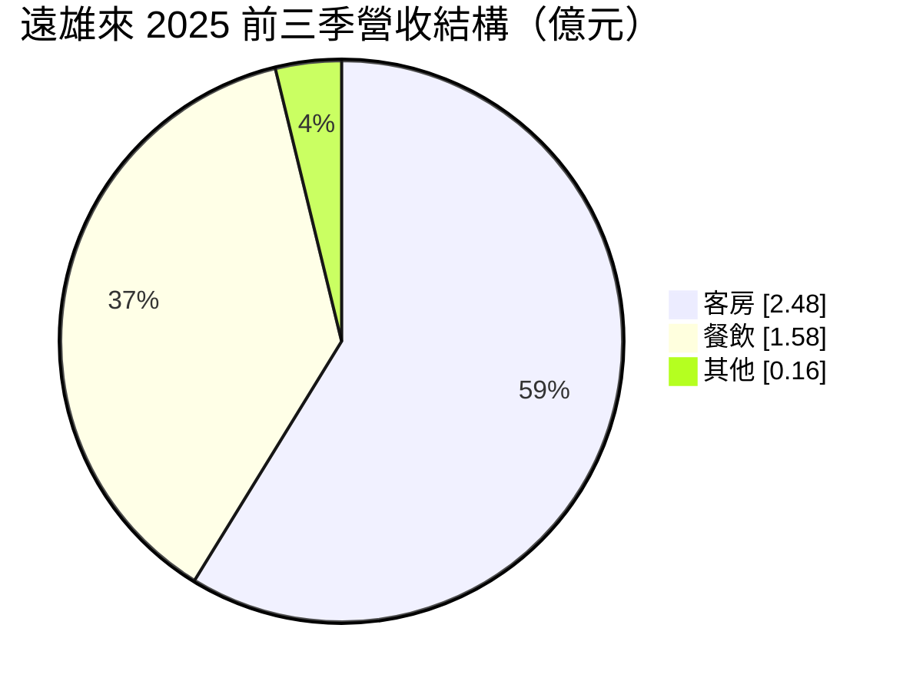
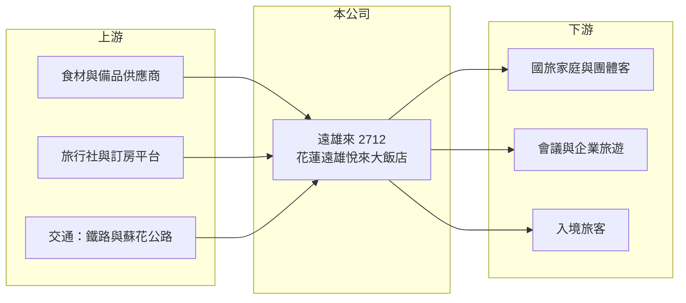

# 2712 遠雄來

> 上市｜[[產業索引-觀光餐旅|觀光餐旅]]｜上市（櫃）日期 2013/12/03

# 第一章：企業模式與商業藍圖

> [!info] 撰寫說明
> 精簡版，由 Claude 依公開資料整理，架構比照 [[2330台積電]] 的四章研究，資料截至 2026-10-08。財務數字來源：Goodinfo 年度經營績效頁、富果研究整理的 2025 年 11 月法說會摘要、證交所開放資料（基本資料、2026 年第二季資產負債與綜合損益、營益分析、股利、本益比）。公開資料有限。#待校對

評估單一飯店公司時，最重要的是理解它的地點決定了什麼樣的客源與風險。本章說明遠雄來（股票代號：2712，以下簡稱遠雄來）作為花蓮單一度假飯店經營者的商業模式，以及為什麼它的命運高度綁定花蓮觀光。

- **核心業務：** 遠雄來成立於 1991 年，2013 年上市，屬遠雄集團旗下，董事長為武祥生，實收資本額 10.5 億元。公司經營花蓮的遠雄悅來大飯店，提供山景與海景客房、自助餐與中西日式餐廳、SPA 與商店街，客群以家庭旅遊、團體旅客與國旅度假客為主。
- **營收結構：** 依 2025 年前三季法說會資料，營收 4.23 億元中客房約 2.48 億元（約 59%）、餐飲約 1.58 億元（約 37%）、其他約 0.16 億元。度假飯店的客人通常在館內用餐，所以餐飲收入與[[住房率]]高度連動，住客一少，兩個部門會同時下滑。
- **營運據點：** 只有花蓮一個據點。依法說會引用的資料，2025 年上半年它在花蓮觀光旅館中營收與住客房間數都居第一，但花蓮觀光旅館的總房間數也從 2023 年的 1,403 間降到 2024 年的 1,038 間，顯示區域市場本身在萎縮。
- **長期方向：** 公司提出獲利、品牌、管理、永續四大策略，包括調整客群結構、擴大線上與線下通路、會員經營與數位轉型。沒有公布新館或擴張計畫，未來仍以單館營運效率為主。

# 第二章：護城河深度與競爭優勢

本章分析遠雄來的競爭優勢與限制。它的優勢來自地點與規模，弱點也來自單一地點。

- **競爭優勢：** 遠雄悅來位於花蓮山海景觀區，規模是當地觀光旅館中的領先者，能承接大型團體、會議與家庭客。集團資源也讓它在通路合作與品牌信任上，比當地小型旅館更有優勢。
- **限制與弱點：** 單館經營代表沒有分散風險的能力。花蓮交通（蘇花公路、鐵路一票難求）與天災直接決定客源，2024 年 4 月花蓮強震後，當年營收從 6.56 億元掉到 3.55 億元，毛利率轉為負值。這類衝擊不是經營團隊能控制的。
- **主要對手：** 花蓮當地的觀光飯店與度假村，以及 [[2707晶華]] 旗下的太魯閣晶英；廣義來說，宜蘭、台東與南部的度假飯店也在搶同一批國旅客，例如 [[2736富野]]、[[2722夏都]]、[[2705六福]]。
- **觀察重點：** 第一，花蓮觀光人次能否回到 2023 年的水準；第二，住房率能否穩定在六成以上（2025 年暑期目標約六成）；第三，累積虧損何時彌補、何時恢復配息。

# 第三章：財務體質與盈利規模

資料日期：2026-10-08，表格是撰寫當時的快照；最新月營收、毛利率、累計 EPS 由自動排程寫在本筆記的屬性欄位（月營收、毛利率、累計EPS 等）。#待校對

本章用多年度三率、ROE 與資本報酬，檢視遠雄來的財務體質。

| 年度 | 營收（新台幣） | [[毛利率]] | [[營業利益率]] | EPS（元） | [[ROE]] |
|---|---|---|---|---|---|
| 2020 | 5.73 億 | 39.0% | 17.5% | 0.93 | 7.90% |
| 2021 | 3.51 億 | 19.4% | -10.9% | -0.20 | -1.68% |
| 2022 | 5.33 億 | 29.2% | 5.32% | 0.23 | 2.00% |
| 2023 | 6.56 億 | 30.0% | 8.70% | 0.47 | 3.96% |
| 2024 | 3.55 億 | -6.88% | -42.6% | -1.42 | -12.8% |
| 2025 | 5.25 億 | 19.2% | -7.17% | -0.38 | -3.86% |
| 2026 上半年 | 2.58 億 | 17.6% | -9.22% | -0.21 | 未查得 |

註：2020 至 2025 年取自 Goodinfo，2026 上半年取自證交所營益分析與綜合損益表。

- **營收規模：** 正常年度營收約 5 億至 6.5 億元，疫情（2021 年）與地震（2024 年）都讓營收腰斬，顯示這家公司的營收波動主要來自外部事件，而不是產業成長。
- **獲利結構：** 飯店的人事、折舊與維修是固定成本，[[營運槓桿]]很高：2023 年營收 6.56 億元時營業利益率 8.7%，2024 年營收掉到 3.55 億元時營業利益率變成 -42.6%。換句話說，營收要回到 6 億元以上，公司才有明顯獲利。
- **長期指標：** 2021 至 2025 年平均 ROE 約 -2.5%（推算）。2025 年度未配發股利，2026 年第二季底保留盈餘為負約 1.54 億元（證交所資料）。
- **財務特色：** 2026 年第二季底總資產約 16.2 億元，負債約 6.2 億元，其中非流動負債約 2.5 億元，權益約 10.0 億元，負債比約 38%。財務結構不算緊繃，但連續虧損會持續侵蝕淨值。

**[[ROIC]] 與 [[WACC]]：** 2025 年營業利益約 -0.38 億元（5.25 億 × -7.17%），稅後營業利益為負；投入資本以權益 10.0 億元加上非流動負債 2.5 億元（作為有息負債代理）合計約 12.5 億元，ROIC 約 -2.4%（推算）。WACC 以 CAPM 推估：無風險利率 1.75%、市場風險溢酬 6%、β 取小型觀光股常見值 0.9，股東權益成本約 7.15%；負債成本 2.75%、稅後 2.2%；權益約占 80%，WACC 約 6.2%（推算）。ROIC 為負代表近年本業在消耗股東資本，即使在正常年度（2023 年）ROIC 也只有約 3.7%（推算：6.56 億 × 8.7% × 0.8 ÷ 12.5 億），仍低於 WACC，單一度假飯店的資本報酬偏低是長期結構問題。

# 第四章：總體風險與地緣政治

本章分析遠雄來長期面對的風險。

- **產業週期：** 國旅需求受經濟景氣、出國旅遊熱潮與政府補助影響。疫情後國人大量出國，國內度假飯店面臨需求分流，平日住房率尤其偏低。
- **營運風險：** 單一據點、單一區域，花蓮交通瓶頸與觀光景點封閉（如太魯閣國家公園）都會直接減少客源。建物老化後的整修支出也會壓縮現金流。
- **其他風險：** 地震、颱風與豪雨是花蓮的常態風險，2024 年強震已證明影響可以長達一年以上；基本工資與電價調漲推高固定成本；集團關係人交易與資源調度也值得留意。

# 專有名詞解析

## 金融

- **[[營運槓桿]]**：固定成本占比高時，營收小幅變動會使營業利益大幅變動的現象。
- **[[ROIC]]**：投入資本報酬率，稅後營業利益除以股東權益與有息負債的合計，衡量本業對所有資金提供者的報酬。
- **[[WACC]]**：加權平均資金成本，依股東權益與負債的比重加權計算的資金成本，ROIC 高於它才代表創造價值。

## 產業

- **[[住房率]]**：已售出客房數占可售客房數的比例，是衡量飯店需求最直接的指標。

# 核心供應鏈

- 上游：食材、備品與能源供應商，國內旅行社與線上訂房平台，以及決定客源能否抵達的鐵路與公路運輸。
- 下游／客戶：國內家庭旅遊與團體客、企業會議與員工旅遊、入境觀光客。
- 同業：[[2707晶華]]、[[2736富野]]、[[2722夏都]]、[[2705六福]]。

## 最新新聞
<!-- news:start -->
<!-- news:end -->

## 相關連結
- [公開資訊觀測站](https://mopsov.twse.com.tw/mops/web/t05st03?step=1&firstin=1&co_id=2712)
- [Goodinfo](https://goodinfo.tw/tw/StockDetail.asp?STOCK_ID=2712)
- [Yahoo 股市](https://tw.stock.yahoo.com/quote/2712)
- [鉅亨網新聞](https://www.cnyes.com/twstock/2712/news)
