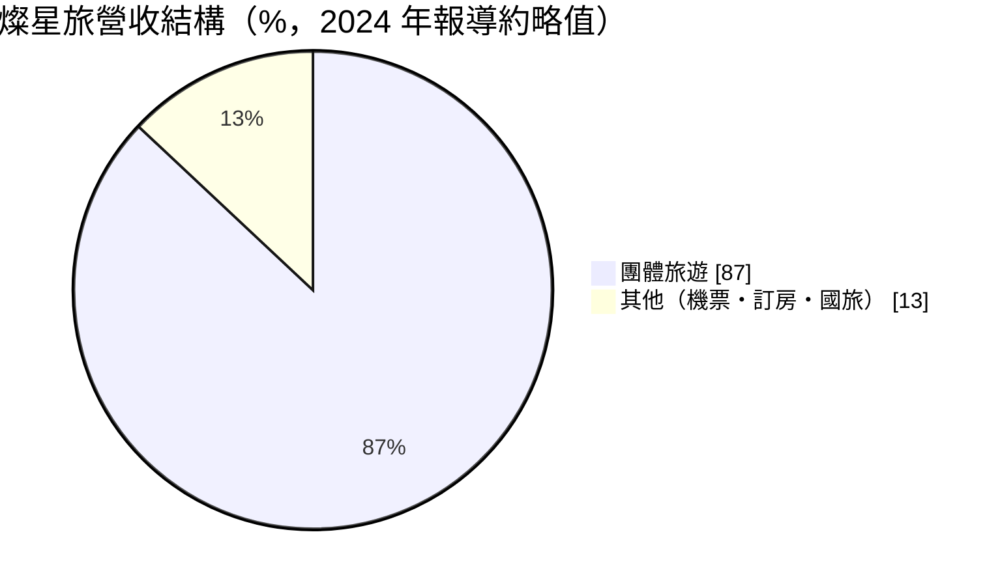
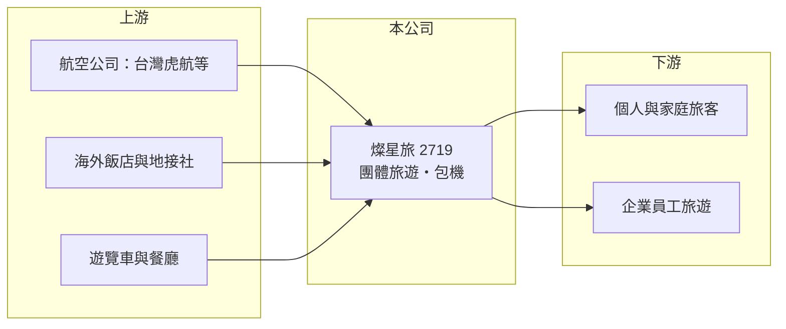

# 2719 燦星旅

> 上櫃｜[[產業索引-觀光餐旅|觀光餐旅]]｜上市（櫃）日期 2012/02/24

# 第一章：企業模式與商業藍圖

> [!info] 撰寫說明
> 精簡版，由 Claude 依公開資料整理，架構比照 [[2330台積電]] 的四章研究，資料截至 2026-10-08。財務數字來源：Goodinfo 年度經營績效頁、理財周刊 2024 年報導、科技新報公司資料頁、櫃買中心開放資料（基本資料、2026 年第二季資產負債與綜合損益、每月營收、本益比）。公開資料有限。#待校對

旅行社的商業模式看似簡單，就是把機位、飯店與行程組合起來賣給旅客，但真正決定獲利的是能不能用合理成本拿到機位，以及能不能把團出滿。本章說明燦星旅（股票代號：2719，正式名稱為台鋼燦星國際旅行社，以下簡稱燦星旅）如何以團體旅遊與[[包機]]為主軸經營。

- **核心業務：** 燦星旅成立於 2003 年，2012 年上櫃，董事長為侯佑霖，實收資本額約 6.9 億元。公司名稱冠上「台鋼」，代表已納入台鋼集團體系（入主年份待校對）。主要業務是出國團體旅遊，另有機票、訂房與國內旅遊等服務。
- **營收結構：** 依 2024 年報導，團體旅遊約占營收 87%。旅行社的營收是以團費「總額」入帳，其中大部分是要付給航空公司與地接社的成本，所以營收很大但[[毛利率]]通常只有 5% 至 15%，真正賺的是組團的價差與服務費。
- **營運據點：** 依 2024 年報導，公司在六都設有 7 間分公司，計畫再進駐新北市。實體分公司負責團體業務與客服，網路則負責行銷與接單。
- **長期方向：** 公司以包機切入差異化市場，曾自桃園包機直飛日本高知、秋田與泰國普吉島，也與 [[6757台灣虎航]] 合作推出台中出發的東京、名古屋與釜山航線。包機能取得一般航班沒有的航點，但也要承擔機位賣不完的風險。

# 第二章：護城河深度與競爭優勢

本章分析燦星旅的競爭優勢與限制。旅行社的進入門檻不高，差異主要在通路、機位取得與品牌信任。

- **競爭優勢：** 包機與區域航點（高知、秋田、台中出發航線）是燦星旅與大型同業做出區隔的方式，能吸引想去冷門日本地區的旅客。集團背景則有助於取得企業客戶與資金支持。
- **限制與弱點：** 規模明顯小於雄獅，議價能力與品牌知名度有限。疫情期間（2020 至 2022 年）營收幾乎歸零，連續虧損，說明輕資產的旅行社雖然不用養工廠，但人事與門市固定成本在需求消失時仍會快速侵蝕淨值。
- **主要對手：** [[2731雄獅]]、[[2743山富]]、[[2706第一店]]、[[6961旅天下]]、[[2734易飛網]]、[[5706鳳凰]]，以及 Klook、KKday 等線上旅遊平台。
- **觀察重點：** 第一，營收能否回到 2024 年的 20 億元以上水準（2026 年前 8 月累計營收年減約 23%）；第二，2026 年上半年營業利益率約 6% 的改善能否延續；第三，包機航線的載客率與獲利。

# 第三章：財務體質與盈利規模

資料日期：2026-10-08，表格是撰寫當時的快照；最新月營收、毛利率、累計 EPS 由自動排程寫在本筆記的屬性欄位（月營收、毛利率、累計EPS 等）。#待校對

本章用多年度三率、ROE 與資本報酬，檢視燦星旅的財務體質。

| 年度 | 營收（新台幣） | [[毛利率]] | [[營業利益率]] | EPS（元） | [[ROE]] |
|---|---|---|---|---|---|
| 2020 | 1.60 億 | 18.1% | -64.9% | -4.28 | -121% |
| 2021 | 0.33 億 | 15.6% | -180% | -1.29 | -71.6% |
| 2022 | 0.82 億 | -0.05% | -90.3% | -1.16 | -16.0% |
| 2023 | 11.0 億 | 10.5% | -3.80% | 1.53 | 18.7% |
| 2024 | 22.9 億 | 4.41% | -4.33% | 1.26 | 13.1% |
| 2025 | 19.6 億 | 5.21% | -1.43% | -0.15 | -1.42% |
| 2026 上半年 | 8.50 億 | 14.6% | 6.01% | 0.55 | 未查得 |

註：2020 至 2025 年取自 Goodinfo，2026 上半年取自櫃買中心綜合損益表推算。

- **營收規模：** 2023 年國境解封後營收從 0.8 億元跳到 11 億元，2024 年再翻倍到 22.9 億元，2025 年小降到 19.6 億元。營收主要隨出國旅遊需求與公司接團量變動。
- **獲利結構：** 2023 至 2025 年營業利益率都是負值，但 2023、2024 年 EPS 為正，代表獲利來自[[業外收益]]而非本業（業外來源本文未查得）。2026 年上半年毛利率升到約 14.6%、營業利益約 0.51 億元，是近年首次本業有明顯獲利，但同期營收規模縮小，代表公司可能在減少低毛利的團或票務。
- **長期指標：** 2021 至 2025 年平均 ROE 約 -11%（推算），受疫情年度拖累；近年未配發現金股利（櫃買中心本益比資料）。
- **財務特色：** 2026 年第二季底總資產約 10.3 億元，負債約 2.8 億元（幾乎都是流動負債，推估以預收團費為主），權益約 7.5 億元，非流動負債僅約 0.1 億元，財務槓桿很低。

**[[ROIC]] 與 [[WACC]]：** 2025 年營業利益約 -0.28 億元（19.6 億 × -1.43%），稅後營業利益為負；投入資本以權益 7.5 億元加上非流動負債 0.1 億元合計約 7.6 億元，ROIC 約 -3%（推算）。若以 2026 年上半年營業利益 0.51 億元年化，ROIC 約 10.8%（推算：0.51 × 2 × 0.8 ÷ 7.6）。WACC 以 CAPM 推估：無風險利率 1.75%、市場風險溢酬 6%、β 取旅遊股常見值 1.0，股東權益成本約 7.75%；公司幾乎沒有有息負債，WACC 約 7.6%（推算）。2025 年 ROIC 低於 WACC，代表本業還沒有創造價值；2026 年的改善若能維持一整年，ROIC 才有機會穩定超過 WACC。

# 第四章：總體風險與地緣政治

本章分析燦星旅長期面對的風險。

- **產業週期：** 出國旅遊需求受景氣、匯率（新台幣貶值會讓出國變貴）與國際事件影響，疫情更證明需求可以在短時間內歸零。日本是台灣旅客的主要目的地，日圓匯率與日本旅遊熱度會直接影響接團量。
- **營運風險：** 包機需要預先承諾機位，若銷售不佳就必須降價甩賣或承擔空位損失。營收規模縮小時，分公司與人事固定成本占比上升，利潤率容易反轉。
- **其他風險：** 旅行業受交通部觀光署規範，須繳交保證金並投保履約保證；航空公司調整航線、燃油附加費上漲、地緣政治與天災都會導致取消或退費。經營權變動後的策略調整也需持續觀察。

# 專有名詞解析

## 金融

- **[[業外收益]]**：本業以外的收入，例如投資收益、處分利益或匯兌利益，通常較不穩定。
- **[[ROIC]]**：投入資本報酬率，稅後營業利益除以股東權益與有息負債的合計，衡量本業對所有資金提供者的報酬。
- **[[WACC]]**：加權平均資金成本，依股東權益與負債的比重加權計算的資金成本，ROIC 高於它才代表創造價值。

## 產業

- **[[包機]]**：旅行社向航空公司包下整架或部分班機的機位，自行銷售，可開發冷門航點但須承擔空位風險。
- **[[團體旅遊]]**：旅行社把機票、住宿、交通與導遊打包成固定行程販售的旅遊產品，以團費總額認列營收。

# 核心供應鏈

- 上游：航空公司（如 [[6757台灣虎航]]、[[2618長榮航]]、[[2610華航]]）提供機位與包機，海外飯店、地接社、遊覽車與餐廳提供當地服務。
- 下游／客戶：個人與家庭出國旅客、企業員工旅遊與獎勵旅遊團。
- 同業：[[2731雄獅]]、[[2743山富]]、[[2706第一店]]、[[6961旅天下]]、[[2734易飛網]]、[[5706鳳凰]]。

## 最新新聞
<!-- news:start -->
<!-- news:end -->

## 相關連結
- [公開資訊觀測站](https://mopsov.twse.com.tw/mops/web/t05st03?step=1&firstin=1&co_id=2719)
- [Goodinfo](https://goodinfo.tw/tw/StockDetail.asp?STOCK_ID=2719)
- [Yahoo 股市](https://tw.stock.yahoo.com/quote/2719)
- [鉅亨網新聞](https://www.cnyes.com/twstock/2719/news)
