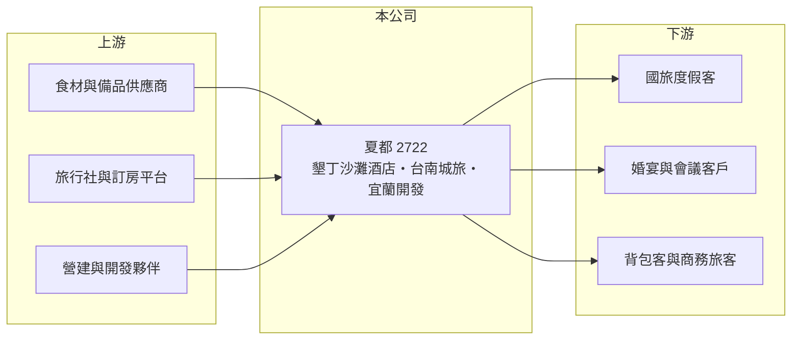

# 2722 夏都

> 上市｜[[產業索引-觀光餐旅|觀光餐旅]]｜上市（櫃）日期 2012/03/14

# 第一章：企業模式與商業藍圖

> [!info] 撰寫說明
> 精簡版，由 Claude 依公開資料整理，架構比照 [[2330台積電]] 的四章研究，資料截至 2026-10-08。財務數字來源：Goodinfo 年度經營績效頁、富果研究整理的 2026 年 8 月法說會摘要、證交所開放資料（基本資料、2026 年第二季資產負債與綜合損益、營益分析、股利、本益比）。公開資料有限。#待校對

一家度假飯店公司的長期價值，取決於核心飯店的獲利能力，以及它手上的資產能否再創造新的現金流。本章說明夏都國際開發（股票代號：2722，以下簡稱夏都）如何以墾丁夏都沙灘酒店為核心，延伸到台南城市旅店與宜蘭開發案，並走向它自稱的「營運加資產」雙引擎模式。

- **核心業務：** 夏都成立於 1995 年，2012 年上市，董事長為陳協同，實收資本額約 14.3 億元。墾丁夏都沙灘酒店是集團的核心現金流來源，提供客房、餐飲、婚宴、會議與海陸活動；台南有夏都城旅安平館，主打自助餐、中餐與宴會。
- **營收結構：** 公司未揭露各事業的營收占比。從 2025 年營收衰退的主因是「墾丁地區營收下滑」來看，墾丁沙灘酒店仍占營收的最大部分。度假飯店的收入包含客房與餐飲，[[住房率]]受季節與連假影響非常大。
- **營運據點：** 除了墾丁與台南安平，子公司夏都富朗（持股 50.65%）經營台南的「宅·夏都」設計旅店，2024 年第四季擴建後共 93 間房，並新增背包客床位；二至四樓商務客房於 2026 年第三季完成整修。
- **長期方向：** 2024 年成立百分之百持股的夏都地產開發，簽下宜蘭 BOT 案，負責「健康臺灣未來示範園區」，目標 2027 年啟動文化館興建工程。這個案子若順利，會讓夏都從單純的飯店經營者，轉為兼具資產開發的公司，但開發期間只會有支出、沒有收入。

# 第二章：護城河深度與競爭優勢

本章分析夏都的競爭優勢與限制。

- **競爭優勢：** 墾丁夏都沙灘酒店擁有直接面海的沙灘區位，這類海濱度假資產在台灣很稀少，品牌也在國旅客中具有知名度。夏都的負債比僅約 28%，資產負債表保守，讓它有能力承接宜蘭這類長期開發案。
- **限制與弱點：** 墾丁觀光人潮自 2010 年代中期後明顯降溫（待校對），加上國人出國比例上升，墾丁飯店面臨長期需求壓力。2024 年起營業利益轉為虧損，2025 年營業利益率 -16.1%，2026 年上半年擴大到 -20.3%，代表核心飯店的現金流正在減弱，而新事業還沒有貢獻。
- **主要對手：** 墾丁地區的度假飯店（如凱撒、福華等，未上市或非本業公司），以及其他國旅度假飯店 [[2705六福]]、[[2736富野]]、[[2712遠雄來]]；台南城市旅店則與 [[2707晶華]] 旗下晶英、捷絲旅等競爭。
- **觀察重點：** 第一，墾丁沙灘酒店的營收能否止跌；第二，台南宅·夏都整修完成後的住房率；第三，宜蘭 BOT 案的投資金額、資金來源與開發時程。

# 第三章：財務體質與盈利規模

資料日期：2026-10-08，表格是撰寫當時的快照；最新月營收、毛利率、累計 EPS 由自動排程寫在本筆記的屬性欄位（月營收、毛利率、累計EPS 等）。#待校對

本章用多年度三率、ROE 與資本報酬，檢視夏都的財務體質。

| 年度 | 營收（新台幣） | [[毛利率]] | [[營業利益率]] | EPS（元） | [[ROE]] |
|---|---|---|---|---|---|
| 2020 | 7.37 億 | 44.4% | 11.5% | 0.79 | 4.46% |
| 2021 | 5.88 億 | 37.4% | -0.39% | 0.18 | 0.78% |
| 2022 | 8.36 億 | 52.0% | 21.8% | 1.38 | 7.32% |
| 2023 | 7.65 億 | 45.3% | 10.3% | 0.69 | 3.69% |
| 2024 | 6.31 億 | 35.8% | -7.44% | 0.03 | -0.68% |
| 2025 | 5.69 億 | 31.9% | -16.1% | -0.49 | -3.20% |
| 2026 上半年 | 2.79 億 | 27.4% | -20.3% | -0.35 | 未查得 |

註：2020 至 2025 年取自 Goodinfo，2026 上半年取自證交所營益分析與綜合損益表。

- **營收規模：** 2022 年國旅熱潮時營收達 8.36 億元高點，之後連續三年下滑到 2025 年的 5.69 億元，2026 年上半年與去年同期大致持平。疫情期間國人無法出國、湧向墾丁的需求已經退潮。
- **獲利結構：** 毛利率從 2022 年的 52% 一路降到 2026 年上半年的 27%，反映營收下滑時人事、折舊與能源等固定成本難以調降，這就是飯店業的[[營運槓桿]]。營收若無法回到 7 億元以上，公司很難恢復本業獲利。
- **長期指標：** 2021 至 2025 年平均 ROE 約 1.6%（推算）。2025 年度未配發股利（證交所資料）。
- **財務特色：** 2026 年第二季底總資產約 39.4 億元，負債約 10.9 億元，其中非流動負債約 3.8 億元；權益約 28.5 億元（含非控制權益約 3.7 億元），每股淨值 17.32 元。總資產遠大於年營收，說明夏都持有大量土地與建物，是資產較重的飯店公司。

**[[ROIC]] 與 [[WACC]]：** 2025 年營業利益約 -0.92 億元（5.69 億 × -16.1%），稅後營業利益為負；投入資本以權益 28.5 億元加上非流動負債 3.8 億元（作為有息負債代理）合計約 32.3 億元，ROIC 約 -2.3%（推算）。即使在最好的 2022 年，ROIC 也只有約 4.5%（推算：8.36 億 × 21.8% × 0.8 ÷ 32.3 億）。WACC 以 CAPM 推估：無風險利率 1.75%、市場風險溢酬 6%、β 取小型觀光股常見值 0.9，股東權益成本約 7.15%；負債成本 2.75%、稅後 2.2%；權益約占 88%，WACC 約 6.6%（推算）。ROIC 長期低於 WACC，代表龐大的資產沒有帶來足夠的本業報酬，宜蘭開發案能否提高資產報酬，是夏都長期價值的關鍵。

# 第四章：總體風險與地緣政治

本章分析夏都長期面對的風險。

- **產業週期：** 國旅需求在疫情期間異常強勁，解封後國人出國大增，墾丁等國內度假地需求明顯回落。政府國旅補助（如 2026 年 9 月起的平日住宿補助）只能短期刺激，無法改變長期趨勢。
- **營運風險：** 營收高度集中在墾丁單一地區，颱風、交通與觀光形象都會影響客源。宜蘭 BOT 案屬長期開發，可能需要大額資本支出與融資，執行延誤或成本超支都會拖累財務。
- **其他風險：** 基本工資與電價調漲推高固定成本；海濱建物的維修與耐候成本較高；BOT 案涉及與政府的契約條件、期滿移轉與法規審查。

# 專有名詞解析

## 金融

- **[[營運槓桿]]**：固定成本占比高時，營收小幅變動會使營業利益大幅變動的現象。
- **[[ROIC]]**：投入資本報酬率，稅後營業利益除以股東權益與有息負債的合計，衡量本業對所有資金提供者的報酬。
- **[[WACC]]**：加權平均資金成本，依股東權益與負債的比重加權計算的資金成本，ROIC 高於它才代表創造價值。

## 產業

- **[[住房率]]**：已售出客房數占可售客房數的比例，是衡量飯店需求最直接的指標。
- **[[BOT]]**：民間興建、營運一段期間後移轉給政府的公共建設合作模式，業者須先投入大筆資金。

# 核心供應鏈

- 上游：食材、備品與能源供應商，旅行社與線上訂房平台，以及宜蘭開發案的營建與規劃夥伴。
- 下游／客戶：墾丁度假的家庭與團體客、台南婚宴與會議客戶、宅·夏都的背包客與商務旅客。
- 同業：[[2705六福]]、[[2736富野]]、[[2712遠雄來]]、[[2707晶華]]。

## 最新新聞
<!-- news:start（自動產生，請勿手動編輯此範圍） -->
- 2026-10-08 📰 媒體 18:21｜營收速報 - 夏都(2722)9月營收4,903萬元年增率高達40.64％｜[鉅亨網](https://news.cnyes.com/news/id/6625169)
- 2026-10-08 🏛️ 重訊 15:04｜公告本公司初次申請股票上市時所出具之承諾事項暨其後續 執行情形｜[觀測站](https://mops.twse.com.tw/mops/#/web/t05st01)

完整紀錄：[[2722夏都 新聞]]
<!-- news:end -->

## 相關連結
- [公開資訊觀測站](https://mopsov.twse.com.tw/mops/web/t05st03?step=1&firstin=1&co_id=2722)
- [Goodinfo](https://goodinfo.tw/tw/StockDetail.asp?STOCK_ID=2722)
- [Yahoo 股市](https://tw.stock.yahoo.com/quote/2722)
- [鉅亨網新聞](https://www.cnyes.com/twstock/2722/news)
