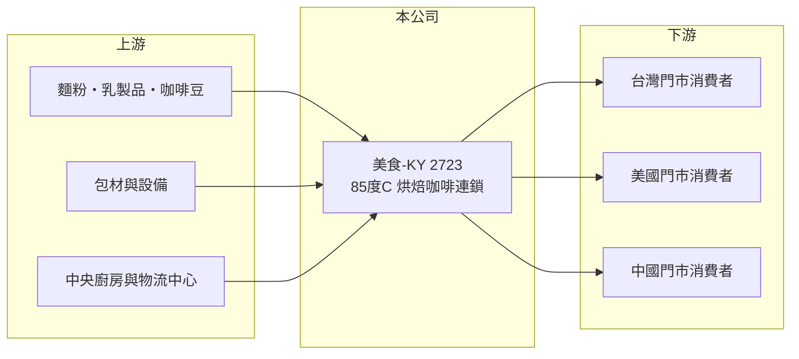

# 2723 美食-KY

> 上市｜[[產業索引-觀光餐旅|觀光餐旅]]｜上市（櫃）日期 2010/11/22

# 第一章：企業模式與商業藍圖

> [!info] 撰寫說明
> 精簡版，由 Claude 依公開資料整理，架構比照 [[2330台積電]] 的四章研究，資料截至 2026-10-08。財務數字來源：Goodinfo 年度經營績效頁、優分析 2025 年 11 月報導（2025 年第三季財報與中國關店）、證交所開放資料（基本資料、2026 年第二季資產負債與綜合損益、營益分析、股利、本益比）。#待校對

連鎖烘焙咖啡的競爭關鍵，在於門市密度、中央廚房與物流的效率，以及在不同國家複製同一套模式的能力。本章說明美食達人（股票代號：2723，以下簡稱美食-KY）如何以「85度C」品牌跨足台灣、中國與美國，以及它在中國市場大幅收縮後的新結構。

- **核心業務：** 美食-KY 是在開曼群島註冊的控股公司（[[KY股]]），2010 年在台上市，董事長兼總經理為創辦人吳政學，實收資本額 18 億元。主要品牌 85度C 以現烤麵包、蛋糕與平價咖啡飲料為核心，門市通常搭配中央廚房與物流中心配送半成品，再於門市烘烤，兼顧新鮮度與成本。
- **營收結構：** 依 2025 年報導，超過 80% 的營收來自海外市場，主要是中國與美國，其次為澳洲等地（待校對），台灣占不到兩成。各地區精確比重本文未查得。烘焙餐飲的[[毛利率]]約 59% 至 61%，比一般零售高，但租金與人事費用也高，營業利益率長期只有 4% 至 9%。
- **營運據點：** 中國原有約 440 家門市，2025 年下半年起關閉約 180 家獲利不佳的門市，並關閉北京、山東、成都、重慶等地的 2 座中央廚房，物流中心由 8 個縮減為 3 個。美國以加州為主要據點（待校對），營收以當地貨幣計算維持雙位數成長；台灣營收連續多季正成長。
- **長期方向：** 公司的策略是收縮中國虧損區域、集中資源在美國展店。這代表美食-KY 的成長引擎，正從過去的中國轉向美國；美國門市坪效與客單價較高，但展店速度受租金、人力與法規限制。

# 第二章：護城河深度與競爭優勢

本章分析美食-KY 的競爭優勢與限制。

- **競爭優勢：** 85度C 在台灣與美國華人社群具有高知名度，「平價現烤」的定位讓它在美國市場與一般麵包店做出差異。中央廚房加門市烘烤的模式，讓它能在大範圍內維持品質一致，並以規模壓低原料採購成本。美國市場的成功也證明這套模式能跨文化複製。
- **限制與弱點：** 中國市場面臨嚴重內捲與內需疲弱，連續多年虧損，2025 年第三季因關店與中央廚房減損認列超過 10 億元一次性損失。烘焙產品容易被模仿，門市生意高度依賴地點與人流，品牌差異化不如飲料或速食龍頭。
- **主要對手：** 台灣有 [[2912統一超]]、[[5903全家]] 等便利商店的鮮食與咖啡，以及各地烘焙連鎖；美國有 Paris Baguette、Tous les Jours 等韓系烘焙連鎖（未上市或非台股）；中國則有大量本土烘焙與茶飲品牌。
- **觀察重點：** 第一，中國關店後是否真的轉虧為盈；第二，美國每年新增門市數與單店營收；第三，新台幣匯率對以美元、人民幣計價營收的影響。

# 第三章：財務體質與盈利規模

資料日期：2026-10-08，表格是撰寫當時的快照；最新月營收、毛利率、累計 EPS 由自動排程寫在本筆記的屬性欄位（月營收、毛利率、累計EPS 等）。#待校對

本章用多年度三率、ROE 與資本報酬，檢視美食-KY 的財務體質。

| 年度 | 營收（新台幣） | [[毛利率]] | [[營業利益率]] | EPS（元） | [[ROE]] |
|---|---|---|---|---|---|
| 2020 | 197 億 | 59.5% | 8.08% | 5.64 | 9.56% |
| 2021 | 199 億 | 59.2% | 7.13% | 6.07 | 9.91% |
| 2022 | 195 億 | 57.6% | 3.75% | 2.68 | 4.32% |
| 2023 | 204 億 | 58.9% | 5.39% | 4.20 | 6.83% |
| 2024 | 190 億 | 59.3% | 6.02% | 3.28 | 5.41% |
| 2025 | 181 億 | 59.4% | 3.73% | -2.47 | -4.07% |
| 2026 上半年 | 82.6 億 | 61.4% | 9.03% | 3.19 | 未查得 |

註：2020 至 2025 年取自 Goodinfo，2026 上半年取自證交所營益分析與綜合損益表。

- **營收規模：** 2020 至 2025 年營收在 180 億至 205 億元之間，年複合成長率約 -1.7%（推算），代表過去五年整體規模沒有成長。中國關店會使 2026 年營收再縮小，2026 年前 8 月累計營收年減約 10%（證交所每月營收資料）。
- **獲利結構：** 2025 年 EPS -2.47 元，主要來自第三季關店與減損的一次性損失（單季每股虧損 6.06 元），扣除後本業仍有獲利。2026 年上半年營業利益率回升到約 9%，是近年最高，顯示關掉虧損門市後，留下來的事業獲利能力較好。
- **長期指標：** 2021 至 2025 年平均 ROE 約 4.5%（推算），以餐飲公司而言偏低。2025 年度因虧損未配發股利（證交所資料）。
- **財務特色：** 2026 年第二季底總資產約 176 億元，負債約 69 億元，其中非流動負債約 24 億元（推估多為門市[[租賃負債]]）；權益約 107 億元，每股淨值 59.68 元，財務結構穩健。

**[[ROIC]] 與 [[WACC]]：** 2025 年營業利益約 6.75 億元（181 億 × 3.73%），稅後約 5.4 億元；投入資本以 2026 年第二季權益 107.5 億元加上非流動負債 24.4 億元合計約 131.8 億元，ROIC 約 4.1%（推算）。以 2026 年上半年營業利益 7.46 億元年化，ROIC 約 9%（推算：7.46 × 2 × 0.8 ÷ 131.8）。WACC 以 CAPM 推估：無風險利率 1.75%、市場風險溢酬 6%、β 取餐飲股常見值 0.8，股東權益成本約 6.55%；負債成本 2.75%、稅後 2.2%；權益約占 82%，WACC 約 5.8%（推算）。過去幾年 ROIC 低於或接近 WACC，代表中國事業在消耗價值；關店後若 ROIC 能維持在 8% 以上，美食-KY 才算重新成為創造價值的公司。

# 第四章：總體風險與地緣政治

本章分析美食-KY 長期面對的風險。

- **產業週期：** 烘焙與咖啡屬於日常消費，受景氣影響相對較小，但中國的消費降級與價格戰顯示，就算是民生消費，在供給過剩時也可能長期虧損。
- **營運風險：** 美國展店需要較高的資本支出與租金承諾，新店若表現不佳會留下長期租約負擔。關店與中央廚房調整後，供應鏈重新配置也可能短期影響效率。
- **其他風險：** 營收以美元與人民幣為主，新台幣升值會壓低帳面營收與獲利；麵粉、奶油、咖啡豆、雞蛋等原物料價格波動；美國最低工資上漲；美中關係變化影響兩地營運；KY 公司的資金匯回與公司治理也需留意。

# 專有名詞解析

## 金融

- **[[KY股]]**：在海外註冊、來台灣上市櫃的公司，代號後加註 KY。
- **[[租賃負債]]**：依 IFRS 16，承租人須把長期租約未來應付租金折現認列為負債，飯店與餐飲業的金額通常很大。
- **[[資產減損]]**：資產未來可回收金額低於帳面價值時，須認列損失並調降帳面價值。
- **[[ROIC]]**：投入資本報酬率，稅後營業利益除以股東權益與有息負債的合計，衡量本業對所有資金提供者的報酬。
- **[[WACC]]**：加權平均資金成本，依股東權益與負債的比重加權計算的資金成本，ROIC 高於它才代表創造價值。

## 產業

- **[[中央廚房]]**：集中製作半成品或成品再配送到各門市的廚房，能統一品質並降低門市人力與食材成本。

# 核心供應鏈

- 上游：麵粉、奶油、乳製品、雞蛋、咖啡豆等原物料與包材供應商，以及公司自有的中央廚房與物流中心。
- 下游／客戶：台灣、美國、中國等地門市的一般消費者，以及節慶蛋糕與團購客戶。
- 同業：[[2912統一超]]、[[5903全家]]、[[2727王品]]、[[2729瓦城]]、[[2732六角]]。

## 最新新聞
<!-- news:start（自動產生，請勿手動編輯此範圍） -->
- 2026-10-21 🏛️ 重訊 14:57｜代子公司美食達人股份有限公司公告 部分資訊系統遭受駭客網路攻擊。｜[觀測站](https://mops.twse.com.tw/mops/#/web/t05st01)

完整紀錄：[[2723美食-KY 新聞]]
<!-- news:end -->

## 相關連結
- [公開資訊觀測站](https://mopsov.twse.com.tw/mops/web/t05st03?step=1&firstin=1&co_id=2723)
- [Goodinfo](https://goodinfo.tw/tw/StockDetail.asp?STOCK_ID=2723)
- [Yahoo 股市](https://tw.stock.yahoo.com/quote/2723)
- [鉅亨網新聞](https://www.cnyes.com/twstock/2723/news)
