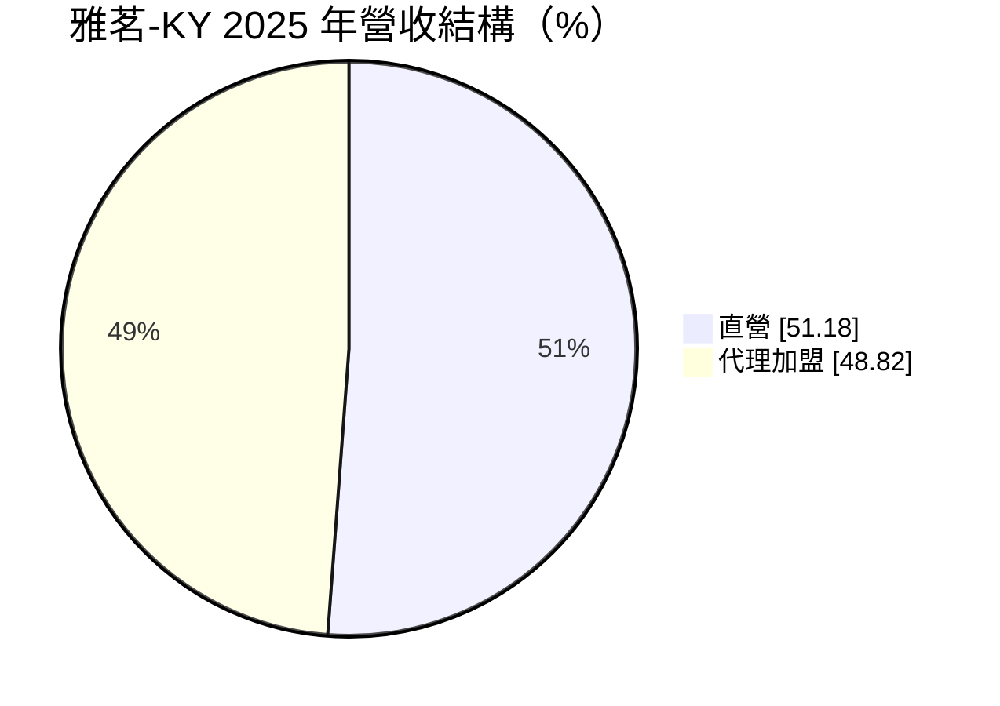
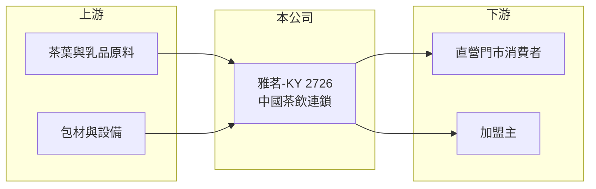

# 2726 雅茗-KY

> 上櫃｜[[產業索引-觀光餐旅|觀光餐旅]]｜上市（櫃）日期 2014/12/24

# 第一章：企業模式與商業藍圖

> [!info] 撰寫說明
> 精簡版，由 Claude 依公開資料整理，架構比照 [[2330台積電]] 的四章研究，資料截至 2026-10-08。財務數字來源：Goodinfo 年度經營績效頁、富邦證券個股基本資料頁（2025 年營收比重）、櫃買中心開放資料（基本資料、2026 年第二季資產負債與綜合損益、每月營收、本益比）。品牌與市場描述部分憑既有知識整理，公開資料有限。#待校對

茶飲連鎖的商業模式由兩條收入組成：自己開的[[直營]]門市賺零售毛利，[[加盟]]門市則賺加盟金、原物料與設備銷售。本章說明雅茗（股票代號：2726，以下簡稱雅茗-KY）在中國茶飲市場的經營模式，以及它為何在激烈競爭下長期難以獲利。

- **核心業務：** 雅茗-KY 是在開曼群島註冊的控股公司（[[KY股]]），2014 年在櫃買中心掛牌，董事長為吳伯超，實收資本額約 3.8 億元。公司主要在中國經營茶飲連鎖，品牌與天仁茗茶體系的「喫茶趣 ToGo」相關（待校對），銷售手搖茶飲與茶葉相關商品。
- **營收結構：** 依 2025 年資料，直營約占 51%、代理加盟約占 49%。直營營收包含門市飲料銷售，毛利率高但要負擔租金與人事；加盟營收主要是向加盟店銷售茶葉、原物料與設備，以及收取加盟相關費用，風險較低但成長取決於加盟主的展店意願。
- **營運據點：** 營運重心在中國，門市分布與門市數本文未查得。
- **長期方向：** 營收從 2020 年的 15.8 億元縮小到 2025 年的 5.7 億元，顯示公司在中國茶飲價格戰中持續收縮直營規模。2025 年後毛利率提升到約 60%，代表公司把重心放在毛利較高的品項與通路，但規模已大幅縮小。

# 第二章：護城河深度與競爭優勢

本章分析雅茗-KY 的競爭優勢與限制。

- **競爭優勢：** 以茶葉起家的品牌背景（待校對），讓它在「原葉茶」的品質形象上有一定基礎；加盟體系讓公司能以較少資本觸及更多城市。
- **限制與弱點：** 中國茶飲市場自 2020 年代起出現大量新品牌與低價連鎖，蜜雪冰城、古茗、茶百道等業者以數千至上萬家門市的規模壓低價格，小型品牌很難在採購成本與行銷聲量上競爭。雅茗-KY 的營收規模持續縮小，2021 至 2025 年有四年營業利益為負，說明它缺乏足以抵禦競爭的護城河。
- **主要對手：** 中國本土茶飲連鎖（蜜雪冰城、古茗、茶百道、霸王茶姬等，非台股）；台股可對照的茶飲連鎖為 [[2732六角]]（Chatime 日出茶太）。
- **觀察重點：** 第一，營收能否止跌；第二，直營與加盟的組合調整能否讓本業回到損益兩平；第三，累積虧損與淨值變化。

# 第三章：財務體質與盈利規模

資料日期：2026-10-08，表格是撰寫當時的快照；最新月營收、毛利率、累計 EPS 由自動排程寫在本筆記的屬性欄位（月營收、毛利率、累計EPS 等）。#待校對

本章用多年度三率、ROE 與資本報酬，檢視雅茗-KY 的財務體質。

| 年度 | 營收（新台幣） | [[毛利率]] | [[營業利益率]] | EPS（元） | [[ROE]] |
|---|---|---|---|---|---|
| 2020 | 15.8 億 | 50.1% | 1.41% | 1.09 | 4.67% |
| 2021 | 14.6 億 | 46.7% | -7.77% | -2.65 | -16.0% |
| 2022 | 8.01 億 | 40.5% | -27.2% | -7.92 | -72.9% |
| 2023 | 7.45 億 | 52.3% | -8.34% | -4.06 | -39.1% |
| 2024 | 5.65 億 | 57.9% | 1.04% | 3.58 | 33.3% |
| 2025 | 5.68 億 | 60.7% | -19.2% | -3.55 | -25.6% |
| 2026 上半年 | 2.76 億 | 63.2% | -12.3% | -0.78 | 未查得 |

註：2020 至 2025 年取自 Goodinfo，2026 上半年取自櫃買中心綜合損益表推算。

- **營收規模：** 2020 至 2025 年營收從 15.8 億元降到 5.7 億元，五年年複合成長率約 -18.5%（推算）。2026 年前 8 月累計營收年減約 6.5%（櫃買中心每月營收資料）。
- **獲利結構：** 毛利率從約 40% 升到 60% 以上，但營業費用占比更高，本業仍虧損。2024 年營業利益率只有 1%，EPS 卻有 3.58 元，代表當年獲利主要來自[[業外收益]]（來源本文未查得），不是本業轉好。
- **長期指標：** 2021 至 2025 年平均 ROE 約 -24%（推算）；近年未配發現金股利（櫃買中心本益比資料）。2026 年第二季底保留盈餘為負約 0.35 億元。
- **財務特色：** 2026 年第二季底總資產約 6.9 億元，負債約 3.3 億元，其中非流動負債約 1.4 億元（推估多為門市[[租賃負債]]），權益約 3.6 億元，每股淨值 9.26 元，已低於面額。

**[[ROIC]] 與 [[WACC]]：** 2025 年營業利益約 -1.09 億元（5.68 億 × -19.2%），稅後營業利益為負；投入資本以權益 3.6 億元加上非流動負債 1.4 億元合計約 5.0 億元，ROIC 約 -18%（推算）。WACC 以 CAPM 推估：無風險利率 1.75%、市場風險溢酬 6%、β 取虧損小型股常見值 1.0，股東權益成本約 7.75%；負債成本 2.75%、稅後 2.2%；權益約占 72%，WACC 約 6.2%（推算）。ROIC 大幅低於 WACC 而且為負，代表本業持續消耗股東資本，若無法止住營收下滑並轉為獲利，淨值會繼續被侵蝕。

# 第四章：總體風險與地緣政治

本章分析雅茗-KY 長期面對的風險。

- **產業週期：** 中國茶飲市場已從高速成長進入整併期，龍頭品牌以低價與高密度展店擠壓中小品牌，價格戰可能持續多年。中國內需疲弱也壓抑消費者的單杯消費金額。
- **營運風險：** 營收規模持續縮小，固定成本攤提壓力上升；加盟主若轉投其他品牌，加盟收入會快速流失。食品安全事件對茶飲品牌的傷害很大。
- **其他風險：** 營收以人民幣計價，人民幣兌新台幣貶值會壓低帳面營收；中國法規與兩岸關係變化；KY 公司的資訊揭露較少，投資人取得營運細節的難度高。

# 專有名詞解析

## 金融

- **[[KY股]]**：在海外註冊、來台灣上市櫃的公司，代號後加註 KY。
- **[[業外收益]]**：本業以外的收入，例如投資收益、處分利益或匯兌利益，通常較不穩定。
- **[[租賃負債]]**：依 IFRS 16，承租人須把長期租約未來應付租金折現認列為負債，飯店與餐飲業的金額通常很大。
- **[[ROIC]]**：投入資本報酬率，稅後營業利益除以股東權益與有息負債的合計，衡量本業對所有資金提供者的報酬。
- **[[WACC]]**：加權平均資金成本，依股東權益與負債的比重加權計算的資金成本，ROIC 高於它才代表創造價值。

## 產業

- **[[直營]]**：由總部自行出資開設並管理的門市，可直接控制品質，但須自行負擔租金、人事與開店成本。
- **[[加盟]]**：由加盟主出資開店、使用總部品牌與供應鏈，總部收取加盟金、權利金或原物料差價的經營模式。

# 核心供應鏈

- 上游：茶葉、乳品、糖漿與配料供應商，杯材包材與飲料設備供應商。
- 下游／客戶：直營門市的一般消費者，以及向公司採購原物料與設備的加盟主。
- 同業：[[2732六角]]；中國茶飲連鎖蜜雪冰城、古茗、茶百道（非台股）。

## 最新新聞
<!-- news:start -->
<!-- news:end -->

## 相關連結
- [公開資訊觀測站](https://mopsov.twse.com.tw/mops/web/t05st03?step=1&firstin=1&co_id=2726)
- [Goodinfo](https://goodinfo.tw/tw/StockDetail.asp?STOCK_ID=2726)
- [Yahoo 股市](https://tw.stock.yahoo.com/quote/2726)
- [鉅亨網新聞](https://www.cnyes.com/twstock/2726/news)
