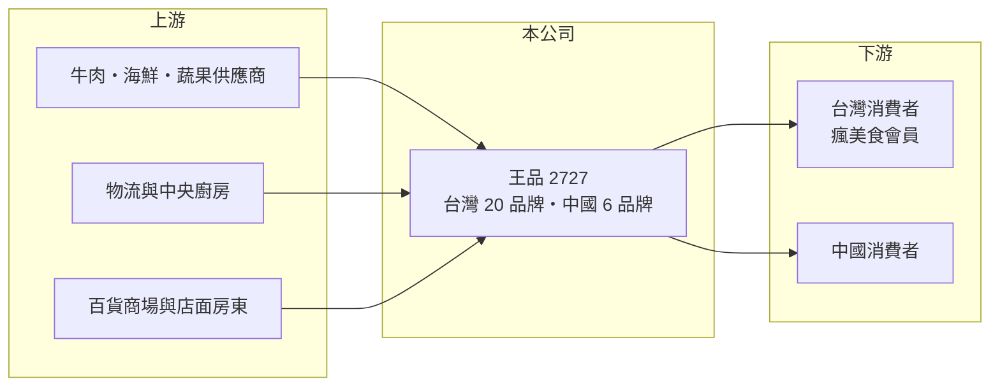

# 2727 王品

> 上市｜[[產業索引-觀光餐旅|觀光餐旅]]｜上市（櫃）日期 2012/03/06

# 第一章：企業模式與商業藍圖

> [!info] 撰寫說明
> 精簡版，由 Claude 依公開資料整理，架構比照 [[2330台積電]] 的四章研究，資料截至 2026-10-08。財務數字來源：Goodinfo 年度經營績效頁、富果研究整理的 2026 年 3 月法說會摘要、證交所開放資料（基本資料、2026 年第二季資產負債與綜合損益、營益分析、股利、本益比）。#待校對

連鎖餐飲要長期賺錢，關鍵不是單一品牌的爆紅，而是能否持續推出新品牌、複製門市，並用規模壓低食材與營運成本。本章說明王品集團（股票代號：2727，以下簡稱王品）如何以[[多品牌經營]]成為台灣最大的連鎖餐飲集團之一。

- **核心業務：** 王品成立於 1993 年，2012 年上市，創辦人為戴勝益（待校對），目前董事長為法人平恆投資，總經理為陳正輝，實收資本額約 8.3 億元。集團經營牛排、鐵板燒、火鍋、燒肉、日式與中式等多種餐飲品牌，涵蓋從平價到高價的客群。
- **品牌與門市：** 依 2026 年 3 月法說會摘要，截至 2026 年 2 月，台灣有 20 個品牌、365 家門店，中國有 6 個品牌、100 家門店。台灣有 8 個月營收破億或接近破億的品牌：聚、西堤、陶板屋、夏慕尼、石二鍋、青花驕、和牛涮、肉次方，享鴨也接近破億。多品牌讓王品能在同一個百貨或商場同時開好幾家店，提高議價能力與商圈滲透率。
- **營運據點：** 以台灣為主，中國為第二市場。中國事業由子公司合品負責，自 2024 年第二季起連續多季獲利，公司計畫讓合品於 2026 年底在台灣申請上市。
- **長期方向：** 2026 年不推出全新品牌，資源集中在既有品牌展店：台灣全年淨增約 35 家，年底目標 400 家；中國計畫展店 25 至 30 家，以云彩坡、王品與西堤為主。接受度較低的品牌會收攏或改裝，例如向辣部分門店已改為和牛涮，這種「汰弱留強」的品牌管理是王品的長期習慣。

# 第二章：護城河深度與競爭優勢

本章分析王品的護城河，重點在品牌組合、會員數據與規模經濟。

- **規模與採購優勢：** 四百多家門店的採購量，讓王品在牛肉、海鮮等主要食材上比中小型餐廳有更好的價格與穩定貨源。2025 年第四季台灣事業群的食材成本率下降 1.17 個百分點、人事與租金成本率下降 1.15 個百分點，顯示規模化後成本仍有下降空間。
- **會員數據：** 「瘋美食」APP 會員數約 573 萬，貢獻台灣事業群逾 60% 營收。會員資料讓王品能精準推送優惠、測試新品牌，並把一個品牌的顧客導流到另一個品牌，這是新進業者很難複製的資產。
- **品牌孵化能力：** 王品長期以內部創業與新品牌測試擴張，失敗的品牌可以快速收掉，成功的品牌再大量展店。這種組合式經營讓集團不必依賴單一品牌的生命週期。
- **主要對手：** [[2729瓦城]]、[[7705三商餐飲]]、[[2753八方雲集]]、[[2754亞洲藏壽司]]、[[2752豆府]]、[[2748雲品]]，以及欣葉、饗賓等未上市餐飲集團。
- **觀察重點：** 第一，台灣門店能否如期達到 400 家而不稀釋單店營收；第二，合品 IPO 後中國事業的獨立價值；第三，基本工資與食材成本上漲能否透過漲價轉嫁。

# 第三章：財務體質與盈利規模

資料日期：2026-10-08，表格是撰寫當時的快照；最新月營收、毛利率、累計 EPS 由自動排程寫在本筆記的屬性欄位（月營收、毛利率、累計EPS 等）。#待校對

本章用多年度三率、ROE 與資本報酬，檢視王品的獲利品質。

| 年度 | 營收（新台幣） | [[毛利率]] | [[營業利益率]] | EPS（元） | [[ROE]] |
|---|---|---|---|---|---|
| 2020 | 152 億 | 46.3% | 3.65% | 4.61 | 6.06% |
| 2021 | 172 億 | 42.5% | -0.12% | -1.40 | -4.60% |
| 2022 | 183 億 | 43.3% | 2.57% | 5.21 | 7.79% |
| 2023 | 223 億 | 46.7% | 7.99% | 16.79 | 33.8% |
| 2024 | 223 億 | 47.2% | 7.78% | 15.66 | 26.7% |
| 2025 | 235 億 | 47.5% | 7.80% | 16.02 | 27.1% |
| 2026 上半年 | 129.2 億 | 47.6% | 8.04% | 9.86 | 未查得 |

註：2020 至 2025 年取自 Goodinfo，2026 上半年取自證交所營益分析與綜合損益表。

- **營收規模：** 營收從 2020 年的 152 億元成長到 2025 年的 235 億元，五年年複合成長率約 9.1%（推算），2026 年上半年持續成長。成長來自展店、新品牌與疫情後的聚餐需求回流。
- **獲利結構：** 2023 年起營業利益率穩定在 7.8% 至 8.0%，EPS 連續三年在 15 元以上。在毛利率維持 47% 左右的情況下，獲利提升主要來自營收放大後的[[營運槓桿]]：租金、總部與行銷費用攤到更大的營收上。
- **長期指標：** 2021 至 2025 年平均 ROE 約 18%（推算），2023 年以後穩定在 27% 至 34%。2025 年度配發現金股利約 16.12 元，配息率約 100%（證交所資料推算），王品傾向把大部分獲利發給股東。
- **財務特色：** 2026 年第二季底總資產約 183 億元，負債約 137 億元，其中非流動負債約 52 億元，推估大部分是門店的[[租賃負債]]；權益約 46 億元。負債比看似偏高，但主要是會計上的租約負債，而非銀行借款。

**[[ROIC]] 與 [[WACC]]：** 2025 年營業利益約 18.3 億元（235 億 × 7.80%），稅後約 14.7 億元；投入資本以 2026 年第二季權益 46.2 億元加上非流動負債 52.4 億元（作為有息負債與租賃負債的代理）合計約 98.6 億元，ROIC 約 15%（推算）。WACC 以 CAPM 推估：無風險利率 1.75%、市場風險溢酬 6%、β 取餐飲股常見值 0.7，股東權益成本約 5.95%；負債成本 2.75%、稅後 2.2%；權益約占 47%，WACC 約 4.0%（推算）。ROIC 高出 WACC 約十個百分點，代表王品近年的展店與多品牌策略在持續創造價值；但這個利差是 2023 年後才出現，2020 至 2022 年 ROIC 明顯較低，顯示餐飲業的資本報酬會隨景氣與疫情大幅擺動。

# 第四章：總體風險與地緣政治

本章分析王品長期面對的風險。

- **產業週期：** 餐飲屬於可選消費，景氣轉弱時聚餐與中高價位品牌最先受影響。疫情期間（2021 年）內用禁令曾讓王品轉為虧損。
- **營運風險：** 台灣門店密度提高後，同集團品牌之間可能互相搶客；新品牌失敗率高，收店會產生減損與裝潢損失。展店依賴百貨商場，租約條件與商場人流變化會影響單店獲利。
- **其他風險：** 基本工資連年調漲與缺工，推高人事成本；牛肉、海鮮等進口食材受匯率與國際價格影響；中國事業面臨內需疲弱與價格競爭，合品上市進度也可能受市場狀況影響；食品安全事件會傷害整個集團的品牌信任。

# 專有名詞解析

## 金融

- **[[營運槓桿]]**：固定成本占比高時，營收小幅變動會使營業利益大幅變動的現象。
- **[[租賃負債]]**：依 IFRS 16，承租人須把長期租約未來應付租金折現認列為負債，飯店與餐飲業的金額通常很大。
- **[[ROIC]]**：投入資本報酬率，稅後營業利益除以股東權益與有息負債的合計，衡量本業對所有資金提供者的報酬。
- **[[WACC]]**：加權平均資金成本，依股東權益與負債的比重加權計算的資金成本，ROIC 高於它才代表創造價值。

## 產業

- **[[多品牌經營]]**：同一集團經營多個定位不同的品牌，以覆蓋不同客群並分散單一品牌衰退的風險。

# 核心供應鏈

- 上游：進口牛肉、海鮮、蔬果與調味料等食材供應商，冷鏈物流與中央廚房，以及提供店面的百貨商場與房東。
- 下游／客戶：台灣各品牌門店的消費者（瘋美食 APP 會員為主力），以及中國門店的消費者。
- 同業：[[2729瓦城]]、[[7705三商餐飲]]、[[2753八方雲集]]、[[2754亞洲藏壽司]]、[[2752豆府]]、[[2748雲品]]。

## 最新新聞
<!-- news:start（自動產生，請勿手動編輯此範圍） -->
- 2026-10-08 📰 媒體 19:49｜王品Q3營收飆出單季新高紀錄 Q4樂觀續旺｜[鉅亨網](https://news.cnyes.com/news/id/6625127)
- 2026-10-06 🏛️ 重訊 17:41｜公告本公司第四次庫藏股買回期間屆滿執行情形｜[觀測站](https://mops.twse.com.tw/mops/#/web/t05st01)

完整紀錄：[[2727王品 新聞]]
<!-- news:end -->

## 相關連結
- [公開資訊觀測站](https://mopsov.twse.com.tw/mops/web/t05st03?step=1&firstin=1&co_id=2727)
- [Goodinfo](https://goodinfo.tw/tw/StockDetail.asp?STOCK_ID=2727)
- [Yahoo 股市](https://tw.stock.yahoo.com/quote/2727)
- [鉅亨網新聞](https://www.cnyes.com/twstock/2727/news)
