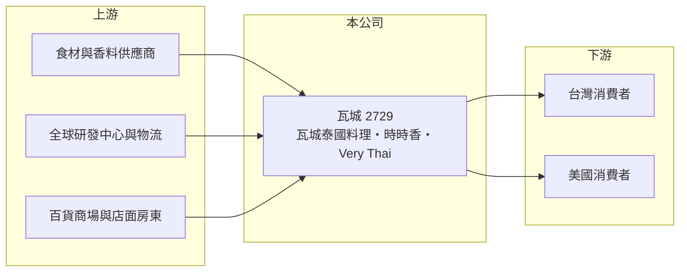

# 2729 瓦城

> 上櫃｜[[產業索引-觀光餐旅|觀光餐旅]]｜上市（櫃）日期 2012/09/17

# 第一章：企業模式與商業藍圖

> [!info] 撰寫說明
> 精簡版，由 Claude 依公開資料整理，架構比照 [[2330台積電]] 的四章研究，資料截至 2026-10-08。財務數字來源：Goodinfo 年度經營績效頁、聯合新聞網 2026 年 6 月股東會報導、櫃買中心開放資料（基本資料、2026 年第二季資產負債與綜合損益、每月營收、本益比）。#待校對

中式與亞洲料理比西餐更難連鎖化，因為熱炒講究火候與廚師手藝，品質很難在數百家店維持一致。本章說明瓦城泰統集團（股票代號：2729，以下簡稱瓦城）如何把泰式與中式熱炒標準化，建立台灣最大的泰式連鎖餐飲品牌，並在 2026 年跨足美國。

- **核心業務：** 瓦城成立於 2000 年，2012 年上櫃，董事長為徐承義，實收資本額約 4.3 億元。主力品牌瓦城泰國料理是台灣最大的泰式連鎖品牌，另有定位「新台灣料理」的時時香，以及非常泰、1010湘、大心等品牌（待校對）。門市以百貨商場與核心商圈的[[直營]]店為主。
- **營收結構：** 2025 年合併營收 61.04 億元，創歷史新高，毛利率約 50.9%。各品牌營收占比本文未查得，但瓦城泰國料理一直是營收與獲利的主要來源。餐飲業毛利率扣除的是食材成本，人事與租金則列在營業費用，因此營業利益率只有 6% 至 10%。
- **營運據點：** 以台灣為主，門市總數本文未查得。2026 年 3 月在洛杉磯開設 Very Thai by 瓦城，是美國第一家店；公司計畫 2026 年下半年在美國再推出泰式休閒餐飲 BO BO THAI 與台灣料理 SHANN SHANN 兩個品牌。
- **長期方向：** 公司定位 2025 年為策略投資密集期，包括全球研發中心、美國布局與新品牌開發。在台灣持續以多品牌提高商場滲透率，在美國則以洛杉磯為據點建立北美營運基礎。這代表瓦城正從台灣成熟市場的現金牛，嘗試轉為跨國餐飲集團。

# 第二章：護城河深度與競爭優勢

本章分析瓦城的護城河，核心在於「把廚藝變成系統」。

- **標準化廚藝系統：** 瓦城長期投入廚師培訓與烹調流程標準化，把熱炒的火候、調味與出餐流程拆解成可教、可複製的步驟（具體制度細節待校對）。這讓它能在台灣各地維持口味一致，也是競爭對手難以快速複製的能力。
- **品牌與商場關係：** 瓦城在百貨商場是常見的主力餐飲租戶，與商場長期合作有助於取得好的店位。多品牌讓同一商場可以進駐不同店型，提高單一商圈的營收貢獻。
- **主要對手：** [[2727王品]]、[[7705三商餐飲]]、[[2754亞洲藏壽司]]、[[2752豆府]]，以及鼎泰豐、欣葉等未上市餐飲集團；美國市場則面對當地泰式與亞洲餐廳。
- **觀察重點：** 第一，美國門店的單店營收與獲利能否達到台灣水準；第二，2023 年後營業利益率從 9.8% 降到 6% 的趨勢能否止住；第三，100% 現金配息政策在海外擴張期能否維持。

# 第三章：財務體質與盈利規模

資料日期：2026-10-08，表格是撰寫當時的快照；最新月營收、毛利率、累計 EPS 由自動排程寫在本筆記的屬性欄位（月營收、毛利率、累計EPS 等）。#待校對

本章用多年度三率、ROE 與資本報酬，檢視瓦城的獲利品質。

| 年度 | 營收（新台幣） | [[毛利率]] | [[營業利益率]] | EPS（元） | [[ROE]] |
|---|---|---|---|---|---|
| 2020 | 46.1 億 | 53.1% | 10.7% | 15.95 | 16.8% |
| 2021 | 42.3 億 | 49.6% | 3.62% | 7.04 | 7.75% |
| 2022 | 45.4 億 | 49.2% | 3.71% | 3.62 | 5.31% |
| 2023 | 57.2 億 | 52.2% | 9.77% | 12.37 | 18.2% |
| 2024 | 60.8 億 | 51.2% | 7.31% | 9.01 | 13.3% |
| 2025 | 61.0 億 | 50.9% | 6.03% | 6.76 | 11.3% |
| 2026 上半年 | 32.9 億 | 50.3% | 6.72% | 3.47 | 未查得 |

註：2020 至 2025 年取自 Goodinfo，2026 上半年取自櫃買中心綜合損益表推算。

- **營收規模：** 營收從 2020 年的 46.1 億元成長到 2025 年的 61.0 億元，五年年複合成長率約 5.8%（推算）。2023 年疫情後聚餐需求回流，營收大幅跳升，之後成長放緩，2026 年前 8 月累計營收年增約 6%（櫃買中心每月營收資料）。
- **獲利結構：** 毛利率長期穩定在 49% 至 53%，代表食材成本控制良好；但營業利益率從 2023 年的 9.8% 降到 2025 年的 6.0%，反映人事、租金上漲與研發中心、美國布局等前期費用。2020 年 EPS 15.95 元相對當年本業偏高，推估含有一次性收益（待校對）。
- **長期指標：** 2021 至 2025 年平均 ROE 約 11%（推算）。2025 年度現金股利每股 6.8 元，現金配發率 100%（股東會報導），瓦城長期維持高配息。
- **財務特色：** 2026 年第二季底總資產約 63.9 億元，負債約 41.2 億元，其中非流動負債約 14.3 億元（推估多為門店[[租賃負債]]），權益約 22.7 億元，每股淨值 53.2 元。

**[[ROIC]] 與 [[WACC]]：** 2025 年營業利益約 3.68 億元（股東會報導），稅後約 2.9 億元；投入資本以 2026 年第二季權益 22.7 億元加上非流動負債 14.3 億元合計約 37.0 億元，ROIC 約 8%（推算）。WACC 以 CAPM 推估：無風險利率 1.75%、市場風險溢酬 6%、β 取餐飲股常見值 0.7，股東權益成本約 5.95%；負債成本 2.75%、稅後 2.2%；權益約占 61%，WACC 約 4.5%（推算）。ROIC 仍高於 WACC，代表瓦城持續創造價值，但利差從 2023 年的高點縮小，美國擴張能否帶來足夠報酬，決定未來利差是擴大還是繼續收窄。

# 第四章：總體風險與地緣政治

本章分析瓦城長期面對的風險。

- **產業週期：** 餐飲屬可選消費，景氣與疫情會直接影響聚餐需求，2021 至 2022 年內用限制就讓營業利益率掉到 3.6% 左右。
- **營運風險：** 美國展店面對不同的租金、人力、法規與口味，前幾年可能虧損；多品牌經營若新品牌不成功，會產生收店與減損損失。熱炒需要有經驗的廚師，人才培育跟不上展店速度時，品質可能下滑。
- **其他風險：** 台灣基本工資連年調漲與餐飲業缺工；食材價格與匯率波動；美國業務使公司面臨美元匯率與當地勞動法規風險；百貨商場人流變化影響門店營收。

# 專有名詞解析

## 金融

- **[[租賃負債]]**：依 IFRS 16，承租人須把長期租約未來應付租金折現認列為負債，飯店與餐飲業的金額通常很大。
- **[[ROIC]]**：投入資本報酬率，稅後營業利益除以股東權益與有息負債的合計，衡量本業對所有資金提供者的報酬。
- **[[WACC]]**：加權平均資金成本，依股東權益與負債的比重加權計算的資金成本，ROIC 高於它才代表創造價值。

## 產業

- **[[直營]]**：由總部自行出資開設並管理的門市，可直接控制品質，但須自行負擔租金、人事與開店成本。
- **[[多品牌經營]]**：同一集團經營多個定位不同的品牌，以覆蓋不同客群並分散單一品牌衰退的風險。

# 核心供應鏈

- 上游：肉品、海鮮、蔬果與泰式香料等食材供應商，公司的全球研發中心與物流體系，以及提供店面的百貨商場與房東。
- 下游／客戶：台灣各品牌門店的消費者，以及 2026 年起的美國洛杉磯門店消費者。
- 同業：[[2727王品]]、[[7705三商餐飲]]、[[2754亞洲藏壽司]]、[[2752豆府]]、[[2753八方雲集]]。

## 最新新聞
<!-- news:start -->
<!-- news:end -->

## 相關連結
- [公開資訊觀測站](https://mopsov.twse.com.tw/mops/web/t05st03?step=1&firstin=1&co_id=2729)
- [Goodinfo](https://goodinfo.tw/tw/StockDetail.asp?STOCK_ID=2729)
- [Yahoo 股市](https://tw.stock.yahoo.com/quote/2729)
- [鉅亨網新聞](https://www.cnyes.com/twstock/2729/news)
