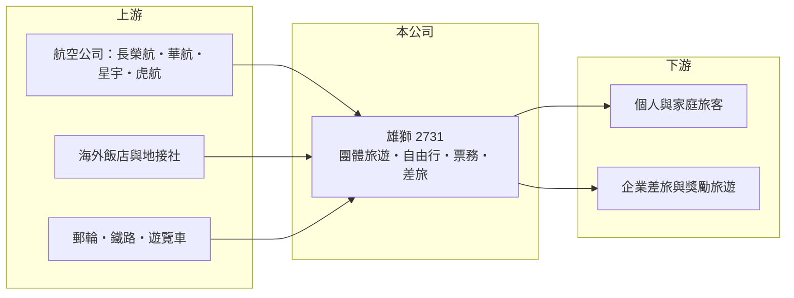

# 2731 雄獅

> 上市｜[[產業索引-觀光餐旅|觀光餐旅]]｜上市（櫃）日期 2013/09/24

# 第一章：企業模式與商業藍圖

> [!info] 撰寫說明
> 精簡版，由 Claude 依公開資料整理，架構比照 [[2330台積電]] 的四章研究，資料截至 2026-10-08。財務數字來源：Goodinfo 年度經營績效頁、nStock 公司介紹頁、證交所開放資料（基本資料、2026 年第二季資產負債與綜合損益、營益分析、股利、本益比）。營收結構與出團人次未查得。#待校對

旅行社是典型的「先收錢、後交付」生意：旅客出發前就付清團費，旅行社再分批付款給航空公司與飯店。本章說明雄獅旅行社（股票代號：2731，以下簡稱雄獅）如何以規模與品牌，成為台灣營收最大的綜合旅行社，以及這種商業模式為何能帶來很高的資本報酬。

- **核心業務：** 雄獅成立於 1977 年，2013 年上市，董事長為創辦人王文傑，總經理為黃信川，實收資本額約 9.3 億元。業務包括自組國內外團體旅遊、自由行套裝、代售機票與交通票券、訂房、簽證代辦，以及企業差旅與獎勵旅遊。
- **營收結構：** 2025 年全年營收約 300 億元。各產品線（團體旅遊、自由行、機票、商務差旅）的精確比重本文未查得。旅行社以團費與票價總額認列營收，毛利率約 14% 至 17%，看起來偏低，但因為幾乎不需要廠房設備，投入資本很少。
- **營運據點：** 以台灣為主，全台有實體門市與線上通路（門市數本文未查得）。過去轉投資的線上旅遊平台 [[6961旅天下]]，在 2023 年 10 月雄獅放棄認購其現金增資後喪失控制力，改為一般投資，當時認列約 5.3 億元處分利益。
- **長期方向：** 雄獅的成長來自三方面：出國旅遊人次持續增加、從團體旅遊延伸到自由行與企業差旅，以及透過線上通路與會員經營降低獲客成本。未來競爭的重點，是在國際線上旅遊平台的價格競爭下，維持團體旅遊的產品設計與服務價值。

# 第二章：護城河深度與競爭優勢

本章分析雄獅的護城河，核心在規模、品牌信任與負營運資金。

- **規模帶來的議價能力：** 雄獅是台灣營收最大的旅行社，每年向航空公司與海外飯店採購大量機位與房間，能取得較好的價格與熱門時段的保留機位，這是中小型旅行社難以取得的條件。
- **品牌信任：** 出國團費金額高、事前付款，消費者傾向選擇規模大、經營久的旅行社，以降低倒閉或服務出問題的風險。雄獅經營近五十年，品牌信任本身就是門檻。
- **預收款模式：** 旅客預付的團費形成大額[[預收款]]，2026 年第二季底流動負債約 82 億元，遠高於權益，代表公司用客戶的錢在經營。這讓雄獅不需要太多自有資本就能擴大營收，也是它 ROE 與 ROIC 很高的原因。
- **主要對手：** [[2743山富]]、[[2706第一店]]、[[5706鳳凰]]、[[2719燦星旅]]、[[2734易飛網]]、[[6961旅天下]]，以及可樂旅遊、東南旅行社等未上市業者，和 Klook、KKday、Booking 等線上平台。
- **觀察重點：** 第一，營收能否在 300 億元基礎上持續成長；第二，營業利益率能否維持 4% 以上；第三，線上平台分流自由行與機票業務的程度。

# 第三章：財務體質與盈利規模

資料日期：2026-10-08，表格是撰寫當時的快照；最新月營收、毛利率、累計 EPS 由自動排程寫在本筆記的屬性欄位（月營收、毛利率、累計EPS 等）。#待校對

本章用多年度三率、ROE 與資本報酬，檢視雄獅的獲利品質。

| 年度 | 營收（新台幣） | [[毛利率]] | [[營業利益率]] | EPS（元） | [[ROE]] |
|---|---|---|---|---|---|
| 2020 | 65.5 億 | 16.0% | -14.6% | -5.90 | -20.9% |
| 2021 | 17.6 億 | 17.3% | -54.5% | -6.43 | -29.1% |
| 2022 | 33.0 億 | 17.8% | -23.9% | -8.91 | -47.5% |
| 2023 | 217 億 | 15.7% | 4.31% | 15.21 | 54.6% |
| 2024 | 283 億 | 13.9% | 3.89% | 9.81 | 23.1% |
| 2025 | 300 億 | 16.8% | 6.02% | 17.49 | 35.1% |
| 2026 上半年 | 164.6 億 | 15.1% | 4.43% | 7.27 | 未查得 |

註：2020 至 2025 年取自 Goodinfo，2026 上半年取自證交所營益分析與綜合損益表。

- **營收規模：** 疫情期間（2020 至 2022 年）出國旅遊停擺，營收一度只剩 17.6 億元；2023 年解封後跳升到 217 億元，2025 年達 300 億元。2026 年前 9 月累計營收約 246.6 億元，年增約 10%（nStock 資料）。
- **獲利結構：** 旅行社的[[營運槓桿]]很明顯：疫情期間營收消失但人事與門市費用仍在，營業利益率一度低到 -54%；營收恢復後，營業利益率回到 4% 至 6%。2023 年 EPS 15.21 元包含旅天下處分利益約 5.3 億元，本業獲利應扣除這部分來看。
- **長期指標：** 2021 至 2025 年平均 ROE 約 7%（推算），被疫情年度大幅拉低；2023 至 2025 年平均 ROE 約 38%（推算）。2025 年度現金股利 12.8 元，配發率約 73%（證交所資料）。
- **財務特色：** 2026 年第二季底總資產約 139 億元，負債約 91.5 億元，其中流動負債約 82.1 億元（推估以預收團費與應付旅行同業款為主），非流動負債約 9.4 億元，權益約 47.5 億元。高負債比反映的是預收款模式，而不是借錢經營。

**[[ROIC]] 與 [[WACC]]：** 2025 年營業利益約 18.1 億元（300 億 × 6.02%），稅後約 14.5 億元；投入資本以 2026 年第二季權益 47.5 億元加上非流動負債 9.4 億元（作為有息負債代理，預收團費不計入）合計約 56.9 億元，ROIC 約 25%（推算）。WACC 以 CAPM 推估：無風險利率 1.75%、市場風險溢酬 6%、β 取旅遊股常見值 1.0，股東權益成本約 7.75%；負債成本 2.75%、稅後 2.2%；權益約占 83%，WACC 約 6.8%（推算）。正常年度 ROIC 遠高於 WACC，代表雄獅的輕資產加預收款模式能創造很高的價值；但疫情年度 ROIC 大幅為負，說明這個高報酬建立在「旅遊需求不中斷」的前提上，長期平均報酬要把這類黑天鵝年度納入。

# 第四章：總體風險與地緣政治

本章分析雄獅長期面對的風險。

- **產業週期：** 出國旅遊需求受景氣、匯率與國際事件影響，疫情證明需求可以在數週內歸零並持續近三年。日本、韓國等熱門目的地的匯率與政策變化，會直接影響團量與毛利。
- **營運風險：** 線上旅遊平台以低價與便利搶走自由行、訂房與機票業務，旅行社在這些產品上的價差持續被壓縮。旅遊旺季的機位取得、包機空位與團體成行率，都會影響利潤。
- **其他風險：** 旅行業須依法繳交保證金並投保履約保證，若發生大規模取消，退費會造成現金流壓力；航空燃油價格與燃油附加費、地緣政治、天災與傳染病都會帶來取消風險；國際天災或旅遊安全事件也可能引發商譽與法律風險。

# 專有名詞解析

## 金融

- **[[預收款]]**：客戶先付款、公司尚未交付商品或服務前認列的負債，例如預收團費，是一種不必付利息的資金來源。
- **[[營運槓桿]]**：固定成本占比高時，營收小幅變動會使營業利益大幅變動的現象。
- **[[ROIC]]**：投入資本報酬率，稅後營業利益除以股東權益與有息負債的合計，衡量本業對所有資金提供者的報酬。
- **[[WACC]]**：加權平均資金成本，依股東權益與負債的比重加權計算的資金成本，ROIC 高於它才代表創造價值。

## 產業

- **[[團體旅遊]]**：旅行社把機票、住宿、交通與導遊打包成固定行程販售的旅遊產品，以團費總額認列營收。
- **[[OTA]]**：線上旅行社（Online Travel Agency），透過網站或 App 銷售機票、訂房與旅遊商品，例如 Booking、Klook。

# 核心供應鏈

- 上游：航空公司（[[2618長榮航]]、[[2610華航]]、[[2646星宇航空]]、[[6757台灣虎航]] 等）、海外飯店與地接社、郵輪、鐵路與遊覽車業者。
- 下游／客戶：個人與家庭出國旅客、國內旅遊客，以及企業差旅、會議與獎勵旅遊客戶。
- 同業：[[2743山富]]、[[2706第一店]]、[[5706鳳凰]]、[[2719燦星旅]]、[[2734易飛網]]、[[6961旅天下]]。

## 最新新聞
<!-- news:start -->
<!-- news:end -->

## 相關連結
- [公開資訊觀測站](https://mopsov.twse.com.tw/mops/web/t05st03?step=1&firstin=1&co_id=2731)
- [Goodinfo](https://goodinfo.tw/tw/StockDetail.asp?STOCK_ID=2731)
- [Yahoo 股市](https://tw.stock.yahoo.com/quote/2731)
- [鉅亨網新聞](https://www.cnyes.com/twstock/2731/news)
