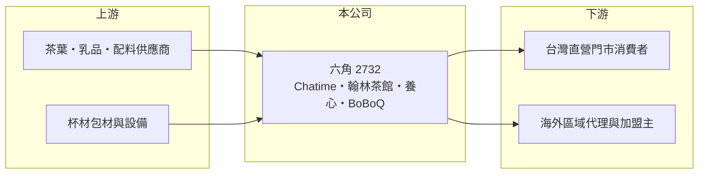

# 2732 六角

> 上櫃｜[[產業索引-觀光餐旅|觀光餐旅]]｜上市（櫃）日期 2015/01/20

# 第一章：企業模式與商業藍圖

> [!info] 撰寫說明
> 精簡版，由 Claude 依公開資料整理，架構比照 [[2330台積電]] 的四章研究，資料截至 2026-10-08。財務數字來源：Goodinfo 年度經營績效頁、工商時報 2026 年 5 月報導、櫃買中心開放資料（基本資料、2026 年第二季資產負債與綜合損益、每月營收、本益比）。#待校對

手搖茶飲是少數能從台灣成功輸出到全球的餐飲業態。本章說明六角國際（股票代號：2732，以下簡稱六角）如何以 Chatime 日出茶太在海外以[[加盟]]授權擴張，同時在台灣以[[直營]]與併購建立多品牌餐飲集團。

- **核心業務：** 六角成立於 2004 年，2015 年上櫃，董事長為創辦人王耀輝，實收資本額約 4.7 億元。核心品牌 Chatime 日出茶太是手搖茶飲連鎖，海外以區域代理與加盟方式拓展；台灣則經營 Chatime 直營店、翰林茶館、養心餐飲、春上布丁蛋糕等品牌，以及段純貞牛肉麵等餐飲品牌（待校對）。
- **營收結構：** 品牌與地區別營收比重本文未查得。海外加盟業務主要收入是向加盟主銷售茶葉、原物料與設備，以及收取授權費用；台灣直營店則賺取門市零售毛利。2026 年第一季毛利率約 50%，屬於餐飲業常見水準。
- **營運據點：** Chatime 海外市場以東南亞與澳洲為主，持續拓展歐洲與美國，2026 年計畫新增約 25 家海外店，第三季在美國休士頓開設第一家 Chatime 加春上布丁蛋糕的複合直營店。德國茶飲品牌 BoBoQ 自 2026 年 1 月起併入貢獻營收。
- **長期方向：** 公司在 2025 年調整營運，轉向以直營管理控制成本，目標 2026 年台灣直營店達 200 家，全年營運回到 2024 年水準。併購翰林茶館、養心餐飲與 BoBoQ，顯示六角正從單一茶飲品牌，走向以併購擴充品牌組合的餐飲集團。

# 第二章：護城河深度與競爭優勢

本章分析六角的競爭優勢與限制。

- **競爭優勢：** Chatime 是少數在海外有規模的台灣茶飲品牌，長期累積的海外加盟網絡與供應鏈（茶葉、配料出口）是新品牌難以短期複製的資產。加盟模式讓海外擴張不需要大量資本，總部主要負責品牌、產品開發與原物料供應。
- **限制與弱點：** 手搖茶飲門檻低、產品容易模仿，各國都有本土競爭者與中國茶飲品牌出海搶市。海外加盟主的經營品質不一，總部對門市的控制力有限。併購帶來品牌組合，也帶來商譽與整合風險，2025 年 EPS 只有 1.09 元，說明轉型期的成本不低。
- **主要對手：** 海外有貢茶、CoCo 都可、蜜雪冰城、霸王茶姬等茶飲品牌（非台股）；台灣茶飲與餐飲同業可對照 [[2726雅茗-KY]]、[[2753八方雲集]]、[[2727王品]]。
- **觀察重點：** 第一，台灣直營店能否如期達到 200 家並維持單店獲利；第二，海外每年淨增店數；第三，併購品牌（翰林、養心、BoBoQ）的獲利貢獻與商譽是否需要減損。

# 第三章：財務體質與盈利規模

資料日期：2026-10-08，表格是撰寫當時的快照；最新月營收、毛利率、累計 EPS 由自動排程寫在本筆記的屬性欄位（月營收、毛利率、累計EPS 等）。#待校對

本章用多年度三率、ROE 與資本報酬，檢視六角的財務體質。

| 年度 | 營收（新台幣） | [[毛利率]] | [[營業利益率]] | EPS（元） | [[ROE]] |
|---|---|---|---|---|---|
| 2020 | 41.7 億 | 42.2% | 5.73% | 3.08 | 7.46% |
| 2021 | 41.8 億 | 41.0% | 4.62% | 3.08 | 5.90% |
| 2022 | 42.1 億 | 44.1% | 8.23% | 6.56 | 14.0% |
| 2023 | 41.0 億 | 48.7% | 8.66% | 6.42 | 14.9% |
| 2024 | 40.1 億 | 51.2% | 5.71% | 4.79 | 9.51% |
| 2025 | 43.0 億 | 51.6% | 3.26% | 1.09 | 2.81% |
| 2026 上半年 | 26.5 億 | 50.2% | 5.93% | 2.13 | 未查得 |

註：2020 至 2025 年取自 Goodinfo，2026 上半年取自櫃買中心綜合損益表推算。

- **營收規模：** 2020 至 2025 年營收在 40 億至 43 億元之間，五年年複合成長率不到 1%（推算），長期幾乎沒有成長。2026 年因併購與直營化，前 8 月累計營收年增約 29.5%（櫃買中心每月營收資料），是近年少見的大幅成長。
- **獲利結構：** 毛利率從 42% 升到 51% 左右，反映產品組合轉向毛利較高的直營門市；但直營也帶來更多人事與租金，營業利益率在 2025 年降到 3.3%。2026 年上半年回升到約 5.9%，第一季單季 EPS 1.10 元就超過 2025 年全年。
- **長期指標：** 2021 至 2025 年平均 ROE 約 9.4%（推算）。依櫃買中心資料，最近一次現金股利為每股 3.5 元，高於 2025 年 EPS，代表公司動用過去累積的盈餘維持配息，這種配息水準需要獲利回升才能長期維持。
- **財務特色：** 2026 年第二季底總資產約 58.1 億元，負債約 36.0 億元，其中非流動負債約 15.1 億元（推估含門市[[租賃負債]]與併購相關借款）；權益約 22.1 億元，其中非控制權益約 4.3 億元，反映部分併購子公司並非百分之百持有。

**[[ROIC]] 與 [[WACC]]：** 2025 年營業利益約 1.40 億元（43.0 億 × 3.26%），稅後約 1.12 億元；投入資本以 2026 年第二季權益 22.1 億元加上非流動負債 15.1 億元合計約 37.2 億元，ROIC 約 3%（推算）。以 2026 年上半年營業利益 1.57 億元年化，ROIC 約 6.8%（推算：1.57 × 2 × 0.8 ÷ 37.2）。WACC 以 CAPM 推估：無風險利率 1.75%、市場風險溢酬 6%、β 取餐飲股常見值 0.8，股東權益成本約 6.55%；負債成本 2.75%、稅後 2.2%；權益約占 59%，WACC 約 4.8%（推算）。2025 年 ROIC 低於 WACC，2026 年的回升若能延續，ROIC 有機會重新高於 WACC；併購擴張能否帶來超過資金成本的報酬，是六角長期價值的關鍵。

# 第四章：總體風險與地緣政治

本章分析六角長期面對的風險。

- **產業週期：** 茶飲屬於低單價的日常消費，景氣影響相對有限，但競爭週期很明顯：新品牌與新口味會快速分走流量，品牌需要持續推出新品維持熱度。
- **營運風險：** 直營化提高門市固定成本，營收若不如預期，利潤率會快速下滑；併購品牌的整合、商譽減損與管理分散都是風險。海外加盟主若經營不善或轉換品牌，會影響原物料銷售與授權收入。
- **其他風險：** 茶葉、乳品、糖與包材價格波動；海外營收以外幣計價，匯率影響帳面數字；各國食品法規與食安事件；台灣基本工資上漲推高直營店成本。

# 專有名詞解析

## 金融

- **[[租賃負債]]**：依 IFRS 16，承租人須把長期租約未來應付租金折現認列為負債，飯店與餐飲業的金額通常很大。
- **[[ROIC]]**：投入資本報酬率，稅後營業利益除以股東權益與有息負債的合計，衡量本業對所有資金提供者的報酬。
- **[[WACC]]**：加權平均資金成本，依股東權益與負債的比重加權計算的資金成本，ROIC 高於它才代表創造價值。

## 產業

- **[[直營]]**：由總部自行出資開設並管理的門市，可直接控制品質，但須自行負擔租金、人事與開店成本。
- **[[加盟]]**：由加盟主出資開店、使用總部品牌與供應鏈，總部收取加盟金、權利金或原物料差價的經營模式。
- **[[多品牌經營]]**：同一集團經營多個定位不同的品牌，以覆蓋不同客群並分散單一品牌衰退的風險。

# 核心供應鏈

- 上游：茶葉、乳品、珍珠與配料供應商，杯材包材與飲料設備供應商。
- 下游／客戶：台灣直營門市的消費者，以及海外各國的 Chatime 區域代理與加盟主（向六角採購原物料並支付授權費用）。
- 同業：[[2726雅茗-KY]]、[[2753八方雲集]]、[[2727王品]]。

## 最新新聞
<!-- news:start -->
<!-- news:end -->

## 相關連結
- [公開資訊觀測站](https://mopsov.twse.com.tw/mops/web/t05st03?step=1&firstin=1&co_id=2732)
- [Goodinfo](https://goodinfo.tw/tw/StockDetail.asp?STOCK_ID=2732)
- [Yahoo 股市](https://tw.stock.yahoo.com/quote/2732)
- [鉅亨網新聞](https://www.cnyes.com/twstock/2732/news)
