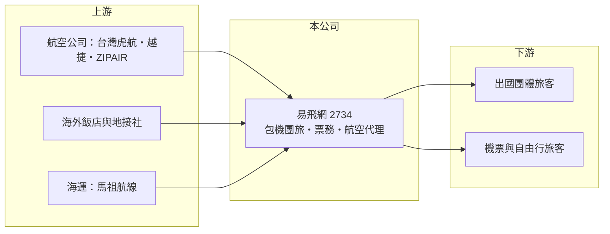

# 2734 易飛網

> 上櫃｜[[產業索引-觀光餐旅|觀光餐旅]]｜上市（櫃）日期 2013/12/26

# 第一章：企業模式與商業藍圖

> [!info] 撰寫說明
> 精簡版，由 Claude 依公開資料整理，架構比照 [[2330台積電]] 的四章研究，資料截至 2026-10-08。財務數字來源：Goodinfo 年度經營績效頁、今周刊 2026 年 9 月報導、櫃買中心開放資料（基本資料、2026 年第二季資產負債與綜合損益、每月營收、本益比）。#待校對

當機票銷售被國際線上平台與航空公司官網瓜分，傳統票務代理該如何生存？本章說明易飛網（股票代號：2734，以下簡稱易飛網）如何從台灣第一家[[OTA]]，轉型為以[[包機]]與自製行程為核心的團體旅遊業者。

- **核心業務：** 易飛網成立於 1999 年，前身是遠東航空的電子訂票部門，後來獨立營運，2013 年上櫃，董事長為周昀生，實收資本額約 5.7 億元。業務包括機票代訂、團體旅遊、包機、航空公司總代理，另有馬祖南北海運代理。
- **轉型歷程：** 2010 年代 Expedia 等國際 OTA 以低價競爭，代訂機票愈來愈難賺。2018 年周昀生接任總經理後，決定自行設計團體旅遊行程；2022 年底與 [[6757台灣虎航]] 合作推出峴港包機，2023 年推出佐賀包機（首月載客率 99.7%），一年內陸續推出六條整架或部分包機航線。2024 年取得越捷航空台灣總代理，2025 年 10 月取得日本 ZIPAIR 的獨家合作。
- **營收結構：** 依 2026 年 9 月報導，2026 年前 8 月營收突破 14 億元，其中國外團體旅遊占比近九成，代表公司已從票務代理轉型為團體旅遊業者。經營層表示團體旅遊的毛利是純票務的一倍以上。
- **長期方向：** 公司以「包機取得獨家機位、自製行程提高毛利、航空代理擴大業務」三條路線發展，2024 年起團體旅遊團隊擴大為 3 倍、約 60 人。這套模式的關鍵在於包機的載客率，賣得好時毛利高，賣不好時空位成本也全由公司吸收。

# 第二章：護城河深度與競爭優勢

本章分析易飛網的競爭優勢與限制。

- **競爭優勢：** 包機讓易飛網取得一般航班沒有的航點與時段（如佐賀、峴港），產品不容易被比價；航空公司台灣總代理（越捷）與獨家合作（ZIPAIR）讓它在機位取得上有別於一般旅行社。二十多年的票務系統與航空公司關係，是它轉型團體旅遊的基礎。
- **限制與弱點：** 公司曾連續約八年虧損，2026 年第二季底保留盈餘仍為負約 2.0 億元。2025 年因轉投資「飛買家」拖累，全年轉為虧損，顯示多角化投資的管理能力仍待證明。規模也遠小於大型旅行社，品牌知名度有限。
- **主要對手：** [[2731雄獅]]、[[2743山富]]、[[2706第一店]]、[[2719燦星旅]]、[[6961旅天下]]、[[5706鳳凰]]，以及 Expedia、Klook、KKday 等國際線上旅遊平台。
- **觀察重點：** 第一，包機航線的載客率與獲利；第二，本業獲利能否穩定，並擺脫轉投資造成的業外損失；第三，航空代理業務能否成為穩定的收入來源。

# 第三章：財務體質與盈利規模

資料日期：2026-10-08，表格是撰寫當時的快照；最新月營收、毛利率、累計 EPS 由自動排程寫在本筆記的屬性欄位（月營收、毛利率、累計EPS 等）。#待校對

本章用多年度三率、ROE 與資本報酬，檢視易飛網的財務體質。

| 年度 | 營收（新台幣） | [[毛利率]] | [[營業利益率]] | EPS（元） | [[ROE]] |
|---|---|---|---|---|---|
| 2020 | 4.25 億 | 14.7% | -25.2% | -2.51 | -32.7% |
| 2021 | 1.98 億 | 20.2% | -45.5% | -2.29 | -34.1% |
| 2022 | 4.36 億 | 22.4% | -15.1% | -1.26 | -17.0% |
| 2023 | 16.1 億 | 12.4% | 1.30% | 0.56 | 7.84% |
| 2024 | 16.0 億 | 10.5% | -3.24% | 1.00 | 7.00% |
| 2025 | 16.4 億 | 14.0% | -0.99% | -1.42 | -11.8% |
| 2026 上半年 | 10.2 億 | 14.8% | 2.03% | 0.02 | 未查得 |

註：2020 至 2025 年取自 Goodinfo，2026 上半年取自櫃買中心綜合損益表推算。

- **營收規模：** 2023 年國境解封後營收跳到約 16 億元，2024、2025 年持平；2026 年前 8 月累計營收年增約 32.9%，有機會突破 2025 年全年水準。
- **獲利結構：** 2023 至 2025 年營業利益率在 -3% 到 1% 之間，本業接近損益兩平；2024 年 EPS 1.00 元主要來自[[業外收益]]，2025 年則因轉投資虧損 EPS 轉為 -1.42 元。2026 年上半年營業利益約 0.21 億元，但業外損失約 0.19 億元，幾乎抵銷本業獲利，EPS 只有 0.02 元。
- **長期指標：** 2021 至 2025 年平均 ROE 約 -9.6%（推算）；近年未配發現金股利（櫃買中心本益比資料）。
- **財務特色：** 2026 年第二季底總資產約 11.2 億元，負債約 4.6 億元（以流動負債為主，推估多為預收團費），非流動負債約 0.5 億元，權益約 6.5 億元，每股淨值 11.42 元，財務槓桿低。

**[[ROIC]] 與 [[WACC]]：** 2025 年營業利益約 -0.16 億元（16.4 億 × -0.99%），稅後營業利益為負；投入資本以權益 6.5 億元加上非流動負債 0.5 億元合計約 7.1 億元，ROIC 約 -1.8%（推算）。以 2026 年上半年營業利益 0.21 億元年化，ROIC 約 4.7%（推算：0.21 × 2 × 0.8 ÷ 7.1）。WACC 以 CAPM 推估：無風險利率 1.75%、市場風險溢酬 6%、β 取旅遊股常見值 1.0，股東權益成本約 7.75%；有息負債很少，WACC 約 7.4%（推算）。ROIC 目前仍低於 WACC，代表轉型尚未讓本業創造價值；包機與團旅若能把營業利益率推到 4% 以上，ROIC 才有機會超過資金成本。

# 第四章：總體風險與地緣政治

本章分析易飛網長期面對的風險。

- **產業週期：** 出國旅遊需求受景氣、匯率與疫情等事件影響，2020 至 2022 年營收曾大幅萎縮。日本、越南等主要目的地的旅遊熱度與匯率，直接影響包機銷售。
- **營運風險：** 包機須預先承諾機位，若銷售不佳會產生空位損失；營收集中在國外團旅，產品線較單一。轉投資事業曾造成重大虧損，未來的投資決策與控管需要觀察。
- **其他風險：** 航空公司調整航線或合作條件，會影響總代理與包機業務；燃油價格、地緣政治與天災可能導致取消；國際 OTA 持續壓低票務價差。旅行業須繳交保證金與履約保證，大規模取消時會有退費壓力。

# 專有名詞解析

## 金融

- **[[業外收益]]**：本業以外的收入，例如投資收益、處分利益或匯兌利益，通常較不穩定。
- **[[ROIC]]**：投入資本報酬率，稅後營業利益除以股東權益與有息負債的合計，衡量本業對所有資金提供者的報酬。
- **[[WACC]]**：加權平均資金成本，依股東權益與負債的比重加權計算的資金成本，ROIC 高於它才代表創造價值。

## 產業

- **[[OTA]]**：線上旅行社（Online Travel Agency），透過網站或 App 銷售機票、訂房與旅遊商品，例如 Booking、Klook。
- **[[包機]]**：旅行社向航空公司包下整架或部分班機的機位，自行銷售，可開發冷門航點但須承擔空位風險。
- **[[團體旅遊]]**：旅行社把機票、住宿、交通與導遊打包成固定行程販售的旅遊產品，以團費總額認列營收。

# 核心供應鏈

- 上游：航空公司（[[6757台灣虎航]]、越捷航空、ZIPAIR 等）提供包機與代理機位，海外飯店與地接社提供當地服務，馬祖南北航線船公司委託代理。
- 下游／客戶：出國團體旅遊旅客、購買機票與自由行商品的個人旅客。
- 同業：[[2731雄獅]]、[[2743山富]]、[[2706第一店]]、[[2719燦星旅]]、[[6961旅天下]]、[[5706鳳凰]]。

## 最新新聞
<!-- news:start -->
<!-- news:end -->

## 相關連結
- [公開資訊觀測站](https://mopsov.twse.com.tw/mops/web/t05st03?step=1&firstin=1&co_id=2734)
- [Goodinfo](https://goodinfo.tw/tw/StockDetail.asp?STOCK_ID=2734)
- [Yahoo 股市](https://tw.stock.yahoo.com/quote/2734)
- [鉅亨網新聞](https://www.cnyes.com/twstock/2734/news)
