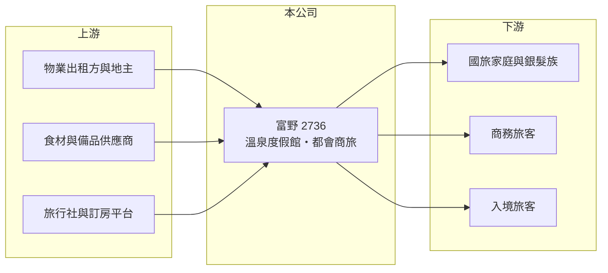

# 2736 富野

> 上櫃｜[[產業索引-觀光餐旅|觀光餐旅]]｜上市（櫃）日期 2016/01/06

# 第一章：企業模式與商業藍圖

> [!info] 撰寫說明
> 精簡版，由 Claude 依公開資料整理，架構比照 [[2330台積電]] 的四章研究，資料截至 2026-10-08。財務數字來源：Goodinfo 年度經營績效頁、富果研究整理的 2025 年 12 月法說會摘要、櫃買中心開放資料（基本資料、2026 年第二季資產負債與綜合損益、每月營收、本益比）。#待校對

以平價國旅為定位的飯店連鎖，能不能賺錢取決於兩件事：能否用低成本取得物業，以及能否在淡季維持足夠的[[住房率]]。本章說明富野集團（股票代號：2736，以下簡稱富野）如何以溫泉度假與都會商務旅館兩條產品線經營，以及它目前面臨的結構性挑戰。

- **核心業務：** 富野成立於 2008 年，2016 年上櫃，董事長為劉清郎，實收資本額約 8.0 億元。主要業務是一般旅館業，提供住宿、餐飲與休閒服務，定位為價格親民的國旅品牌。
- **營運據點：** 依 2025 年 12 月法說會摘要，富野在全台營運 8 個據點，分為兩類：度假型的武陵富野渡假村（台中）、知本溫泉會館、關子嶺富野溫泉會館（台南），以及都會商務休閒型的高雄、花蓮、台東市區、嘉義等館；緬甸仰光據點籌備中。集團總部將遷至台東富野渡假酒店。
- **營收結構：** 各據點營收占比本文未查得。2025 年 9 月集團平均住房率約 48.1%，[[平均房價]]約 3,000 至 4,000 元，其中武陵富野約 46%、高雄富野約 40%，花蓮館因天災降至約 24%。這個住房率水準代表大部分據點平日有一半以上的房間空著。
- **長期方向：** 知本的富野大飯店（580 間客房）在 2025 年 11 月租約到期後結束營運，是集團規模的一次重大調整。新據點方面，武陵富野於 2024 年第四季整修後重新營運，關子嶺溫泉會館於 2024 年開幕，台東杉原灣的杉原文旅預計 2026 年第三季試營運。公司以租賃或整修既有物業擴張，屬於較[[輕資產]]的模式，但也意味著租約到期時可能失去據點。

# 第二章：護城河深度與競爭優勢

本章分析富野的競爭優勢與限制。

- **競爭優勢：** 富野的據點多在溫泉與自然景觀區（武陵、知本、關子嶺、台東），結合平價定位，能吸引家庭與銀髮族的國旅需求。多據點經營也讓它能做區域聯合採購與會員共用，降低單館成本。
- **限制與弱點：** 定位平價代表房價提升空間有限，而人事與電價等成本持續上漲，利潤被雙向擠壓。據點多在花東，受天災與交通影響大；最大的富野大飯店結束營運，也使營收基礎縮小。2021 年以後有四年營業利益為負，說明現有模式尚未找到穩定獲利的方式。
- **主要對手：** 國旅度假飯店同業如 [[2712遠雄來]]、[[2722夏都]]、[[2705六福]]、[[2707晶華]] 旗下捷絲旅，以及各地溫泉旅館與平價連鎖商旅。
- **觀察重點：** 第一，富野大飯店退出後，其餘據點的營收能否填補缺口（2026 年前 8 月累計營收年增約 14.8%）；第二，杉原文旅開幕後的住房率；第三，集團平均住房率能否回到五成以上。

# 第三章：財務體質與盈利規模

資料日期：2026-10-08，表格是撰寫當時的快照；最新月營收、毛利率、累計 EPS 由自動排程寫在本筆記的屬性欄位（月營收、毛利率、累計EPS 等）。#待校對

本章用多年度三率、ROE 與資本報酬，檢視富野的財務體質。

| 年度 | 營收（新台幣） | [[毛利率]] | [[營業利益率]] | EPS（元） | [[ROE]] |
|---|---|---|---|---|---|
| 2020 | 6.34 億 | 54.5% | 4.53% | 0.18 | 0.70% |
| 2021 | 4.93 億 | 51.6% | -6.14% | -0.69 | -2.82% |
| 2022 | 5.92 億 | 55.7% | 4.66% | 0.24 | 1.01% |
| 2023 | 5.29 億 | 54.3% | -6.61% | -0.40 | -2.11% |
| 2024 | 3.85 億 | 44.6% | -39.9% | -1.77 | -9.05% |
| 2025 | 5.24 億 | 45.4% | -24.0% | -1.83 | -10.6% |
| 2026 上半年 | 2.96 億 | 48.4% | -13.0% | -0.58 | 未查得 |

註：2020 至 2025 年取自 Goodinfo，2026 上半年取自櫃買中心綜合損益表推算。

- **營收規模：** 營收長期在 4 億至 6.3 億元之間，2024 年因據點整修與花蓮地震降到 3.85 億元，2025 年回升到 5.24 億元，五年營收沒有成長。
- **獲利結構：** 飯店的租金、人事與折舊是固定成本，[[營運槓桿]]很高：營收在 6 億元左右時營業利益率約 4% 至 5%，營收低於 5.5 億元時就轉為虧損，2024 年營業利益率更低到 -40%。2026 年上半年虧損幅度收斂到 -13%，但仍未損益兩平。
- **長期指標：** 2021 至 2025 年平均 ROE 約 -4.7%（推算）；近年未配發現金股利（櫃買中心本益比資料），2026 年第二季底保留盈餘為負約 0.36 億元。
- **財務特色：** 2026 年第二季底總資產約 23.0 億元，負債約 8.8 億元，其中非流動負債約 5.8 億元（推估多為飯店租約的[[租賃負債]]與長期借款），權益約 14.1 億元，每股淨值 17.13 元，負債比約 38%。

**[[ROIC]] 與 [[WACC]]：** 2025 年營業利益約 -1.26 億元（5.24 億 × -24.0%），稅後營業利益為負；投入資本以權益 14.1 億元加上非流動負債 5.8 億元合計約 19.9 億元，ROIC 約 -5%（推算）。即使在獲利的 2022 年，ROIC 也只有約 1.1%（推算：5.92 億 × 4.66% × 0.8 ÷ 19.9 億）。WACC 以 CAPM 推估：無風險利率 1.75%、市場風險溢酬 6%、β 取小型觀光股常見值 0.9，股東權益成本約 7.15%；負債成本 2.75%、稅後 2.2%；權益約占 71%，WACC 約 5.7%（推算）。ROIC 長期低於 WACC 且近年為負，代表富野的據點組合沒有為股東創造價值，必須提高住房率或房價，讓本業營業利益率回到 10% 以上，資本報酬才會超過資金成本。

# 第四章：總體風險與地緣政治

本章分析富野長期面對的風險。

- **產業週期：** 國旅需求受出國旅遊熱潮擠壓，疫情後國人大量出國，國內度假飯店平日住房率偏低。政府國旅補助只能短期刺激需求，淡旺季落差仍大。
- **營運風險：** 以租賃為主的模式，在租約到期時可能失去據點（如 2025 年的富野大飯店）；新據點整修與開幕初期通常虧損。全台飯店供給增加，價格競爭激烈。緬甸據點的政治與經營環境風險高。
- **其他風險：** 花東地區地震、颱風影響交通與觀光；基本工資與電價調漲推高固定成本；溫泉與老舊物業的維修支出較高。

# 專有名詞解析

## 金融

- **[[營運槓桿]]**：固定成本占比高時，營收小幅變動會使營業利益大幅變動的現象。
- **[[租賃負債]]**：依 IFRS 16，承租人須把長期租約未來應付租金折現認列為負債，飯店與餐飲業的金額通常很大。
- **[[ROIC]]**：投入資本報酬率，稅後營業利益除以股東權益與有息負債的合計，衡量本業對所有資金提供者的報酬。
- **[[WACC]]**：加權平均資金成本，依股東權益與負債的比重加權計算的資金成本，ROIC 高於它才代表創造價值。

## 產業

- **[[住房率]]**：已售出客房數占可售客房數的比例，是衡量飯店需求最直接的指標。
- **[[平均房價]]**：已售出客房的平均每晚房價，與住房率相乘即可推算每間可售客房的收入。
- **[[輕資產]]**：不自己擁有土地與建物，改以管理合約或租賃擴張，降低資本支出並提高資本報酬率的經營方式。

# 核心供應鏈

- 上游：提供飯店物業的出租方與地主，食材、備品與能源供應商，以及合作的旅行社、運輸業者與線上訂房平台。
- 下游／客戶：國旅家庭、銀髮族與團體旅客，都會館的商務旅客，以及入境觀光客。
- 同業：[[2712遠雄來]]、[[2722夏都]]、[[2705六福]]、[[2707晶華]]。

## 最新新聞
<!-- news:start -->
<!-- news:end -->

## 相關連結
- [公開資訊觀測站](https://mopsov.twse.com.tw/mops/web/t05st03?step=1&firstin=1&co_id=2736)
- [Goodinfo](https://goodinfo.tw/tw/StockDetail.asp?STOCK_ID=2736)
- [Yahoo 股市](https://tw.stock.yahoo.com/quote/2736)
- [鉅亨網新聞](https://www.cnyes.com/twstock/2736/news)
