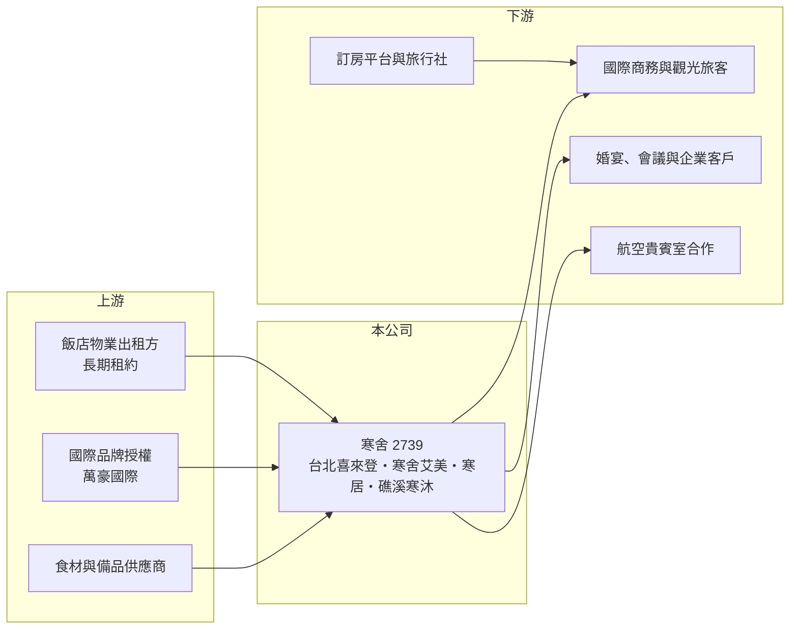

# 2739 寒舍

> 上市｜[[產業索引-觀光餐旅|觀光餐旅]]｜上市（櫃）日期 2016/05/19

# 第一章：企業模式與商業藍圖

> [!info] 撰寫說明
> 精簡版，由 Claude 依公開資料整理，架構比照 [[2330台積電]] 的四章研究，資料截至 2026-10-08。來源：Goodinfo 年度經營績效頁、優分析 2025 年飯店業報導、證交所開放資料快照（基本資料、2026 年第二季資產負債與綜合損益、股利）。各飯店房間數與客房／餐飲營收比重未查得。#待校對

本章說明寒舍餐旅（股票代號：2739，以下簡稱寒舍）靠什麼賺錢：它是一家以台北都會區高端飯店為核心、兼營宜蘭溫泉度假酒店的觀光旅館經營公司。

- **核心業務：** 寒舍成立於 2000 年，2016 年上市，旗下經營台北喜來登大飯店、台北寒舍艾美酒店、寒居酒店與礁溪寒沐酒店。前兩家掛萬豪國際（Marriott）旗下品牌，能共用萬豪的全球訂房系統與會員，寒居與寒沐則是自有品牌。這種「國際品牌加自有品牌」的組合，讓公司同時有國際商務客源與自主定價的空間。
- **營收結構：** 飯店收入主要來自客房與餐飲兩大塊，台北喜來登館內的米其林一星中餐廳請客樓與辰園，是餐飲業務的招牌。餐飲除了內用，也延伸到婚宴、會議與外部合作，例如與 [[2646星宇航空]] 合作把請客樓的菜色帶進桃園機場貴賓室。客房與餐飲的實際比重本次未查得，但對國際觀光旅館而言，餐飲通常占相當高的比例，能在客房淡季提供支撐。
- **營運據點：** 依優分析整理的交通部觀光署統計，台北市國際觀光旅館某年上半年平均[[住房率]]約 72.5%、[[平均房價]]約 5,531 元，而台北寒舍艾美住房率約 87%、平均房價超過一萬元，寒居住房率約 81%，顯示寒舍的台北據點在價格與入住率上都高於同業平均。四家飯店集中在台北與宜蘭礁溪，地理集中度高。
- **長期方向：** 公司的策略是讓兩家萬豪品牌飯店深耕國際商務與高端客群，寒居鎖定香港、日本自由行，寒沐強化溫泉度假定位。飯店業成長主要靠既有館的房價提升、客房改裝與餐飲延伸，而不是快速增加新館。2026 年起推動的中高階主管員工持股，則反映公司把留才視為服務業的長期競爭力。

# 第二章：護城河深度與競爭優勢

飯店業的護城河主要來自地段、品牌與服務口碑，本章分析寒舍具備哪些不易被複製的條件。

- **競爭優勢：** 台北市中心的大型國際觀光飯店土地稀缺，新進者很難在相同地段蓋出同規模的飯店，這是寒舍最主要的結構性優勢。萬豪品牌帶來的會員客源，讓公司不必完全依賴旅行社與訂房平台，降低通路抽成。米其林星級餐廳則讓餐飲業務擁有品牌溢價，可以支撐較高的宴會與外燴價格。
- **主要對手：** 在台北高端飯店市場，寒舍的對手包括 [[2707晶華]]（晶華酒店與麗晶品牌）、[[2704國賓]]、[[2748雲品]]（君品酒店）、[[2712遠雄來]]，以及台北萬豪、W 飯店等外資或集團飯店。宜蘭溫泉度假市場則面對 [[5704老爺知]]、[[2705六福]] 與眾多地方型溫泉旅館。各家都在搶同一批國際商務客、婚宴與高端國旅客。
- **觀察重點：** 2021 至 2022 年疫情期間寒舍連續虧損，2022 年 ROE 為 -44.5%，說明飯店業在需求消失時沒有防禦力，護城河只在需求正常時有效。長期要觀察的是國際商務與展會客源能否持續回流、高房價能否維持，以及公司在既有館之外有沒有新的成長來源。

# 第三章：財務體質與盈利規模

資料日期：2026-10-08，表格是撰寫當時的快照；最新月營收、毛利率、累計 EPS 由自動排程寫在本筆記的屬性欄位（月營收、毛利率、累計EPS 等）。#待校對

本章用五年的經營數字、資本報酬與股利，檢視寒舍走出疫情後的獲利品質。

| 年度 | 營收（新台幣） | [[毛利率]] | [[營業利益率]] | EPS（元） | [[ROE]] |
|---|---|---|---|---|---|
| 2021 | 23.3 億 | 8.07% | -34.4% | -6.45 | -62.4% |
| 2022 | 34.2 億 | 24.8% | -6.73% | -3.69 | -44.5% |
| 2023 | 48.3 億 | 38.6% | 13.0% | 4.52 | 43.5% |
| 2024 | 50.3 億 | 39.5% | 14.0% | 5.39 | 36.3% |
| 2025 | 51.7 億 | 39.9% | 7.81% | 2.36 | 13.7% |

- **營收規模：** 營收從 2021 年疫情低點的 23.3 億元回升到 2025 年的 51.7 億元，四年年複合成長率約 22%（推算），但這主要是疫情基期回升，不能視為常態成長。2023 年後營收增速明顯放緩，代表既有館已接近滿載，後續成長要靠房價與餐飲單價。2026 年上半年營收 26.9 億元，[[毛利率]] 40.4%、[[營業利益率]] 12.7%、EPS 2.73 元（證交所開放資料）。
- **獲利：** 飯店人事、租金與折舊多屬固定成本，屬於典型的[[營運槓桿]]產業，營收一回升利潤率就跳升，2023 年營業利益率由負轉為 13%。2025 年營業利益率降到 7.8%，原因本次未查得，可能與成本上升或一次性費用有關（推估）。2021 至 2025 年平均 ROE 約 -2.7%（推算），被疫情兩年大幅拉低，若只看 2023 至 2025 年則平均約 31%。
- **財務特色：** 依 2026 年第二季資料，寒舍總資產 113.7 億元，負債 97.3 億元，股東權益只有 16.4 億元，其中非流動負債 72.5 億元。這樣的結構推估主要來自飯店物業長期承租所認列的[[租賃負債]]（推估），因此 ROE 被高槓桿放大，帳面 ROE 看起來很高，但不代表資產本身報酬率高。2025 年度現金股利 2.58 元，高於當年 EPS 2.36 元，[[配息率]]超過 100%，顯示公司偏好把現金發還股東。
- **[[ROIC]] 與 [[WACC]]：** 以 2025 年計，營業利益約 4.04 億元（51.7 億 × 7.81%），稅後約 3.23 億元；投入資本取 2026 年第二季股東權益 16.4 億元加非流動負債 72.5 億元（視為租賃與長期有息負債），合計約 88.9 億元，ROIC 約 3.6%（推算）；若用 2024 年營業利益約 7.0 億元計算，ROIC 約 6.3%（推算）。WACC 以 CAPM 推估：10 年期公債 1.75%、市場風險溢酬 6%、β 取觀光同業常見值 0.8，股東權益成本約 6.6%；租賃與借款成本假設 3%、稅後 2.4%；權益占投入資本約 18%，WACC 約 3.2%（推算）。ROIC 只略高於 WACC，代表在把租賃當成資本計算後，寒舍創造的超額價值不大，價值主要來自高槓桿下的股東報酬，景氣反轉時風險也會被放大。

# 第四章：總體風險與地緣政治

飯店業高度受旅遊需求與總體景氣影響，本章整理寒舍長期必須面對的風險。

- **產業週期：** 國際觀光飯店的需求來自商務差旅、國際旅客、展會與婚宴，這些都和景氣與國境政策同步。疫情期間寒舍連虧兩年，證明這類資產在需求斷崖時幾乎沒有緩衝。景氣下滑時企業先砍差旅與尾牙，飯店營收會比整體經濟更早、更大幅度地下滑。
- **營運風險：** 飯店是勞力密集產業，基本工資調升與服務人力短缺會直接壓縮利潤，公司已透過校園合作與新南向人才計畫擴大人力來源。高額租賃負債代表每年的固定支出很難因營收減少而調降，營業槓桿雙向放大。四家飯店集中在台北與宜蘭，單一城市的需求變化影響很大。
- **其他風險：** 國際品牌授權合約若到期不續約或條件改變，會影響客源與品牌定位。兩岸關係、國際航班與匯率會左右外國旅客來台意願，而新台幣走強則可能讓國人轉往海外旅遊。新飯店在台北陸續開幕，也可能壓抑高端市場的房價。

# 專有名詞解析

## 金融

- **[[營運槓桿]]**：固定成本占比高時，營收小幅變動會使營業利益大幅變動的現象。
- **[[租賃負債]]**：承租場地或設備依會計準則認列的未來租金現值負債。
- **[[ROIC]]**：投入資本報酬率，稅後營業利益除以股東權益加有息負債，衡量本業運用資本的效率。
- **[[WACC]]**：加權平均資金成本，股東與債權人要求報酬率的加權平均，是 ROIC 要超越的門檻。

## 產業

- **[[住房率]]**：已出租客房數占可售客房數的比例，是飯店需求強弱的核心指標。
- **[[平均房價]]**：客房收入除以已出租房數，反映飯店的定價能力。

# 核心供應鏈

- 上游：飯店物業出租方、萬豪國際品牌授權與訂房系統、食材與備品供應商。
- 下游／客戶：國際商務與觀光旅客、婚宴與會議客戶；航空合作如 [[2646星宇航空]] 貴賓室。
- 同業：[[2707晶華]]、[[2704國賓]]、[[2748雲品]]、[[2712遠雄來]]、[[5704老爺知]]、[[2705六福]]。

## 最新新聞
<!-- news:start -->
<!-- news:end -->

## 相關連結
- [公開資訊觀測站](https://mopsov.twse.com.tw/mops/web/t05st03?step=1&firstin=1&co_id=2739)
- [Goodinfo](https://goodinfo.tw/tw/StockDetail.asp?STOCK_ID=2739)
- [Yahoo 股市](https://tw.stock.yahoo.com/quote/2739)
- [鉅亨網新聞](https://www.cnyes.com/twstock/2739/news)
