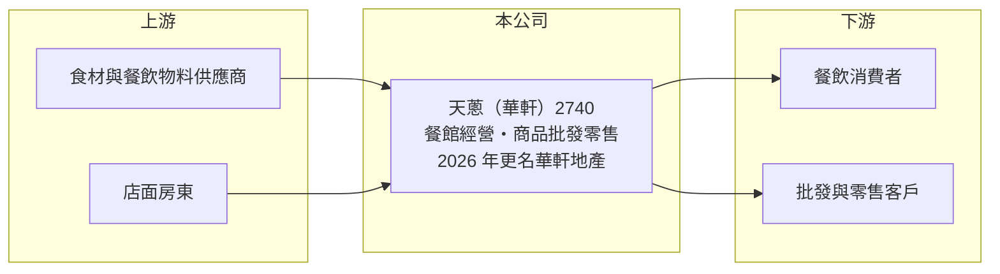

# 2740 天蔥

> 上櫃｜[[產業索引-觀光餐旅|觀光餐旅]]｜上市（櫃）日期 2015/12/24

# 第一章：企業模式與商業藍圖

> [!info] 撰寫說明
> 精簡版，由 Claude 依公開資料整理，架構比照 [[2330台積電]] 的四章研究，資料截至 2026-10-08。來源：Goodinfo 年度經營績效頁、nStock 公司簡介、櫃買中心開放資料快照（基本資料、2026 年第二季資產負債與綜合損益、每月營收）。公開資料有限，品牌與營收結構未查得；更名後的實際業務方向待公司公告確認。#待校對

本章說明天蔥（股票代號：2740）的事業內容。公司在櫃買中心的簡稱已改為「華軒」，是一家規模很小、長期虧損、正在[[轉型]]、調整定位的觀光餐旅類上櫃公司。

- **核心業務：** 依 nStock 整理的公司資料，合併公司主要營業項目為經營各式餐館、商品批發及零售。公司 2015 年底在櫃買中心掛牌，實收資本額約 1.68 億元，屬於股本極小的公司。由於營收規模只有一至二億元，任何單一門市或業務的變動都會明顯影響整體表現。
- **更名與轉型：** 依 nStock 資料，公司在 2025 年 12 月股東臨時會通過更名，2026 年 1 月經新北市政府核准，由天蔥國際更名為華軒地產股份有限公司。名稱從餐飲轉向「地產」，代表經營層可能把重心移往不動產相關業務，但本次未查得具體的事業計畫，屬於需要追蹤公告確認的結構性變化。對長期投資人而言，公司未來的獲利模式仍不確定。
- **營收結構：** 本次未查得各品牌或各業務的營收比重。從櫃買中心月營收資料看，2026 年 1 至 8 月累計營收約 3,770 萬元，較去年同期減少約 61%，顯示原有餐飲業務正在大幅縮小（推估與轉型有關）。
- **長期方向：** 在原本的餐飲業務持續虧損的情況下，公司的長期價值取決於新業務是否能建立穩定收入來源。投資人應把它視為「轉型中的殼型小公司」來研究，重點放在新事業的實際內容與資金來源，而非過去的餐飲數字。

# 第二章：護城河深度與競爭優勢

護城河是企業維持超額利潤的能力。天蔥規模小、連年虧損，本章說明它目前缺乏哪些條件，以及轉型後要看什麼。

- **競爭優勢：** 從 2021 至 2025 年連續五年營業虧損來看，天蔥在餐飲市場並沒有展現出品牌或成本上的優勢。毛利率維持在 36% 至 42%，屬於餐飲業正常水準，但營業費用遠高於毛利，代表規模不足以攤提租金與人事。公司目前唯一可見的資源是上櫃公司的身分與約 1.3 億元的股東權益。
- **主要對手：** 原有餐飲業務面對的是 [[2727王品]]、[[2729瓦城]]、[[2752豆府]]、[[2753八方雲集]] 等大型連鎖集團，這些對手在採購、展店與行銷上都有規模優勢。若轉往不動產，則要面對眾多資本更雄厚的建商與開發商，小型公司較難取得好地段與融資條件。
- **觀察重點：** 要觀察公司是否公布具體的不動產開發或租賃計畫、是否辦理增資或引進新股東，以及原有餐飲門市的處理方式。轉型若缺乏資金與專業團隊，可能持續消耗股東權益。

# 第三章：財務體質與盈利規模

資料日期：2026-10-08，表格是撰寫當時的快照；最新月營收、毛利率、累計 EPS 由自動排程寫在本筆記的屬性欄位（月營收、毛利率、累計EPS 等）。#待校對

本章用五年經營數字檢視天蔥的財務體質，重點在於虧損的持續性與資本侵蝕。

| 年度 | 營收（新台幣） | [[毛利率]] | [[營業利益率]] | EPS（元） | [[ROE]] |
|---|---|---|---|---|---|
| 2021 | 1.10 億 | 42.5% | -39.4% | -2.65 | -89.4% |
| 2022 | 0.88 億 | 38.2% | -61.4% | -3.34 | -55.8% |
| 2023 | 1.64 億 | 41.3% | -29.5% | -2.15 | -29.1% |
| 2024 | 2.36 億 | 35.7% | -21.7% | -4.65 | -51.0% |
| 2025 | 1.28 億 | 39.9% | -25.5% | -3.19 | -51.6% |

- **營收規模：** 營收在 0.9 億至 2.4 億元之間波動，2024 年曾增至 2.36 億元，2025 年又降到 1.28 億元，2026 年上半年只有約 3,000 萬元（櫃買中心資料）。營收規模太小，無法支撐上市櫃公司的固定營運成本。
- **獲利：** 五年平均 ROE 約 -55%（推算），每年 EPS 都是負數。2026 年上半年營業虧損約 2,300 萬元、EPS -2.10 元，虧損仍在持續。公司沒有發放現金股利的能力。
- **財務特色：** 依 2026 年第二季資料，總資產約 1.73 億元，負債約 0.45 億元，股東權益約 1.28 億元，[[每股淨值]]約 7.65 元，已低於面額 10 元，代表累積虧損已侵蝕部分股本。負債比不高，短期財務壓力有限，但若虧損持續，股東權益會繼續縮水。
- **[[ROIC]] 與 [[WACC]]：** 2025 年營業虧損約 0.33 億元（1.28 億 × -25.5%），虧損年度不計所得稅；投入資本取股東權益 1.28 億元加非流動負債 0.29 億元，約 1.57 億元，ROIC 約 -21%（推算）。WACC 以 CAPM 推估：10 年期公債 1.75%、市場風險溢酬 6%、小型虧損股 β 假設 1.0，股東權益成本約 7.75%；負債比重低，WACC 約 7%（推算）。ROIC 遠低於 WACC，代表公司目前持續消耗股東資本，沒有創造價值。

# 第四章：總體風險與地緣政治

本章整理天蔥（華軒）長期必須面對的風險，重點是轉型的不確定性。

- **產業週期：** 餐飲業受消費景氣、食材價格與人力成本影響，小型業者在成本上漲時最難轉嫁。若轉往不動產，則會進入受利率、[[信用管制]]與房市景氣主導的高週期產業。兩種業務都需要足夠的規模或資金才能抵抗週期。
- **營運風險：** 連年虧損使股東權益逐年減少，公司若需要資金推動轉型，可能必須辦理增資，稀釋現有股東。經營團隊在不動產領域的經驗本次未查得，執行能力有待驗證。
- **其他風險：** 小型股流動性低，經營權或大股東變動可能大幅改變公司方向。每股淨值低於面額、持續虧損的公司，也可能面臨主管機關的監理與資訊揭露要求增加。

# 專有名詞解析

## 金融

- **[[每股淨值]]**：股東權益除以流通股數，代表每股在帳面上可分到的資產價值。
- **[[信用管制]]**：央行限制購屋與建商貸款成數的政策，會影響房市成交與建商資金。
- **[[ROIC]]**：投入資本報酬率，稅後營業利益除以股東權益加有息負債，衡量本業運用資本的效率。
- **[[WACC]]**：加權平均資金成本，股東與債權人要求報酬率的加權平均，是 ROIC 要超越的門檻。

## 產業

- **[[轉型]]**：企業把主要業務從原產業移往新產業，過程中營收與獲利常出現斷層。

# 核心供應鏈

- 上游：食材與餐飲物料供應商、店面出租方。
- 下游／客戶：一般餐飲消費者、商品批發與零售客戶。
- 同業：[[2727王品]]、[[2729瓦城]]、[[2752豆府]]、[[2753八方雲集]]。

## 最新新聞
<!-- news:start -->
<!-- news:end -->

## 相關連結
- [公開資訊觀測站](https://mopsov.twse.com.tw/mops/web/t05st03?step=1&firstin=1&co_id=2740)
- [Goodinfo](https://goodinfo.tw/tw/StockDetail.asp?STOCK_ID=2740)
- [Yahoo 股市](https://tw.stock.yahoo.com/quote/2740)
- [鉅亨網新聞](https://www.cnyes.com/twstock/2740/news)
