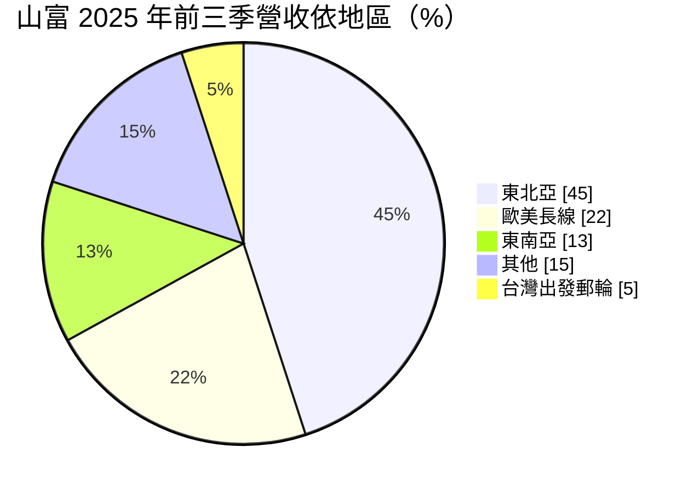
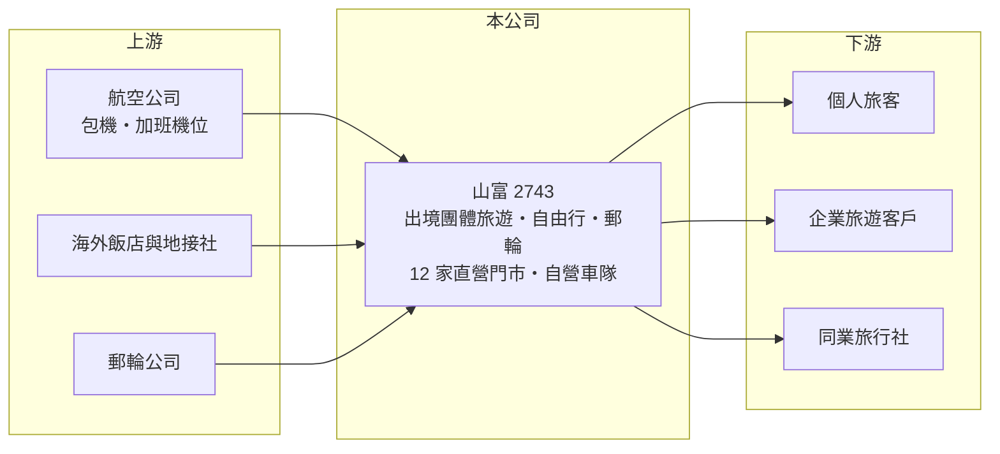

# 2743 山富

> 上櫃｜[[產業索引-觀光餐旅|觀光餐旅]]｜上市（櫃）日期 2020/03/09

# 第一章：企業模式與商業藍圖

> [!info] 撰寫說明
> 精簡版，由 Claude 依公開資料整理，架構比照 [[2330台積電]] 的四章研究，資料截至 2026-10-08。來源：Goodinfo 年度經營績效頁、富果研究 2025 年 11 月法說會整理、櫃買中心開放資料快照（基本資料、2026 年第二季資產負債與綜合損益、股利）。出團人次與平均團費未查得。#待校對

本章說明山富國際旅行社（股票代號：2743，以下簡稱山富）的商業模式：它是一家以出境團體旅遊為主的旅行社，靠組團、包機與機位採購賺取價差。

- **核心業務：** 山富成立於 1988 年，2020 年在櫃買中心掛牌，主要業務是出境旅遊，包括團體旅遊、自由行與從台灣出發的郵輪行程。旅行社的本質是「組裝與零售」：先向航空公司、飯店、地接社採購機位與住宿，再包裝成行程賣給旅客。山富以[[包機]]與先買斷機位的方式確保旺季供給，這是它和一般小型旅行社的主要差別。
- **營收結構：** 依富果研究整理的法說資料，2025 年前三季合併營收約 49.9 億元，東北亞（日本、韓國）占 45%、歐美長線占 22%、東南亞占 13%、其他占 15%、台灣出發郵輪占 5%。日本與韓國是最大的收入來源，長線行程客單價高，是近年成長最快的部分。
- **營運據點：** 公司在全台設有直營門市，2025 年 11 月彰化中彰分公司開幕後達 12 家，另有自營遊覽車公司，約有 25 輛巴士。自有車隊讓山富在國內接送與國旅產品上能掌握品質與成本。
- **長期方向：** 經營層列出的策略包括擴充業務與產品團隊、在更多縣市開設實體門市、與銀行合作推出供同業使用的「山富採購卡」，以及推廣企業旅遊方案。2025 年 12 月起實施員工持股信託，公司與員工以 1 比 1 提撥，目的是留住熟悉產品與客戶的業務人才。

# 第二章：護城河深度與競爭優勢

旅行社的進入門檻不高，本章分析山富靠什麼在激烈競爭中維持獲利，以及哪些優勢守不住。

- **競爭優勢：** 山富的核心能力在於機位與包機的採購規模，以及長期累積的熟客與同業通路。旅遊旺季時機位是稀缺資源，能提前鎖定包機與加班機位的旅行社，才能在旺季接到最多的團。直營門市與自有車隊則提高服務品質與客戶黏著度。
- **主要對手：** 主要競爭者包括 [[2731雄獅]]、[[2745五福]]、[[2719燦星旅]]、[[2734易飛網]]，以及可樂旅遊、東南旅行社等未上市大型業者。線上旅遊平台（OTA）如 Agoda、Klook 則在自由行與機加酒市場分食客源，壓縮傳統旅行社的利潤。
- **觀察重點：** 守得住的是需要專人帶團、行程複雜的長線團與郵輪；守不住的是日本、韓國等短程市場，因為旅客越來越習慣自行訂票。2025 年東北亞與東南亞營收下滑，公司歸因於疫後機票價格正常化帶動團費下降。長期要看長線產品比重能否持續提高，以及門市擴張能否帶來穩定客源。

# 第三章：財務體質與盈利規模

資料日期：2026-10-08，表格是撰寫當時的快照；最新月營收、毛利率、累計 EPS 由自動排程寫在本筆記的屬性欄位（月營收、毛利率、累計EPS 等）。#待校對

本章用五年經營數字與資本報酬，檢視山富在疫情後的獲利能力。

| 年度 | 營收（新台幣） | [[毛利率]] | [[營業利益率]] | EPS（元） | [[ROE]] |
|---|---|---|---|---|---|
| 2021 | 2.02 億 | 24.2% | -44.6% | -1.64 | -10.6% |
| 2022 | 5.59 億 | 20.0% | -11.2% | -1.99 | -12.7% |
| 2023 | 50.1 億 | 14.8% | 8.06% | 9.66 | 48.6% |
| 2024 | 68.4 億 | 13.4% | 5.97% | 7.24 | 27.0% |
| 2025 | 67.3 億 | 12.3% | 5.16% | 3.94 | 16.7% |

- **營收規模：** 2021 至 2022 年國境封閉，營收幾乎歸零；2023 年出國旅遊恢復後營收跳升到 50 億元，2024 年達 68.4 億元，2025 年持平。營收以團費全額認列，所以營收數字大、毛利率低，比較時應看毛利金額而不是營收。2026 年上半年營收 34.5 億元、EPS 2.32 元（櫃買中心資料）。
- **獲利：** 毛利率從 2023 年的 14.8% 逐年降到 2025 年的 12.3%，營業利益率也從 8.1% 降到 5.2%，反映疫後報復性旅遊結束、團費回落。2023 至 2025 年平均 ROE 約 31%（推算），但逐年下降。2025 年 EPS 降幅較大，也受到 2025 年盈餘轉增資、股本由約 3.6 億元增加到 4.68 億元的稀釋影響。
- **財務特色：** 旅行社先收團費、後付供應商，帳上有大量預收款。依 2026 年第二季資料，流動負債約 18.7 億元，遠高於非流動負債約 3.1 億元，推估大部分是旅客預付的團費（[[合約負債]]），屬於不用付息的資金。這讓山富的營運資金需求很低，資本主要用於門市與車隊。2025 年度現金股利 3.2 元，[[配息率]]約 81%（推算）。
- **[[ROIC]] 與 [[WACC]]：** 2025 年營業利益約 3.47 億元（67.3 億 × 5.16%），稅後約 2.78 億元；投入資本取 2026 年第二季股東權益 11.35 億元加非流動負債 3.08 億元（含租賃，視為有息負債），約 14.4 億元，ROIC 約 19%（推算）。WACC 以 CAPM 推估：10 年期公債 1.75%、市場風險溢酬 6%、β 取旅遊同業常見值 0.9，股東權益成本約 7.2%；負債成本 3%、稅後 2.4%；權益占約 79%，WACC 約 6.2%（推算）。ROIC 明顯高於 WACC，主要來自旅客預收款降低資本需求；但這種高報酬在疫情等衝擊下會瞬間消失，必須搭配週期一起看。

# 第四章：總體風險與地緣政治

旅行社是對外部衝擊最敏感的行業之一，本章整理山富長期面對的風險。

- **產業週期：** 出國旅遊需求受景氣、匯率、航空運能與假期安排影響，旺季與淡季差距大。疫情期間營收幾乎歸零的經驗說明，國境政策或公共衛生事件可以讓整個行業停擺。機票價格從疫後高點回落後，團費與毛利也一起下降。
- **營運風險：** 包機與先買斷機位能提高旺季收入，但如果需求突然轉弱，賣不完的機位就成為虧損。2025 年第二季日本地震預言傳言曾讓日本線營收下滑約三成，顯示單一目的地的事件風險會直接衝擊營收。
- **其他風險：** 線上旅遊平台持續搶走自由行與短程市場；新台幣與日圓、歐元匯率變動會影響旅客出國意願與公司成本；旅遊糾紛與安全事故則可能帶來賠償與商譽損失。

# 專有名詞解析

## 金融

- **[[合約負債]]**：已向客戶收取但尚未交付產品的款項，建商的預售屋訂金即屬此類，可作為未來營收的領先指標。
- **[[配息率]]**：現金股利占每股盈餘的比例，反映公司把多少獲利回饋給股東。
- **[[ROIC]]**：投入資本報酬率，稅後營業利益除以股東權益加有息負債，衡量本業運用資本的效率。
- **[[WACC]]**：加權平均資金成本，股東與債權人要求報酬率的加權平均，是 ROIC 要超越的門檻。

## 產業

- **[[包機]]**：旅行社向航空公司包下整架飛機或固定航班座位，自行負責銷售，可確保旺季機位但須承擔空位風險。
- **[[線上旅遊平台]]**：透過網站或 App 直接販售機票、住宿與行程的業者，簡稱 OTA，與傳統旅行社競爭自由行客源。

# 核心供應鏈

- 上游：航空公司如 [[2610華航]]、[[2618長榮航]]、[[2646星宇航空]]；海外飯店與地接社；郵輪公司。
- 下游／客戶：個人旅客、企業旅遊客戶、使用山富採購卡的同業旅行社。
- 同業：[[2731雄獅]]、[[2745五福]]、[[2719燦星旅]]、[[2734易飛網]]。

## 最新新聞
<!-- news:start -->
<!-- news:end -->

## 相關連結
- [公開資訊觀測站](https://mopsov.twse.com.tw/mops/web/t05st03?step=1&firstin=1&co_id=2743)
- [Goodinfo](https://goodinfo.tw/tw/StockDetail.asp?STOCK_ID=2743)
- [Yahoo 股市](https://tw.stock.yahoo.com/quote/2743)
- [鉅亨網新聞](https://www.cnyes.com/twstock/2743/news)
