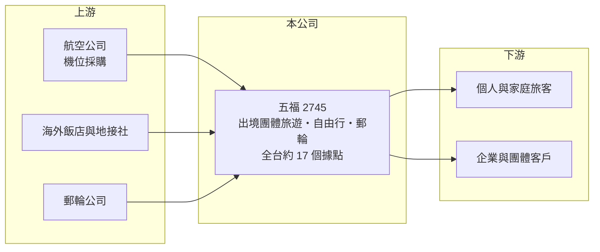

# 2745 五福

> 上櫃｜[[產業索引-觀光餐旅|觀光餐旅]]｜上市（櫃）日期 2018/04/16

# 第一章：企業模式與商業藍圖

> [!info] 撰寫說明
> 精簡版，由 Claude 依公開資料整理，架構比照 [[2330台積電]] 的四章研究，資料截至 2026-10-08。來源：Goodinfo 年度經營績效頁、自由時報 2026 年 1 月營收報導、櫃買中心開放資料快照（基本資料、2026 年第二季資產負債與綜合損益、股利）。營收依地區或產品的比重、出團人次未查得。#待校對

本章說明五福旅行社（股票代號：2745，以下簡稱五福）的商業模式：它是台灣規模較大的出境旅遊業者之一，以團體旅遊、自由行與郵輪產品為主要收入。

- **核心業務：** 五福成立於 1988 年，2018 年在櫃買中心掛牌，主要販售出境旅遊行程，包括日本、韓國等短程團體旅遊，以及長線行程與郵輪。旅行社的獲利來源是把機位、飯店、地接服務組合成行程後的加價，因此採購規模越大、議價能力越強。五福營收以團費全額認列，營收數字大但毛利率只有一成多，是旅行社的典型財務樣貌。
- **營收結構：** 依自由時報報導，2025 年營收 87.6 億元，比 2024 年的 75.6 億元成長 15.8%，成長動力來自日本、韓國冬季旅遊需求與郵輪業務。日圓匯率處於低檔時，國人赴日意願提高，是近年日本線成長的重要背景。各地區與產品的營收比重本次未查得。
- **營運據點：** 依同一報導，五福全台約有 17 個服務據點，2026 年第一季規劃在新北三峽、桃園中壢再各開一間門市，並擴充台中出發的產品線。員工約 550 人，約為疫情前的八成，公司計畫 2026 年再招募逾百人，重點在業務與產品規劃人員。
- **長期方向：** 公司的方向是擴大門市覆蓋、強化中南部出發的產品，以及提前開賣、早鳥優惠等方式拉長訂單能見度。對旅行社而言，人力就是產能，業務與產品人員回補的速度，決定了公司能承接多少團量。

# 第二章：護城河深度與競爭優勢

旅行社的進入門檻低，本章分析五福在同業中的相對優勢與限制。

- **競爭優勢：** 五福的優勢在於長期經營累積的品牌知名度、門市通路與機位採購量。旺季機位有限，採購量大的旅行社可以拿到較好的價格與座位，再透過門市與業務員把團賣滿。2023 至 2025 年 ROE 都在 37% 以上，顯示五福在需求恢復後把規模優勢轉化為獲利的能力不錯。
- **主要對手：** 主要對手包括 [[2731雄獅]]、[[2743山富]]、[[2719燦星旅]]、[[2734易飛網]]，以及可樂旅遊、東南旅行社等未上市業者。Agoda、Klook 等[[線上旅遊平台]]則在自由行與機加酒市場持續搶客。
- **觀察重點：** 守得住的是需要領隊、行程複雜的長線團、郵輪與熟齡客群；守不住的是短程自由行，這部分越來越多旅客自行在網路訂購。長期要看五福能否在客單價較高的產品上擴大比重，以及新門市能否帶來新的客源。

# 第三章：財務體質與盈利規模

資料日期：2026-10-08，表格是撰寫當時的快照；最新月營收、毛利率、累計 EPS 由自動排程寫在本筆記的屬性欄位（月營收、毛利率、累計EPS 等）。#待校對

本章用五年經營數字與資本報酬檢視五福的獲利品質。

| 年度 | 營收（新台幣） | [[毛利率]] | [[營業利益率]] | EPS（元） | [[ROE]] |
|---|---|---|---|---|---|
| 2021 | 1.10 億 | 18.9% | -134% | -4.41 | -32.4% |
| 2022 | 2.91 億 | 16.6% | -37.2% | -2.59 | -25.7% |
| 2023 | 49.8 億 | 12.4% | 5.43% | 7.87 | 57.4% |
| 2024 | 76.6 億 | 12.4% | 5.17% | 9.07 | 40.5% |
| 2025 | 87.6 億 | 13.3% | 5.30% | 10.01 | 37.1% |

- **營收規模：** 2021 至 2022 年國境管制期間營收不到 3 億元，2023 年起恢復到 50 億元，2025 年達 87.6 億元，連續三年成長。2026 年上半年營收 50.5 億元，毛利率約 14.2%、營業利益率約 4.9%、EPS 5.12 元（櫃買中心資料，推算比率）。
- **獲利：** 2023 至 2025 年營業利益率穩定在 5.2% 至 5.4%，EPS 由 7.87 元逐年增加到 10.01 元。與部分同業毛利率逐年下滑不同，五福 2025 年毛利率反而回升到 13.3%，顯示產品組合或採購成本有所改善（推估）。2023 至 2025 年平均 ROE 約 45%（推算）。
- **財務特色：** 依 2026 年第二季資料，五福總資產約 30.4 億元，流動負債約 17.7 億元，股東權益約 9.2 億元。流動負債大部分推估為旅客預付團費等[[合約負債]]，不需付息，讓公司幾乎不需要額外資本就能擴大營業規模，這也是 ROE 偏高的原因。2025 年度現金股利 7.5 元，[[配息率]]約 75%（推算）；Goodinfo 統計歷年平均現金股利約 1.98 元，因疫情年度沒有配息而被拉低。
- **[[ROIC]] 與 [[WACC]]：** 2025 年營業利益約 4.64 億元（87.6 億 × 5.30%），稅後約 3.71 億元；投入資本取 2026 年第二季股東權益 9.18 億元加非流動負債 3.52 億元（視為租賃與有息負債），約 12.7 億元，ROIC 約 29%（推算）。WACC 以 CAPM 推估：10 年期公債 1.75%、市場風險溢酬 6%、β 取旅遊同業常見值 0.9，股東權益成本約 7.2%；負債成本 3%、稅後 2.4%；權益占約 72%，WACC 約 5.8%（推算）。ROIC 遠高於 WACC，代表在正常年度五福能創造明顯的超額報酬，但疫情期間的虧損說明這種報酬需要用整個週期平均來評估。

# 第四章：總體風險與地緣政治

旅遊業對外部衝擊非常敏感，本章整理五福長期必須面對的風險。

- **產業週期：** 出國旅遊需求跟著景氣、匯率、假期與航空運能起伏。疫情期間五福營收幾乎消失、連續兩年虧損，顯示國境政策或公共衛生事件可以讓整個產業停擺。疫後的報復性旅遊潮結束後，團費可能回到較低水準。
- **營運風險：** 旅行社為了旺季需要先付款鎖定機位與房間，如果需求突然下滑，就可能出現賣不掉的庫存。業務與領隊人力回補不足，會限制承接團量；人力成本上升則壓縮本來就不高的利潤率。
- **其他風險：** 營收高度集中在日本、韓國等短程市場，當地天災、政治事件或匯率變化都會直接影響訂單。線上旅遊平台與航空公司直售持續侵蝕自由行市場，旅遊糾紛與安全事故也可能帶來賠償與商譽損失。

# 專有名詞解析

## 金融

- **[[合約負債]]**：已向客戶收取但尚未交付產品的款項，建商的預售屋訂金即屬此類，可作為未來營收的領先指標。
- **[[配息率]]**：現金股利占每股盈餘的比例，反映公司把多少獲利回饋給股東。
- **[[ROIC]]**：投入資本報酬率，稅後營業利益除以股東權益加有息負債，衡量本業運用資本的效率。
- **[[WACC]]**：加權平均資金成本，股東與債權人要求報酬率的加權平均，是 ROIC 要超越的門檻。

## 產業

- **[[線上旅遊平台]]**：透過網站或 App 直接販售機票、住宿與行程的業者，簡稱 OTA，與傳統旅行社競爭自由行客源。

# 核心供應鏈

- 上游：航空公司如 [[2610華航]]、[[2618長榮航]]、[[2646星宇航空]]；海外飯店與地接社；郵輪公司。
- 下游／客戶：個人與家庭旅客、企業獎勵旅遊與團體客戶。
- 同業：[[2731雄獅]]、[[2743山富]]、[[2719燦星旅]]、[[2734易飛網]]。

## 最新新聞
<!-- news:start -->
<!-- news:end -->

## 相關連結
- [公開資訊觀測站](https://mopsov.twse.com.tw/mops/web/t05st03?step=1&firstin=1&co_id=2745)
- [Goodinfo](https://goodinfo.tw/tw/StockDetail.asp?STOCK_ID=2745)
- [Yahoo 股市](https://tw.stock.yahoo.com/quote/2745)
- [鉅亨網新聞](https://www.cnyes.com/twstock/2745/news)
