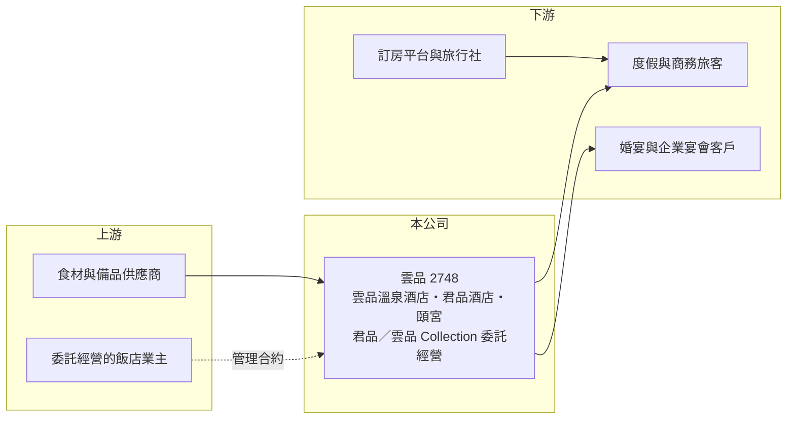

# 2748 雲品

> 上市｜[[產業索引-觀光餐旅|觀光餐旅]]｜上市（櫃）日期 2016/11/23

# 第一章：企業模式與商業藍圖

> [!info] 撰寫說明
> 精簡版，由 Claude 依公開資料整理，架構比照 [[2330台積電]] 的四章研究，資料截至 2026-10-08。來源：Goodinfo 年度經營績效頁、富果研究 2025 年 12 月法說會整理、證交所開放資料快照（基本資料、2026 年第二季資產負債、綜合損益與營益分析、股利）。各飯店房間數、住房率與客房／餐飲營收比重未查得。#待校對

本章說明雲品國際（股票代號：2748，以下簡稱雲品）的商業模式：它以兩家自有五星級飯店為基礎，逐步發展成輸出品牌與管理能力的「[[輕資產]]」飯店管理公司。

- **核心業務：** 雲品成立於 2012 年，2016 年上市，自營兩家旗艦飯店：日月潭的雲品溫泉酒店（五星級休閒度假）與台北的君品酒店（五星級商務觀光）。君品館內的頤宮中餐廳依法說資料已連續八年獲米其林三星，是公司最重要的品牌資產。另外，公司也經營頤品大飯店、頤璽等館外大型宴會廳，把餐飲品牌延伸到飯店之外。
- **營收結構：** 收入來自客房、餐飲與[[委託經營]]三類。依法說資料，2025 年前三季營收約 17.4 億元，其中委託經營相關收入約 7,700 萬元，比重仍小，但這部分幾乎不需要投入資本。君品酒店[[平均房價]]約 5,306 元、雲品溫泉酒店約 12,568 元，度假飯店的房價明顯較高。
- **營運據點：** 委託經營分為三個系列：君品 Collection（茹曦酒店、台中蘭克斯特、台南亞果薈）、雲品 Collection（烏來蘇卡利漫活 Villa、台東寶桑町屋，以及預計 2026 年加入的南投與嘉義 Villa），以及以杭州雲品酒店為代表的海外星級飯店案。頤宮海外首店規劃 2026 年第三季在阿布達比開幕，義大利佛羅倫斯另有不動產案。
- **長期方向：** 經營層把輕資產的委託經營視為核心成長動能，並推動品牌國際化。這個方向的意義是：雲品不必自己買地蓋飯店，只要輸出品牌、管理團隊與訂房系統，就能收取管理費，讓營收成長不再受限於自有房間數。

# 第二章：護城河深度與競爭優勢

飯店業的護城河來自地段、品牌與服務口碑，本章分析雲品的優勢能否延伸到委託經營。

- **競爭優勢：** 雲品最難被複製的資產是頤宮米其林三星的餐飲品牌，以及日月潭湖畔度假飯店的稀缺地段。這兩項資產讓公司能維持高房價與高宴會單價，也讓業主願意把飯店交給雲品管理。2025 年 3 月起雲品溫泉酒店實施員工週休三日，公司表示離職率因此下降，在缺工的觀光業中，留才本身就是競爭力。
- **主要對手：** 在台北高端飯店市場，雲品面對 [[2707晶華]]、[[2739寒舍]]、[[2704國賓]] 等同業；在度假飯店市場，對手包括 [[5704老爺知]]、[[2705六福]] 與日月潭周邊的涵碧樓等業者；在飯店管理輸出市場，則要和萬豪、希爾頓等國際連鎖品牌競爭業主的合約。
- **觀察重點：** 守得住的是頤宮與兩家旗艦館的品牌溢價；較難守住的是委託經營的議價空間，因為業主可以在國際品牌與本土品牌之間比價。長期要觀察委託經營收入的比重能否持續提高、杭州與阿布達比等海外案能否順利營運，以及新品牌是否稀釋原有的高端形象。

# 第三章：財務體質與盈利規模

資料日期：2026-10-08，表格是撰寫當時的快照；最新月營收、毛利率、累計 EPS 由自動排程寫在本筆記的屬性欄位（月營收、毛利率、累計EPS 等）。#待校對

本章用五年經營數字與資本報酬，檢視雲品的獲利品質。

| 年度 | 營收（新台幣） | [[毛利率]] | [[營業利益率]] | EPS（元） | [[ROE]] |
|---|---|---|---|---|---|
| 2021 | 14.5 億 | 17.8% | -3.78% | -0.38 | -1.92% |
| 2022 | 20.7 億 | 31.0% | 12.5% | 2.20 | 10.7% |
| 2023 | 23.6 億 | 33.2% | 13.7% | 2.76 | 11.7% |
| 2024 | 24.4 億 | 33.2% | 13.7% | 3.13 | 11.4% |
| 2025 | 24.2 億 | 32.1% | 11.7% | 2.17 | 7.65% |

- **營收規模：** 營收從 2021 年的 14.5 億元回升到 2023 年後的 24 億元上下，2021 至 2025 年年複合成長率約 13.7%（推算），但 2023 年以後已趨於持平，代表兩家自有飯店接近飽和。2026 年上半年營收 13.1 億元、[[毛利率]] 31.8%、[[營業利益率]] 11.5%、EPS 1.14 元（證交所資料）。
- **獲利：** 營業利益率在 2022 至 2024 年穩定在 12.5% 至 13.7%，2025 年降到 11.7%。依法說資料，2025 年前三季稅後淨利年減約 43%，公司說明主因是美元部位的匯兌損失，而不是本業衰退，所以 2025 年 EPS 下滑有相當部分來自業外。2021 至 2025 年平均 ROE 約 7.9%（推算），在觀光股中偏低，原因是帳上股東權益較大、槓桿低。
- **財務特色：** 依 2026 年第二季資料，總資產約 48.6 億元，負債約 19.0 億元，股東權益約 29.5 億元，負債比約 39%，是財務相當保守的飯店公司。公司表示維持穩定現金股利政策，2025 年度現金股利 1.75 元，[[配息率]]約 81%（推算）。
- **[[ROIC]] 與 [[WACC]]：** 2025 年營業利益約 2.83 億元（24.2 億 × 11.7%），稅後約 2.27 億元；投入資本取 2026 年第二季股東權益 29.5 億元加非流動負債 5.3 億元（視為租賃與有息負債），約 34.8 億元，ROIC 約 6.5%（推算）。WACC 以 CAPM 推估：10 年期公債 1.75%、市場風險溢酬 6%、β 取觀光同業常見值 0.8，股東權益成本約 6.6%；負債成本 3%、稅後 2.4%；權益占約 85%，WACC 約 5.9%（推算）。ROIC 只小幅高於 WACC，代表重資產的自有飯店創造的超額報酬有限；委託經營若能放大，因為幾乎不占用資本，是拉高 ROIC 的主要途徑。

# 第四章：總體風險與地緣政治

飯店業受旅遊需求與總體景氣影響，本章整理雲品長期必須面對的風險。

- **產業週期：** 日月潭度假飯店依賴國旅與陸客以外的國際客，台北君品依賴商務與宴會客源，兩者都會隨景氣與假期起伏。2021 年疫情期間公司營業虧損，說明高端飯店在需求消失時同樣缺乏防禦力。國人出國旅遊熱潮則會分走國內度假需求。
- **營運風險：** 委託經營的收入取決於業主飯店的營運表現，合約到期不續約或業主經營困難，都會影響管理費。海外案（杭州、阿布達比、佛羅倫斯）的法規、人才與文化差異大，執行風險高於國內。人力成本持續上升，也會壓縮本來就有限的利潤率。
- **其他風險：** 公司持有美元部位，匯率波動會造成業外損益起伏，2025 年就是例子。日月潭地區的天災、交通與環境法規，也會直接影響旗艦度假飯店的營運。

# 專有名詞解析

## 金融

- **[[配息率]]**：現金股利占每股盈餘的比例，反映公司把多少獲利回饋給股東。
- **[[ROIC]]**：投入資本報酬率，稅後營業利益除以股東權益加有息負債，衡量本業運用資本的效率。
- **[[WACC]]**：加權平均資金成本，股東與債權人要求報酬率的加權平均，是 ROIC 要超越的門檻。

## 產業

- **[[委託經營]]**：飯店業主把飯店交給專業管理公司經營，管理公司收取管理費而不必投入資產，屬於輕資產模式。
- **[[平均房價]]**：客房收入除以已出租房數，反映飯店的定價能力。
- **[[輕資產]]**：企業不持有或少持有廠房、土地等重資產，靠品牌、管理或技術授權賺錢的經營模式。

# 核心供應鏈

- 上游：食材與飯店備品供應商；委託經營案的飯店業主（茹曦酒店、台中蘭克斯特、台南亞果薈、杭州雲品酒店等）。
- 下游／客戶：度假與商務旅客、婚宴與企業宴會客戶、訂房平台與旅行社。
- 同業：[[2707晶華]]、[[2739寒舍]]、[[2704國賓]]、[[5704老爺知]]、[[2705六福]]。

## 最新新聞
<!-- news:start -->
<!-- news:end -->

## 相關連結
- [公開資訊觀測站](https://mopsov.twse.com.tw/mops/web/t05st03?step=1&firstin=1&co_id=2748)
- [Goodinfo](https://goodinfo.tw/tw/StockDetail.asp?STOCK_ID=2748)
- [Yahoo 股市](https://tw.stock.yahoo.com/quote/2748)
- [鉅亨網新聞](https://www.cnyes.com/twstock/2748/news)
