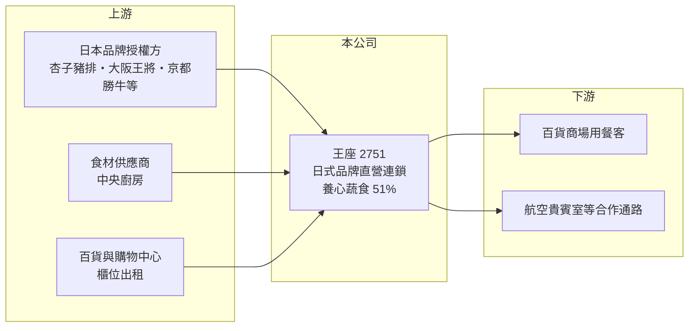

# 2751 王座

> 上櫃｜[[產業索引-觀光餐旅|觀光餐旅]]｜上市（櫃）日期 2024/09/10

# 第一章：企業模式與商業藍圖

> [!info] 撰寫說明
> 精簡版，由 Claude 依公開資料整理，架構比照 [[2330台積電]] 的四章研究，資料截至 2026-10-08。來源：Goodinfo 年度經營績效頁、科技新報 2025 年 4 月併購報導、櫃買中心開放資料快照（基本資料、2026 年第二季資產負債與綜合損益、每月營收）。各品牌營收比重未查得；Goodinfo 的 2021 年營收數字與其他欄位不一致，表格中列為未查得。#待校對

本章說明王座國際餐飲（股票代號：2751，以下簡稱王座）的商業模式：它把日本知名餐飲品牌引進台灣、以直營連鎖方式經營，2025 年起再透過併購跨入蔬食餐飲。

- **核心業務：** 王座成立於 2015 年，2024 年在櫃買中心掛牌，旗下品牌包括銀座杏子日式豬排、大阪王將、京都勝牛、橋村炸雞與段純貞牛肉麵。多數品牌來自日本，王座取得台灣的[[品牌代理]]權後，自行負責展店、採購與營運。這種模式的好處是品牌在日本已經驗證過，在台灣的知名度與菜色接受度較高，省下從零打造品牌的時間。
- **併購養心：** 依科技新報報導，王座在 2025 年 4 月以 1.071 億元取得養心餐飲 51% 股權，這是公司第一次透過併購擴張。養心旗下有養心茶樓（蔬食港式飲茶）、Yache（韓式蔬食）與 NOZOMI（烘焙坊），當時有 5 家直營門市、年營收約 3 億元。這筆交易讓王座的品牌數增至八個，也讓公司從「日式代理」延伸到「自有蔬食品牌」。
- **營運據點：** 依同一報導，併購前王座旗下約 62 家門市，合併後台灣門市總數約 69 家，主要開在百貨公司與購物中心的美食街與餐廳樓層。直營模式讓公司能掌握品質，但展店需要自己出資與承租店面。
- **長期方向：** 經營層計畫協助養心品牌發展連鎖並持續展店，以養心茶樓進軍百貨通路，未來也考慮以[[加盟]]方式把養心品牌輸出到美國、東南亞與東北亞。中央廚房啟用後可以集中備料，是支撐多品牌擴張的基礎設施。

# 第二章：護城河深度與競爭優勢

連鎖餐飲的護城河通常來自品牌、展店能力與供應鏈效率，本章分析王座的優勢與限制。

- **競爭優勢：** 王座的核心能力是挑選日本品牌、談下代理權，並在百貨商場快速複製門市。2022 至 2025 年[[毛利率]]穩定在 44% 至 49%，代表食材成本控制良好。與百貨通路的長期合作，則讓王座在熱門商場取得櫃位上有一定優勢。
- **主要對手：** 在百貨商場餐飲市場，王座的對手包括 [[2727王品]]、[[2729瓦城]]、[[2752豆府]]、[[2754亞洲藏壽司]]，以及其他同樣代理日本品牌的餐飲集團。日式豬排、拉麵與炸雞等品類競爭者眾多，消費者轉換成本很低。
- **觀察重點：** 代理品牌的最大限制是品牌所有權在日本母公司手上，代理合約條件改變或到期不續約，會直接影響營收；這也是王座併購自有蔬食品牌的原因之一。長期要觀察自有品牌比重能否提高、養心能否成功連鎖化，以及營業利益率能否從目前約 5% 的水準提升。

# 第三章：財務體質與盈利規模

資料日期：2026-10-08，表格是撰寫當時的快照；最新月營收、毛利率、累計 EPS 由自動排程寫在本筆記的屬性欄位（月營收、毛利率、累計EPS 等）。#待校對

本章用多年度經營數字與資本報酬，檢視王座的獲利品質。

| 年度 | 營收（新台幣） | [[毛利率]] | [[營業利益率]] | EPS（元） | [[ROE]] |
|---|---|---|---|---|---|
| 2021 | 未查得 | 未查得 | 未查得 | 未查得 | 未查得 |
| 2022 | 9.21 億 | 44.6% | 1.65% | 0.89 | 10.6% |
| 2023 | 12.5 億 | 48.4% | 9.26% | 6.83 | 55.1% |
| 2024 | 13.9 億 | 48.6% | 5.83% | 4.55 | 22.3% |
| 2025 | 17.7 億 | 48.2% | 5.25% | 4.57 | 19.5% |

- **營收規模：** 營收從 2022 年的 9.2 億元成長到 2025 年的 17.7 億元，三年年複合成長率約 24%（推算），主要來自展店與 2025 年併入養心。2026 年 1 至 8 月累計營收約 14.0 億元，年增約 24%；上半年營收 10.1 億元、EPS 2.41 元（櫃買中心資料）。
- **獲利：** 營業利益率在 2023 年達 9.3% 後回落到 5% 上下，代表新店開辦費用、人事與租金上漲吃掉了部分毛利。2022 至 2025 年平均 ROE 約 27%（推算），但 2023 年的 55% 與上櫃前股本較小有關，上櫃增資後 ROE 回到約 20%。
- **財務特色：** 依 2026 年第二季資料，總資產約 12.7 億元，負債約 7.6 億元，股東權益約 5.0 億元（其中母公司權益約 4.3 億元，其餘為養心的少數股權）。非流動負債約 3.4 億元，推估主要是店面長期承租的[[租賃負債]]（推估）。最近一次現金股利約 3.99 元，相對 2025 年 EPS 4.57 元，[[配息率]]約 87%（推算）。
- **[[ROIC]] 與 [[WACC]]：** 2025 年營業利益約 0.93 億元（17.7 億 × 5.25%），稅後約 0.74 億元；投入資本取 2026 年第二季權益總額 5.0 億元加非流動負債 3.4 億元（視為租賃與有息負債），約 8.4 億元，ROIC 約 8.9%（推算）。WACC 以 CAPM 推估：10 年期公債 1.75%、市場風險溢酬 6%、β 取餐飲同業常見值 0.9，股東權益成本約 7.2%；負債成本 3%、稅後 2.4%；權益占約 60%，WACC 約 5.3%（推算）。ROIC 高於 WACC，代表公司仍在創造價值，但利差不算寬，展店效率與新品牌的獲利能力決定利差能否擴大。

# 第四章：總體風險與地緣政治

餐飲業受消費景氣與成本影響很大，本章整理王座長期必須面對的風險。

- **產業週期：** 外食需求雖然長期穩定，但景氣轉弱時消費者會減少到百貨商場用餐的次數，或轉向較平價的選擇。百貨商場人潮的變化，也會直接影響以商場店為主的王座。
- **營運風險：** 代理品牌的合約條件與續約與否掌握在日本母公司手上，是王座最特殊的風險。餐飲業人力短缺與基本工資調升會持續推高人事成本，食材價格與店租上漲則壓縮利潤率。併購養心後的整合、海外加盟輸出的執行，也都需要時間驗證。
- **其他風險：** 食品安全事件會重創品牌信譽；日圓匯率影響部分進口食材成本；多品牌擴張若分散管理資源，可能讓既有品牌的表現下滑。

# 專有名詞解析

## 金融

- **[[租賃負債]]**：承租場地或設備依會計準則認列的未來租金現值負債。
- **[[配息率]]**：現金股利占每股盈餘的比例，反映公司把多少獲利回饋給股東。
- **[[ROIC]]**：投入資本報酬率，稅後營業利益除以股東權益加有息負債，衡量本業運用資本的效率。
- **[[WACC]]**：加權平均資金成本，股東與債權人要求報酬率的加權平均，是 ROIC 要超越的門檻。

## 產業

- **[[品牌代理]]**：取得國外品牌在特定地區的經營權，由代理商負責展店與營運，通常須支付權利金。
- **[[加盟]]**：由總部提供品牌、技術與物料，加盟主出資開店並支付加盟金與權利金的經營模式。

# 核心供應鏈

- 上游：日本品牌授權方、食材供應商與中央廚房、百貨與購物中心通路。
- 下游／客戶：百貨商場與街邊用餐客；養心品牌延伸的 [[2610華航]] 貴賓室合作。
- 同業：[[2727王品]]、[[2729瓦城]]、[[2752豆府]]、[[2754亞洲藏壽司]]。

## 最新新聞
<!-- news:start -->
<!-- news:end -->

## 相關連結
- [公開資訊觀測站](https://mopsov.twse.com.tw/mops/web/t05st03?step=1&firstin=1&co_id=2751)
- [Goodinfo](https://goodinfo.tw/tw/StockDetail.asp?STOCK_ID=2751)
- [Yahoo 股市](https://tw.stock.yahoo.com/quote/2751)
- [鉅亨網新聞](https://www.cnyes.com/twstock/2751/news)
