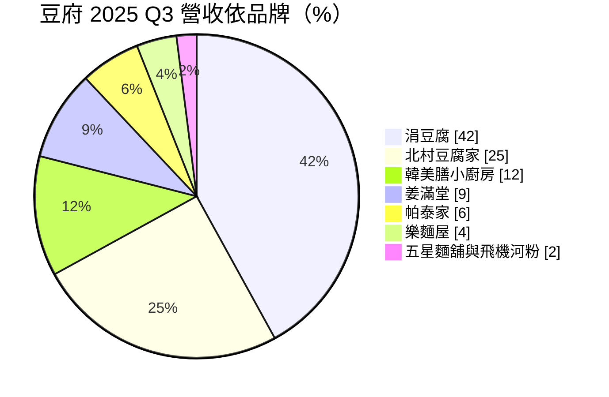
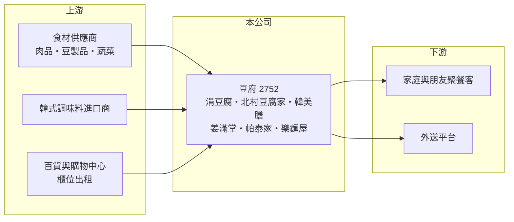

# 2752 豆府

> 上櫃｜[[產業索引-觀光餐旅|觀光餐旅]]｜上市（櫃）日期 2019/09/25

# 第一章：企業模式與商業藍圖

> [!info] 撰寫說明
> 精簡版，由 Claude 依公開資料整理，架構比照 [[2330台積電]] 的四章研究，資料截至 2026-10-08。來源：Goodinfo 年度經營績效頁、富果研究 2025 年 11 月法說會整理、櫃買中心開放資料快照（基本資料、2026 年第二季資產負債與綜合損益、股利）。#待校對

本章說明豆府（股票代號：2752）的商業模式：它以韓式豆腐鍋起家，發展成橫跨韓、泰、台、越、日五種風味的多品牌直營連鎖餐飲集團。

- **核心業務：** 豆府成立於 2008 年，2019 年在櫃買中心掛牌，主力品牌是涓豆腐與北村豆腐家，另有韓美膳小廚房、姜滿堂（韓式烤肉）、帕泰家（泰式）、樂麵屋（日式拉麵，2024 年併購）、五星麵舖與飛機河粉。主力品牌客單價約 200 至 500 元，屬於百貨商場中價位的家庭與朋友聚餐市場；姜滿堂客單價約 900 元，是集團往較高價位延伸的品牌。
- **營收結構：** 依法說資料，2025 年第三季品牌營收占比為涓豆腐 42%、北村豆腐家 25%、韓美膳小廚房 12%、姜滿堂 9%、帕泰家 6%、樂麵屋 4%、五星麵舖與飛機河粉合計 2%。韓式品牌合計接近九成，品牌雖多，但獲利仍高度依賴涓豆腐與北村兩大主力。
- **營運據點：** 截至 2025 年第三季，集團總店數 94 家、員工超過 3,000 人，其中涓豆腐 27 家、北村豆腐家 25 家、韓美膳小廚房 20 家、姜滿堂 7 家、帕泰家 6 家、樂麵屋 4 家。門市以百貨公司與購物中心為主，全部採直營，便於控制品質與服務。
- **長期方向：** 經營層提出三大支柱：穩健增加門店、透過併購或內部開發拓增品牌版圖，以及推進國際合作。公司強調「獲利為先」而非追求店數，海外則正與北美、亞洲及歐洲的潛在夥伴洽談，策略是先打穩台灣基礎再輸出經營模式。

# 第二章：護城河深度與競爭優勢

連鎖餐飲的護城河來自品牌組合、展店紀律與成本管理，本章分析豆府的優勢與限制。

- **競爭優勢：** 豆府的毛利率長期維持在 50% 以上，在連鎖餐飲中屬於高水準，顯示韓式鍋物的食材成本結構與標準化作業有效。多品牌策略讓公司能在同一個商場同時開設不同品牌，提高與百貨通路談判的籌碼，也分散單一品類退流行的風險。全直營模式則讓服務品質一致，是品牌口碑的基礎。
- **主要對手：** 主要對手包括 [[2727王品]]（旗下多個中價位品牌）、[[2729瓦城]]、[[2751王座]]、[[2754亞洲藏壽司]]，以及各大商場中的韓式料理與鍋物連鎖店。韓式料理進入門檻不高，新品牌容易出現，競爭主要比的是地點、品質穩定度與價格。
- **觀察重點：** 守得住的是主力品牌在商場的座位使用效率（[[翻桌率]]）與成本控制；較難守住的是韓式料理熱潮能否長期延續，以及新品牌能否複製主力品牌的獲利。長期要看非韓式品牌的比重能否提高、併購的樂麵屋等品牌能否放大，以及海外合作能否真正落地。

# 第三章：財務體質與盈利規模

資料日期：2026-10-08，表格是撰寫當時的快照；最新月營收、毛利率、累計 EPS 由自動排程寫在本筆記的屬性欄位（月營收、毛利率、累計EPS 等）。#待校對

本章用五年經營數字、股利與資本報酬，檢視豆府的成長與獲利品質。

| 年度 | 營收（新台幣） | [[毛利率]] | [[營業利益率]] | EPS（元） | [[ROE]] |
|---|---|---|---|---|---|
| 2021 | 17.9 億 | 50.1% | 8.80% | 6.68 | 16.8% |
| 2022 | 24.2 億 | 52.0% | 13.2% | 10.36 | 27.2% |
| 2023 | 31.0 億 | 53.4% | 15.8% | 14.78 | 34.4% |
| 2024 | 36.5 億 | 52.1% | 13.4% | 15.66 | 32.4% |
| 2025 | 40.7 億 | 51.9% | 12.3% | 15.04 | 29.1% |

- **營收規模：** 營收從 2021 年的 17.9 億元成長到 2025 年的 40.7 億元，四年年複合成長率約 22.8%（推算），主要來自穩定展店與品牌擴充。2026 年上半年營收 21.9 億元、毛利率約 52.4%、營業利益率約 11.8%、EPS 8.10 元（櫃買中心資料，推算比率）。
- **獲利：** 營業利益率在 2023 年達 15.8% 的高點後，逐年降到 2025 年的 12.3%，代表人事、租金與新店開辦費用的上升速度快於營收。即使如此，2021 至 2025 年平均 ROE 約 28%（推算），在餐飲股中仍屬前段。
- **財務特色：** 依法說資料，2025 年第三季現金及約當定存約 7.6 億元、銀行借款約 1.9 億元，屬於淨現金狀態。依 2026 年第二季資料，非流動負債約 4.1 億元，推估多為店面的[[租賃負債]]（推估）。豆府近五年平均[[配息率]]約 90%，2025 年度現金股利 13.5 元，相對 EPS 15.04 元也約九成，展現高配息政策，同時代表公司的展店資金主要靠每年營業現金流支應。
- **[[ROIC]] 與 [[WACC]]：** 2025 年營業利益約 5.01 億元（40.7 億 × 12.3%），稅後約 4.0 億元；投入資本取 2026 年第二季權益總額 12.6 億元加非流動負債 4.1 億元（視為租賃與有息負債），約 16.7 億元，ROIC 約 24%（推算）。WACC 以 CAPM 推估：10 年期公債 1.75%、市場風險溢酬 6%、β 取餐飲同業常見值 0.9，股東權益成本約 7.2%；負債成本 3%、稅後 2.4%；權益占約 75%，WACC 約 6.0%（推算）。ROIC 約為 WACC 的四倍，代表豆府的展店模式能長期創造價值；只要新店的回收期維持，持續展店就是在擴大這個利差。

# 第四章：總體風險與地緣政治

餐飲業受消費景氣、成本與流行趨勢影響，本章整理豆府長期必須面對的風險。

- **產業週期：** 外食需求整體穩定，但景氣轉弱時消費者會降低聚餐頻率或轉向平價選擇。豆府門市集中在百貨商場，商場人潮的消長直接影響來客數。
- **營運風險：** 營收高度集中在涓豆腐與北村豆腐家兩個品牌，若韓式料理熱潮退燒或品牌老化，影響會很大。直營模式代表每家新店都要公司自己出資並承擔租約，人力短缺與基本工資調升則持續推高人事成本，這是近年營業利益率下滑的主要原因之一（推估）。
- **其他風險：** 食材價格（如肉品、黃豆、蔬菜）與進口調味料匯率波動會影響毛利率；食品安全事件會重創品牌信譽；海外合作與新品牌併購若整合不順，可能拖累整體獲利。

# 專有名詞解析

## 金融

- **[[租賃負債]]**：承租場地或設備依會計準則認列的未來租金現值負債。
- **[[配息率]]**：現金股利占每股盈餘的比例，反映公司把多少獲利回饋給股東。
- **[[ROIC]]**：投入資本報酬率，稅後營業利益除以股東權益加有息負債，衡量本業運用資本的效率。
- **[[WACC]]**：加權平均資金成本，股東與債權人要求報酬率的加權平均，是 ROIC 要超越的門檻。

## 產業

- **[[直營]]**：由總公司自行出資、管理所有門市的經營模式，品質一致但展店速度受資金限制。
- **[[翻桌率]]**：一個營業時段內每張餐桌平均接待的客人組數，反映餐廳座位的使用效率。

# 核心供應鏈

- 上游：肉品、豆製品與蔬菜等食材供應商，韓式調味料進口商，百貨與購物中心通路。
- 下游／客戶：百貨商場的家庭與朋友聚餐客、外送平台。
- 同業：[[2727王品]]、[[2729瓦城]]、[[2751王座]]、[[2754亞洲藏壽司]]。

## 最新新聞
<!-- news:start -->
<!-- news:end -->

## 相關連結
- [公開資訊觀測站](https://mopsov.twse.com.tw/mops/web/t05st03?step=1&firstin=1&co_id=2752)
- [Goodinfo](https://goodinfo.tw/tw/StockDetail.asp?STOCK_ID=2752)
- [Yahoo 股市](https://tw.stock.yahoo.com/quote/2752)
- [鉅亨網新聞](https://www.cnyes.com/twstock/2752/news)
