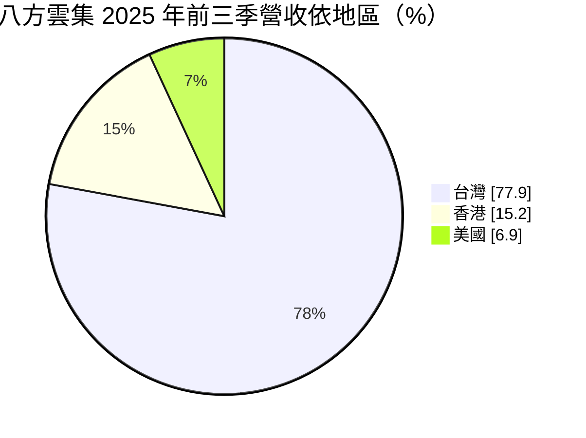
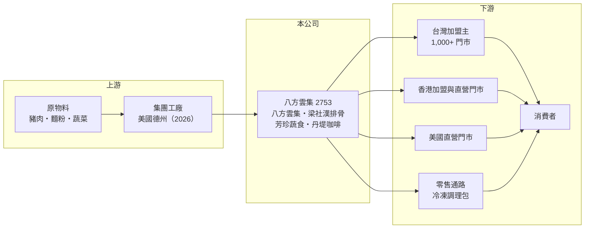

# 2753 八方雲集

> 上市｜[[產業索引-觀光餐旅|觀光餐旅]]｜上市（櫃）日期 2021/09/09

# 第一章：企業模式與商業藍圖

> [!info] 撰寫說明
> 精簡版，由 Claude 依公開資料整理，架構比照 [[2330台積電]] 的四章研究，資料截至 2026-10-08。來源：Goodinfo 年度經營績效頁、富果研究 2025 年 12 月法說會整理、證交所開放資料快照（基本資料、2026 年第二季資產負債、綜合損益與營益分析、股利）。加盟體系的收入組成（原物料銷售、加盟金等）未查得比重。#待校對

本章說明八方雲集國際（股票代號：2753，以下簡稱八方雲集）的商業模式：它是台灣門市數最多的鍋貼水餃連鎖，以加盟體系在台灣快速複製，再以直營模式開拓香港與美國市場。

- **核心業務：** 八方雲集成立於 2000 年，2021 年在證交所上市，旗下品牌包括八方雲集（鍋貼水餃）、梁社漢排骨（便當）、芳珍蔬食與丹堤咖啡。台灣以[[加盟]]為主，總部負責品牌、研發與供應水餃等核心原物料，加盟主負責開店與營運（原物料供應方式為整理性描述，待校對）。這種模式讓公司用加盟主的資金展店，總部則靠穩定的原物料銷售與加盟相關收入獲利。
- **營收結構：** 依法說資料，2025 年前三季營收依地區為台灣 77.9%、香港 15.2%、美國 6.9%；依品牌為八方雲集 75.1%、梁社漢排骨 23.6%、其他約 1.3%。梁社漢排骨已成為第二支柱，美國則是比重最小但成長潛力最大的市場。
- **營運據點：** 截至 2025 年 11 月，台灣有八方雲集 1,038 家、梁社漢排骨 202 家、丹堤咖啡 12 家、芳珍蔬食 2 家；香港共 78 家（其中八方雲集 59 家），加盟與直營並行；美國 13 家，全部[[直營]]。台灣超過一千家門市的密度，讓八方雲集在原物料採購與物流上有明顯的規模優勢。
- **長期方向：** 公司把美國定位為主要成長動能，目標 3 至 5 年內美國營收占比達 20% 至 30%，單店營收為台灣的 2 至 3 倍，並在德州興建工廠支援當地展店（法說資料對投產時程說法為 2026 年第二季或 4 月）。台灣則推動複合店型與郊區、工業區等非傳統商圈，並進軍零售通路推出冷凍調理包；日本、歐洲、杜拜等市場仍在評估。

# 第二章：護城河深度與競爭優勢

加盟連鎖的護城河來自品牌、門市密度與供應鏈，本章分析八方雲集的優勢能否延伸到海外。

- **競爭優勢：** 八方雲集在台灣有超過一千家門市，品牌幾乎家喻戶曉，這種密度帶來三個優勢：採購量大使食材成本較低、物流配送效率高、廣告效果可以分攤到所有門市。加盟主出資開店，讓公司不用承擔大部分展店資本，總部的資本報酬因此較高。公司備有 1 至 2 季的豬肉庫存，並開發雞肉內餡配方，顯示在原物料管理上有一定的避險能力。
- **主要對手：** 在台灣平價餐飲市場，對手包括四海遊龍等鍋貼連鎖、[[2912統一超]] 與全家等便利商店的鮮食、[[2732六角]]，以及各地自助餐與便當店；梁社漢排骨則與各大便當連鎖競爭。在美國，八方雲集面對的是當地亞洲餐飲與速食連鎖。
- **觀察重點：** 台灣門市已超過千家，成長空間有限，公司持續「汰弱留強」並開發新店型。長期的關鍵在美國：直營店的單店經濟效益能否如預期、德州工廠能否降低物流成本，以及在當地建立品牌知名度的速度。香港因消費景氣趨緩已放慢展店。

# 第三章：財務體質與盈利規模

資料日期：2026-10-08，表格是撰寫當時的快照；最新月營收、毛利率、累計 EPS 由自動排程寫在本筆記的屬性欄位（月營收、毛利率、累計EPS 等）。#待校對

本章用五年經營數字、股利與資本報酬，檢視八方雲集的成長與獲利品質。

| 年度 | 營收（新台幣） | [[毛利率]] | [[營業利益率]] | EPS（元） | [[ROE]] |
|---|---|---|---|---|---|
| 2021 | 59.6 億 | 37.5% | 11.0% | 8.74 | 20.5% |
| 2022 | 68.0 億 | 37.1% | 11.6% | 10.00 | 20.2% |
| 2023 | 73.4 億 | 34.8% | 9.11% | 8.35 | 15.8% |
| 2024 | 80.3 億 | 34.6% | 8.99% | 9.05 | 16.3% |
| 2025 | 87.9 億 | 36.0% | 12.3% | 12.84 | 20.7% |

- **營收規模：** 營收從 2021 年的 59.6 億元穩定成長到 2025 年的 87.9 億元，每年都創新高，四年年複合成長率約 10.2%（推算）。2026 年上半年營收 46.0 億元、[[毛利率]] 36.0%、[[營業利益率]] 12.1%、EPS 7.01 元（證交所資料）。對一家門市已超過千家的公司而言，維持一成左右的成長，主要來自梁社漢排骨展店、海外與單店營收提升。
- **獲利：** 2023 至 2024 年毛利率降到 34.6% 至 34.8%，推估與豬肉等原物料成本上升及美國展店初期費用有關（推估）；2025 年毛利率回升到 36%，營業利益率也回到 12.3%，EPS 12.84 元創新高。2021 至 2025 年平均 ROE 約 18.7%（推算），波動不大，顯示加盟模式的獲利穩定性。
- **財務特色：** 依 2026 年第二季資料，總資產約 84.4 億元，負債約 42.6 億元，權益總額約 41.9 億元，非流動負債約 23.7 億元，推估包含海外直營店的[[租賃負債]]與廠房相關借款（推估）。公司採半年配息，2025 年下半年現金股利 7.5 元、2026 年上半年 5.2 元；Goodinfo 統計 2019 至 2025 年平均現金股利約 7.21 元，配息相當穩定。
- **[[ROIC]] 與 [[WACC]]：** 2025 年營業利益約 10.8 億元（87.9 億 × 12.3%），稅後約 8.65 億元；投入資本取 2026 年第二季權益總額 41.9 億元加非流動負債 23.7 億元（視為租賃與有息負債），約 65.5 億元，ROIC 約 13%（推算）。WACC 以 CAPM 推估：10 年期公債 1.75%、市場風險溢酬 6%、β 取民生消費同業常見值 0.7，股東權益成本約 6.0%；負債成本 3%、稅後 2.4%；權益占約 64%，WACC 約 4.7%（推算）。ROIC 明顯高於 WACC，代表台灣加盟體系長期創造價值；美國直營與德州工廠屬於重資產投資，若單店效益不如預期，可能拉低整體 ROIC，這是未來幾年要追蹤的重點。

# 第四章：總體風險與地緣政治

連鎖餐飲受原物料、消費景氣與海外擴張影響，本章整理八方雲集長期必須面對的風險。

- **產業週期：** 八方雲集屬於平價民生餐飲，景氣下滑時有一定的抗跌性，甚至可能承接從中高價餐廳轉來的客人。但台灣市場已趨飽和，長期成長必須仰賴海外，而海外市場的景氣循環與消費習慣和台灣不同，香港近年消費趨緩就是例子。
- **營運風險：** 豬肉、麵粉、蔬菜等原物料價格波動會直接影響毛利率，非洲豬瘟等疫病也可能衝擊豬肉供應。加盟體系依賴加盟主的經營品質，個別門市的食安或服務問題可能波及整個品牌。美國直營店需要自行負擔租金與人事，且當地人力成本高，展店初期可能壓抑獲利。
- **其他風險：** 新台幣與美元、港幣匯率變動影響海外營收換算；美國的食品法規、勞動法規與工廠營運都有學習成本；台灣基本工資調升則會提高加盟主的經營壓力，間接影響展店意願。

# 專有名詞解析

## 金融

- **[[租賃負債]]**：承租場地或設備依會計準則認列的未來租金現值負債。
- **[[ROIC]]**：投入資本報酬率，稅後營業利益除以股東權益加有息負債，衡量本業運用資本的效率。
- **[[WACC]]**：加權平均資金成本，股東與債權人要求報酬率的加權平均，是 ROIC 要超越的門檻。

## 產業

- **[[加盟]]**：由總部提供品牌、技術與物料，加盟主出資開店並支付加盟金與權利金的經營模式。
- **[[直營]]**：由總公司自行出資、管理所有門市的經營模式，品質一致但展店速度受資金限制。

# 核心供應鏈

- 上游：豬肉、麵粉、蔬菜等原物料供應商；集團工廠（美國德州廠依法說資料於 2026 年投產）。
- 下游／客戶：台灣加盟主、香港與美國門市、零售通路與一般消費者。
- 同業：[[2732六角]]、[[2912統一超]]、[[2727王品]]、[[2755揚秦]]。

## 最新新聞
<!-- news:start -->
<!-- news:end -->

## 相關連結
- [公開資訊觀測站](https://mopsov.twse.com.tw/mops/web/t05st03?step=1&firstin=1&co_id=2753)
- [Goodinfo](https://goodinfo.tw/tw/StockDetail.asp?STOCK_ID=2753)
- [Yahoo 股市](https://tw.stock.yahoo.com/quote/2753)
- [鉅亨網新聞](https://www.cnyes.com/twstock/2753/news)
