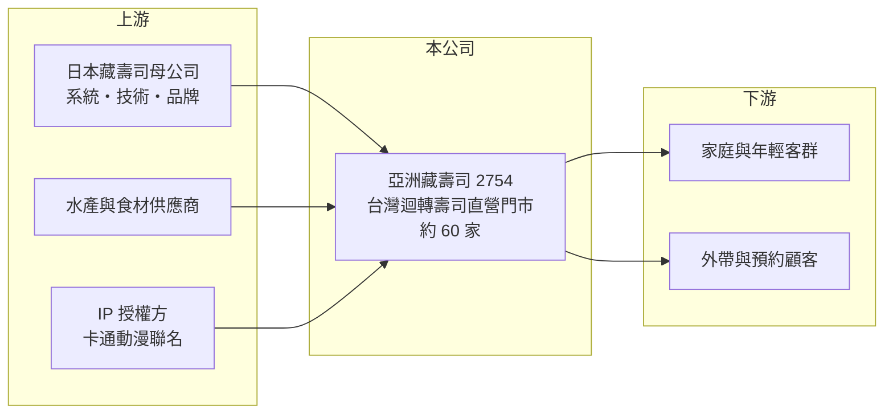

# 2754 亞洲藏壽司

> 上櫃｜[[產業索引-觀光餐旅|觀光餐旅]]｜上市（櫃）日期 2020/09/17

# 第一章：企業模式與商業藍圖

> [!info] 撰寫說明
> 精簡版，由 Claude 依公開資料整理，架構比照 [[2330台積電]] 的四章研究，資料截至 2026-10-08。來源：Goodinfo 年度經營績效頁、富果研究 2025 年 9 月法說會整理、櫃買中心開放資料快照（基本資料、2026 年第二季資產負債與綜合損益、股利）。日本母公司持股比例與權利金條件未查得。#待校對

本章說明亞洲藏壽司（股票代號：2754）的商業模式：它是日本藏壽司集團在台灣的子公司，以標準化、高度自動化的迴轉壽司門市經營平價日式餐飲。

- **核心業務：** 亞洲藏壽司成立於 2014 年，2020 年在櫃買中心掛牌，在台灣經營日式[[迴轉壽司]]連鎖。門市特色包括保鮮蓋技術、用空盤投入換扭蛋的遊戲，以及全面導入的預約、手機點餐與自助結帳系統。這些設計都來自日本母公司，目的是用科技降低人力需求，同時讓用餐變成適合家庭的娛樂體驗。
- **營收結構：** 營收幾乎全部來自台灣門市的內用與外帶，2024 年營收約 53.9 億元。公司的行銷高度依賴[[IP 聯名]]，例如與熱門卡通角色合作推出限定扭蛋，法說資料指出 2025 年 5 月起業績因聯名活動回溫。產品或通路的細項比重本次未查得。
- **營運據點：** 截至 2025 年 8 月，台灣共有 59 間門市，預計 2025 年 10 月達 61 間；展店目標為 2025 年新增 2 間、2026 年新增 5 間。上海 3 間門市已於 2025 年 8 月結束營業，公司重新聚焦台灣。單店投資回收期平均約 5 年內，商場店租期最長約 10 年，街邊店租期多在 15 年以上。
- **長期方向：** 公司的策略是立足台灣，並與日本母公司合作評估進入日本以外的其他亞洲國家，但尚未公布具體國家。法說資料指出，快速展店高峰已過，早期門市的折舊陸續攤提完畢，2026 年起折舊費用可望下降，這代表公司正從「擴張期」轉入「收成期」。

# 第二章：護城河深度與競爭優勢

迴轉壽司是規模與效率的生意，本章分析亞洲藏壽司的優勢從何而來，以及有哪些限制。

- **競爭優勢：** 亞洲藏壽司最大的優勢是母公司的系統與品牌：從保鮮蓋、自動化點餐到扭蛋遊戲，都是經過日本市場驗證的設計，新進者很難在短期內複製。標準化的門市設計讓展店與營運效率高，毛利率長期維持在約 40%。IP 聯名行銷則能在短期內大幅拉高來客數，形成和一般壽司店的差異。
- **主要對手：** 在台灣平價迴轉壽司市場，主要對手是爭鮮與壽司郎（日本迴轉壽司集團在台據點，待校對），兩者在門市數與價格上都有競爭力。在百貨商場家庭餐飲市場，則面對 [[2727王品]]、[[2752豆府]]、[[2751王座]] 等連鎖集團。
- **觀察重點：** 守得住的是自動化系統與家庭客群的黏著度；較難守住的是價格優勢，因為三大迴轉壽司品牌的價位接近，且壽司郎持續展店。長期要觀察來客數是否過度依賴 IP 聯名、折舊下降能否實際轉為利潤，以及海外擴張是否會重蹈上海虧損的覆轍。

# 第三章：財務體質與盈利規模

資料日期：2026-10-08，表格是撰寫當時的快照；最新月營收、毛利率、累計 EPS 由自動排程寫在本筆記的屬性欄位（月營收、毛利率、累計EPS 等）。#待校對

本章用五年經營數字與資本報酬，檢視亞洲藏壽司的獲利品質。

| 年度 | 營收（新台幣） | [[毛利率]] | [[營業利益率]] | EPS（元） | [[ROE]] |
|---|---|---|---|---|---|
| 2021 | 25.3 億 | 39.3% | 1.29% | 0.49 | 1.76% |
| 2022 | 38.5 億 | 41.8% | 8.38% | 5.21 | 18.9% |
| 2023 | 50.3 億 | 39.9% | 5.94% | 4.54 | 14.6% |
| 2024 | 53.9 億 | 40.5% | 4.76% | 2.31 | 6.51% |
| 2025 | 57.1 億 | 40.8% | 4.61% | 2.35 | 6.41% |

- **營收規模：** 營收從 2021 年的 25.3 億元成長到 2025 年的 57.1 億元，四年年複合成長率約 22.6%（推算），主要來自快速展店與疫後來客回升。2023 年後成長放緩到每年約 6% 至 7%，與展店速度放慢一致。2026 年上半年營收 29.9 億元、毛利率約 41.1%、營業利益率約 6.1%、EPS 2.60 元（櫃買中心資料，推算比率），上半年 EPS 已超過 2025 年全年。
- **獲利：** 毛利率穩定在約 40%，但營業利益率從 2022 年的 8.4% 降到 2024 至 2025 年的約 4.7%，原因是新店折舊、人事成本上升與上海門市虧損。2021 至 2025 年平均 ROE 約 9.6%（推算），近兩年只有 6.5% 左右，在餐飲股中偏低。
- **財務特色：** 依 2026 年第二季資料，總資產約 51.3 億元，負債約 33.0 億元，股東權益約 18.3 億元，其中非流動負債約 21.8 億元，推估主要是長期店面租約的[[租賃負債]]（推估）。迴轉壽司門市需要投入大量設備，屬於資本密集的餐飲業態。2024 年度現金股利 0.8 元，公司表示偏低是因上海關店的一次性影響；最近一次現金股利約 1.0 元，相對 2025 年 EPS 2.35 元，[[配息率]]約 43%（推算），低於多數餐飲同業。
- **[[ROIC]] 與 [[WACC]]：** 2025 年營業利益約 2.63 億元（57.1 億 × 4.61%），稅後約 2.1 億元；投入資本取 2026 年第二季股東權益 18.3 億元加非流動負債 21.8 億元（視為租賃與有息負債），約 40.1 億元，ROIC 約 5.2%（推算）。WACC 以 CAPM 推估：10 年期公債 1.75%、市場風險溢酬 6%、β 取餐飲同業常見值 0.8，股東權益成本約 6.6%；負債成本 3%、稅後 2.4%；權益占約 46%，WACC 約 4.3%（推算）。ROIC 只略高於 WACC，代表過去幾年的大量展店尚未轉化為明顯的超額報酬；若 2026 年起折舊下降、營業利益率回升，利差才會擴大。

# 第四章：總體風險與地緣政治

餐飲業受消費景氣、成本與競爭影響，本章整理亞洲藏壽司長期必須面對的風險。

- **產業週期：** 平價迴轉壽司在景氣下滑時有一定的抗跌性，可能承接從高價餐廳轉來的家庭客。但商場人潮變化與消費者對聯名活動的熱度都會影響來客，聯名效果退燒時業績容易回落。
- **營運風險：** 水產原料價格與進口成本波動會影響毛利率；長期租約與設備投資讓固定成本偏高，來客數下降時獲利會被放大衰退。母子公司關係下，經營團隊、技術與行銷策略多由日本主導，依法說資料，2026 年起的總經理人選也來自日本藏壽司本部，公司策略自主性有限。
- **其他風險：** 日圓匯率影響向日本採購的設備與食材成本；海外擴張若再次失利，可能帶來關店損失，上海經驗就是前例；食品安全與衛生事件則會重創品牌信譽。

# 專有名詞解析

## 金融

- **[[租賃負債]]**：承租場地或設備依會計準則認列的未來租金現值負債。
- **[[配息率]]**：現金股利占每股盈餘的比例，反映公司把多少獲利回饋給股東。
- **[[ROIC]]**：投入資本報酬率，稅後營業利益除以股東權益加有息負債，衡量本業運用資本的效率。
- **[[WACC]]**：加權平均資金成本，股東與債權人要求報酬率的加權平均，是 ROIC 要超越的門檻。

## 產業

- **[[迴轉壽司]]**：以輸送帶或軌道把壽司送到座位前的平價壽司業態，強調標準化與快速出餐。
- **[[IP 聯名]]**：與動漫、卡通等智慧財產合作推出限定商品或活動，用來吸引特定粉絲來店消費。

# 核心供應鏈

- 上游：日本藏壽司母公司（系統、技術與品牌）、水產與食材供應商、IP 授權方。
- 下游／客戶：家庭與年輕客群、外帶與預約顧客。
- 同業：爭鮮、壽司郎；[[2727王品]]、[[2752豆府]]、[[2751王座]]。

## 最新新聞
<!-- news:start（自動產生，請勿手動編輯此範圍） -->
- 2026-10-08 🏛️ 重訊 17:19｜公告本公司2026年第一次員工認股權憑證發行日期｜[觀測站](https://mops.twse.com.tw/mops/#/web/t05st01)

完整紀錄：[[2754亞洲藏壽司 新聞]]
<!-- news:end -->

## 相關連結
- [公開資訊觀測站](https://mopsov.twse.com.tw/mops/web/t05st03?step=1&firstin=1&co_id=2754)
- [Goodinfo](https://goodinfo.tw/tw/StockDetail.asp?STOCK_ID=2754)
- [Yahoo 股市](https://tw.stock.yahoo.com/quote/2754)
- [鉅亨網新聞](https://www.cnyes.com/twstock/2754/news)
