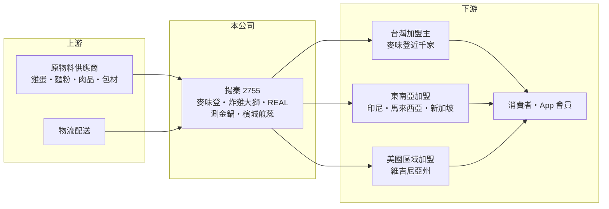

# 2755 揚秦

> 上櫃｜[[產業索引-觀光餐旅|觀光餐旅]]｜上市（櫃）日期 2020/12/16

# 第一章：企業模式與商業藍圖

> [!info] 撰寫說明
> 精簡版，由 Claude 依公開資料整理，架構比照 [[2330台積電]] 的四章研究，資料截至 2026-10-08。來源：Goodinfo 年度經營績效頁、ETtoday 2025 年 8 月報導、櫃買中心開放資料快照（基本資料、2026 年第二季資產負債與綜合損益、每月營收、股利）。營收組成（原物料銷售、加盟金等）比重未查得。#待校對

本章說明揚秦國際（股票代號：2755，以下簡稱揚秦）的商業模式：它是連鎖早餐店麥味登的母公司，以加盟體系經營早餐與炸雞品牌，並把炸雞品牌輸出到東南亞與美國。

- **核心業務：** 揚秦登記成立於 2015 年，2020 年在櫃買中心掛牌，旗下品牌包括麥味登（連鎖早午餐）、炸雞大獅、REAL 真‧Cafe‧Bread、涮金鍋，以及代理的檳城煎蕊。麥味登與炸雞大獅是以[[加盟]]為主的兩大引擎：總部提供品牌、菜單與原物料，加盟主出資開店。對總部來說，門市越多，原物料與包材的出貨量越大，規模經濟也越明顯。
- **營收結構：** 加盟體系總部的收入通常以供應加盟店的原物料、包材為大宗，再加上加盟金與權利金（一般性描述，揚秦的實際比重未查得）。從財務數字看，揚秦毛利率只有約 27%，遠低於直營餐飲業者的 40% 至 50%，這正符合「以銷售物料給加盟店為主」的特徵（推估）。
- **營運據點：** 依 ETtoday 2025 年 8 月報導，麥味登全台 933 家、炸雞大獅海內外 134 家、REAL 6 家、涮金鍋 5 家；東南亞總店數 37 家，涵蓋馬來西亞（砂拉越、柔佛、吉隆坡）、印尼（大雅加達、萬隆、泗水，共 29 家）與新加坡。集團 App 會員突破 108 萬人，會員數據是加盟體系做行銷與新品開發的基礎。
- **長期方向：** 炸雞大獅自 2025 年起在美國改採[[區域加盟]]模式，首個區域維吉尼亞州已簽約，首店設於 Glen Allen；美國客單價約為台灣的三倍。台灣方面，麥味登持續以聯名商品與新菜色維持品牌熱度，涮金鍋則從桃園往新北擴展。海外加盟讓公司能在不投入大量資本的情況下擴大品牌版圖。

# 第二章：護城河深度與競爭優勢

加盟連鎖的護城河來自門市密度、品牌與供應鏈，本章分析揚秦的優勢與限制。

- **競爭優勢：** 麥味登接近千家的門市規模，讓揚秦在早餐原物料的採購、物流配送與廣告分攤上都有規模優勢。加盟主出資開店，總部資本需求低，因此 ROE 能長期維持在 20% 上下。炸雞大獅在東南亞與美國的加盟輸出，則讓公司的成長不只依賴已經相當飽和的台灣早餐市場。
- **主要對手：** 在連鎖早餐市場，主要對手是美而美、拉亞漢堡、弘爺漢堡等加盟品牌（依一般市場認知整理，待校對），以及便利商店與麥當勞的早餐產品；在平價餐飲與炸雞市場，則面對 [[2753八方雲集]]、[[2732六角]] 與各大速食連鎖。美國市場的主要對手依報導是 Raising Cane's 等炸雞連鎖。
- **觀察重點：** 守得住的是麥味登的門市密度與加盟主網絡；較難守住的是早餐市場的價格競爭，因為消費者可選擇的早餐店非常多。長期要看炸雞大獅海外加盟的展店速度與單店獲利、加盟主的經營穩定度，以及新品牌能否成為第三支柱。

# 第三章：財務體質與盈利規模

資料日期：2026-10-08，表格是撰寫當時的快照；最新月營收、毛利率、累計 EPS 由自動排程寫在本筆記的屬性欄位（月營收、毛利率、累計EPS 等）。#待校對

本章用五年經營數字、股利與資本報酬，檢視揚秦的成長與獲利品質。

| 年度 | 營收（新台幣） | [[毛利率]] | [[營業利益率]] | EPS（元） | [[ROE]] |
|---|---|---|---|---|---|
| 2021 | 15.6 億 | 25.5% | 6.31% | 3.65 | 13.0% |
| 2022 | 18.8 億 | 26.7% | 6.84% | 5.25 | 18.7% |
| 2023 | 21.6 億 | 26.6% | 7.26% | 4.40 | 18.8% |
| 2024 | 25.3 億 | 26.8% | 8.73% | 5.84 | 22.4% |
| 2025 | 30.4 億 | 27.4% | 9.70% | 6.44 | 25.0% |

- **營收規模：** 營收從 2021 年的 15.6 億元成長到 2025 年的 30.4 億元，每年都成長，四年年複合成長率約 18.2%（推算）。2026 年 1 至 8 月累計營收約 23.3 億元，年增約 18.7%；上半年營收 17.1 億元、毛利率約 27.6%、營業利益率約 9.7%、EPS 2.90 元（櫃買中心資料，推算比率）。
- **獲利：** 毛利率穩定在 25% 至 27%，營業利益率則從 6.3% 逐年提高到 9.7%，代表門市數增加後，總部的管理與行銷費用被更多營收分攤，這是加盟模式的規模效益。2021 至 2025 年平均 ROE 約 19.6%（推算），而且逐年上升。
- **財務特色：** 依 2026 年第二季資料，總資產約 23.9 億元，負債約 12.8 億元，股東權益約 11.1 億元。最近一次現金股利約 5.92 元，相對 2025 年 EPS 6.44 元，[[配息率]]約 92%（推算），顯示加盟模式資本需求低、能把大部分獲利發給股東。Goodinfo 統計歷年平均現金股利約 2.36 元，近年明顯提高。
- **[[ROIC]] 與 [[WACC]]：** 2025 年營業利益約 2.95 億元（30.4 億 × 9.7%），稅後約 2.36 億元；投入資本取 2026 年第二季股東權益 11.1 億元加非流動負債 5.7 億元（視為租賃與有息負債），約 16.8 億元，ROIC 約 14%（推算）。WACC 以 CAPM 推估：10 年期公債 1.75%、市場風險溢酬 6%、β 取餐飲同業常見值 0.9，股東權益成本約 7.2%；負債成本 3%、稅後 2.4%；權益占約 66%，WACC 約 5.5%（推算）。ROIC 約為 WACC 的 2.5 倍，代表加盟體系能長期創造價值，且隨營業利益率提高，利差有擴大趨勢。

# 第四章：總體風險與地緣政治

加盟連鎖受消費景氣、原物料與加盟主經營狀況影響，本章整理揚秦長期必須面對的風險。

- **產業週期：** 早餐屬於民生必需消費，景氣下滑時需求相對穩定，但消費者對價格更敏感，可能壓抑客單價。台灣早餐市場已高度飽和，長期成長需要靠新品牌與海外市場。
- **營運風險：** 雞蛋、麵粉、肉品等原物料價格波動會影響總部的出貨毛利，若總部為維持加盟店的競爭力而吸收成本，毛利率會被壓縮。加盟體系依賴加盟主的經營品質，個別門市的食安或服務問題可能波及整個品牌；基本工資調升也會增加加盟主的經營壓力，影響開店意願。
- **其他風險：** 海外加盟的法規、文化與品牌接受度都存在不確定性，美國區域加盟商的執行能力尤其關鍵；匯率變動會影響海外營收換算與進口原物料成本。

# 專有名詞解析

## 金融

- **[[配息率]]**：現金股利占每股盈餘的比例，反映公司把多少獲利回饋給股東。
- **[[ROIC]]**：投入資本報酬率，稅後營業利益除以股東權益加有息負債，衡量本業運用資本的效率。
- **[[WACC]]**：加權平均資金成本，股東與債權人要求報酬率的加權平均，是 ROIC 要超越的門檻。

## 產業

- **[[加盟]]**：由總部提供品牌、技術與物料，加盟主出資開店並支付加盟金與權利金的經營模式。
- **[[區域加盟]]**：把一個國家或地區的展店權授予單一加盟商，由其負責在區域內開設多家門市。

# 核心供應鏈

- 上游：雞蛋、麵粉、肉品與包材等原物料供應商，物流配送業者。
- 下游／客戶：台灣與海外加盟主、一般消費者與 App 會員。
- 同業：[[2753八方雲集]]、[[2732六角]]、[[2727王品]]。

## 最新新聞
<!-- news:start -->
<!-- news:end -->

## 相關連結
- [公開資訊觀測站](https://mopsov.twse.com.tw/mops/web/t05st03?step=1&firstin=1&co_id=2755)
- [Goodinfo](https://goodinfo.tw/tw/StockDetail.asp?STOCK_ID=2755)
- [Yahoo 股市](https://tw.stock.yahoo.com/quote/2755)
- [鉅亨網新聞](https://www.cnyes.com/twstock/2755/news)
