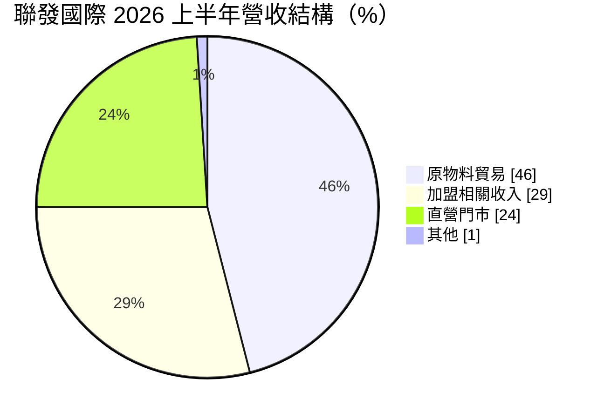
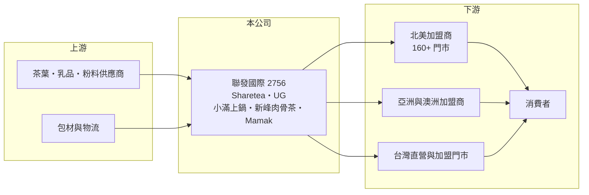

# 2756 聯發國際

> 上櫃｜[[產業索引-觀光餐旅|觀光餐旅]]｜上市（櫃）日期 2022/01/14

# 第一章：企業模式與商業藍圖

> [!info] 撰寫說明
> 精簡版，由 Claude 依公開資料整理，架構比照 [[2330台積電]] 的四章研究，資料截至 2026-10-08。來源：Goodinfo 年度經營績效頁、富果研究 2026 年 9 月法說會整理、櫃買中心開放資料快照（基本資料、2026 年第二季資產負債與綜合損益、股利）。2025 年營收大增的原因（是否含新品牌併入）未查得。#待校對

本章說明聯發國際（股票代號：2756，以下簡稱聯發）的商業模式：它是手搖茶品牌 Sharetea（歇腳亭）的品牌商，以國際[[加盟]]把台灣茶飲輸出到全球，近年轉向茶飲加餐食的多品牌經營。

- **核心業務：** 聯發成立於 2004 年，2022 年在櫃買中心掛牌。依法說資料，主力品牌 Sharetea 已有 34 年歷史，是少數以海外市場為主的台灣茶飲品牌；另有定位較高端的時尚茶飲品牌 UG。公司的角色像是「品牌與供應鏈總部」：授權各國加盟商開店，並供應茶葉、粉料、包材等核心原物料。
- **營收結構：** 依法說資料，2026 年上半年營收中，原物料貿易占 46%、加盟相關收入占 29%、直營門市占 24%、其他占 1%。加盟金與權利金幾乎沒有成本，原物料貿易則隨門市數成長，兩者合計超過七成，是典型的[[品牌授權]]加供應鏈模式，這也是聯發毛利率能維持在 50% 以上的原因。
- **營運據點：** 依同一資料，集團在 15 個國家經營超過 500 家門市，北美是最重要的市場，超過 160 家。展店目標包括 UG 在 2026 年底達台灣 100 家、北美 10 至 12 家，2027 年北美 30 家、澳洲 3 家、馬來西亞 5 家；Sharetea 印度 2026 年底 12 家、2027 年 30 家，並拓展墨西哥。
- **長期方向：** 公司在 2025 至 2028 年計畫中提出深耕台灣、加速美國、拓展全球、增加餐食與投資併購五大策略。餐食品牌包括個人鍋物小滿上鍋、與馬來西亞品牌合資的新峰肉骨茶，以及馬來西亞餐廳 Mamak。經營層把 2026 年定為轉型年、2027 年為擴張年，目標 2028 年在美國茶飲市場進入第一線。

# 第二章：護城河深度與競爭優勢

品牌授權模式的護城河來自品牌知名度、加盟網絡與供應鏈，本章分析聯發的優勢與限制。

- **競爭優勢：** Sharetea 長期耕耘北美、澳洲與東南亞，累積了大量海外加盟商與在地供應鏈經驗，這是新進茶飲品牌很難在短期內取得的資源。加盟主出資開店，總部只需投入品牌與供應鏈管理，資本需求低。核心原物料由總部供應，則讓公司能隨門市成長持續收取收入，並確保各地口味一致。
- **主要對手：** 在國際手搖茶市場，對手包括 [[2723美食-KY]]（85度C）、[[2726雅茗-KY]]、[[2732六角]]（Chatime 日出茶太）等台灣品牌，以及 CoCo 都可、貢茶、一芳等（品牌歸屬依一般市場認知整理，待校對），在美國與東南亞也有大量中國與在地茶飲品牌。茶飲產品同質性高、進入門檻低，品牌行銷與店點選擇決定勝負。
- **觀察重點：** 守得住的是 Sharetea 在北美的既有加盟網絡；較難守住的是品牌熱度，因為茶飲流行變化快，新品牌不斷出現。長期要看 UG 能否複製 Sharetea 的海外擴張、餐食品牌能否成為第二支柱，以及經營層設定的 2027 年稅前利益率 10% 以上目標能否達成。

# 第三章：財務體質與盈利規模

資料日期：2026-10-08，表格是撰寫當時的快照；最新月營收、毛利率、累計 EPS 由自動排程寫在本筆記的屬性欄位（月營收、毛利率、累計EPS 等）。#待校對

本章用五年經營數字、股利與資本報酬，檢視聯發的獲利品質與轉型代價。

| 年度 | 營收（新台幣） | [[毛利率]] | [[營業利益率]] | EPS（元） | [[ROE]] |
|---|---|---|---|---|---|
| 2021 | 8.17 億 | 50.5% | 19.8% | 7.58 | 49.9% |
| 2022 | 7.90 億 | 57.1% | 23.0% | 7.12 | 35.9% |
| 2023 | 7.39 億 | 60.3% | 20.5% | 4.56 | 20.6% |
| 2024 | 6.91 億 | 61.3% | 8.86% | 2.41 | 10.9% |
| 2025 | 11.7 億 | 53.4% | 8.43% | 3.93 | 17.2% |

- **營收規模：** 2021 至 2024 年營收從 8.2 億元逐年降到 6.9 億元，2025 年跳升到 11.7 億元，增幅約 69%，推估與新品牌與直營門市擴充有關（推估）。2021 至 2025 年年複合成長率約 9.4%（推算）。2026 年上半年營收約 6.1 億元、年增 21.7%，毛利率 51.4%、EPS 1.53 元（法說資料與櫃買中心資料）。
- **獲利：** 營業利益率從 2022 年的 23% 降到 2024 至 2025 年的約 8.5%，ROE 也從近 50% 降到 10% 至 17%。這反映公司從輕資產的單一品牌授權，轉向需要投入直營門市、新品牌與海外團隊的多品牌經營，費用先行而效益尚未完全顯現。2021 至 2025 年平均 ROE 約 27%（推算），但趨勢是下降。
- **財務特色：** 依 2026 年第二季資料，總資產約 13.2 億元，負債約 7.6 億元，權益總額約 5.6 億元，負債以流動負債約 5.3 億元為主。公司維持高配息政策，最近一次年度現金股利約 3.3 元，相對 2025 年 EPS 3.93 元，[[配息率]]約 84%（推算）；2026 年上半年另配發現金股利 1.5 元。
- **[[ROIC]] 與 [[WACC]]：** 2025 年營業利益約 0.99 億元（11.7 億 × 8.43%），稅後約 0.79 億元；投入資本取 2026 年第二季權益總額 5.6 億元加非流動負債 2.2 億元（視為租賃與有息負債），約 7.8 億元，ROIC 約 10%（推算）。WACC 以 CAPM 推估：10 年期公債 1.75%、市場風險溢酬 6%、β 取餐飲同業常見值 0.9，股東權益成本約 7.2%；負債成本 3%、稅後 2.4%；權益占約 71%，WACC 約 5.8%（推算）。ROIC 仍高於 WACC，但和 2021 至 2022 年純授權時期相比已明顯下降；轉型能否成功，要看新事業能否把 ROIC 拉回過去的高水準。

# 第四章：總體風險與地緣政治

茶飲與餐飲受流行趨勢、原物料與海外市場影響，本章整理聯發長期必須面對的風險。

- **產業週期：** 手搖茶屬於平價消費，景氣下滑時需求相對穩定，但流行變化快，品牌熱度可能在幾年內明顯消退。海外各市場的景氣與消費習慣不同，北美占比高，美國消費狀況對公司影響最大。
- **營運風險：** 多品牌與直營擴張讓費用先行，若新品牌展店不如預期，獲利率可能長期停留在低檔。海外加盟商的經營品質良莠不齊，個別市場的食安或品牌形象問題可能波及整體。原物料貿易占營收近半，茶葉、乳品、糖與包材價格與運費波動會影響毛利。
- **其他風險：** 美國關稅與食品進口法規可能提高原物料出口成本；美元、澳幣、印度盧比等匯率波動影響營收換算；合資與併購的整合風險，也是推動五大策略時必須面對的挑戰。

# 專有名詞解析

## 金融

- **[[配息率]]**：現金股利占每股盈餘的比例，反映公司把多少獲利回饋給股東。
- **[[ROIC]]**：投入資本報酬率，稅後營業利益除以股東權益加有息負債，衡量本業運用資本的效率。
- **[[WACC]]**：加權平均資金成本，股東與債權人要求報酬率的加權平均，是 ROIC 要超越的門檻。

## 產業

- **[[品牌授權]]**：品牌商授權他人使用品牌開店或販售商品，收取授權金與權利金的經營模式。
- **[[加盟]]**：由總部提供品牌、技術與物料，加盟主出資開店並支付加盟金與權利金的經營模式。

# 核心供應鏈

- 上游：茶葉、乳品、粉料、包材供應商與國際物流。
- 下游／客戶：北美、亞洲、澳洲與台灣的加盟商與直營門市，以及一般消費者。
- 同業：[[2723美食-KY]]、[[2726雅茗-KY]]、[[2732六角]]、[[2755揚秦]]。

## 最新新聞
<!-- news:start -->
<!-- news:end -->

## 相關連結
- [公開資訊觀測站](https://mopsov.twse.com.tw/mops/web/t05st03?step=1&firstin=1&co_id=2756)
- [Goodinfo](https://goodinfo.tw/tw/StockDetail.asp?STOCK_ID=2756)
- [Yahoo 股市](https://tw.stock.yahoo.com/quote/2756)
- [鉅亨網新聞](https://www.cnyes.com/twstock/2756/news)
