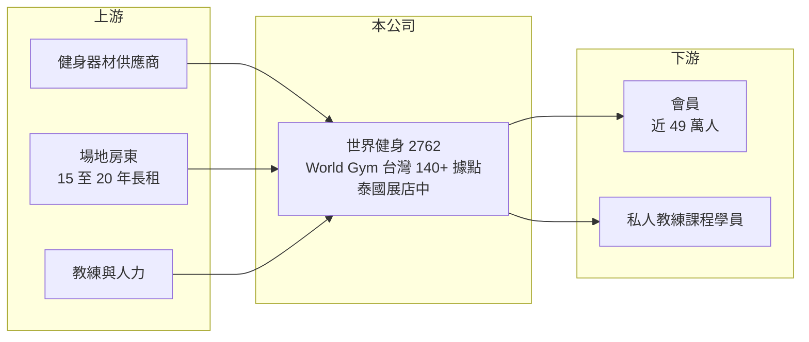

# 2762 世界健身-KY

> 上市｜[[產業索引-運動休閒|運動休閒]]｜上市（櫃）日期 2024/01/24

# 第一章：企業模式與商業藍圖

> [!info] 撰寫說明
> 精簡版，由 Claude 依公開資料整理，架構比照 [[2330台積電]]，資料截至 2026-10-08。來源：MoneyDJ 理財網財務比率年表（2020 至 2025 年）；富果研究 2026 年 3 月法說會備忘錄（據點、會員、展店計畫、2025 年財務數字）；證交所開放資料快照（基本資料、2026 年上半年資產負債與損益、季度股利）。營收結構比重未查得。#待校對

世界健身是開曼群島註冊的[[KY股]]控股公司，控股公司成立於 2013 年 11 月，2024 年 1 月上市，營運總部在台中，董事長兼總經理為柯約翰，實收資本額 11.25 億元。它在台灣經營 World Gym 連鎖健身房，是國內規模最大的健身房品牌，生意本質是「用長期租約租下大型場地，再靠會籍與私人教練課程回收」。

- **核心業務：** 世界健身經營大型綜合健身中心，提供重訓與有氧器材、團體課程、游泳池等設施，收入來自會員按月繳交的會籍費，以及按堂計費的私人教練課程。據點多為上千坪的大型場館，以「器材多、設施全、營業時間長」吸引一般上班族會員。World Gym 品牌源自美國，台灣業者取得品牌使用權後在台經營（品牌授權細節待校對）。
- **營收結構：** 依富果整理，2025 年營收 109.8 億元、年增 11.9%，會籍收入與教練課程收入的[[同店銷售]]成長都約 6% 至 7%。會籍與教練課各占多少比重未查得；從同業柏文的結構（會籍約六成、教練課約三成五）推估，世界健身也以會籍為主、教練課為輔（推估）。
- **營運據點：** 台灣超過 140 個據點、近 49 萬名會員、超過 3,000 位正職教練（2026 年 3 月法說會）。新店多簽 15 至 20 年長期租約，2026 年計畫新增 10 至 15 家直營店，其中台灣約 12 家、泰國約 2 家，泰國預計投入約 2 億元資本支出。
- **長期方向：** 台灣健身人口滲透率仍低於歐美，世界健身的長期成長來自「台灣持續展店＋既有店會員與教練課滲透＋海外複製」。泰國是第一個海外市場，若能把台灣的大型場館與教練制度成功移植，將是公司從單一市場走向區域品牌的關鍵。經營層在上市後維持季配息、高股利政策，顯示傾向把現金回饋股東。

# 第二章：護城河深度與競爭優勢

世界健身的護城河是規模：最多的據點、最多的會員與最大的教練團隊，形成網絡效應與成本優勢。

- **競爭優勢：** 大型健身房的據點越多，會員可跨店使用的便利性越高，品牌知名度與招募教練的能力也越強，這是一種地方性的網絡效應。大規模採購器材、統一行銷與標準化的教練培訓，讓每一家新店都能快速複製既有模式。此外，好地段的大型場地有限，世界健身先卡位的長期租約，本身就是新進者難以取得的資源。
- **主要對手：** 最直接的對手是 [[8462柏文]] 的健身工廠，兩者是台灣中大型連鎖健身房的兩大品牌；其他還有 Anytime Fitness 等 24 小時小型健身房，以及各地的獨立健身房與運動中心（公辦民營）。小型 24 小時健身房以低月費、近住家搶客，是大型場館需要面對的替代競爭。
- **觀察重點：** 健身房的獲利關鍵在「單店坪效」與「新店爬坡速度」。長期要看同店銷售能否維持正成長、私人教練課滲透率能否提升，以及泰國店能否在 2 至 3 年內損益兩平。若展店速度太快、新店會員招募不如預期，大量租賃成本會先侵蝕獲利。

# 第三章：財務體質與盈利規模

資料日期：2026-10-08，表格是撰寫當時的快照；最新月營收、毛利率、累計 EPS 由自動排程寫在本筆記的屬性欄位（月營收、毛利率、累計EPS 等）。#待校對

世界健身的毛利率約一成六至一成七、營業利益率約 5% 至 6%，屬於低利潤率、高周轉的服務業，靠穩定的會員現金流支撐高配息。

| 年度 | 營收（億元） | [[毛利率]] | [[營業利益率]] | EPS（元） | [[ROE]] |
|---|---|---|---|---|---|
| 2021 | 未查得 | 13.16% | 1.74% | 0.67 | 2.62% |
| 2022 | 未查得 | 16.09% | 5.48% | 3.04 | 11.07% |
| 2023 | 未查得 | 16.45% | 5.42% | 3.50 | 14.21% |
| 2024 | 約 98.1（推算） | 16.15% | 5.36% | 3.19 | 12.88% |
| 2025 | 109.8 | 17.29% | 5.99% | 3.75 | 13.58% |

註：2024 年營收以 2025 年營收除以 1.119（年增 11.9%）推算；2021 至 2023 年上市前股數不同，未以每股營業額推算。毛利率低是因為場地租金折舊與教練薪資都列在營業成本。

- **長期指標：** 2021 至 2025 年平均 ROE 約 10.9%（推算），2021 年受疫情停業影響最低，之後穩定在 11% 至 14%。每股現金流量 2020 至 2025 年皆為正且遠高於 EPS（2025 年 29.54 元對 EPS 3.75 元），因為會費預收與大量折舊攤提讓現金流大於帳上獲利。股利採季配，2025 年度合計擬配 5.95 元，高於 EPS，其中部分來自資本公積（證交所資料顯示 2025 年第四季每股配發盈餘 1.38 元加資本公積 2.74 元）。
- **[[ROIC]] 與 [[WACC]]：** 2025 年營業利益 6.58 億元，稅後約 5.26 億元（稅率 20%）。2026 年第二季權益總計 26.9 億元、負債總計 155.5 億元，其中非流動負債 94.8 億元推估多為[[租賃負債]]。若把租賃負債視為有息負債（推估約 120 億元），ROIC 僅約 3.6%（推算）；若只算股東權益加少量銀行借款，ROIC 約 15% 至 20%（推算）。WACC 約 4% 至 6%（推算：無風險利率 1.75%、市場風險溢酬 6%、β 取服務業常見值 0.8，股東權益成本 6.55%；租賃負債隱含利率約 2.5%、稅率 20%，權重依是否計入租賃負債而定）。結論是：計入租約後 ROIC 與 WACC 大致打平，價值創造幅度有限，股東報酬主要來自穩定現金流與高配息，而非高資本報酬。
- **財務特色：** 2026 年第二季總資產 182.4 億元、負債 155.5 億元，負債比率約 85%，絕大部分是長期租約認列的負債與預收會費，並非銀行借款。2026 年上半年營收 57.6 億元、毛利率 21.6%、營業利益率 10.9%、EPS 4.01 元，利潤率明顯高於往年，需觀察是否為結構性改善。

# 第四章：總體風險與地緣政治

世界健身的風險在於長期租約帶來的固定成本、展店執行與消費景氣。

- **產業週期：** 健身房是可選消費，景氣差時會員退會或降級，但會籍屬於月費制、黏著度較高，波動通常小於零售業。真正的衝擊是疫情這類強制停業事件，2021 年獲利跌到谷底就是例子。長期來看，台灣健身滲透率仍在上升，產業處於成長期。
- **營運風險：** 15 至 20 年的長期租約讓成本高度固定，一旦某家店會員不足，租金照付，可能需要提列減損。展店需要先投入裝潢與器材，新店前一兩年多半虧損，展店太快會壓低整體獲利。教練是營收主力，教練流動率與勞動法規（例如勞雇關係認定、加班）也會影響成本。
- **其他風險：** 預收會費與教練課程受消費者保護法規範，若公司營運出狀況，預收款履約保證是監理重點。泰國海外展店面臨不同的租賃、勞動法規與匯率風險。作為 KY 公司，法律適用與資訊揭露和本國公司有所不同，投資人需留意。

# 專有名詞解析

## 金融

- **[[KY股]]**：在台灣上市櫃、但註冊於開曼群島等境外地區的公司，適用的公司法與揭露規範與本國公司不同。
- **[[租賃負債]]**：企業承租店面或設備時，依會計準則把未來租金折現認列的負債，零售與餐飲業金額通常很大。
- **[[ROIC]]**：投入資本報酬率，稅後營業利益除以股東權益加有息負債，衡量本業運用資本的效率。
- **[[WACC]]**：加權平均資金成本，股東與債權人要求報酬率的加權平均，是 ROIC 要超越的門檻。

## 產業

- **[[同店銷售]]**：只比較營運滿一定期間的既有門市營收變化，排除新店貢獻，用來判斷本業成長是否健康。

# 核心供應鏈

- 上游：健身器材供應商（國際品牌與台灣廠商如 [[1736喬山]]、[[1598岱宇]] 屬此類型，實際採購對象未查得）；商場與大樓房東；教練人力。
- 下游／客戶：一般消費者會員、私人教練課程學員。
- 同業：[[8462柏文]]（健身工廠）；Anytime Fitness 等 24 小時小型健身房；各地運動中心。

## 最新新聞
<!-- news:start（自動產生，請勿手動編輯此範圍） -->
- 2026-10-12 🏛️ 重訊 17:44｜公告本公司董事長訂定115年第2季股利配息基準日｜[觀測站](https://mops.twse.com.tw/mops/#/web/t05st01)
- 2026-10-12 📰 媒體 16:11｜〈健身商機正夯〉世界健身-KY 9月營收創高 結合醫學打造健康管理平台、海外展店｜[鉅亨網](https://news.cnyes.com/news/id/6628102)

完整紀錄：[[2762世界健身-KY 新聞]]
<!-- news:end -->

## 相關連結
- [公開資訊觀測站](https://mopsov.twse.com.tw/mops/web/t05st03?step=1&firstin=1&co_id=2762)
- [Goodinfo](https://goodinfo.tw/tw/StockDetail.asp?STOCK_ID=2762)
- [Yahoo 股市](https://tw.stock.yahoo.com/quote/2762)
- [鉅亨網新聞](https://www.cnyes.com/twstock/2762/news)
