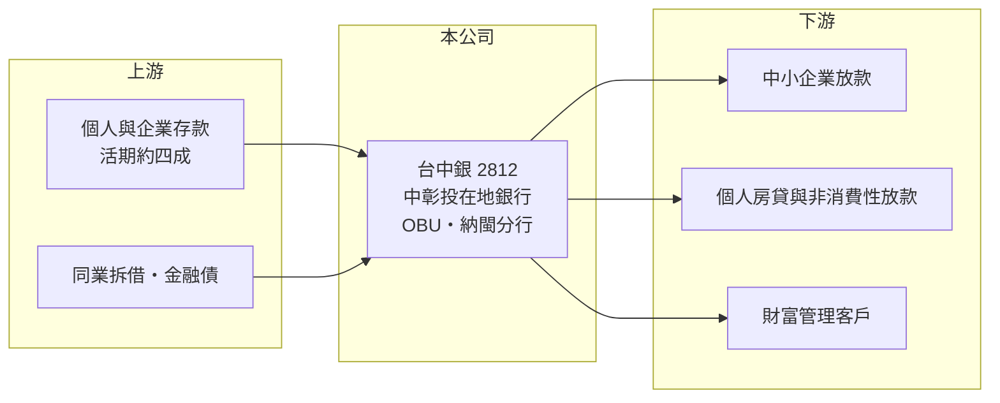

# 2812 台中銀

> 上市｜[[產業索引-金融保險業|金融保險業]]｜上市（櫃）日期 1984/05/15

# 第一章：企業模式與商業藍圖

> [!info] 撰寫說明
> 精簡版，由 Claude 依公開資料整理，架構比照 [[2330台積電]] 的四章研究，資料截至 2026-10-08。財務數字來源：Goodinfo 年度經營績效頁、富果研究整理的 2025 年 8 月法說會摘要（2025 年第二季資料）、證交所開放資料（基本資料、股利、每月營收、本益比）。合會儲蓄公司沿革與子公司描述憑記憶整理。#待校對

在評估銀行股的長期價值時，首要步驟是理解它的存款從哪裡來、放款給誰。本章說明台中商業銀行（股票代號：2812，以下簡稱台中銀）如何以中彰投地區的中小企業為核心客群，從地方合會發展成總資產突破兆元的區域銀行。

- **核心業務：** 台中銀成立於 1953 年，前身是台中地區的合會儲蓄公司，後改制為商業銀行（待校對），1984 年上市。它的獲利模式是吸收存款、放款給企業與個人，賺取存放款利差，再加上財富管理與放款手續費。截至 2025 年第二季，總放款約 6,347 億元、總存款約 8,480 億元，合併總資產約 1 兆 47 億元。
- **放款結構：** 中小企業放款約占 36.19%，其他個人非消費性放款約占 34.50%，有擔保放款約占 83.16%，擔保品以不動產為主。新台幣放款約占 92.67%。這代表台中銀的放款高度依賴中部地區中小企業主與不動產擔保，風險分散在大量小額客戶上，但也與房地產景氣連動。
- **營運據點：** 經營重心在台中、彰化、南投，長期與當地中小企業主往來，分行網路主要在中部（分行家數未查得）。海外業務以國際金融業務分行（OBU）與馬來西亞納閩分行為主，2025 年上半年兩者合計貢獻全行稅前淨利約 16.36%。
- **長期方向：** 以中小企業主為入口，延伸到這些客戶個人的財富管理與高資產客戶業務，2025 年已向主管機關申請高資產客戶財富管理業務。財務操作維持保守，並強化防詐風控。

# 第二章：護城河深度與競爭優勢

本章分析台中銀的護城河：在地關係、存款基礎與穩健的資產品質。

- **在地關係：** 中小企業放款看重對企業主與當地產業的了解，台中銀七十多年深耕中部，與傳產、機械、建築等在地企業主建立長期往來，這種關係型放款是大型全國性銀行不易取代的。企業主的家族存款與財富管理需求，也讓同一位客戶可以貢獻多種收入。
- **資金成本：** 新台幣存款中活期約占 42.51%，活期存款利率低，是銀行重要的低成本資金來源，有助於維持利差。
- **主要對手：** 全國性公股銀行（如 [[2834臺企銀]]，同樣以中小企業放款為主）、大型金控旗下銀行（如 [[2884玉山金]]、[[2891中信金]]），以及同為中型民營銀行的 [[2838聯邦銀]]、[[2845遠東銀]]、[[2897王道銀行]]。
- **觀察重點：** 第一，存放利差與 [[NIM]] 在利率環境變化下的走勢；第二，不動產授信集中度與房市變化；第三，財富管理手續費能否成為穩定的第二收入來源。

# 第三章：財務體質與盈利規模

資料日期：2026-10-08。數字取自 Goodinfo 年度經營績效頁、法說會摘要與證交所開放資料，表格是撰寫當時的快照；最新月營收、累計 EPS 由自動排程寫在本筆記的屬性欄位（月營收、累計EPS 等）。#待校對

銀行業不適用毛利率與營業利益率，本章改用淨收益、稅後淨利、[[ROE]]、[[ROA]]、資產品質與資本適足率，檢視台中銀的獲利品質。

| 年度 | 淨收益（新台幣） | 稅後淨利 | EPS（元） | [[ROE]] | [[ROA]] |
|---|---|---|---|---|---|
| 2019 | 121 億 | 43.2 億 | 1.16 | 8.72% | 0.63% |
| 2020 | 116 億 | 40.3 億 | 1.03 | 7.41% | 0.57% |
| 2021 | 137 億 | 48.0 億 | 1.10 | 7.94% | 0.64% |
| 2022 | 150 億 | 53.4 億 | 1.12 | 8.06% | 0.68% |
| 2023 | 175 億 | 68.2 億 | 1.31 | 9.36% | 0.81% |
| 2024 | 193 億 | 82.9 億 | 1.50 | 10.5% | 0.90% |
| 2025 | 206 億 | 90.6 億 | 1.53 | 10.4% | 0.91% |

註：取自 Goodinfo 合併報表，淨收益欄為 Goodinfo 標示的營業收入。

- **獲利成長：** 2020 至 2025 年稅後淨利從 40.3 億元增至 90.6 億元，年複合成長率約 17.6%（推算），ROE 從 7.4% 提升到 10% 以上，在中型銀行中屬於成長較快者。2022 年後的升息循環推升放款利率，加上放款規模年增一成左右，是主要動力。
- **EPS 與股本：** 同期 EPS 只從 1.03 元升到 1.53 元，遠慢於淨利成長，原因是台中銀長年以[[股票股利]]為主。2025 年度配發現金 0.39 元、股票 0.67 元，合計 1.06 元，配發率約 69%（推算，1.06 ÷ 1.53）。股票股利把資本留在銀行支應放款成長，代價是股本持續膨脹。
- **利差與效率：** 2025 年第二季 [[NIM]] 1.32%、存放利差 1.75%，分別年減 4 與 7 個基點；上半年成本效益比 43.24%，高於前一年同期的 39.14%。上半年 ROE（年化）10.12%、ROA（年化）0.86%。
- **資產品質與資本：** 2025 年第二季[[逾放比]] 0.29%（年增 0.18 個百分點），[[備抵呆帳覆蓋率]] 404.77%；合併[[資本適足率]] 13.82%、第一類資本比率 12.39%、普通股權益比率 11.24%。逾放比雖略升但仍低，資本水準符合法規並有緩衝。
- **長期指標：** 2021 至 2025 年平均 ROE 約 9.25%（推算）。2026 年 1 至 8 月累計營收年增約 16.7%（證交所月營收資料）。

**ROE 與權益資金成本：** 銀行的存款與借款是營業原料，無法和資本分開計算，因此不用 [[ROIC]] 與 [[WACC]]，改以 ROE 比較股東要求的報酬率。以 [[CAPM]] 推估：台灣 10 年期公債殖利率 1.75%、市場風險溢酬 6%、β 取台灣中型民營銀行常見值 0.7（同業常見值，非來源數字），權益資金成本約 5.95%（推算）；β 若為 0.8，約 6.55%。台中銀 2024 至 2025 年 ROE 約 10.4% 至 10.5%，高於權益成本約 4 個百分點，2019 至 2022 年的 7.4% 至 8.7% 也都高於權益成本，代表長期持續創造價值。證交所資料顯示股價淨值比約 1.17 倍，與 ROE 高於權益成本的判斷一致。

# 第四章：總體風險與地緣政治

本章分析台中銀長期面對的風險。

- **利率週期：** 銀行獲利高度依賴存放利差。降息時放款利率通常比定存利率先下調，NIM 會收窄；2025 年 NIM 與存放利差已小幅下滑。
- **授信集中：** 放款集中在中部中小企業與不動產擔保，若區域產業（如機械、傳產）景氣轉弱或房價下跌，逾放比與提存可能同步上升。主管機關的不動產授信集中度規定，也會限制房貸與建築融資的成長。
- **資本與股本：** 放款快速成長會消耗資本，若持續以股票股利補充資本，EPS 成長將繼續落後淨利成長。
- **其他風險：** 詐騙與洗錢防制的法遵成本上升；海外分行與 OBU 業務受國際利率、匯率與當地信用風險影響；數位銀行與大型金控在存款與財管業務的競爭。

# 專有名詞解析

## 金融

- **[[NIM]]**：淨利息收益率，利息淨收益除以生息資產，衡量銀行整體資產賺取利息的效率。
- **[[逾放比]]**：逾期放款占總放款的比例，數字越低代表放款資產品質越好。
- **[[備抵呆帳覆蓋率]]**：備抵呆帳除以逾期放款，衡量銀行為可能的壞帳預先提列了多少緩衝。
- **[[資本適足率]]**：自有資本除以風險性資產，主管機關用來確保金融機構有足夠資本承擔損失；放款越多需要的資本越多。
- **[[股票股利]]**：公司以發放新股代替現金分配盈餘，可把資金留在公司內部，但會使股本擴大、稀釋每股盈餘。
- **[[CAPM]]**：資本資產定價模型，以無風險利率加上 β 乘以市場風險溢酬，推估股東要求的報酬率。
- **[[ROA]]**：資產報酬率，稅後淨利除以總資產，銀行因槓桿高，ROA 通常低於 1%。

# 核心供應鏈

- 上游：資金來源為中部地區個人與企業的存款（2025 年第二季約 8,480 億元），以及同業拆借與金融債券。
- 下游／客戶：中部中小企業與企業主、以不動產為擔保的個人放款戶，以及財富管理客戶。
- 同業：[[2834臺企銀]]、[[2838聯邦銀]]、[[2845遠東銀]]、[[2897王道銀行]]、[[2836高雄銀]]。

## 最新新聞
<!-- news:start（自動產生，請勿手動編輯此範圍） -->
- 2026-10-08 🏛️ 重訊 17:53｜公告本公司董事會重要決議事項｜[觀測站](https://mops.twse.com.tw/mops/#/web/t05st01)
- 2026-10-08 🏛️ 重訊 17:52｜公告本公司暨子公司115年9月份財務及業務資料。｜[觀測站](https://mops.twse.com.tw/mops/#/web/t05st01)

完整紀錄：[[2812台中銀 新聞]]
<!-- news:end -->

## 相關連結
- [公開資訊觀測站](https://mopsov.twse.com.tw/mops/web/t05st03?step=1&firstin=1&co_id=2812)
- [Goodinfo](https://goodinfo.tw/tw/StockDetail.asp?STOCK_ID=2812)
- [Yahoo 股市](https://tw.stock.yahoo.com/quote/2812)
- [鉅亨網新聞](https://www.cnyes.com/twstock/2812/news)
