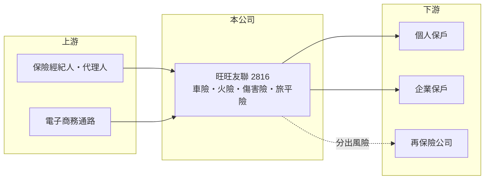

# 2816 旺旺保

> 上市｜[[產業索引-金融保險業|金融保險業]]｜上市（櫃）日期 1992/05/05

# 第一章：企業模式與商業藍圖

> [!info] 撰寫說明
> 精簡版，由 Claude 依公開資料整理，架構比照 [[2330台積電]] 的四章研究，資料截至 2026-10-08。財務數字來源：Goodinfo 年度經營績效頁、工商時報 2025 年 10 月旅綜險市場報導、證交所開放資料（基本資料、股利、每月營收、本益比）。旺旺集團入主與防疫保單事件憑記憶整理；公開資料有限，險種比重、綜合率與 RBC 未查得。#待校對

在評估保險股的長期價值時，首要步驟是理解它收的保費能否覆蓋理賠與費用。本章說明旺旺友聯產物保險（股票代號：2816，以下簡稱旺旺友聯）這家中小型產險公司的經營模式，以及 2022 年防疫保單事件如何改變它的財務體質。

- **核心業務：** 旺旺友聯前身為 1963 年成立的友聯產物保險，1992 年上市，2000 年代後期由旺旺集團入主並更名（待校對），目前董事長為洪吉雄。產險公司的獲利來自兩部分：一是[[核保損益]]，也就是保費收入扣掉理賠與費用後的結果；二是把保費在理賠前先拿去投資的投資收益。
- **營收結構：** 產品以車險、火險、傷害險與健康險等個人與企業保險為主（推估，險種比重未查得）。2025 年前八月旅行綜合保險簽單保費年增 63%，排名進入產險業前五大，並推出可選擇是否包含法定傳染病保障的旅平險方案，顯示公司積極經營個人旅遊相關商品。
- **規模定位：** 實收資本額約 22.4 億元，在台灣產險業屬中小型公司，與大型金控旗下的富邦產、國泰產相比規模差距明顯。中小型產險公司通常在通路與定價上較難與大型公司競爭，必須靠特定險種或通路找到利基。
- **長期方向：** 透過電子商務與數位服務（例如班機延誤簡訊通知）經營個人險種，並在旅平險等成長市場擴大市占率。長期關鍵在於維持核保紀律，避免為了衝保費而承接定價不足的風險。

# 第二章：護城河深度與競爭優勢

本章分析旺旺友聯的競爭地位。產險商品同質性高，護城河主要來自定價能力、通路與資本實力。

- **競爭優勢：** 旺旺集團的品牌知名度與集團資源，有助於個人險種的行銷；數位通路與商品設計的彈性，讓它能在旅平險這類新興需求中快速反應。
- **限制與弱點：** 2022 年防疫保單理賠讓公司單年大幅虧損（待校對），暴露出中小型產險公司在單一險種定價失準時，資本緩衝不足的弱點。相較大型產險公司，它的再保險安排、資本規模與通路議價能力都較弱。
- **主要對手：** 大型產險公司如富邦產（[[2881富邦金]]）、國泰產（[[2882國泰金]]），以及同為上市產險的 [[2832台產]]、[[2850新產]]、[[2852第一保]]；再保方面則與 [[2851中再保]] 往來。
- **觀察重點：** 第一，核保損益與綜合率能否長期維持在 100% 以下；第二，旅平險等個人險種的成長；第三，資本適足（[[RBC]]）水準與配息能力。

# 第三章：財務體質與盈利規模

資料日期：2026-10-08。數字取自 Goodinfo 年度經營績效頁與證交所開放資料，表格是撰寫當時的快照；最新月營收、累計 EPS 由自動排程寫在本筆記的屬性欄位（月營收、累計EPS 等）。#待校對

保險業不適用毛利率與營業利益率，本章改用營業收入、稅後淨利、[[ROE]]、[[ROA]] 與[[綜合率]]，檢視旺旺友聯的經營品質。

| 年度 | 營業收入（新台幣） | 稅後淨利 | EPS（元） | [[ROE]] | [[ROA]] |
|---|---|---|---|---|---|
| 2019 | 80.8 億 | 7.04 億 | 3.30 | 13.6% | 4.02% |
| 2020 | 82.4 億 | 7.02 億 | 3.14 | 12.4% | 3.97% |
| 2021 | 88.1 億 | 6.97 億 | 3.12 | 11.3% | 3.79% |
| 2022 | 85.0 億 | -13.2 億 | -5.91 | -23.5% | -7.09% |
| 2023 | 102 億 | 12.0 億 | 5.37 | 22.0% | 6.28% |
| 2024 | 110 億 | 12.2 億 | 5.46 | 18.2% | 5.66% |
| 2025 | 111 億 | 10.4 億 | 4.66 | 13.6% | 4.28% |

註：取自 Goodinfo 合併報表。綜合率（損失率加費用率）與 RBC 未查得。

- **獲利結構：** 除了 2022 年，旺旺友聯的 ROE 長期維持在 11% 至 22%，在產險業屬於中上水準。2022 年虧損 13.2 億元，推估主要來自防疫保單理賠（推估），單一年度就吃掉約兩年的獲利，說明產險業的風險在於低機率、高損失的集中理賠。
- **成長軌跡：** 營業收入從 2019 年的 80.8 億元增至 2025 年的 111 億元，年複合成長率約 5.4%（推算）。2026 年 1 至 8 月累計營收年增約 16.3%（證交所月營收資料）。
- **長期指標：** 2021 至 2025 年平均 ROE 約 8.3%（推算），若排除 2022 年則約 16%。2025 年度現金股利 1.5 元，[[配息率]]約 32%（推算，1.5 ÷ 4.66），配息偏保守，推估與彌補 2022 年虧損、重建資本有關（推估）。
- **估值觀察：** 證交所資料顯示股價淨值比約 0.92 倍、本益比約 3.45 倍。本益比明顯偏低，推估近四季獲利含一次性因素（推估，未查得原因），解讀時應以長期 ROE 為準。

**ROE 與權益資金成本：** 保險業的保費準備金屬於營運負債，不適合用 [[ROIC]] 與 [[WACC]] 分析，改以 ROE 比較股東要求的報酬率。以 [[CAPM]] 推估：台灣 10 年期公債殖利率 1.75%、市場風險溢酬 6%、β 取產險股常見值 0.6（同業常見值，非來源數字），權益資金成本約 5.35%（推算）；β 若為 0.8，約 6.55%。2023 至 2025 年 ROE 介於 13.6% 至 22%，明顯高於權益成本；但把 2022 年虧損納入後，五年平均約 8.3%，僅比權益成本高約 3 個百分點。結論是旺旺友聯在正常年度能創造價值，但必須把偶發巨額理賠的風險納入長期評估。

# 第四章：總體風險與地緣政治

本章分析旺旺友聯長期面對的風險。

- **巨災與集中理賠：** 颱風、地震、疫情等事件可能在短時間內造成大量理賠。2022 年的防疫保單就是單一商品定價失準造成重大虧損的例子；[[再保險]]安排是否充足，決定了這類事件的衝擊大小。
- **定價競爭：** 車險等主要險種的商品同質性高，大型產險公司以規模與通路優勢競爭，中小型公司若以降價搶市占，可能損害核保利潤。
- **投資風險：** 保費在理賠前會投入股票、債券等資產，股市與利率波動會影響投資收益與淨值。
- **其他風險：** 2026 年台灣保險業接軌 IFRS 17 與新的清償能力制度，資本要求與財報認列方式改變；監理機關對商品設計與資本的要求趨嚴，也會影響配息能力。

# 專有名詞解析

## 金融

- **[[核保損益]]**：保險公司收取的保費扣除理賠、準備金提存與營業費用後的損益，代表承保業務本身是否賺錢。
- **[[綜合率]]**：損失率加費用率，低於 100% 代表核保有利潤，是衡量產險經營效率的核心指標。
- **[[RBC]]**：風險資本適足率，保險公司自有資本除以風險資本，台灣法定最低要求為 200%。
- **[[再保險]]**：保險公司把部分承保風險轉給再保公司，以分散巨災等大額理賠風險。
- **[[配息率]]**：現金股利占每股盈餘的比例，反映公司把多少獲利分配給股東。
- **[[CAPM]]**：資本資產定價模型，以無風險利率加上 β 乘以市場風險溢酬，推估股東要求的報酬率。
- **[[ROA]]**：資產報酬率，稅後淨利除以總資產，衡量金融機構運用資產創造獲利的效率。

# 核心供應鏈

- 上游：保險經紀人、代理人、銀行與車商通路，以及公司自營的電子商務平台，負責把商品賣到保戶手上。
- 下游／客戶：購買車險、旅平險、傷害與健康險的個人保戶，以及投保火險、工程險的企業；部分風險再分給國內外再保險公司（如 [[2851中再保]]）。
- 同業：[[2832台產]]、[[2850新產]]、[[2852第一保]]，以及金控旗下的富邦產（[[2881富邦金]]）、國泰產（[[2882國泰金]]）。

## 最新新聞
<!-- news:start（自動產生，請勿手動編輯此範圍） -->
- 2026-10-13 🏛️ 重訊 14:16｜公告本公司召開法人說明會｜[觀測站](https://mops.twse.com.tw/mops/#/web/t05st01)

完整紀錄：[[2816旺旺保 新聞]]
<!-- news:end -->

## 相關連結
- [公開資訊觀測站](https://mopsov.twse.com.tw/mops/web/t05st03?step=1&firstin=1&co_id=2816)
- [Goodinfo](https://goodinfo.tw/tw/StockDetail.asp?STOCK_ID=2816)
- [Yahoo 股市](https://tw.stock.yahoo.com/quote/2816)
- [鉅亨網新聞](https://www.cnyes.com/twstock/2816/news)
