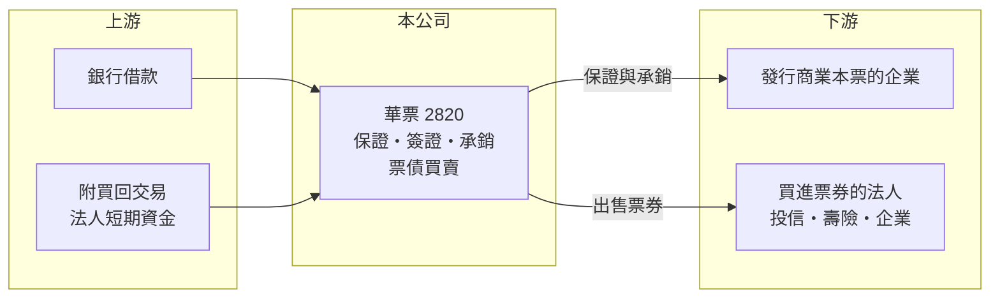

# 2820 華票

> 上市｜[[產業索引-金融保險業|金融保險業]]｜上市（櫃）日期 1994/10/26

# 第一章：企業模式與商業藍圖

> [!info] 撰寫說明
> 精簡版，由 Claude 依公開資料整理，架構比照 [[2330台積電]] 的四章研究，資料截至 2026-10-08。財務數字來源：Goodinfo 年度經營績效頁、CMoney 2022 年個股研究筆記（2021 年資料）、證交所開放資料（基本資料、股利、每月營收、本益比）。股東結構為 2021 年資料，現況可能已改變；公開資料有限，業務收益比重與資本適足率未查得。#待校對

在評估票券公司的長期價值時，首要步驟是理解它在貨幣市場扮演的角色。本章說明中華票券金融（股票代號：2820，以下簡稱華票）如何靠短期資金利差與票券保證獲利，以及它的獲利為何對利率高度敏感。

- **核心業務：** 華票 1978 年設立，同年 12 月開業，1994 年上市，實收資本額約 134.3 億元，是國內前三大票券商之一。[[票券]]公司的主要工作，是替企業發行的[[商業本票]]提供保證與簽證、承銷給投資人，並自己買賣票券與債券，賺取短期利率與資金成本之間的價差。
- **業務結構：** 業務分為四大類：票券業務（商業本票、銀行可轉讓定期存單、銀行承兌匯票、國庫券等）、債券業務（公債、公司債、金融債與外幣債）、股權投資，以及授信（保證）業務。各項收益比重未查得，但票券與債券的利息淨收益是主要來源（推估）。
- **營運據點：** 總公司在台北內湖，2021 年底在板橋、桃園、台中、台南、高雄設有分公司，服務對象是需要短期週轉資金的企業，以及把閒置資金投入貨幣市場的法人。
- **股東結構：** 依 2021 年資料，王道商業銀行持股約 28.36%、寶佳資產管理持股約 16.98%，是兩大股東（待校對現況）。大股東的組成會影響公司的經營方向與股利政策。

# 第二章：護城河深度與競爭優勢

本章分析華票的競爭地位：信用、資金調度能力與資產品質。

- **競爭優勢：** 票券保證的本質是信用，企業找票券公司保證，是因為投資人信任票券公司的審查與償付能力。華票經營四十多年，2021 年獲惠譽給予國內長期評等 A+(twn)、短期評等 F1(twn)，加上多年逾放比為零，這種信用紀錄是新進者無法短期取得的門檻。
- **資金調度：** 票券公司沒有存款，資金主要來自銀行借款與[[附買回交易]]（RP），因此資金調度能力與同業間的信用關係，決定了資金成本高低。規模較大的票券商通常能取得較低的資金成本。
- **主要對手：** 金控旗下的票券公司如兆豐票券（[[2886兆豐金]]）、國際票券（[[2889國票金]]），以及台新金旗下的大中票券（[[2887台新新光金]]）；銀行本身也承作短期企業授信，是間接競爭者。
- **觀察重點：** 第一，利率走勢對利差的影響；第二，不動產相關保證的風險控管，金管會曾規劃限制票券業對不動產保證餘額比重；第三，大股東結構變化對經營策略的影響。

# 第三章：財務體質與盈利規模

資料日期：2026-10-08。數字取自 Goodinfo 年度經營績效頁與證交所開放資料，表格是撰寫當時的快照；最新月營收、累計 EPS 由自動排程寫在本筆記的屬性欄位（月營收、累計EPS 等）。#待校對

票券業不適用毛利率與營業利益率，本章改用營業收入（淨收益）、稅後淨利、[[ROE]]、[[ROA]] 與資產品質，檢視華票的經營品質。

| 年度 | 營業收入（新台幣） | 稅後淨利 | EPS（元） | [[ROE]] | [[ROA]] |
|---|---|---|---|---|---|
| 2019 | 20.1 億 | 12.4 億 | 0.93 | 5.28% | 0.63% |
| 2020 | 25.1 億 | 15.8 億 | 1.18 | 6.40% | 0.76% |
| 2021 | 28.5 億 | 18.6 億 | 1.38 | 7.28% | 0.83% |
| 2022 | 16.5 億 | 10.4 億 | 0.77 | 4.38% | 0.48% |
| 2023 | 20.2 億 | 12.9 億 | 0.96 | 5.49% | 0.60% |
| 2024 | 22.4 億 | 13.7 億 | 1.02 | 5.48% | 0.58% |
| 2025 | 29.8 億 | 18.0 億 | 1.34 | 6.77% | 0.69% |

註：取自 Goodinfo 合併報表。

- **利率敏感度：** 2020 至 2021 年低利率時期資金成本低，淨利創高；2022 年央行升息，票券公司以短天期借款支應持有的票債部位，資金成本上升速度快於資產收益率，淨利掉到 10.4 億元。2023 年後利率趨穩，獲利逐步回升，2025 年回到 18 億元。這說明票券公司的獲利主要看利率變動的方向與速度。
- **近期動能：** 2026 年 1 至 8 月累計營收年增約 46.7%，公司說明主要是票債淨利息收入與金融商品收益增加（證交所月營收資料）。
- **長期指標：** 2019 至 2025 年稅後淨利年複合成長率約 6.4%（推算）；2021 至 2025 年平均 ROE 約 5.9%（推算）。華票以現金股利為主，2021 年報導指出已連續 13 年配發股利，每年約 0.8 元上下；2025 年度現金股利 0.9 元，[[配息率]]約 67%（推算，0.9 ÷ 1.34）。
- **資產品質：** 2021 年報導指出華票連續五年[[逾放比]]為零，保證業務的信用損失極低。資本適足率未查得。

**ROE 與權益資金成本：** 票券公司的借款與附買回負債是營業原料，不適合用 [[ROIC]] 與 [[WACC]] 分析，改以 ROE 比較股東要求的報酬率。以 [[CAPM]] 推估：台灣 10 年期公債殖利率 1.75%、市場風險溢酬 6%、β 取票券與中型金融股常見值 0.7（同業常見值，非來源數字），權益資金成本約 5.95%（推算）。華票 2021 至 2025 年平均 ROE 約 5.9%，與權益成本幾乎相同，2022 至 2024 年甚至略低。結論是華票長期大致在「打平」附近，並未明顯創造超額價值；證交所資料顯示股價淨值比約 0.80 倍，與這個判斷一致。投資價值主要在穩定配息，而不是成長。

# 第四章：總體風險與地緣政治

本章分析華票長期面對的風險。

- **利率風險：** 票券公司以短期資金支應票債部位，利率快速上升時資金成本上升快於收益，利差會被壓縮，債券部位也會出現評價損失，2022 年就是例子。
- **信用風險：** 保證業務一旦遇到企業違約，票券公司必須代為償付。若保證集中在營建、不動產等景氣循環產業，房市反轉時風險會升高，這也是主管機關規劃限制不動產保證比重的原因。
- **市場結構：** 企業可以改向銀行借款或發行公司債籌資，票券市場的成長空間有限；金控旗下票券公司可以利用集團資源，對獨立票券公司形成競爭壓力。
- **其他風險：** 股東結構變動可能帶來經營權或策略改變；股權投資部位受股市波動影響，會讓獲利出現非經常性起伏。

# 專有名詞解析

## 金融

- **[[票券]]**：一年期以下的短期票據，如商業本票，由票券公司簽證、承銷與買賣，賺取短期資金利差。
- **[[商業本票]]**：企業為籌措短期資金發行的票據，通常由票券公司保證後在貨幣市場出售。
- **[[附買回交易]]**：簡稱 RP，賣方出售債券或票券時約定在未來以約定價格買回，實質上是以票債為擔保的短期借款。
- **[[逾放比]]**：逾期放款占總放款的比例，數字越低代表放款資產品質越好。
- **[[配息率]]**：現金股利占每股盈餘的比例，反映公司把多少獲利分配給股東。
- **[[CAPM]]**：資本資產定價模型，以無風險利率加上 β 乘以市場風險溢酬，推估股東要求的報酬率。
- **[[ROA]]**：資產報酬率，稅後淨利除以總資產，衡量金融機構運用資產創造獲利的效率。

# 核心供應鏈

- 上游：資金來源為銀行借款與附買回交易，資金提供者包括銀行、投信貨幣市場基金與企業閒置資金。
- 下游／客戶：需要短期週轉資金、發行商業本票的企業，以及買進票券與債券的法人投資人。
- 同業：兆豐票券（[[2886兆豐金]]）、國際票券（[[2889國票金]]）、大中票券（[[2887台新新光金]]）；大股東 [[2897王道銀行]]。

## 最新新聞
<!-- news:start -->
<!-- news:end -->

## 相關連結
- [公開資訊觀測站](https://mopsov.twse.com.tw/mops/web/t05st03?step=1&firstin=1&co_id=2820)
- [Goodinfo](https://goodinfo.tw/tw/StockDetail.asp?STOCK_ID=2820)
- [Yahoo 股市](https://tw.stock.yahoo.com/quote/2820)
- [鉅亨網新聞](https://www.cnyes.com/twstock/2820/news)
