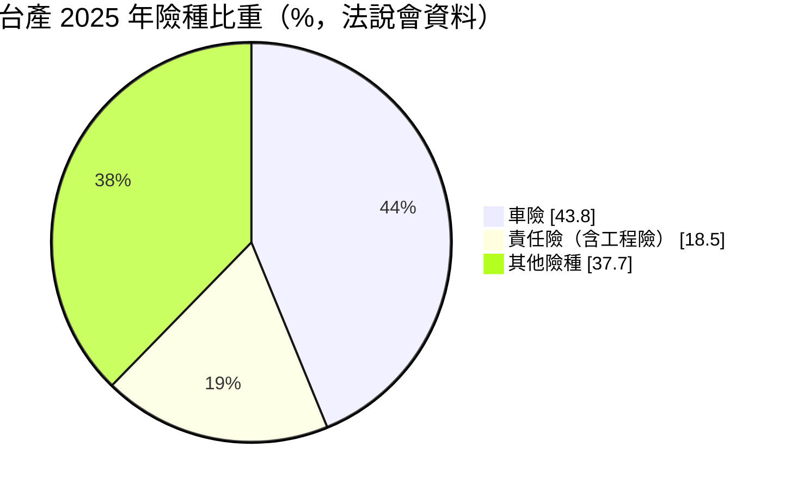
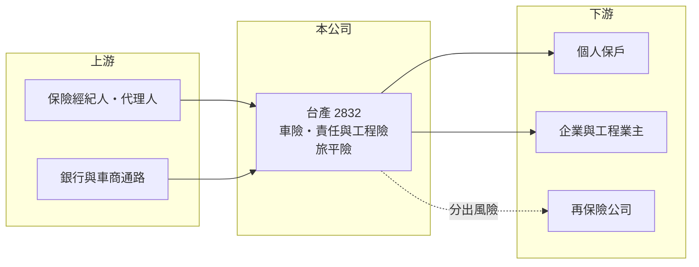

# 2832 台產

> 上市｜[[產業索引-金融保險業|金融保險業]]｜上市（櫃）日期 1997/09/30

# 第一章：企業模式與商業藍圖

> [!info] 撰寫說明
> 精簡版，由 Claude 依公開資料整理，架構比照 [[2330台積電]] 的四章研究，資料截至 2026-10-08。財務數字來源：Goodinfo 年度經營績效頁、富果研究整理的 2026 年 3 月法說會摘要（含 2025 年上半年與全年資料）、工商時報 2025 年 10 月旅綜險市場報導、證交所開放資料（基本資料、股利、每月營收、本益比）。法說會摘要為 AI 整理，數字以公司公告為準；大股東結構與市占率未查得。#待校對

在評估保險股的長期價值時，首要步驟是理解它收的保費能否覆蓋理賠與費用。本章說明台灣產物保險（股票代號：2832，以下簡稱台產）這家成立於 1948 年的老牌產險公司，如何在保守經營之下，透過調整險種結構與現金減資提升股東報酬。

- **核心業務：** 台產 1948 年成立，1997 年上市，是台灣歷史最悠久的產險公司之一。產險公司的獲利來自兩部分：一是[[核保損益]]，也就是保費扣掉理賠與費用後的結果；二是把保費在理賠前先投資所賺的投資收益。2025 年簽單保費約 94.94 億元，年增 7%，創歷史新高。
- **險種結構：** 車險是最大險種，但比重從 2023 年的 49.2% 降到 2025 年的 43.8%；責任險（主要由工程險帶動）從 14.0% 升到 18.5%。商業險成長率已連續數年高於個人險，旅行平安險也大幅成長，2025 年前八月旅綜險保費年增約 73%，為產險業最高。險種從車險往商業險分散，可以降低對單一險種定價競爭的依賴。
- **資本政策：** 2025 年獲主管機關核准現金減資約三成，股本由約 36 億元降至 25.35 億元，把閒置資金退還股東，目的是提高 ROE 與 EPS。減資後 [[RBC]] 估計仍約 660%，遠高於法定的 200%，代表資本仍相當充足。
- **長期方向：** 投資原則保守，以債息、股利與租金為核心，海外投資計畫降到 5% 以下；名下約 20 億元的不動產計畫拆除舊大樓後改建。整體策略是「承保穩健、投資保守、資本精簡」。

# 第二章：護城河深度與競爭優勢

本章分析台產的競爭地位：老牌信譽、商業險承保經驗與資本實力。

- **競爭優勢：** 商業險（工程險、責任險、火險）需要核保人員對產業與工程風險的專業判斷，客戶也重視保險公司的理賠紀錄與財務穩健度。台產經營七十多年、RBC 遠高於法定標準，這種信譽讓它在商業險市場具備競爭力。
- **核保紀律：** 2025 年上半年自留[[綜合率]]約 40%，低於前一年同期的 50% 以上，保險業務利益年增近 60%，代表核保獲利能力良好。不過這個數字會因颱風、重大事故等理賠而大幅波動。
- **主要對手：** 大型產險公司如富邦產（[[2881富邦金]]）、國泰產（[[2882國泰金]]），以及同為上市產險的 [[2850新產]]、[[2816旺旺保]]、[[2852第一保]]。
- **觀察重點：** 第一，商業險與工程險的成長能否持續；第二，巨災與重大事故理賠對損失率的影響；第三，減資後 ROE 能否穩定在 10% 以上。

# 第三章：財務體質與盈利規模

資料日期：2026-10-08。數字取自 Goodinfo 年度經營績效頁、法說會摘要與證交所開放資料，表格是撰寫當時的快照；最新月營收、累計 EPS 由自動排程寫在本筆記的屬性欄位（月營收、累計EPS 等）。#待校對

保險業不適用毛利率與營業利益率，本章改用營業收入、稅後淨利、[[ROE]]、[[ROA]]、綜合率與 RBC，檢視台產的經營品質。

| 年度 | 營業收入（新台幣） | 稅後淨利 | EPS（元） | [[ROE]] | [[ROA]] |
|---|---|---|---|---|---|
| 2019 | 52.0 億 | 7.03 億 | 1.94 | 8.03% | 3.81% |
| 2020 | 54.0 億 | 6.88 億 | 1.90 | 7.37% | 3.57% |
| 2021 | 75.1 億 | 3.73 億 | 1.03 | 3.78% | 1.86% |
| 2022 | 60.6 億 | 6.72 億 | 1.86 | 6.68% | 3.24% |
| 2023 | 67.7 億 | 9.78 億 | 2.70 | 9.26% | 4.48% |
| 2024 | 73.4 億 | 11.6 億 | 3.21 | 9.91% | 4.87% |
| 2025 | 72.7 億 | 12.4 億 | 3.91 | 10.3% | 4.92% |

註：取自 Goodinfo 合併報表。2025 年 EPS 3.91 元以減資前加權股數計算；以減資後約 2.535 億股計算，每股約 4.90 元（推算）。

- **獲利成長：** 2019 至 2025 年稅後淨利從 7.03 億元增至 12.4 億元，年複合成長率約 9.9%（推算），2025 年創歷史新高。2021 年淨利只有 3.73 億元，推估與當年防疫保單等理賠有關（推估）。ROE 從 2021 年的 3.78% 逐年升到 2025 年的 10.3%。
- **收益結構變化：** 2025 年上半年保險業務利益 6.68 億元、年增近 60%，投資業務利益只有 0.43 億元、年減近 90%，顯示台產近年的獲利改善主要來自本業核保，而不是投資。
- **長期指標：** 2021 至 2025 年平均 ROE 約 8.0%（推算）。2025 年度現金股利 3.5 元（減資後股本），現金股利總額約 8.87 億元，[[配息率]]約 71%（推算，8.87 億 ÷ 12.42 億）。2025 年底自有資本比率 46.2%、RBC 741%，減資後估計分別約 42% 與 660%。
- **估值觀察：** 證交所資料顯示股價淨值比約 1.18 倍、本益比約 9.35 倍。減資讓淨值縮小、ROE 提高，股價淨值比高於 1 倍與 ROE 改善的方向一致。

**ROE 與權益資金成本：** 保險業的保費準備金屬於營運負債，不適合用 [[ROIC]] 與 [[WACC]] 分析，改以 ROE 比較股東要求的報酬率。以 [[CAPM]] 推估：台灣 10 年期公債殖利率 1.75%、市場風險溢酬 6%、β 取產險股常見值 0.6（同業常見值，非來源數字），權益資金成本約 5.35%（推算）；β 若為 0.8，約 6.55%。台產 2023 至 2025 年 ROE 介於 9.3% 至 10.3%，高於權益成本約 4 至 5 個百分點；2021 年的 3.78% 則低於權益成本。過去台產因資本過多而拉低 ROE，2025 年的現金減資正是把無法產生足夠報酬的資本退還股東，若減資後 ROE 能提高到 12% 以上（推算），價值創造會更明顯。

# 第四章：總體風險與地緣政治

本章分析台產長期面對的風險。

- **巨災與重大事故：** 颱風、地震與工廠事故可能在短時間內造成大量理賠。法說會提到 2025 年 7 月丹娜絲颱風與三元能源電廠爆炸案的理賠，會在第三季後反映，可能讓全年損失率回升；工程險比重提高，也代表承擔的大型事故風險增加，[[再保險]]安排因此更為重要。
- **車險競爭：** 車險仍占四成以上，商品同質性高，大型產險公司以通路與價格競爭，費率若被壓低會影響核保利潤。
- **投資風險：** 投資收益受股市與利率影響，2025 年上半年投資業務利益大幅減少，說明這一塊並不穩定；多數股票部位列在其他綜合損益，股價下跌會直接減少淨值。
- **其他風險：** 2026 年台灣保險業接軌 IFRS 17 與新的清償能力制度，資本要求與財報認列方式改變；減資後資本緩衝變薄，若遇重大理賠，配息能力可能受影響。

# 專有名詞解析

## 金融

- **[[核保損益]]**：保險公司收取的保費扣除理賠、準備金提存與營業費用後的損益，代表承保業務本身是否賺錢。
- **[[綜合率]]**：損失率加費用率，低於 100% 代表核保有利潤，是衡量產險經營效率的核心指標。
- **[[RBC]]**：風險資本適足率，保險公司自有資本除以風險資本，台灣法定最低要求為 200%。
- **[[再保險]]**：保險公司把部分承保風險轉給再保公司，以分散巨災等大額理賠風險。
- **[[配息率]]**：現金股利占每股盈餘的比例，反映公司把多少獲利分配給股東。
- **[[CAPM]]**：資本資產定價模型，以無風險利率加上 β 乘以市場風險溢酬，推估股東要求的報酬率。
- **[[ROA]]**：資產報酬率，稅後淨利除以總資產，衡量金融機構運用資產創造獲利的效率。

# 核心供應鏈

- 上游：保險經紀人、代理人、銀行與車商通路，負責把車險、旅平險與商業保險賣到保戶手上。
- 下游／客戶：個人車險與旅平險保戶，以及投保工程險、責任險、火險的企業與工程業主；大額風險分給國內外再保險公司（如 [[2851中再保]]）。
- 同業：[[2850新產]]、[[2816旺旺保]]、[[2852第一保]]，以及金控旗下的富邦產（[[2881富邦金]]）、國泰產（[[2882國泰金]]）。

## 最新新聞
<!-- news:start -->
<!-- news:end -->

## 相關連結
- [公開資訊觀測站](https://mopsov.twse.com.tw/mops/web/t05st03?step=1&firstin=1&co_id=2832)
- [Goodinfo](https://goodinfo.tw/tw/StockDetail.asp?STOCK_ID=2832)
- [Yahoo 股市](https://tw.stock.yahoo.com/quote/2832)
- [鉅亨網新聞](https://www.cnyes.com/twstock/2832/news)
