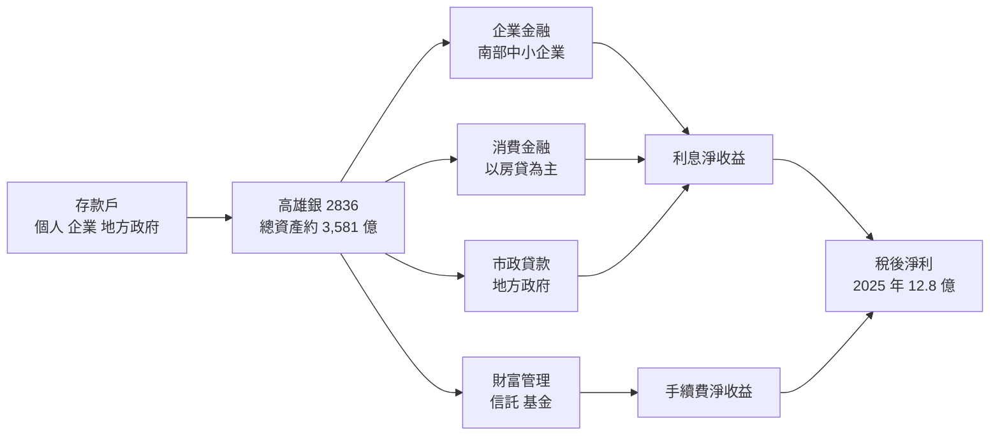
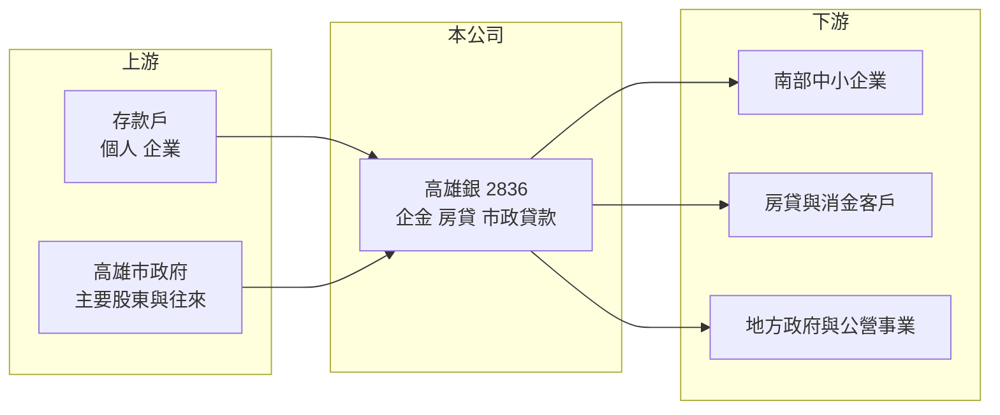

# 2836 高雄銀

> 上市｜[[產業索引-金融保險業|金融保險業]]｜上市（櫃）日期 1998/05/18

# 第一章：企業模式與商業藍圖

> [!info] 撰寫說明
> 精簡版，由 Claude 依公開資料整理，架構比照 [[2330台積電]] 的四章研究，資料截至 2026-10-08。財務數字來源：Goodinfo 年度經營績效頁、富果研究（高雄銀 2026 年 9 月法說會備忘錄）、證交所開放資料（基本資料、股利、本益比）；股東結構等背景描述憑整理性資料撰寫，尚未逐條比對原始文件。#待校對

本章說明高雄銀行（股票代號：2836，以下簡稱高雄銀）的商業模式：一家由地方政府出資、以南台灣為主要市場的中小型銀行，如何靠存放款利差與市政往來維持營運，以及它在 2025 至 2026 年進行的資產負債結構調整。

- **核心業務：** 高雄銀成立於 1982 年，前身為高雄市政府設立的市營銀行，1998 年上市，高雄市政府至今仍是主要股東（持股比例待校對），屬於地方公股銀行。業務以存款、企業放款、房貸與對地方政府的市政貸款為主，賺取的是存放款[[利差]]。這種模式的優點是資金來源穩定、政府往來業務有保障，缺點是放款對象集中在南部地區，規模與獲利效率都不容易放大。
- **營收結構：** 依法說會資料，2026 年第二季貼現及放款占總資產 63%，存款及匯款占總負債 87%，代表高雄銀幾乎完全靠存款支應放款，是很傳統的商業銀行結構。2026 年上半年淨收益 26.79 億元，增加的部分主要來自利息淨收益與財務操作，手續費收入只有 3.33 億元，占比約一成二（推算），財富管理仍是待發展的業務。
- **營運據點：** 總行位於高雄市左營區，分行網路以高雄地區為核心，並在台北等地設有分行（分行總數未查得）。2026 年 6 月內湖分行遷入自有行舍、空間擴大兩倍，顯示公司仍在補強北部據點。
- **長期方向：** 管理層把 2025 年下半年至 2026 年上半年定為「穩健經營」期，主動降低放款集中度與大額存款，總資產一度縮減；2026 年下半年起進入「穩健成長」期，重新擴大資產負債規模。另一條主線是數位化與財富管理，2026 年推出新版行動銀行 APP，舊版預計 2026 年 12 月停用。

# 第二章：護城河深度與競爭優勢

本章分析高雄銀的競爭位置。台灣銀行家數多、產品同質性高，一家地方型中小銀行的優勢主要來自地緣關係，而不是價格或規模。

- **競爭優勢：** 高雄銀最明顯的優勢是與高雄市政府的往來關係，包括市政貸款、公庫相關業務與地方政策性貸款（例如青年創業貸款），這些業務風險低、關係穩定，其他銀行不易取代。其次是對南部中小企業與在地客戶的長期經營，地方銀行對客戶的熟悉度有助於授信判斷。整體來看屬於「窄護城河」，優勢集中在特定區域與特定客群。
- **主要對手：** 在南部存放款市場，高雄銀要面對 [[5880合庫金]]、[[2892第一金]]、[[2880華南金]]、[[2801彰銀]] 等全國性公股銀行，以及 [[2884玉山金]]、[[2891中信金]] 等民營金控。這些對手分行更多、資金成本更低、財管與數位資源更完整。中小型同業如 [[2834臺企銀]]、[[2812台中銀]] 則和高雄銀在中小企業放款上直接競爭。
- **觀察重點：** 第一是[[NIM]]能否維持改善，2026 年第二季 NIM 1.13%，比去年同期增加 0.11 個百分點，是結構調整的直接成果。第二是重新擴張資產時，能否同時守住[[逾放比]]與放款集中度。第三是手續費與財富管理比重能否提高，讓獲利不再只依賴利差。

| 對手 | 定位 | 對高雄銀的影響 |
|---|---|---|
| 全國性公股銀行 | 分行多、資金成本低 | 在優質企業與房貸客戶上壓縮利差 |
| 民營金控 | 財管、信用卡、數位資源完整 | 爭奪手續費與年輕客群 |
| 中小型銀行 | 中小企業放款 | 在地區型授信上直接競爭 |

# 第三章：財務體質與盈利規模

資料日期：2026-10-08，表格是撰寫當時的快照；最新月營收、累計 EPS 由自動排程寫在本筆記的屬性欄位（月營收、累計EPS 等）。#待校對

銀行業不適用毛利率與營業利益率，本章改用淨收益、稅後淨利、[[ROE]]、[[ROA]]、利差、資產品質與資本適足率檢視高雄銀的獲利品質。

| 年度 | 淨收益（新台幣） | 稅後淨利 | EPS（元） | [[ROE]] | [[ROA]] |
|---|---|---|---|---|---|
| 2020 | 37.3 億 | 7.63 億 | 0.68 | 4.82% | 0.28% |
| 2021 | 40.1 億 | 9.10 億 | 0.78 | 5.37% | 0.32% |
| 2022 | 39.0 億 | 9.35 億 | 0.75 | 5.54% | 0.33% |
| 2023 | 38.2 億 | 8.65 億 | 0.70 | 5.00% | 0.30% |
| 2024 | 43.8 億 | 9.61 億 | 0.55 | 4.41% | 0.29% |
| 2025 | 50.2 億 | 12.80 億 | 0.68 | 4.94% | 0.36% |

註：取自 Goodinfo 合併報表。2024 年淨利增加但 EPS 下降，推估與股本增加或特別股股息有關（推估）。

- **營收規模：** 2020 至 2025 年淨收益從 37.3 億元增至 50.2 億元，年複合成長率約 6.1%（推算），2024 至 2025 年成長較快，與升息後利差改善有關。2026 年上半年淨收益 26.79 億元，持續成長。
- **獲利：** 2021 至 2025 年平均 ROE 約 5.1%（推算），ROA 長期在 0.3% 上下，低於台灣銀行業平均。2026 年上半年稅前淨利 9.09 億元、年增 21.77%，稅前 ROE 3.32%（未年化）。
- **利差與資產品質：** 2026 年第二季 [[NIM]] 1.13%，[[逾放比]] 0.35%，[[備抵呆帳覆蓋率]] 333.50%。逾放比低、覆蓋率超過三倍，資產品質大致穩健，但覆蓋率低於大型公股銀行常見的五倍以上水準。
- **資本適足：** 2026 年第二季 [[資本適足率]] 15.43%、第一類資本比率 13.10%、普通股權益比率 10.99%，資本適足率比去年同期增加 1.33 個百分點，管理層表示透過調整資產結構達成的效果比增資 50 億元更有效。
- **股利：** 2025 年度配發現金股利 0.40 元與股票股利 0.05 元，配發率約 66%（推算，0.45 ÷ 0.68）。

**ROE 與權益資金成本：** 銀行的存款是營業原料而非投入資本，[[ROIC]] 與 [[WACC]] 的框架不適用，因此改以 ROE 對比 [[CAPM]] 推算的權益資金成本。假設台灣 10 年期公債殖利率 1.75%、市場風險溢酬 6%、β 取地方公股銀行常見值 0.6（同業常見值，非來源數字），權益資金成本約 1.75% ＋ 0.6 × 6% ＝ 5.35%（推算）；β 若為 0.7 則約 5.95%。高雄銀 2021 至 2025 年平均 ROE 約 5.1%，略低於推算的權益成本，代表長期大致處於「未能創造超額價值」的狀態。證交所資料顯示股價淨值比約 0.81 倍，與 ROE 低於權益成本的判斷一致。結構調整後 NIM 回升，若能把 ROE 推升到 6% 以上，才算跨過價值創造的門檻（推估）。

# 第四章：總體風險與地緣政治

本章分析高雄銀面對的利率、區域經濟與營運風險。

- **產業週期：** 銀行獲利跟著利率週期走。升息初期放款利率調整較快、利差擴大；降息時利差收窄。高雄銀活期存款占比約 56%，存款成本相對低，但放款端以企業與市政貸款為主，議價空間有限，利率下行時獲利壓力較大。
- **營運風險：** 放款集中在南部地區與特定大戶，地方產業（石化、鋼鐵、傳產）景氣轉弱時，資產品質會較早受到影響。管理層已把降低放款集中度列為調整重點，但重新擴張資產的階段，仍需觀察授信紀律能否維持。
- **其他風險：** 第一，公股銀行的經營方向受地方政府政策影響，配合政策性貸款可能犧牲部分獲利。第二，市場規模有限，財富管理與數位金融需要投入資源，卻要和大型金控競爭，回收期較長。第三，法規對資本與房貸的規範趨嚴，會提高資本需求；新版 APP 上線與舊版停用的過渡期也有客戶流失與資安風險。

# 專有名詞解析

## 金融

- **[[利差]]**：銀行放款利率與存款利率的差距，是銀行最主要的獲利來源；利差擴大或收窄會直接反映在利息淨收益。
- **[[NIM]]**：淨利息收益率，利息淨收益除以生息資產，衡量銀行整體資產賺取利息的效率。
- **[[逾放比]]**：逾期放款占總放款的比例，數字越低代表放款資產品質越好。
- **[[備抵呆帳覆蓋率]]**：備抵呆帳除以逾期放款，衡量銀行為可能的壞帳預先提列了多少緩衝。
- **[[資本適足率]]**：自有資本除以風險性資產，主管機關用來確保金融機構有足夠資本承擔損失；放款越多需要的資本越多。
- **[[ROA]]**：資產報酬率，稅後淨利除以總資產，銀行因槓桿高，ROA 通常低於 1%。
- **[[CAPM]]**：資本資產定價模型，以無風險利率加上 β 乘以市場風險溢酬，推估股東要求的報酬率。
- **[[ROIC]]**：投入資本報酬率，稅後營業利益除以股東權益加有息負債，衡量本業運用資本的效率；不適用於銀行。
- **[[WACC]]**：加權平均資金成本，依股權與負債比重加權的資金成本，是判斷 ROIC 是否創造價值的門檻。

# 核心供應鏈

- 上游：個人與企業存款（活期性存款約占 56%）、同業資金；主要股東為高雄市政府（持股比例待校對）。
- 下游／客戶：南部中小企業、房貸客戶、地方政府市政貸款、財富管理客戶。
- 同業：全國性公股銀行 [[5880合庫金]]、[[2892第一金]]、[[2880華南金]]、[[2801彰銀]]；中小型銀行 [[2834臺企銀]]、[[2812台中銀]]、[[2838聯邦銀]]；民營金控 [[2884玉山金]]、[[2891中信金]]。

## 最新新聞
<!-- news:start（自動產生，請勿手動編輯此範圍） -->
- 2026-10-08 🏛️ 重訊 16:46｜公告本公司115年9月份自結盈餘｜[觀測站](https://mops.twse.com.tw/mops/#/web/t05st01)

完整紀錄：[[2836高雄銀 新聞]]
<!-- news:end -->

## 相關連結
- [公開資訊觀測站](https://mopsov.twse.com.tw/mops/web/t05st03?step=1&firstin=1&co_id=2836)
- [Goodinfo](https://goodinfo.tw/tw/StockDetail.asp?STOCK_ID=2836)
- [Yahoo 股市](https://tw.stock.yahoo.com/quote/2836)
- [鉅亨網新聞](https://www.cnyes.com/twstock/2836/news)
