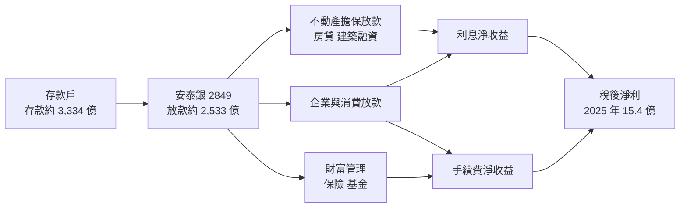
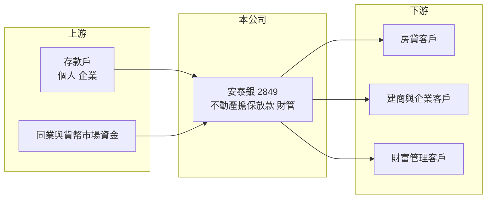

# 2849 安泰銀

> 上市｜[[產業索引-金融保險業|金融保險業]]｜上市（櫃）日期 1999/09/27

# 第一章：企業模式與商業藍圖

> [!info] 撰寫說明
> 精簡版，由 Claude 依公開資料整理，架構比照 [[2330台積電]] 的四章研究，資料截至 2026-10-08。財務數字來源：Goodinfo 年度經營績效頁、優分析（安泰銀 2025 年第三季法說會報導）、NOWnews（2026 年股東常會報導）、證交所開放資料（基本資料、股利、本益比）；業務特色與股東背景為整理性描述，尚未逐條比對原始文件。#待校對

本章說明安泰商業銀行（股票代號：2849，以下簡稱安泰銀）的商業模式：一家 1990 年代開放新銀行時設立的中型民營銀行，如何以不動產相關放款為主力，並以偏高的資本水準作為經營基調。

- **核心業務：** 安泰銀成立於 1992 年，1999 年上市，屬於政府開放民營新銀行設立時的第一批銀行之一。業務以存款支應放款、賺取[[利差]]為主，放款中不動產擔保放款（房貸與建築融資）比重較高（比重未查得，待校對）。這類放款有擔保品保護、違約損失有限，但業務量受房市與央行[[信用管制]]影響大。
- **營收結構：** 2025 年前三季淨收益 42.19 億元，其中手續費淨收益 11.9 億元、年增 14.9%，約占淨收益的 28%（推算），主要來自放款手續費與保險佣金；利息淨收益因資產結構調整、利差縮窄而較前一年減少，但第三季已季增 11%。截至 2025 年 9 月底，放款餘額 2,533 億元、存款餘額 3,334 億元，平均[[存放比]] 75.96%。
- **營運據點：** 總行位於台北市信義區，分行以北部都會區為主（分行數未查得）。實收資本額約 195.8 億元，董事長為俞宇琦。
- **長期方向：** 管理層的長期重點是三件事：持續清理壞帳、在風險與收益間調整出平衡的放款組合，以及維持強健的資本水準。安泰銀 2025 年中的普通股權益比率 14.97%，在本國銀行中排名第 4，代表它選擇用「資本厚、成長慢」換取經營安全，並已連續 16 年配發現金股利。

# 第二章：護城河深度與競爭優勢

本章分析安泰銀的護城河與競爭位置。中型民營銀行在存放款市場上很難靠產品差異取勝，競爭力主要來自授信專業與資本實力。

- **競爭優勢：** 第一是資本緩衝厚，第一類資本比率與普通股權益比率長期高於本國銀行平均，在景氣下行或房市修正時，有較大的空間吸收損失，也能在同業收縮時承接業務。第二是不動產授信的專業經驗，對擔保品鑑價與建案進度的掌握，是長期累積的能力。整體屬於「窄護城河」，優勢偏防守型。
- **主要對手：** 房貸市場的主要對手是資金成本更低的公股銀行，例如 [[5880合庫金]]、[[2892第一金]]、[[2880華南金]]；建築融資與財富管理則要面對 [[2891中信金]]、[[2884玉山金]]、[[2882國泰金]] 等民營金控，以及 [[2838聯邦銀]]、[[2845遠東銀]]、[[2897王道銀行]] 等中型銀行。
- **觀察重點：** 利息淨收益能否延續 2025 年第三季後的回升趨勢、壞帳清理是否告一段落（呆帳費用是否持續下降），以及手續費收入能否在保險佣金之外建立更穩定的來源。

| 對手 | 定位 | 對安泰銀的影響 |
|---|---|---|
| 公股銀行 | 房貸量大、資金成本低 | 以低利率爭取優質房貸客戶，壓縮利差 |
| 民營金控 | 財管與數位資源完整 | 在財富管理與企業金融全面競爭 |
| 中型民營銀行 | 房貸、中小企業放款 | 存款利率與放款條件直接競爭 |

# 第三章：財務體質與盈利規模

資料日期：2026-10-08，表格是撰寫當時的快照；最新月營收、累計 EPS 由自動排程寫在本筆記的屬性欄位（月營收、累計EPS 等）。#待校對

銀行業不適用毛利率與營業利益率，本章改用淨收益、稅後淨利、[[ROE]]、[[ROA]]、存放比與資本適足率檢視安泰銀的獲利品質。

| 年度 | 淨收益（新台幣） | 稅後淨利 | EPS（元） | [[ROE]] | [[ROA]] |
|---|---|---|---|---|---|
| 2020 | 58.5 億 | 21.7 億 | 1.11 | 6.37% | 0.70% |
| 2021 | 59.4 億 | 23.2 億 | 1.19 | 6.70% | 0.72% |
| 2022 | 59.8 億 | 10.7 億 | 0.54 | 3.15% | 0.31% |
| 2023 | 58.2 億 | 11.0 億 | 0.56 | 3.32% | 0.32% |
| 2024 | 55.4 億 | 13.3 億 | 0.68 | 3.91% | 0.38% |
| 2025 | 57.6 億 | 15.4 億 | 0.79 | 4.37% | 0.41% |

註：取自 Goodinfo 合併報表。頁面擷取時 EPS 與 ROA 兩欄疑似錯置，本表依「稅後淨利 ÷ 約 19.6 億股」核對後對調，2025 年 EPS 0.79 元與證交所股利資料的本期淨利 15.39 億元一致，其餘年度仍待以年報校對。

- **營收規模：** 2020 至 2025 年淨收益在 55 億至 60 億元之間，幾乎沒有成長，年複合成長率約 -0.3%（推算）。這反映安泰銀近年的重點是調整資產結構與清理壞帳，而不是擴大規模。
- **獲利：** 稅後淨利在 2022 年從 23.2 億元腰斬到 10.7 億元，推估與提列呆帳與資產品質處理有關（推估），之後逐年回升到 2025 年的 15.4 億元，但仍未回到 2021 年水準。2021 至 2025 年平均 ROE 約 4.3%（推算）。
- **資產品質與資本：** [[逾放比]] 與 [[備抵呆帳覆蓋率]] 未查得。2025 年 6 月底 [[資本適足率]] 16.15%、第一類資本比率與普通股權益比率皆為 14.97%，第一類資本比率排名本國銀行第 3，資本品質高（普通股權益占絕大部分）。
- **股利：** 2025 年度配發現金股利 0.51 元，配息率約 65%（推算，0.51 ÷ 0.79），已連續 16 年配發現金股利。

**ROE 與權益資金成本：** 銀行的存款是營業原料，[[ROIC]] 與 [[WACC]] 不適用，改以 ROE 對比 [[CAPM]] 推算的權益資金成本。假設台灣 10 年期公債殖利率 1.75%、市場風險溢酬 6%、β 取中型民營銀行常見值 0.7（同業常見值，非來源數字），權益資金成本約 1.75% ＋ 0.7 × 6% ＝ 5.95%（推算）。安泰銀 2021 至 2025 年平均 ROE 約 4.3%，2022 年以來每年都低於權益成本，只有 2020 至 2021 年接近打平。換句話說，偏高的資本水準雖然提高安全性，卻也稀釋了股東報酬，股價淨值比約 0.83 倍正反映這個落差。要跨過價值創造門檻，需要利差回升、呆帳費用下降，或把多餘資本透過股利返還股東（推估）。

# 第四章：總體風險與地緣政治

本章分析安泰銀面對的房市、利率與營運風險。

- **產業週期：** 不動產擔保放款比重高，讓安泰銀的業務量與房市週期高度連動。央行選擇性信用管制收緊時，房貸與建築融資成長受限；房價若大幅修正，擔保品價值下降，建商授信的風險會先浮現。
- **營運風險：** 2022 年獲利腰斬顯示資產品質曾出現問題，管理層至 2025 年仍把清理壞帳列為重點。若壞帳處理不如預期，呆帳費用可能再次壓低獲利。另一方面，利差在資產結構調整後收窄，回升速度取決於放款組合能否轉向收益較高的客群。
- **其他風險：** 利率方向會同時影響存款成本與放款利率，降息時利差承壓。資本規範對房貸與建築融資的風險權數若提高，會增加資本需求。股東結構與經營權若有變動，策略方向也可能隨之調整（待校對）。

# 專有名詞解析

## 金融

- **[[利差]]**：銀行放款利率與存款利率的差距，是銀行最主要的獲利來源；利差擴大或收窄會直接反映在利息淨收益。
- **[[存放比]]**：放款餘額除以存款餘額，比率低代表銀行有較多資金放在債券等非放款資產，流動性較高但利差較低。
- **[[信用管制]]**：央行針對房貸成數、利率與寬限期的選擇性限制，用來抑制房地產過熱。
- **[[逾放比]]**：逾期放款占總放款的比例，數字越低代表放款資產品質越好。
- **[[備抵呆帳覆蓋率]]**：備抵呆帳除以逾期放款，衡量銀行為可能的壞帳預先提列了多少緩衝。
- **[[資本適足率]]**：自有資本除以風險性資產，主管機關用來確保金融機構有足夠資本承擔損失；放款越多需要的資本越多。
- **[[ROA]]**：資產報酬率，稅後淨利除以總資產，銀行因槓桿高，ROA 通常低於 1%。
- **[[CAPM]]**：資本資產定價模型，以無風險利率加上 β 乘以市場風險溢酬，推估股東要求的報酬率。
- **[[ROIC]]**：投入資本報酬率，稅後營業利益除以股東權益加有息負債，衡量本業運用資本的效率；不適用於銀行。
- **[[WACC]]**：加權平均資金成本，依股權與負債比重加權的資金成本，是判斷 ROIC 是否創造價值的門檻。

# 核心供應鏈

- 上游：個人與企業存款（2025 年 9 月底約 3,334 億元）、同業拆借與貨幣市場。
- 下游／客戶：房貸客戶、建商與企業授信客戶、保險與基金等財富管理客戶；合作保險公司提供保險佣金收入。
- 同業：中型民營銀行 [[2838聯邦銀]]、[[2845遠東銀]]、[[2897王道銀行]]；公股銀行 [[5880合庫金]]、[[2892第一金]]、[[2880華南金]]；民營金控 [[2891中信金]]、[[2884玉山金]]、[[2882國泰金]]。

## 最新新聞
<!-- news:start -->
<!-- news:end -->

## 相關連結
- [公開資訊觀測站](https://mopsov.twse.com.tw/mops/web/t05st03?step=1&firstin=1&co_id=2849)
- [Goodinfo](https://goodinfo.tw/tw/StockDetail.asp?STOCK_ID=2849)
- [Yahoo 股市](https://tw.stock.yahoo.com/quote/2849)
- [鉅亨網新聞](https://www.cnyes.com/twstock/2849/news)
